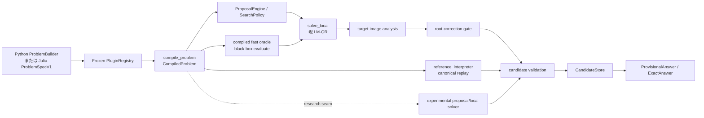

# Repository の現状と architecture

## 1. 正確な snapshot

| 項目 | 状態 |
|---|---|
| repository | `C:\solver` |
| canonical branch | `main` のみ |
| algorithm snapshot | `e2cf389346f5ffa3a307e52204542ad219ebdd07` |
| algorithm subject | `feat(benchmarks): add truth-blind solver algorithm lab` |
| algorithm-ready tag | `algorithm-lab-ready-2026-07-11`、上記 snapshot と同一 |
| detailed handoff tag | `solver-handoff-2026-07-11`、本 Markdown package の commit |
| earlier handoff tag | `handoff-2026-07-11` → `e9bd24c` |
| worktree | `C:\solver` の 1 個 |
| tracked state | algorithm snapshot は clean。本資料 commit/tag 後も clean にして渡す |
| remote | なし |
| historical branches | branch は削除済み、`archive/2026-07-11/*` annotated tags に tip を保存 |
| runtime contract | Julia 1.12.6、Python >=3.12、`uv`、Windows PowerShell |
| public license | なし。private/all rights reserved |

`research/` は tracked file の大半を占め、機械生成された experiment contract、formal protocol、過去 result が多い。概算では product 側 Julia core 約 11k 行に対し、`research/` の対象 text は 375k 行規模である。この差は「研究が豊富」というより、**通常の algorithm loop へ過去 infrastructure をコピーしない方がよい**という保守上の注意である。

## 2. 既にできていること

- Python で geometry-independent な problem graph を authoring / validation できる。
- Julia の open-world plugin ABI へ custom operation、custom type、branch/selector、capability を登録できる。
- graph を immutable な compiled problem へ lower し、black-box evaluation と canonical replay を分けて実行できる。
- deterministic proposal/search loop、`iid`-labelled insurance lane、deadline/budget、checkpoint/resume がある。現 counter stream の joint IID capture proof は未確立である。
- scaled LM + pivoted QR + finite-difference Jacobian による local solver がある。
- candidate の canonical validation、configuration archive、target image の診断、provisional/exact result container がある。
- direct analytic benchmark 8 family と、truth-blind paired local-solver runner がある。
- production path の proposal factory と local solver だけを差し替える bounded research seam がある。
- Python、Julia integration、benchmark、fuzz/metamorphic、governance/architecture lint の gate がある。

これらは基盤として十分であり、次の段階は broad infrastructure ではなく algorithm experiment である。

## 3. end-to-end data flow



algorithm candidate が変えてよいのは原則として proposal、local step、refinement、reversible scheduling である。ProblemSpec、plugin semantics、canonical replay、Gold、answer assurance を candidate の都合で変えてはならない。

## 4. 実装 map

| 層 | 正本 | 主な役割 |
|---|---|---|
| product invariants | `CHARTER.md` | distinct scalar target、fixed budget、black-box、canonical validation、fair search |
| Python DSL | `python/src/geotarget/model.py` | `ProblemBuilder`、variable/literal/call/select/relation/guard/domain/target |
| stable types | `julia/GeoTargetBase/src/` | graph、problem、plugin、capability、result/status types |
| plugin ABI | `julia/GeoTargetBase/src/plugins.jl` | typed operations、custom objects、branches/selectors |
| registry | `julia/GeoTargetCore/src/registry.jl` | explicit allowlist、registration、freeze |
| compiler | `julia/GeoTargetCore/src/compiler.jl` | `CompiledProblem`、dependency/sparsity metadata |
| fast compiled oracle | `julia/GeoTargetCore/src/compiled_oracle.jl` | repeated black-box evaluation |
| canonical truth interpreter | `julia/GeoTargetCore/src/reference_interpreter.jl` | `evaluate_canonical` が delegate する independent semantic replay |
| proposals | `julia/GeoTargetCore/src/proposal_engine.jl` | `iid`-labelled counter、Halton heuristic、bounded/unbounded proposals |
| scheduling | `julia/GeoTargetCore/src/search_policy.jl` | lane fairness、pending/refinement work |
| event loop | `julia/GeoTargetCore/src/search_loop.jl` | deadline、budget、local attempt、candidate insertion |
| local solver | `julia/GeoTargetCore/src/local_solver.jl` | scaled LM、augmented QR、finite differences、gain ratio |
| validation | `julia/GeoTargetCore/src/candidate_validation.jl` | fast/canonical/capability-aware replay |
| archive | `julia/GeoTargetCore/src/candidate_store.jl` | configuration evidence、reversible target niches |
| target analysis | `julia/GeoTargetCore/src/target_image.jl` | finite/continuous/inconclusive target-image diagnostics |
| orchestration | `julia/GeoTargetCore/src/solver.jl` | `solve_execution`、stable `solve`、research strategy |
| local algorithm lab | `julia/GeoTargetBenchmarks/src/solver_experiment.jl` | truth-blind variants、budget accounting、Gold-side scoring |
| Core lab adapter | `benchmarks/solver_lab/CoreBaseline.jl` | current LM-QR を `SolverVariant` 化 |
| lab CLI | `benchmarks/solver_lab/run.jl` | representative 9-case baseline |

重要な public/research seam:

- `UnstableResearchStrategy` — `julia/GeoTargetCore/src/solver.jl`
- `solve_execution(...; research_strategy=...)`
- `SolverExperimentCase` / `evaluate_case`
- `SolverVariant`
- `run_solver_experiment`

`UnstableResearchStrategy` は proposal factory と compiled-aware local solver だけを置換する。experimental local solver は渡された `evaluate_fn` 経由で全評価を行う。research strategy と checkpoint resume は併用できない。

## 5. 幾何 DSL の表現力は保たれているか

現 architecture は保っている。

1. Python DSL は既知の幾何 primitive の closed enum ではなく generic typed call graph を作る。
2. Julia plugin は private な intermediate type と callback implementation を持てる。
3. Core compiler/solver は operation の数学式や polynomial representation を要求せず、compiled black-box oracle を呼ぶ。
4. opaque/transcendental C0 benchmark があり、finite-difference local solver で動く。
5. C1/JVP/VJP/C3V 等は capability であり、C0 problem の表現を禁止しない。
6. domain、strict guard、branch、selector は graph semantics として保持される。

実行例は `docs/SDK_AND_PLUGIN_QUICKSTART.md` と `julia/fixtures/OpaquePlugin/` にある。

今後の sparse AD、lifted factor graph、interval verification を採用する場合も、これらは **optional compiled view / capability backend** とし、black-box nested view を消してはならない。

## 6. 二つの実験経路を混同しない

### 6.1 local-solver screening

`benchmarks/solver_lab/` は saved start ごとに `(case, start)` を local solver へ渡す。variant に見えるのは dimension、bounds、numeric scales、black-box evaluation だけで、family/instance ID、Gold、saved-start collection は見えない。

適する課題:

- LM / Trust Region / Gauss–Newton の比較
- finite-difference stencil、scaling、linear solve
- stopping、endpoint correction、acceptance
- per-start work と local capture の比較

適さない課題:

- proposal stream の生成・順序
- case-total budget の adaptive allocation
- archive-aware novelty / exclusion
- end-to-end distinct-target presentation

### 6.2 production-path discovery

`UnstableResearchStrategy` と `solve_execution` で差し替えられるのは proposal factory と local solver だけである。この seam なら proposal 座標/source を full event loop、canonical validation、既存 CandidateStore まで通せる。`SolvePolicy` の lane weights/scheduler や CandidateStore 実装自体は差し替えられない。

したがって start-source 比較は research strategy で行う。adaptive scheduler、archive-aware novelty、store policy を比較する場合は、survivor 仮説に必要な最小の research-only seam を既存 `search_policy.jl` / `candidate_store.jl` に追加するか、既存 internal component を直接比較する。第二の event loop/store を作らず、research strategy だけで置換可能だと誤認しない。

`julia/integration/solver_runtests.jl` に research strategy の実例がある。survivor を `ProblemSpecV1` + plugin + canonical validation 経路へ通し、direct analytic benchmark だけの artifact と区別する。

## 7. 現 lab の重要な metric caveat

runner の truth separation と callback accounting は良好だが、現 summary には promotion 前に直すべき小さい意味上の穴がある。

- `target_recall` / `all_targets` は endpoint の Gold match であり、`reported_accepted` を条件にしていない。
- `false_candidates` / `false_targets` も未採用 endpoint を含む。
- したがって summary は local endpoint 品質の診断には使えるが、「solver が返した答えの recall / false answer」を直接表さない。

最初の実験前に以下を追加する。

- reported-accepted distinct-target recall
- `lab_safe_all_targets` = 全 Gold target が `reported_accepted && gold_matched` witness で覆われ、かつ **すべての** reported-accepted endpoint が `canonical_valid && gold_matched && !target_ambiguous`
- reported-accepted canonical-invalid / Gold-inconsistent / numeric-target-only / ambiguous witness counts
- suffix-stable first lab-safe-full までの cumulative work

`reported_accepted` は local variant の自己申告であり、`ProvisionalAnswer` / `ExactAnswer` の production promotion ではない。これらは local algorithm screening proxy と呼び、release の `P_full_validated` / `P_full_exact` と区別する。

既存 field を削除せず diagnostic として残す。Gold を algorithm 側へ渡さない。変更は scorer のみで、別の評価 infrastructure を作らない。

## 8. distinct target presentation の未解決点

`CandidateStore` は証明 identity がない数値 target を不可逆に同一視しない。通常の provisional identity は configuration に結び付くため、異なる配置が同じ数値 target を与える場合、複数の provisional output になり得る。

これは false dedup を防ぐ保守的な内部設計として正しいが、利用者が期待する「異なる target 値の list」との presentation gap がある。

後続作業:

1. target-collision problem を production path で 1 本通し、現 JSON output を固定 test にする。
2. proof identity と reversible numerical display cluster を分ける。
3. internal evidence は全 configuration を保持し、UI/result presentation だけ overlap/uncertainty を明示する。

ALG-LAB-001 を止めて大規模 archive redesign を始めてはならない。

## 9. 既知の制限

- production `worker_count > 1` は未実装。
- Python CLI は Julia solver を自動起動しない。
- dynamic plugin loader/generated wrapper はない。application が frozen registry を注入する。
- general validation は point replay であり、近傍の root existence、forward error、all-roots completeness を一般には証明しない。
- C3V validated interval path は ADR で境界が定義されたが optional backend は未完成。
- current default local algorithm は一系統の LM-QR。
- default algorithm lab は deterministic 9 cases、8 starts までで、未知問題の holdout ではない。
- current `iid`-labelled proposal lane は deterministic counter mapping であり、D0 independent-uniform control の IID theorem をそのまま主張できない。
- refinement queue が残ったまま refinement budget を使い切ると new proposals が停止し得る。R3 の fairness gate 前に refinement-exhaustion starvation を再現・修正または明示する必要がある。
- Git remote がないため、repository 外 backup/push は自動ではない。
- public license がないため外部公開・配布は別判断が必要。

## 10. テスト状態とコマンド

直前 checkpoint では full Smoke gate、`GeoTargetBenchmarks` 全 test、local solver targeted test、solver-lab integration が成功し、独立 review で unresolved P0/P1 はなかった。本資料は source algorithm を変更しないが、次の担当者は環境差を確認する。

```powershell
powershell -File scripts/doctor.ps1

julia +1.12.6 --startup-file=no --history-file=no `
  --project=julia/GeoTargetBenchmarks `
  -e "using Pkg; Pkg.instantiate(); Pkg.test()"

julia +1.12.6 --startup-file=no --history-file=no `
  --project=julia julia/integration/runtests.jl

powershell -File scripts/ci.ps1 -Tier Smoke
```

production champion 候補だけ `powershell -File scripts/ci.ps1` と Nightly 相当を実行する。初期 candidate のたびに 200 秒級全 gate を回して研究速度を落とさない。

## 11. Git の扱い

- `main` を唯一の長期正本にする。
- experiment の hypothesis、candidate、decision を小 commit に分ける。
- 並行 edit の衝突がなければ subagent は同 worktree の別 file を担当する。
- isolation が必要な場合だけ短命 `codex/exp-*` branch/worktree を作り、統合後すぐ削除する。
- risky run 前に annotated checkpoint tag を作る。
- raw trace は ignored path、small aggregate/decision/checksum だけ tracked にする。
- archive tag を丸ごと merge しない。

既存 `docs/operations/HANDOFF.md` の「new codex branch」は必須ではない。本資料では OD-11 に合わせ、main-only を通常方針とする。
