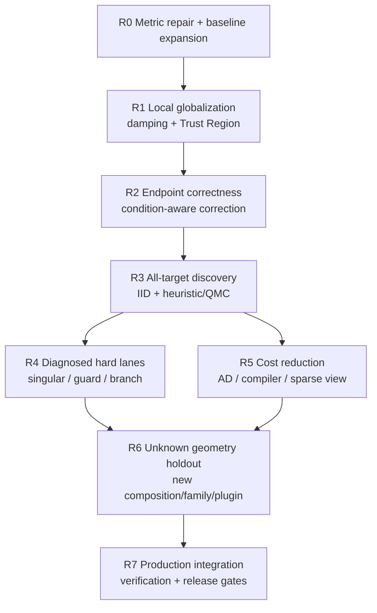
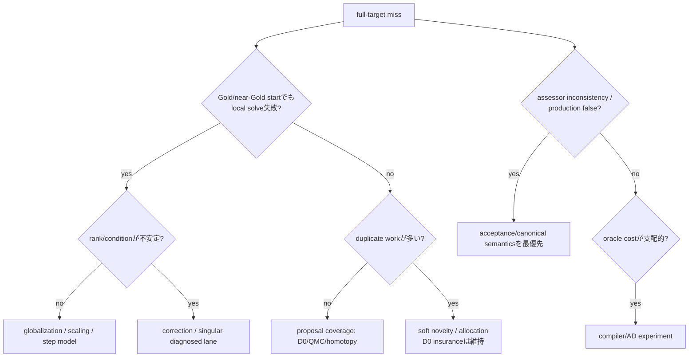

# Algorithm research roadmap

## 1. 固定するものと実験で決めるもの

固定するもの:

- black-box geometry DSL と open-world plugin ABI
- distinct scalar target をすべて得るという product objective
- fixed-budget / anytime evaluation
- canonical semantics と independent replay
- independent full-support insurance lane（current `iid`-labelled counter stream の joint IID 性は未確立）
- truth-blind algorithm、Gold-side assessment
- safety → all-target recall → work → simplicity の選択順

実験で決めるもの:

- local globalization: LM、Trust Region、その他
- scaling、finite difference/AD、linear solve
- stopping、correction、rank/singular route
- proposal stream と budget allocation
- novelty、deflation、continuation、lifting の適用条件
- optional validation / exactification backend

この distinction により、計画からドリフトせず、algorithm を早すぎる段階で固定しない。

## 2. 全体 milestone



各 milestone は calendar ではなく evidence gate で進む。前段の champion を固定し、後段の experiment では一つの軸だけ変える。

## 3. R0 — measurement を信用できる最小状態

### R0.1 assessor / reported-acceptance metrics

現 runner の endpoint recall に加え、次を scorer 側へ追加する。

- `reported_accepted_targets_found`
- `reported_accepted_target_recall`
- `lab_safe_all_targets`
- `reported_accepted_canonical_invalid`
- `reported_accepted_gold_inconsistent`
- `reported_accepted_numeric_target_only`
- `reported_accepted_ambiguous`
- `assessor_qualified`
- `assessor_qualified_target_recall`
- `assessor_qualified_gold_inconsistent`
- `assessor_all_targets`
- `assessor_safe_all_targets`
- `suffix_stable_evaluations_to_lab_safe_full`

`lab_safe_all_targets` は、全 Gold target が `reported_accepted && gold_matched` witness で覆われ、かつ全 reported-accepted endpoint が `canonical_valid && gold_matched && !target_ambiguous` のときだけ true とする。したがって numeric target だけ一致して configuration witness が不整合な endpoint も safety failure である。

primary frozen assessor は、endpoint が存在し、independent replay が finite/in-bounds/semantics-valid で、scaled residual infinity norm `<= 1e-12` のときだけ `assessor_qualified=true` とする。Gold configuration/target matching tolerancesはそれぞれ `1e-6`。`assessor_all_targets` は qualified consistent witnesses が全 Gold target IDを覆うこと、`assessor_safe_all_targets` はさらに qualified Gold-inconsistent/ambiguous endpoint が 0 であることを要求する。tolerances と predicate は JSON/card に記録し、結果後に変えない。`sqrt(eps)` と `3.7e-11` は secondary sensitivity だけにする。

algorithm API、Gold separation、budget accounting は変えない。unit test では、Gold-matching but rejected endpoint が reported recall に入らないこと、reported-accepted false/invalid/numeric-target-only endpoint が safety failure になることを固定する。さらに variant retcode/acceptance に依存しない frozen assessor qualification を別集計する。reported metrics と assessor metrics は local proxies であり、production の validated/exact promotion ではない。

first-success work は、後続 prefix が unsafe にならない suffix-stable success のときだけ定義する。各 prefix の safe/unsafe state を必ず残す。

### R0.2 failure-focused trace

attempt に既にある status、accepted、residual、rank/condition、distance、target、work でまず分類する。追加 telemetry は TR/correction の判定に必要な以下だけを candidate configuration/diagnostic に出す。

- step norm
- predicted/actual reduction ratio
- trust radius または damping
- endpoint correction norm
- numerical-rank stability across two stencils

包括的な新 failure framework は作らない。

### R0.3 baseline layers

- T0: NearRank、Tangent、Warped `z1`、Warped collision、Curved
- T1: 現 9 cases
- T2: 8 family × 6 parameterized development instances × 32 paired starts

T2 の導線は R1 が T1 で signal を出してから作る。過去 `EXP-LOCAL-002` の parameter grid は再利用してよいが、formal harness は再利用しない。

旧 lab control は 120 iterations / 600 evaluations、residual `sqrt(eps)` である。R0 では `legacy-lab-120x600` と、tolerance だけ production に合わせた `prod-tol-120x600` を別名で残す。nominal production local options は 250/2000、residual `1e-12` なので `prod-options-250x2000` を別 diagnostic にする。どれも production の target-image/root-correction/validation を含まず production-equivalent ではない。

R0 exit:

- assessor/reported metrics の test が通る。
- baseline JSON が clean HEAD、fixed options、problem checksums を持つ。
- endpoint quality と solver acceptance を区別した table を生成できる。

## 4. R1 / ALG-LAB-001 — damping/globalization を現在の lab で検証

### 仮説

現行 LM の scale-independent な初期 damping を safeguarded/scale-aware にするか、bound-aware Trust Region least squares を使うことで、matched cumulative oracle-work curve 上の local Gold endpoint と lab-safe all-target を増やせる。

過去の 48-case development では NonlinearSolve Trust Region が LXR-LMQR より `P_local_gold`、`P_full_target`、charged work で強かった。ただし現在の truth-blind runner、600 cap、Core semantics では未再現である。引継ぎ時の stdout-only pilot では、local tolerance `1e-14` の固定診断で initial damping を `1e-3` から `1e-16`/`1e-20` へ下げると、代表 target recall が 10/16 から 13/16、evaluations が 14,703 から約 6,000 へ変化した。これは固定微小 lambda の採用根拠ではなく、damping/globalization が大きな lever だという signal である。

### Stage A — external reference

variants:

1. `legacy-lab-120x600` LM-QR (`sqrt(eps)`, continuity only)
2. `prod-tol-120x600` LM-QR (`1e-12`, `initial_damping=1e-3`)
3. `prod-options-250x2000` diagnostic
4. fixed smaller-damping LM diagnostics（mechanism probe only）
5. NonlinearSolve LM library control
6. NonlinearSolve Trust Region reference

adapter の拘束:

- residual callback は必ず `evaluate_case(case, x)` を通す。
- `DirectAnalyticProblem`、Gold、family/instance ID、saved-start collection を closure に入れない。
- external return code、adapter の `reported_accepted`、frozen assessor qualification を別 field にする。globalization primary は全 variants に同じ assessor predicate を使う。
- runner-counted evaluations を primary work にする。
- dependency は experiment-only に置き、signal 前に `GeoTargetCore` へ追加しない。
- fixed tiny damping は scale grid/counterexample 用 diagnostic に限定し、production candidate にしない。

実行順:

- T0: launch-count prefixes 2/4/8、600 eval/start。prefix 自体を equal-budget と呼ばない
- T1: 全 9 cases
- signal があれば T2: launch-count prefixes 8/16/32、600 eval/start
- 2000 cap は過去 result の再現診断に限る
- primary comparison は共通 cumulative callback thresholds で conservative censor した curve。case-total interruptionが必要なら小 ledger を追加

Stage A kill:

- common assessor-qualified Gold-inconsistent/invalid endpoint が control より増える、または production validator smoke が false promotion を出す。
- current accounting で recall/work gain が再現しない。
- gain が一 family、one cap、JIT order だけに依存する。

この場合 native globalization を実装しない。過去差を adapter/budget artifact として記録し、R1 の別 candidate を選ぶ。

### Stage B — native research candidate

Stage A survivor が出た場合だけ、research-only `SolverVariant` として小さな bound-aware TR Gauss–Newton または Moré-style safeguarded LM を作る。二つとも勝った場合は別 variants とし、最初から hybrid にしない。

最小 mechanism:

1. 現行と同じ semantic residual scaling と central finite difference を使う。
2. `min ||J p + r||` の local model を pivoted QR で解く。
3. full step が radius 外なら Cauchy/dogleg または regularized TR subproblemへ移る。
4. bounds で切った **effective step** に対して predicted reduction を計算する。
5. actual/predicted reduction ratio で radius と step acceptance を更新する。
6. rank-deficient model は無条件 success にせず、regularized step または typed uncertain result を返す。
7. final acceptance は undeformed canonical residual/semantics で行う。

safeguarded LM candidate では、problem scale と `J` column scale を使う damping parameterization、step norm、actual/predicted reduction を記録し、固定 magic lambda を避ける。

Stage B では sparse AD、deflation、adaptive precision、novelty を混ぜない。

native promotion signal:

- external TR の assessor-qualified recall/work gain の大半を再現する。
- assessor-qualified inconsistent endpoint を control より増やさず、production validator smoke の false promotion 0。
- callback work と warm wall の両方で妥当。
- opaque C0 plugin を `UnstableResearchStrategy` 経由で通す。

survivor 後だけ、finite-difference helper や step model を `local_solver.jl` 内で共有し、control と candidate の重複を削る。production preset を変えるのは R2 後である。

## 5. R2 / ALG-LAB-002 — condition-aware correction と acceptance

### 仮説

small residual だけで converged/accepted とせず、charged endpoint correction と forward-uncertainty gate を使えば、NearRank/Tangent の false endpoint を正しい root へ refine するか、安全に `unknown` にできる。

### candidates

control は R1 champion。以下は別 variants とし、最初から一つに積み重ねない。

- L0: endpoint で `h` と `h/2` の central FD Jacobian を再構成し、CPQR correction を最大 2–3 回行う。
- L1: SVD diagnostic control。stable rank と correction norm を比較する。
- L2: target sensitivity/error estimate を加え、target accuracy と residual accuracy を分ける。
- HP0: capability がある場合だけ BigFloat residual/Jacobian/correction ladder。Float64-only `SolverExperimentCase` では実行しない。現 `UnstableResearchStrategy` の charged callback も Float64 C0 固定なので使わず、precision-aware callback と独立 work ledger を持つ separate budgeted driverを作る。将来 strategy を使うなら capability/precision-aware charged callback seam を先に追加する。point replay だけで root certificate としない。

acceptance signal:

- bounds/declared-scale normalized correction `<= τ_x`。primary `τ_x = sqrt(CandidateValidationOptions().residual_tolerance) = 1e-6`。
- two-stencil rank/correction が安定する。
- corrected point が canonical semantics と residual gate を通る。
- target propagated correction/uncertainty `<= τ_T`。primary `τ_T = CandidateValidationOptions().target_consistency_tolerance = 1e-12`。

`τ_x` / `τ_T` は Gold を使わず、ALG-LAB-002 card に validation configuration/hash とともに固定する。別 threshold は事前宣言した sensitivity variant にし、結果後に primary を差し替えない。

不安定なら endpoint を evidence として残し、`reported_accepted=false` / `unknown` とする。

### required cases

- NearRank ratio: `1`, `1e-4`, `1e-8`, `1e-12`
- Tangent height/radius: regular から `0.99999999` まで
- Warped condition/close-root grid
- fixed near-null nonroot P1
- constant-target manifold と varying-target manifold
- exact-zero、regular close-root、guard/domain controls
- equivalent scale、signed permutation、orthogonal representation replicas

単に residual tolerance を `1e-12` にする candidate は主候補にしない。過去 NLS-TR-STRICT は全-target gain を示していない。

R2 exit:

- common-assessor inconsistent endpoint が減り、production false promotion 0。
- reported acceptance rate、unknown/rejection rate、Gold-recoverable false rejection、target recall を別々に報告する。
- regular controls の reported/assessor recall loss <= preregistered noninferiority margin。
- unrelated family overhead が gate 内。

全 reject は Gold-recoverable false rejection と target recall gate を落とすため kill する。manifold は有限 Gold configuration distance で false candidate とせず、target-image/continuity 用の別 assessor を使う。

### R2b / ALG-LAB-002B — condition-guided symmetric weak-direction exploration

R2 の endpoint Jacobian/rank evidence を correctness gate だけで捨てず、canonical-valid endpoint から近接した別 solution candidate を探索する heuristic proposal に使う。

exploratory mechanism:

1. canonical-valid endpoint `u` の bounds/declared-scale normalized Jacobian `J_s` を得る。
2. stable な最小右特異方向または weak subspace `V_w` を計算する。
3. `u ± r_k v` の symmetric multiscale proposals を既存 refinement queue へ入れる。
4. 全 proposal を通常 local champion と undeformed canonical gate へ通す。
5. `(configuration, weak-subspace hash, radius)` を evidence として duplicate emission を抑えるが、insurance lane は削らない。

引継ぎ時の one-session pilot では Warped の `v_min` probes が inner roots を発見し、Tangent でも反対 target を得た。artifact はなく、正式 evidence ではない。この candidate は既存 algorithm の単なる stack ではなく、GeoTarget の「target 全回収」と local numerical geometry を結ぶ有力な研究仮説である。

experiment variants:

- W0: frozen local champion + independent-uniform D0 control
- W1: W0 + symmetric `v_min` probes
- W2: W0 + stable weak-subspace probes（nullity > 1 control）
- W3:同じ probe 数の isotropic local perturbation control

radius は normalized coordinates で事前 grid に固定し、結果後に root separation へ合わせない。両符号を必須とし、SVD vector の sign ambiguity を消す。

kill gates:

- representation replicas で route/proposal set が不安定。
- manifold で無限 duplicate work。
- guard/domain crossing が accepted される。
- same charged probes の isotropic control に勝たない。
- MultiRoot/Tangent 以外の unrelated close-root family へ広がらない。

survivor は新 lane/store を作らず、`TargetImageDiagnostic` または local attempt が持つ scaled Jacobian evidence から bounded refinement hints を既存 scheduler へ渡す。

## 6. R3 / ALG-LAB-003 — all-target discovery stream

R1/R2 で local pipeline を固定してから開始する。local solver と proposal stream を同時に変えない。

### Stage A — start source のみ

候補:

- D0: materialized independent-uniform all-launch control。conditional IID capture argument はこの variant にだけ適用
- D1: existing contiguous Halton pure-source diagnostic。promotion ineligible alone
- D2: current `iid`-labelled counter/Halton mix。joint IID と呼ばない
- D3: one materialized Owen-scrambled Sobol pure-source diagnostic。promotion ineligible alone
- D4: 25% independent-uniform insurance + 75% selected QMC
- D5: independent-uniform insurance + frozen weak-direction refinement（R2b survivor のみ）

rules:

- maximal prefix matrix を一度生成・checksum し、8/16/32/64/128 は先頭列を使う。
- sampling/scrambling overhead を charge する。
- 全 point を launch し、hard clustering/suppression をしない。
- pure D1/D3 は diagnostic comparator なので insurance cadence を持たず、completeness/fairness claim を付けない。promotion-eligible D4/D5/combined policy は independent-uniform service cadence を nonzero かつ bounded-gap に保つ。
- QMC に probabilistic completeness の理論 claim を付けない。
- current refinement-exhaustion path が `allow_new=false` にして fresh proposals を止める case を mandatory control とし、attribution/refinement budget exhaustion が insurance stream を starve しないことを確認する。
- independent-uniform lane の bounded service と、enqueue 済み各 heuristic/refinement queue の eventual service を別 invariant とする。一つの lane が他 source の proposals を処理すると説明しない。

cases:

- root count 2/4/8
- separation `1e-1`, `1e-3`, `1e-6`
- condition/warp grid
- `z1` と `z1²` target collision を latent cluster として paired 評価
- unrelated opaque C0 と geometry composition controls

### Stage B — soft allocation

Stage A champion を固定してから、一つずつ比較する。

- TGO-inspired residual topograph を **order/defer only** に使う。
- reversible basin/target novelty priority。
- duplicate hit に応じた soft budget allocation。
- APOSMM-inspired launch eligibility は hard discard しない。independent-uniform insurance lane は独立に bounded service を受け、enqueue 済み各 heuristic queue は scheduler fairness により eventual service を受ける。

weak-direction refinement と QMC source を同時に導入せず、W1 vs D0、QMC vs D0、最後に champion combination の順で ablation する。

adaptive queue は per-attempt lab では測れない。proposal source だけなら既存 production event loop + `UnstableResearchStrategy` を使える。一方、この seam は `SolvePolicy` scheduler や CandidateStore を置換しない。lane weights/novelty/archive policy の survivor を測る場合だけ、既存 `search_policy.jl` / `candidate_store.jl` の bounded research-only seam または truth-blind case-total-budget wrapper を一つ追加し、第二の search loop/store を作らない。

R3 exit:

- critical multi-root strata の full-target success が matched case-total oracle-work thresholds で改善する。launch prefix だけで fixed-budget claim をしない。
- close-root / collision の regression が gate 内。
- independent-uniform insurance starvation、truth leak、case-ID routing 0。
- candidate の improvement が at least 3 unrelated families か、明確に scoped された diagnosed lane で再現する。

## 7. R4 — diagnosed hard lanes

R1–R3 後に残った failure 数で優先順位を決める。下記を既定路線にしない。

### 7.1 singular / rank-deficient roots

候補 queue:

1. solver-native Jacobian/progress state を使う cheap rank-instability trigger
2. RRQR/SVD regularized correction
3. bordered nullspace Newton for generalized-regular isolated singular roots
4. representation-stable successor to two-step deflation-one refinement
5. adaptive multiprecision endgame

禁止:

- separate up-front dense rank diagnostic（NEG-006 の再実行）
- fixed SVD cutoff 一個で universal route
- S3 good-Broyden の cap retune
- S4 two-step の同じ final audit の再利用

manifold、nonroot、regular close-root を必ず control にし、convergence から isolation を推論しない。

### 7.2 deflation / exclusion

local champion と archive semantics が安定してから別 experiment とする。

- shifted residual deflation は canonical point replay ではなく、independent numerical-root evidence または C3V 等で isolation assumption を支えた witness だけを使う。
- acceptance は original residual に対して行う。
- target collision と複数 configuration/target を含める。
- preparation/archive-distance work を charge する。
- まず soft proposal repulsion と residual deflation を separate ablation にする。

EXP-DEF-001 v2 の同 mechanism は再実行しない。positive deflation-specific signal、false/no-root promotion 0、economics が reopen 条件である。

### 7.3 guard / branch / boundary

canonical semantics は固定する。候補は filter/restoration、branch-fixed local chart、lazy split、boundary-aware TR step である。barrier 近傍を valid とみなさない。branch/guard failure が実測で上位になるまでは実装しない。

### 7.4 configuration homotopy / lifted factor graph

direct local solver と discovery が改善しても、deep construction chain、branch switching、narrow basin が主要 failure として残る場合だけ reopen する。

- homotopy は applicability predicate と path cost を持つ diagnosed lane。
- lifting は optional `LiftedFactorGraphView` とし、nested black-box view を残す。
- all constructions の無条件 lift を default にしない。
- three unrelated families と nested control で比較する。

## 8. R5 — derivative、compiler、language performance

algorithmic champion 前に performance rewrite を始めない。profile で cost share を分ける。

1. oracle evaluation
2. finite-difference callback
3. Jacobian factorization
4. proposal/screening/archive
5. Julia compilation
6. serialization/application overhead

### derivative queue

- C0 dense central FD control
- C1 ForwardDiff/native plugin derivative
- prepared DifferentiationInterface adapter
- compiler-derived conservative sparsity + cached coloring
- JVP/VJP / iterative linear solve for larger systems

colored FD は callback reductionだけで採用しない。過去 experiment は sparse familyで work を減らしたが dense/cold overhead gate を落とした。cached preparation と applicability predicate を持つ fresh experiment が必要である。

### compiler/lifted queue

現 compiler は typed plan と dependency metadata を持つ。追加 optimization は profile 後に一つずつ行う。

- allocation/type-instability removal
- prepared buffers / function barriers
- optional runtime-generated kernel
- conservative sparsity extraction
- nested vs lifted view comparator

dynamic input expression evaluationは使わない。

### Rust/Julia decision

main core は既に Julia である。Rust rewrite を検討するのは、以下を全て満たす場合だけ。

- stable algorithm champion がある。
- Julia profile で warm runtime の支配的 hot loop が特定される。
- type stability、allocation、preparation、native linear algebra で解消しない。
- FFI/duplicate implementation/compile cost を含む prototype が end-to-end で大きく勝つ。
- plugin ABI と C0/C1 expressiveness を維持できる。

それまでは Julia 内の小さい最適化を優先する。

## 9. R6 — unknown geometry generalization

holdout を次の四層に分ける。

- U1: known family の未知 parameter/seed
- U2: known primitives の未知 composition
- U3: generator-disjoint unknown failure family
- U4: plugin-private operation/type を含む未知 plugin

candidate freeze 前に manifest/checksum を commit する。holdout を一度開いて failure を見たら、その set は burn して development set へ移し、新 holdout を作る。

production route で次を確認する。

- `ProblemSpecV1` compile/evaluate/canonical replay
- C0 opaque plugin fallback
- optional C1 acceleration の explicit fallback
- domain/guard/branch semantics
- checkpoint なしの research strategy execution
- target collision presentation
- deadlines 60/180/420 秒、複数 seed の anytime curve

## 10. R7 — coherent production solver へ統合

final algorithm は「候補を全部積んだ portfolio」ではなく、次の小さい構造を目標にする。

```text
one compiled oracle
one proposal scheduler with permanent independent full-support insurance
one default local globalization
zero or a few diagnosed, capability-based rescue lanes
one canonical candidate gate
one evidence/archive model
optional independent validation/exactification backends
```

各 rescue lane は public numeric metadata だけで route し、case ID、family ID、primitive 名、Gold を使わない。勝たなかった route/knob/dependency は削除する。

## 11. failure から次 experiment を選ぶ decision tree



同時に複数 branch へ進まず、現 data で最大の failure class を一つ選ぶ。

## 12. roadmap を止める kill conditions

candidate は次のどれかで削除する。

- Gold/family ID/private problem callback を algorithm が見る。
- `evaluate_case` / production `evaluate_fn` を迂回する。
- accepted false target、invalid semantics、budget count violation を出す。
- 2 tuning roundsで再現 signal がない。
- 3 unrelated families または明示 applicability stratum に広がらない。
- unknown composition/plugin で gain が消える。
- 別 solver/validator/archive copy を作る。
- cold/end-to-end overhead で callback gain が消える。
- code complexity に対し recall/work gain が 5% 未満である。

negative decision は一ページと checksum を残すが、dead implementation は main から削除する。
