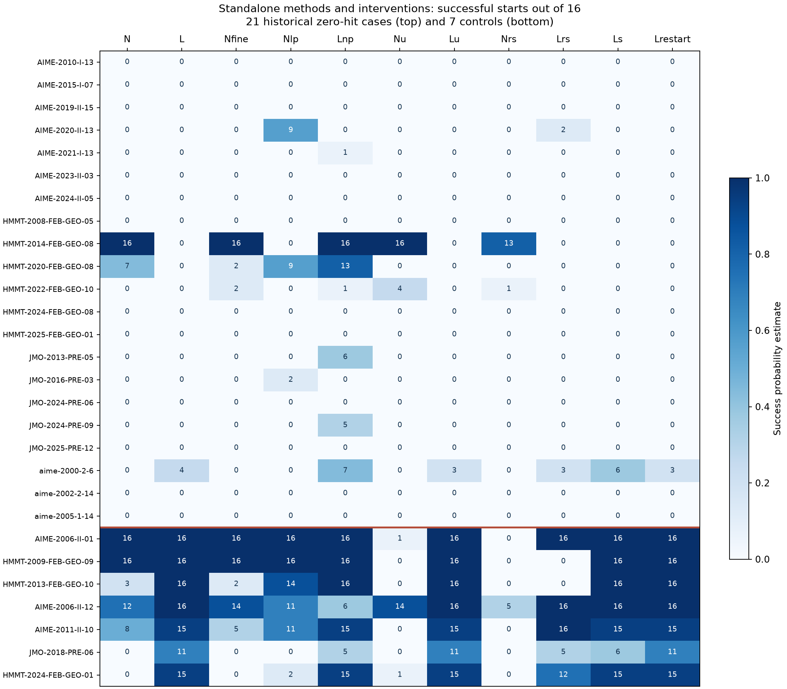
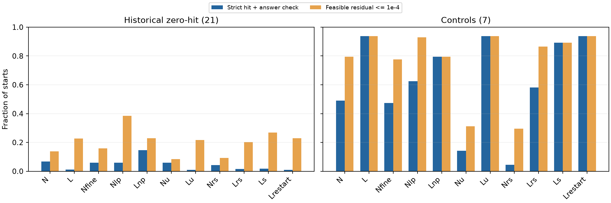

**4基準の判定**：①直感に反する＝△（異なる目的関数・採点点の比較が混じる）、②深い理論が必要＝×（確認した例は罰則とTaylor展開で説明できる）、③再現性と広がり＝△（28問・2seedで追試、未知問題への広がりは未確認）、④solver固有か＝×（実装上の罰則差はあるが、独自の数学的機構とは言えない）。

**Aの中心を担えるか：不可（現時点の証拠では）。** 罰則の不一致を見つけ、比較の前提を修正する実証例としては使える。「微分を捨てると、暗黙の平滑化によって21問が解ける」という中心的主張にはできない。

同じ一様始点・同じ上限予算で4,928試行を完了した。対象21問の主指標はNOMAD **23/336＝6.85%**、LM **4/336＝1.19%**、差は**＋5.65ポイント**。観測値はNOMADが高いが、固定した10ポイント以上の優位G0には届かない。NOMADの成功は2問に集中し、完成solverの21問63/63を単体では再現しない。一方、LMをNOMAD側の有限罰則へ変更すると**49/336＝14.58%**へ増えた。最も明確な介入効果はこの罰則交換である。

ただし、主指標は事前に固定した「評価中の最良の許容点」を両手法から返す規則に依存する。事後にライブラリの返却点だけを採点すると、対象群のNOMADは**0/336**、LMは**4/336**、罰則交換LMは**49/336**だった。この違いも含めて、一般的なNOMAD単体の優越とは結論しない。[主集計](summary.json)、[最終点の補助集計](endpoint-summary.json)。

**比較対象と予測固定。** [Q27f](../../strategy/astra-consult-18/Q27f/answer.md)の0/6,971と完成solver63/63は、1開始の局所終点と、複数探索・精密化・検証を含む完成版の成功という異なる単位だった。採用元は第1探索NOMAD41、第2探索NOMAD8、rescue/NOMAD7、SciPy7で、63件全てが単体NOMADではない。また21問中aime-2000-2-6の旧局所probeはPowellだった。[Q31保存資料](sources/Q31-answer.md)でもこの区別が確認される。

21問を全て使用し、対照は[Q27d](../../strategy/astra-consult-18/Q27d/answer.md)の旧記録から、各次元1〜7で両seedの低い方の成功率が最大の1問ずつを選んだ。新しい結果で選び直していない。2seed×8点、各問16点を凍結版の推定箱で一様生成し、全11条件で物理始点を共有した。[対象選択](selection.csv)、[予測固定](prediction.md)、[封印記録](prediction.lock.json)。

固定時刻は **2026-10-23 15:30:17.549434 UTC**、prediction.mdのSHA-256は `a7214b4d992dedc3d265c392a14292be849e2ee0e870a61a6069c64e1a025117`。「予測固定」を標準出力へ出してから対象探索を開始した。これは自己記録であり第三者の時刻認証ではない。探索は凍結版 `60db4b679b04167175c51c479c87c22fa663fda0` の評価器・NomadConfig・NomadBlackboxAdapter・LM拡張残差を使い、srcのハッシュ一致を確認した。答えはgrading/に分離し、探索に渡していない。

各条件の予算は元の残差ベクトル**1,200評価または壁時計6秒**。有限差分、Gaussian標本、失敗評価も数える。尺度計算の32評価／出発は別枠。LMの旧max_nfev=80はこの共通評価上限に置き換え、m<nでも零行を補ってLMを使った。NOMADの箱拡張、多点開始、代数的前処理、後段精密化、rescueは使っていない。

主指標は箱内・guard/hard許容・元残差ノルム≤1e−8に加え、targetが参照値の一つと相対許容1e−6で一致すること。全答え集合の一致や厳密証明を意味しない。候補は答えを使わず元残差で選択する。補助指標は答え照合を要求しない許容残差≤1e−4。予算・候補選択・成功基準の詳細は固定文書に記載した。

**全11条件の結果。** 括弧内は主成功率。対象群は各336開始、対照群は各112開始で、問題数に比例する試行率と問題等重みの平均が一致する。

| 条件 | 変更 | 対象21問：主成功数 | 対照7問：主成功数 | 対象：残差≤1e−4 |
|---|---|---:|---:|---:|
| N | 元のNOMAD | 23 (6.85%) | 55 (49.11%) | 46 |
| L | 元のLM | 4 (1.19%) | 105 (93.75%) | 76 |
| Nfine | 初期frameを箱幅10%→0.1% | 20 (5.95%) | 53 (47.32%) | 53 |
| Nlp | NOMADをLMの拡張残差二乗へ | 20 (5.95%) | 70 (62.50%) | 129 |
| Lnp | LMをNOMADの有限罰則へ | 49 (14.58%) | 89 (79.46%) | 77 |
| Nu | Nを箱の単位座標へ | 20 (5.95%) | 16 (14.29%) | 28 |
| Lu | Lを箱の単位座標へ | 3 (0.89%) | 105 (93.75%) | 73 |
| Nrs | Nu＋残差行の尺度調整 | 14 (4.17%) | 5 (4.46%) | 31 |
| Lrs | Lu＋残差行の尺度調整 | 5 (1.49%) | 65 (58.04%) | 68 |
| Ls | Lu＋Gaussian残差continuation | 6 (1.79%) | 100 (89.29%) | 90 |
| Lrestart | Luを平滑化なしで同じ4段再開 | 3 (0.89%) | 105 (93.75%) | 77 |

対象群のN−L差の問題単位bootstrapによる記述的95%区間は **−2.38〜＋16.97ポイント**。選択済み21問を未知母集団の無作為標本とみなす検定ではない。各問題16点しかなく、0/16の真の成功確率の片側95%上限は約17.1%。0を不可能性と読まない。[問題別率と区間](per-problem.csv)、[同一始点の差](paired-effects.csv)。

主要条件のseed別成功数は以下。各セルの分母は168である。

| seed | N | L | Nfine | Nlp | Lnp | Lu | Ls | Lrestart |
|---|---:|---:|---:|---:|---:|---:|---:|---:|
| 32001 | 10 | 2 | 9 | 8 | 24 | 1 | 5 | 1 |
| 32002 | 13 | 2 | 11 | 12 | 25 | 2 | 1 | 2 |

Nの成功はHMMT-2014-FEB-GEO-08の16/16とHMMT-2020-FEB-GEO-08の7/16だけ。Lの4成功とLsの6成功は全て、旧probeがPowellだったaime-2000-2-6にある。**旧probeもLMだった20問では、今回のLは0/320、Nは23/320**。この事後の内訳を、21問全体の事前判定と入れ替えない。

全28問・全11条件の個別成功数／16を図示した。[機械可読の行列](success-matrix.csv)、[出発点ごとの4,928行](per-start.csv)も保存した。

**固定した仮説判定。** G0が未達なのでH1〜H3を集団全体の主因と認定する条件は満たさない。それに加え、各介入の個別条件も以下のように未達だった。「機構が存在しない」との証明ではない。

| 仮説 | 固定した主要条件 | 観測 | 判定 |
|---|---|---|---|
| H1：強い尺度空間説 | NfineがNより10pt以上低下。LsがLuより10pt、Lrestartより5pt以上改善。各4問以上・両seed同符号 | Nfine−N＝−0.89pt。Ls−Lu＝＋0.89pt。格子縮小で低下1問、平滑化で改善1問。平滑化のseed別差は＋4/168と−1/168 | 支持なし |
| H2：罰則差が主要因 | 両方向の目的関数交換でN−L差の絶対値が半分以下、かつLnpが5pt以上改善 | 半分の閾値2.83ptに対し、Nlp−L＝＋4.76pt、N−Lnp＝−7.74pt。Lnp−L＝＋13.39ptの改善は達成 | 固定した「双方向半減」は未達。ただし罰則交換の改善は明瞭 |
| H3：座標・尺度が主要因 | N−L差を半分以下にし、Lが10pt以上改善、両seed改善 | 単位座標の差5.06pt、Lの変化−0.30pt。残差尺度込みの差2.68pt、Lの変化＋0.30pt | 支持なし |

罰則交換LnpはLに対して**46開始を救済し1開始を喪失**、7問で問題別成功率が改善し、悪化する問題はなかった。seed別でも24−2、25−2と増えた。差の問題単位bootstrap区間は＋3.27〜＋26.49pt。旧probeもLMだった20問に限れば6問で改善している。ただし対照群では105→89成功と16開始を失い、普遍的に優れた罰則とは言えない。

主指標と粗い残差到達は区別が必要である。対象群ではLの残差≤1e−4候補は76、Nは46で、主成功率の大小と逆になる。Lnpは粗い候補77に対して主成功49、Lは粗い候補76に対して主成功4。改善を「新しい谷へ到達できた」ことだけに帰属させず、元残差の精度と罰則によるずれも調べる必要がある。

**罰則差を具体的に説明できる1問。** NOMADの有限なhard不許容点の目的は `||F||²+10^6`、許容点では `||F||²`。BB_OUTPUT_TYPEはOBJのみで、全hard条件をextreme barrierとして渡している実装ではない。評価不能点のcallback失敗は別の扱いである。LMは `[F,10*guard_penalty,10*hard_penalty]` を最小化し、hard不許容時の二乗罰則は10^8。さらに、**許容点でも有限の幾何margin mがあると残差行10^−5/mが残る**。[NOMAD実装](../../../src/geosolver/engine/standard/search/nomad_blackbox_adapter.py)、[LM実装](../../../src/geosolver/engine/standard/search/scipy_multistart_backend.py)。

guard罰則が0の滑らかな許容領域では、LMの目的は

`J_L(x)=||F(x)||²+10^−10/m(x)²`。

F(x*)=0でも∇m(x*)≠0なら、追加項の勾配 `−2*10^−10*m(x*)^−3 ∇m(x*)` は0でない。従って、**等式を満たす点が、拡張目的関数の停留点でなくなる**。微分法一般の弱さを持ち出す前に、何を最小化しているかをそろえる必要がある。

HMMT-2014-FEB-GEO-08では、同じ16始点で次の2×2結果になった。ここでもNOMADのセルは評価中の最良候補を採点した値である。

| 手法 | NOMAD側の目的 | LM側の目的 |
|---|---:|---:|
| NOMAD | 16/16 | 0/16 |
| LM | 16/16 | 0/16 |

この例では、手法をまたいで目的関数側に結果が対応する。Lの保存候補は残差1.615e−6〜1.709e−6で止まり、Lnpは0〜4.44e−16。Lnpの根近傍に元のLM目的を当てると、margin罰則の勾配ノルムは約1.865e−8で消えない。Lの候補では等式項と罰則項の勾配は逆向きで、cos＝−1。2種類の差分幅で全16点の罰則勾配が一致した。[全近根候補の診断](margin-diagnostic.csv)。

この問題は紙上でも導ける。A=(0,0), M=(3,0), Y=(3t,8(1−t))の円の中心は `(3/2,(64−73t)/16)`。直線ANへの接触からt*=82/73を得る。残差は根で二次に消えるので、等式の二乗和は四次の谷になる。小罰則λqを足すと先頭の停留条件は `4c²δ³+λq'(t*)≈0`、ずれは `δ=O(λ^(1/3))`、残差は `O(λ^(2/3))`。Taylor近似の残差1.83e−6は観測されたずれの規模と整合するが、厳密なLM収束証明ではない。[手計算](case-study.md)、[凍結評価器との4点照合](case-formula-check.json)。導いた根を探索へ投入していない。

この診断は事後の説明で、固定したH2認定とは別である。罰則交換はmarginだけでなくguard項・不許容時の定数も変えるため、全7改善例をmargin単独の効果と断定しない。なお、この問題の旧完成solverの採用元はSciPyの3/3であり、元からNOMAD専用の成功例ではなかった。

**Clarke微分・尺度空間・ホモトピーで何が言えるか。** MADSの一般化停留性は局所Lipschitz性、poll方向の密化、極限などの仮定の下での結果で、有限予算の大域的な根発見率を保証しない。定数段差罰則の境界は不連続になり得るため、通常のClarke微分をそのまま適用できない。凍結版のDiscoMADSと一般MADSの収束定理も区別する。[Audet–Dennis (2006)、訂正付き一次資料](https://epubs.siam.org/doi/abs/10.1137/040603371)。

粗い格子は離れた点の値を調べる仕組みで、近傍の値を積分するmollificationと同一ではない。Gaussian残差 `Fσ=E[F(x+σZ)]` は適切な可積分性の下で尺度空間となるが、`E||F||²=||EF||²+tr Cov(F)` なので、残差の平滑化と目的値の平滑化も異なる。今回のNfineは初期frameだけを1/100にし、後の拡大やsearchは残した。[NOMAD公式のframe/mesh説明](https://nomad-4-user-guide.readthedocs.io/en/v.4.4.0/HowToUseNomad.html)。

Lsは単位座標でσ=0.1→0.03→0.01→0、各正σで固定16標本の平均残差とStein Jacobianを使う近似continuationである。厳密なGaussian積分でも、各尺度の厳密な極小追跡でもない。上の1変数例は退化点近傍でmargin罰則が発散し、真の畳み込みには可積分性や正当な有界延長・切断も必要になる。有限近似の陰性結果で全ての平滑化を否定しない。平滑化ホモトピー自体も一般の大域保証を持たず、保証される関数族には追加仮定がある。[Mobahi–Fisher (2015)](https://people.csail.mit.edu/hmobahi/pubs/aaai_2015.pdf)、[Hazanら (2016)](https://proceedings.mlr.press/v48/hazanb16.html)。詳細は[literature.md](literature.md)。

**候補選択・計算量・残る差。** 事後のnative返却点の再採点でNが0/336だったことは、主指標に関わる重要な制限である。HMMT-2014の最初の試行では、nativeの目的値6.15e−14に対し、保存された最良評価点の目的値は4.74e−29。実環境のNOMADヘルプには数値比較epsilon=1e−13が記載され、この差と整合的だが、epsilon変更の介入はしていない。候補選択の差をepsilonの因果効果と確定しない。[補助監査](native-epsilon-audit.json)。LMの49成功への改善はnative終点でも変わらず、評価中の候補を拾う規則だけでは生じていない。

対象群の平均実評価数／平均壁時間は、Nが643.2／3.41秒、Lが363.0／0.42秒、Lnpが258.6／0.23秒。**同じ上限予算であり、実使用量まで同じではない**。NOMADはcache込みの内部MAX_EVALでも止まり、LMの早期収束後に残予算を再出発へ使わない。NOMADのnative時間停止422件を含め、時間制限に達した条件は423/4,928だった。rawのstatusだけを数えた35件とは異なる。[使用量と停止](resource-summary.csv)。

NOMADは箱内、LMは元実装同様に箱外へ出られ、採点時に箱外を除外する。対象群でLMのnative終点116/336は箱外だった。初期点は許容123、有限だが不許容197、評価不能16。評価不能16は両baselineとも0成功である。これは「全開始が滑らかな多項式の悪い局所極小へ落ちた」という説明にはならない。[初期許容性と終点](endpoint-summary.json)。

単位座標化や残差の重み変更でNOMAD・LMが同じ軌道を保つとは限らない。特に元残差で採点し、停止条件の全てを尺度不変に作り直してはいない。今回のH3介入は単純な線形座標変更と固定probeによる行尺度であり、完成solverのpositive_scale_chartや非線形表現変更を検査したものではない。

**人が先に導けるか、代替手段で得られるか。** はい。罰則が根で消えるか、根が拡張目的の停留点かは、探索を回す前にコードと微分で調べられる。上の1問は幾何の接触条件から直接解ける。今回のLM罰則交換自体が代替手段の実例であり、残差の書換え、罰則除去後の精密化、制約付き局所法、既知のcontinuationも候補になる。ただし後者を全21問に適用した成功率は今回測定していない。数値実験の価値は効果量と失敗例を確定した点にあり、人が考案できない理論やsolverだけの能力を示した点にはない。

**取得時点と検証。** 初期checkoutにはQ32節とQ31成果物がなく、Q27f・Q27d、Q31タスク指示、関連凍結コードを先に読んだ。294出発完了時に別のローカルGit参照からQ31成果物とQ32節を取得したため、これら全てを予測固定前に読んだとは報告しない。Q32節は依頼文に基づく固定仕様と一致し、予測や設定は変更しなかった。[取得記録](sources/late-source-audit.json)。別のQ32実験結果は参照していない。

全448出発×11条件がそろい、候補の再評価不一致0、欠測0。Gaussian標本から始まるLsを除く4,480条件は最初の実評価点が共有始点と完全一致した。予測・入力・凍結srcのハッシュ照合を通過。探索総評価2,523,157回に準備14,336回を別計上し、事後診断には探索を使っていない。数値worker最大3、各BLAS1スレッド、最長コマンド106.60秒、最長worker36.87秒。6秒停止は評価境界で確認するため、個別の実測最長は返却処理込み6.11秒だった。[verification.json](verification.json)。

20出発後に、空のPyNomad x_bestの座標変換だけを修正した。探索・候補選択・固定予測は不変で、報告例外2件は原票と分母に残し、再試行していない。[修正前コードとハッシュ履歴](amendments/amendment-01.json)。最初の20出発はreceiptにコードSHAの欄がなく、固定原本・修正時刻と旧コードを保存している。残り428出発はreceiptにもコードSHAを記録した。

全出力は指定ディレクトリ内、各ファイル5MB未満。再集計方法と成果物一覧は[README.md](README.md)。この追試は既知21問と、旧LM成功率で選んだ対照7問に対する小規模な介入比較であり、未知問題への一般化、完成solverの63/63の全機構、各部品の必要性までは確定しない。
