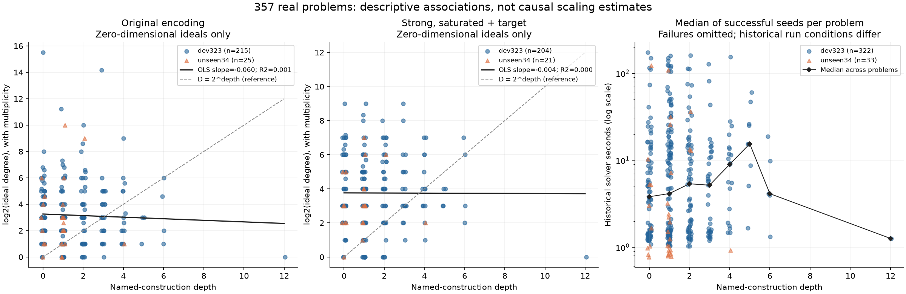
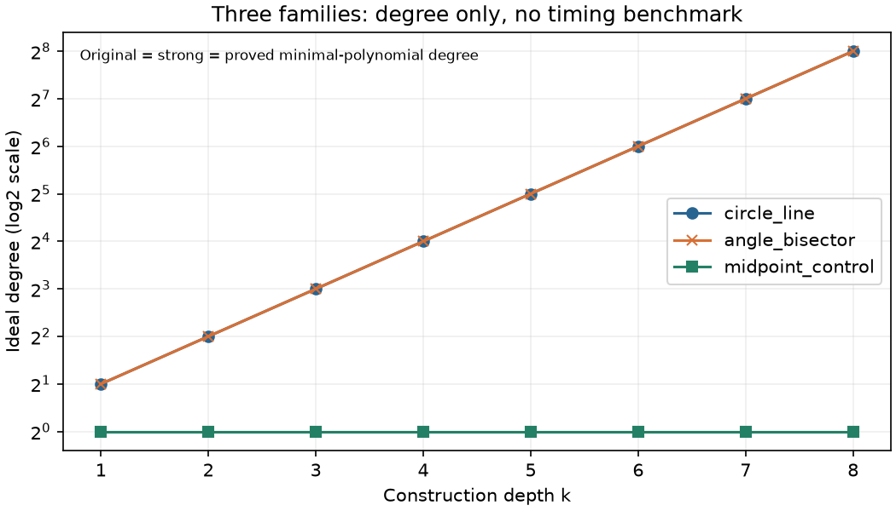

> **判断（2026-10-24、研究方針の検討）**：実問題357問で深さと次数がほぼ無関係だったため、「作図が深いほど次数が指数的に増える」という仮説は実問題で支持されず、主軸から外した。以後、人工の族による拡張はしない（`families/` は中止基準に当たる前に完了していた分の記録で、結論の根拠には使わない）。実問題の表（real-problems.csv）はそのまま残す。

# 実問題の次数と作図の深さ

全357問（開発323、開発外34）を収録した。既存系の零次元次数が分かったのは240問、強化系は225問。正次元で次元と次数を得たのは既存61問、強化31問で、次数不明はそれぞれ56問・101問。次数は重複度込みで、相異なる複素解の個数とは限らない。主な観測は、既存系の `log2(次数) = a + b×深さ` の傾き **-0.0595**（R²=0.00144）、強化系は **-0.00369**（R²=7.6e-06）だった。深さだけから次数≈2^kを一般に説明できるとは言えない。以下は観測の記述であり、予測の固定・修正は行っていない。

深さ別の次数は次の通り。中央値 [最小, 最大]。零次元だけを集計し、正次元の次数を混ぜない。

|深さ|全問|既存・零次元n|既存次数|既存・正次元n|既存・不明n|強化・零次元n|強化次数|
|---|---|---|---|---|---|---|---|
|0|86|62|8 [1, 46656]|13|11|57|8 [1, 512]|
|1|130|87|4 [1, 2384]|21|22|84|8 [1, 512]|
|2|70|44|8 [1, 1024]|17|9|43|16 [1, 256]|
|3|35|24|8 [1, 18432]|6|5|18|12 [2, 512]|
|4|21|15|6 [2, 512]|2|4|14|16 [2, 128]|
|5|9|3|8 [2, 8]|2|4|4|12 [8, 16]|
|6|5|4|14 [2, 64]|0|1|4|36 [4, 128]|
|12|1|1|1 [1, 1]|0|0|1|1 [1, 1]|

群別・正次元の次数分布も [depth-distribution.csv](depth-distribution.csv) に収録。

回帰の傾きは**問題の種類・自由変数数・条件数・DSLの書き方による交絡がある参考値**。次数未判明の難しい系を除いた選択もある。深さ12は1問だけで、深さ7〜11の観測はない。傾き1や傾き0の検定、因果関係の推定はしていない。

|群|縦軸|n|傾き|切片|R²|
|---|---|---|---|---|---|
|dev323|base_log2_degree|215|-0.0766|3.32|0.00257|
|dev323|strong_log2_degree|204|-0.0262|3.85|0.00039|
|dev323|solver_seconds|322|-0.673|18.2|0.00104|
|dev323|solver_log2_seconds|322|0.0372|2.51|0.000779|
|unseen34|base_log2_degree|25|0.113|2.79|0.00137|
|unseen34|strong_log2_degree|21|0.171|3.1|0.00818|
|unseen34|solver_seconds|33|-1.73|13.9|0.00252|
|unseen34|solver_log2_seconds|33|0.0876|1.53|0.00109|
|all|base_log2_degree|240|-0.0595|3.26|0.00144|
|all|strong_log2_degree|225|-0.00369|3.76|7.6e-06|
|all|solver_seconds|355|-0.555|17.6|0.000687|
|all|solver_log2_seconds|355|0.0647|2.38|0.00218|

solverの秒数を直接回帰すると1段当たり -0.555 秒、R²=0.000687。正解seedの時間中央値だけの関係なので、時間切れ・不正解は0秒とせず除外した。これだけで「1本の枝をたどり、時間が深さに比例する」とは結論できない。既存BASE相当solverには代数的前処理、多点出発、第2探索、rescueが含まれる。

深さを点の生成だけで数える補助定義では、既存次数の傾きは -0.16、targetが直接参照する作図の最大深さでは -0.2。[全回帰値](regressions.csv)。定義による差も、深さが入力表現に依存することを示す。

## 既存msolveの失敗・時間切れ

過去の結果区分をそのまま集計した。`error`を全てメモリ超過と決めつけない。`no_unknowns`は求解器失敗と同義ではなく、既存変換が未知数を残さなかった区分。次表の次数は今回計算できた既存系の零次元分だけ。

|msolve結果|n|深さ 中央値 [範囲]|零次元n|次数 中央値 [範囲]|正次元n|次数不明n|
|---|---|---|---|---|---|---|
|answer_set_matches|201|1 [0, 6]|197|8 [1, 1024]|0|4|
|error|15|1 [0, 4]|0|—|0|15|
|free_parameter|3|2 [0, 3]|2|9 [2, 16]|0|1|
|no_unknowns|13|1 [0, 12]|13|1 [1, 1]|0|0|
|not_run|2|3 [1, 5]|0|—|0|2|
|positive_dimensional|65|1 [0, 5]|0|—|56|9|
|timeout|9|2 [0, 3]|3|18432 [2384, 46656]|0|6|
|unsupported|15|1 [0, 6]|0|—|0|15|
|不正解|1|0 [0, 0]|0|—|0|1|
|変換不能|4|0.5 [0, 1]|2|1 [1, 1]|0|2|
|時間切れ|1|1 [1, 1]|1|1024 [1024, 1024]|0|0|
|有限でない|5|1 [0, 2]|0|—|5|0|
|正しい答え集合|23|1 [0, 4]|22|5 [1, 512]|0|1|

開発群の時間切れ9問のうち、次数が判明した3問は2384〜46656（中央値18432）、深さ0〜3。開発外の時間切れ1問は次数1024・深さ1だった。高次数でも浅いDSLが含まれる。開発群の`error`15問は今回も全て次数不明なので、大次数だとは判定できない。旧READMEの「有限でない68問」は、元CSVでは`positive_dimensional`65問と`free_parameter`3問に分かれる。

時間切れ群の次数不明を大次数と置換しない。有限でない群は有限解の列挙とは課題が違う。正次元でもTが有限個に決まることがあり、全配置の次数とTの最小多項式次数は別物である。[群別の詳細](msolve-profile.csv)。

## 大きい次数を速く解いた例と逆の例

「速い」は既存の正解seed中央値10秒以下とした表示上の基準。次数降順、同次数は時間昇順の上位10問。この例示基準は予測や仮説検定には使わない。

|問題ID|群|深さ|既存次数|強化次数|正解/seed|正解秒中央値|
|---|---|---|---|---|---|---|
|HMMT-2010-FEB-GEO-01|dev323|0|46656|—|3/3|1.22|
|AIME-2006-I-07|dev323|3|18432|—|3/3|3.12|
|HMMT-2024-FEB-GUTS-04|unseen34|1|1024|—|5/5|0.777|
|HMMT-2013-FEB-GEO-07|dev323|2|1024|—|3/3|5.46|
|HMMT-2011-two-circles-tangent-line|dev323|4|512|—|3/3|1.65|
|HMMT-2017-FEB-GEO-09|dev323|0|256|512|3/3|1.81|
|AIME-2023-I-05|dev323|1|128|128|3/3|6.69|
|HMMT-2006-FEB-GEO-08|dev323|0|112|64|3/3|4.34|
|JMO-2012-PRE-02|dev323|2|96|—|3/3|1.32|
|AIME-2012-II-13|dev323|3|64|512|3/3|1.33|

最大の例HMMT-2010-FEB-GEO-01（次数46656、深さ0）はDSL自由変数0で、七角形の頂点をsin/cos定数で直接置く問題。既存変換は6組の三角定数をそれぞれ代数化し、共役・符号の選択を独立に残すため6^6=46656になる。solverは固定配置の直接評価を使える。これは表現による候補増加の例であり、46656個の本来の図を1本の探索で処理した証拠ではない。七角形の三角定数のような、平方根だけでない代数拡大もこの実問題群には含まれる。

次は既存次数16以下で、少なくとも1seedで正解しなかった記録がある例。部分失敗と全seed失敗を区別する。正解時間「—」は全seed失敗であり0秒ではない。

|問題ID|深さ|既存次数|正解/seed|正解秒中央値|全seed秒中央値|
|---|---|---|---|---|---|
|JMO-2015-PRE-02|1|8|2/3|122|163|
|AIME-2014-II-10|0|16|0/5|—|178|
|AIME-2007-I-15|0|16|2/3|5.69|5.57|
|AIME-2016-I-15|3|16|2/3|127|172|

次数の大小に関係なく、次数が判明した記録済み失敗の全一覧は [low-degree-failures.csv](low-degree-failures.csv) に残した。

## 強化版について

両方が零次元で次数判明の207問では、強化系の次数は低下25問、同じ43問、増加139問。「R1〜R4でも次数そのものは減らせない」という一般論は、この表とは合わない。ただし既存系はTなし・Rabinowitsch変数付き、強化系はT付き・飽和済みであり、表現と対象が完全には同一でない。

具体例AIME-2001-I-05は深さ0、既存次数8、強化次数4。DSLの厳密不等式 x>0、y<1 が与える x≠0、y−1≠0 による飽和で退化成分が除かれる。この例のTは既存の距離補助変数と線形に同定されるので、T追加だけでは倍増しない。逆に新しい距離・根号をtargetに追加すると符号分岐が増える。高次の系でもTへの射影の次数は小さい場合があるため、全系の次数と出力の次数を同一視しない。

## 方法・出典・欠測

1. `benchmarks/cases.jsonl` の323問と `unseen-2/{a,b}/cases.jsonl` の17+17問を全数使用。各ケースの内包DSLと `dsl_path` のJSONが一致することを確認。群の入替え・難易度による除外なし。
2. 既存系は `/tmp/q6-tools/exact_comparison/benchmarks/exact_comparison/algebraize.py` の `translate(mode="fresh",with_target=False)` と既存 `run_exact.build(rabinowitsch=True)` を無変更で使用。`origin/claude/project-thread-fos2rk` の変換器とSHA-256が一致する。等式で使う変数を残し、既存の分母因子の積に補助変数zzを付ける。
3. 強化系は無変更の `strong_translate.translate` と `run_strong.prepare`。Tを追加し、R2の各非零因子で順に `sat`。今回はそのイデアルの次数を測った。R1のTへの射影・実根列挙・復元・検証を実問題では実行していない。R3の代数定数も変換器どおり。R4の「DSL未知数0なら直接評価」は求解手順であってイデアルの定義ではないので、直接評価器を呼ばず変換された系の次数を記録した。強化パイプライン全体の成功率・時間とは異なる。
4. 有理数体・次数逆辞書式順序で `G=std(J)`、`dim(G)`、`mult(G)` を計算。零次元では `vdim(G)` と一致する重複度込みの次数。異なる複素点の個数は非被約ならこれより少ない。正次元は有限個の解数ではなく、最高次元成分の重複度込みの次数。空イデアルは次元−1・次数0で別扱い。正次元で補助変数やTを加えると、同じ幾何を表す場合も埋込みの次数は変わり得る。
5. 深さkは**名前付き作図命令の依存DAGの最大段数**。定数・自由パラメータは0。他の作図名を参照しない `Point` と自由パラメータの単なる別名は0。その他の名前付き出力は、式中で参照する先行作図名の最大深さ+1（参照なしは1）。点・直線・円・スカラーを含む。匿名の入れ子は独立ノードにせず、条件・targetを加算しない。作図が条件だけに書かれたDSLは深さ0でも高次数になり得る。依存抽出はPython AST、`expand_k.py` とDSLパーサの式形式を参照。各ノードの証跡は `depths/`。
6. 補助列 `point_depth` は点を返す名前付き命令だけを+1し、線・円・スカラーは依存深さを伝播する。`target_dependency_depth` はtargetが参照する作図名の最大の主深さ。主定義の結果をこの定義に差し替えていない。
7. Singular 4.4.1をPATH先頭 `/tmp/q6-tools/bin` で使用。1系30秒、1問の2系合計最大60秒、最大4並列。変換は1系20秒、各子プロセスの仮想メモリ2 GiB、1ファイル2,900,000 byteを上限とした。ログの次数計算時間は予算管理用で、時間比較には使用しない。再試行・新規msolve時間測定・solver実行なし。

既存時間の参照は次の通り（CSV各行にもパス・列名を収録）。

- 開発外msolve: `capability-1024/exp1-msolve/per-problem.csv` の `msolve_solve_seconds`, `msolve_category`。`solve_seconds`と同じ求解部分であり、変換・検証を含む全体時間ではない。
- 開発msolve: `jssa/strategy/astra-consult-18/Q24/source-msolve-cases.csv` の `msolve_s`, `msolve_class`。10/22、コードbranch `claude/project-thread-fos2rk` b0575a0。結果の元保存先は別branch `claude/project-thread-nycxfb` のc0bd76d、`jssa/results/exact-comparison-pc-20261022/aggregate/cases.csv`。現ローカルでは元commit/結果ツリーを参照できなかったが、保存コピーのGit blob SHA `2270f6bb7b6596e23c7ad0e9bfa37c0c5026d7b8` は既存来歴と一致した。探索した `git log --all` / `git ls-tree` / `git show` / `rg` の範囲は [provenance.json](provenance.json)。
- 開発外solver: `unseen-2/a/per-run.csv` と `b/results.csv` の `matched` と `wall_seconds`。Q30、seed301〜305の正解数と、正解した実行だけの壁時間中央値。
- 開発solver: `jssa/results/mechanism-attribution/attribution.csv` の `matched` と `wall_s`。凍結版本計測 `jssa-main-j6-20261022`、seed0〜2、BASE相当。全323×3行を使用。

開発外HMMT-2015-FEB-GUTS-24のseed301は記録欠測（process_crash）。予定5seedの分母には含め、正解時間から除いた。`solver_missing_count` / `solver_missing_seeds` と `solver_confirmed_noncorrect_count` で欠測と記録済み不正解を分離した。

開発群の旧msolveは1800秒・4並列・5 GiBで、別の難しさ実験も同時に動いていた。solver本計測は6並列。開発外msolveは600秒の記録。機械・同時負荷・上限・seed数が揃わないため、この表の秒数から厳密法とsolverの公平な速度倍率は出さない。

既存記録と今回変換の変数数・等式数の照合で差があるのは0項目。[照合表](historic-system-size-check.csv)。今回確認できた範囲で、既存変換が等式から落としたDSL自由変数を持つのは2問。該当ID: AIME-2010-II-09, HMMT-2023-FEB-GEO-01。その行の零次元次数は使用変数だけの系の値であり、元DSLの配置が有限である証拠ではない。

次数不明は推測で補完していない。理由別件数は次の通り。全ID・詳細・既存時間の欠測も [missing.csv](missing.csv) に列挙した。正次元で次数が計算できたものは欠測ではない。

|系|理由コード|件数|
|---|---|---|
|base|DEGREE_TIMEOUT|33|
|base|MEMORY_LIMIT|1|
|base|TRANSLATION_ERROR|1|
|base|TRANSLATION_TIMEOUT|4|
|base|TRANSLATION_UNSUPPORTED|17|
|strong|DEGREE_TIMEOUT|25|
|strong|TRANSLATION_ERROR|1|
|strong|TRANSLATION_TIMEOUT|1|
|strong|TRANSLATION_UNSUPPORTED|74|

`TRANSLATION_UNSUPPORTED`=命令/定数/target等が未対応、`TRANSLATION_TIMEOUT`=変換20秒超過、`DEGREE_TIMEOUT`=Singular30秒超過、`MEMORY_LIMIT`=2 GiB上限、`TRANSLATION_ERROR`=既存変換器の例外、`WORKER_LIMIT`=外側監視の終了、`ARTIFACT_SIZE_LIMIT`=2.9 MB上限、`TOTAL_BUDGET_LIMIT`=全体枠。出現していないコードの欠測が発生したと主張するものではない。

次数・変数数・等式数は総次数の上界（Bézout積）ではなく、実際に計算したイデアルの量。不等式の符号、平方根の主値、実在、枝選択はこの複素系では完全には表さない。今回の観測は「全ての問題で2^k」「強化しても次数を下げられない」「solverは必ず線形時間」を裏付けない。一方、有限の平方根拡大が毎段独立に必要な特定の族では指数増加が起こり得る。この範囲を人工族で別に確かめる。

<!-- FAMILIES -->
## 人工族（補強）

実問題表と骨子を2026-10-24 01:33:00 UTCに保存し、`progress.jsonl` に「実問題表完了」を記録した後に着手した。次数計算の実問題部分は約10分20秒、補強は約1分18秒（初回の比較検査の修正を含む）。3族×k=1〜8の24組を作成。生成スクリプト・DSL・日本語問題文・証明は [families/](families/README.md)、値は [degrees.csv](degrees.csv)。全て1個の自由スカラーtを最終座標に等置し、選択した実数の枝で答えは1個に決まる。

|族|k|選択したt|既存系次数|強化系次数|tの最小多項式次数|
|---|---|---|---|---|---|
|円と直線の交点の鎖|1〜8|2 cos(π/2^(k+1))|2^k|2^k|2^k|
|角の二等分の鎖|1〜8|tan(π/2^(k+2))|2^k|2^k|2^k|
|中点の鎖（対照）|1〜8|2^(−k)|1|1|1|

2つの二次的な族では各kの次数は **2, 4, 8, 16, 32, 64, 128, 256**。中点の族は全て1。強化版の非零因子がどの共役でも消えない2族では、飽和しても次数が下がらない。この限定された族では2^kを確認できたが、実問題全体への一般化や時間の増加率はこの結果からは決まらない。

円の鎖は `y0=0, yi²=2+y(i−1)`。最小多項式を `P0(T)=T, Pi(T)=P(i−1)(T²−2)` と作り、素数2のEisenstein判定で既約性と次数2^iを確認した。全ての共役は−2と2の間にあり、円と交点は退化しない。
二等分の鎖は `yi=y(i−1)/(1+sqrt(1+y(i−1)²))`。n=2^kとして `X^(2n)+1` の既約性と `Q(exp(iπ/(2n)))=Q(t,i)` からtの体次数nを導いた。中点の最小多項式は `2^k*T−1`。各族とも最後の座標から前段を逆に決められるので、全配置の有限性も確認できる。詳細は [証明](families/README.md)。

**角の二等分k=8では、既存・強化の次元0・次数256は計算済みだが、強化系の後続のT消去が30秒で停止した。**そのT最小多項式次数256は上の独立した厳密な導出による。消去との照合は未完として `ELIMINATION_TIMEOUT` を残した。残る23組はSingularの消去式の平方因子を除いたものと、証明した最小多項式が一致。計算秒は制限管理用に保存しただけで、時間比較には使わない。

今回の全24入力ではDSLの自由変数が常に1個で、最後の等式もtについて一次である。一般の多変数探索の難しさを再現する族ではない。完成solverの代数的前処理や定数評価が主役になる可能性もあり、段階2では採用された経路を併記する。初回の多項式照合はZZ/QQの表記差で停止したため、係数領域を揃えて保存済み出力から再開した。CASの再実行はない。

## 確認状況

`verify_artifacts.py` で全ID、出典のハッシュ、深さ、正解数・時間中央値、次数とSingular出力、ファイル上限、実問題→補強の順序を確認した。[verification.json](verification.json)。各系の入力 `.sing` と結果 `.log` / `.json` を保存。変換器・solver・元データは変更していない。git commit/push、新規solver実行、時間比較、システム導入、昇格コマンドは行っていない。

## 段階2（時間比較）の推奨設計案

以下は今後の実行案で、今回は実行していない。予測・成功基準・打切り規則は、依頼者が固定してから開始する。

|族|主比較のk|補足|
|---|---|---|
|円と直線の交点の鎖|1〜8|全段で次数とT消去が確認済み|
|角の二等分の鎖|1〜7|k=8は消去30秒打切りの別枠として事前指定して含める|
|中点の鎖|1〜8|次数を増やさず深さだけ増やす対照|

1. このDSL・変換器・BASE相当solver・採点器のハッシュを固定する。厳密な答えは最小多項式と実根の区別まで指定する。円の族は最大の実根、角の族は最小の正の実根、中点は有理数。共役全体を正解集合として採点しない。
2. 同じ機械で、他の計算と重ならない期間を確保し、1実行1コア・最大4並列・メモリ上限を揃える。全体壁時間は例えば180秒、仮想メモリは2 GiB。各方式の変換・起動・候補生成・復元・検証を全てこの枠に含める。方法・k・反復の実行順は事前に乱数seedを固定して混ぜる。
3. 既存msolve経路、強化Singular経路、完成solverの3方式を同じ入力・同じ採点で比較する。msolveは1スレッド、元のfresh変換を使用。決定的な厳密法は各3反復、solverは例えばseed0〜4。全配置を列挙する経路とTへ射影する経路を区別して記録し、単なる次数計算を求解時間に代用しない。
4. 主指標は正しいtの同定・最終検証までの全体時間と成功率。別列に変換、代数計算、探索、精密化、同定、検証の時間と採用経路を残す。代数次数や係数長がsolverの既定の同定上限を超える場合は、そのまま理由を記録する。数値的な図の実現と厳密な答えの同定を分け、前者だけを「解けた」としない。
5. 各kの全試行・失敗・打切りを残し、正解試行の中央値だけで線形/指数増加を主張しない。全体時間に加えて時間内成功率と打切り数を表示する。`秒=a+b k` と `log2(秒)=a+b k` は記述モデルとして並べ、起動時間の床、係数のビット長、必要精度、前処理の効果を確認する。次数2^kだけから時間2^kを仮定しない。
