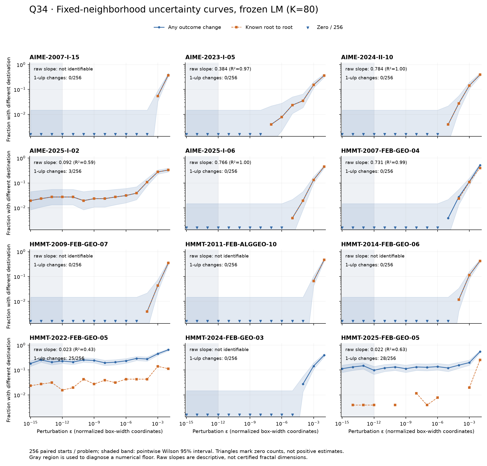

4基準の最終判定：**直感に反するか＝一部、深い理論が必要か＝未確認、再現性と広がり＝限定的、solver固有か＝弱い。Aの中心を担えるか：不可。**

Q34、2026-10-24 JST。この判定は今回得た材料についてであり、フラクタル境界の不存在を意味しない。

**結論。** 凍結版 `60db4b6` の局所探索を12問で測定した。文字どおりの1ulp摂動による行き先変更は **3/12問** にあった。しかし、数値床・反復上限・未収束分類を除いてフラクタルな根境界と認定する事前条件を満たしたのは **0/12問**。有望な1問を新しい1024始点で再測定しても、有限尺度の傾きα≈0.447は残ったが、認定には届かなかった。

完成solverは、事前登録120実行と実際の53ビット演算まで丸めを変える補足48実行で、**同seedの厳密答え集合の変更0/24組**だった。丸め変更で数値候補の座標や精密化失敗が変わる例はあるが、最終答えの取りこぼしにはつながらなかった。したがって、今回の測定から「10/21のOS・libm・CPU差による答えの揺れはフラクタル境界で説明できた」とは言えない。

**事前固定と予測の当否。** [prediction.md](prediction.md) のSHA-256とUTC時刻を [prediction.lock.json](prediction.lock.json) に保存し、新規局所実行前の `2026-10-23T15:24:09.496146+00:00` に標準出力へ「予測固定」と出した。文書ハッシュは `61afbb924fcecbd0da0462d2680371295aacebd973e41ac58d2b2367d9904a49`。その後のcommit `428223c` はユーザー側によるもの。予測本文は変更していない。

| 予測 | 実測 | 判定 |
|---|---|---|
| P1：3〜6/12問で床を除いた根境界がフラクタルと整合、α=0.10〜0.60 | 認定0/12問 | 成立せず。検出力不足もあり、非フラクタルとの断定は不可 |
| P2：素朴な回帰で6〜10問がα<0.25 | 3問。別の5問は指数を識別できず | 予測を確認できず |
| P3a：完成solverの答え集合が変わる組は0〜2/24 | 0/24 | 範囲内 |
| P3b：精密化候補の既知根集合が8/24組以上で変わる | 0/24 | 不成立 |
| P4：1ulpで行き先が変わる問が3問以上 | 3/12 | 成立 |

後述の追加標本とmpmath丸め介入は別枠の補足であり、P1/P3の分母や成功数へ加えていない。

**局所測定。** 各問2か所の境界近傍を、既存の異なる根へ行く始点対から選び、12回二分して固定した。箱幅で正規化した座標に半幅0.005の固定patchを置き、2seed×2patch×64点＝256始点を一様抽出した。同じ始点・方向にε=10^-15〜10^-2の14尺度を加えた。εごとに境界へ近づけ直す操作はしていない。εは**探索箱幅で正規化したL2距離**であり、元の単位での絶対距離やulp数ではない。別途、1座標だけ `nextafter(+∞)` する1ulp試験も実施した。

局所関数は元の `_collect_local_start_record`、LMのmax_nfev=80、元の残差・guard・hard罰則・停止許容値のまま。根ラベルは既存の正解終点から箱幅基準L∞距離10^-5で照合し、残差≤10^-8と元の許容条件も要求した。Fは不採用、Uは未知の小残差終点であり、真の吸引先とは呼ばない。各問32始点をmax_nfev=320でも確認した。

| 問題 | α_raw［95% bootstrap区間］ | 回帰尺度 | 1ulpで変更 / 256 | うち既知根→別の既知根 |
|---|---:|---|---:|---:|
| AIME-2007-I-15 | 識別不能 | 非ゼロ尺度不足 | 0 | 0 |
| AIME-2023-I-05 | 0.384 [0.224, 0.552] | 10^-7〜10^-3、5点 | 0 | 0 |
| AIME-2024-II-10 | 0.784 [0.511, 0.835] | 10^-5〜10^-3、3点 | 0 | 0 |
| AIME-2025-I-02 | 0.092 [0.068, 0.135] | 10^-12〜10^-3、10点 | 3 | 3 |
| AIME-2025-I-06 | 0.766 [0.507, 0.812] | 10^-5〜10^-3、3点 | 0 | 0 |
| HMMT-2007-FEB-GEO-04 | 0.731 [0.423, 0.796] | 10^-5〜10^-3、3点 | 0 | 0 |
| HMMT-2009-FEB-GEO-07 | 識別不能 | 非ゼロ尺度不足 | 0 | 0 |
| HMMT-2011-FEB-ALGGEO-10 | 識別不能 | 非ゼロ尺度不足 | 0 | 0 |
| HMMT-2014-FEB-GEO-06 | 識別不能 | 非ゼロ尺度不足 | 0 | 0 |
| HMMT-2022-FEB-GEO-05 | 0.023 [0.014, 0.031] | 10^-12〜10^-3、10点 | 25 | 2 |
| HMMT-2024-FEB-GEO-03 | 識別不能 | 非ゼロ尺度不足 | 0 | 0 |
| HMMT-2025-FEB-GEO-05 | 0.022 [0.011, 0.033] | 10^-12〜10^-3、10点 | 28 | 0 |

α_rawは、事前固定した10^-12〜10^-3の範囲内で0<f<1となる尺度だけの記述的な傾きである。**次元の確定値ではない。** 少数の変更件数から有効尺度を選ぶため、特に3点回帰のbootstrap区間は過大に精密と解釈できない。非ゼロ尺度が3点に満たない5問には数値を無理に付けなかった。完全な尺度別件数・実際の変位・根間変更率・seed別変更率は [uncertainty.csv](uncertainty.csv)、問題別区間と判定理由は [per-problem.csv](per-problem.csv) / [local-summary.json](local-summary.json) にある。

**小さいαをそのままフラクタルと呼べない理由。** 算出できた7問はすべてα_raw<1だった。しかし、1ulp感度が出た3問は微小εで変更率がほぼ横ばいである。ε≤10^-12での最大変更率はAIME-2025-I-02が7/256、HMMT-2022-FEB-GEO-05が65/256、HMMT-2025-FEB-GEO-05が38/256。これを全尺度の直線へ押し込むとαは0に近づく。

HMMT-2022はmax_nfevを80→320にすると、確認160終点中9点（5.625%）のラベルが変わった。他11問は0/160。さらにHMMT-2022とHMMT-2025は根対根以外の変化が多い。56件の1ulp行き先変更のうち、既知根同士は5件だけで、その5件の**目標値はすべて同じ**だった。初回192件の同一入力再生はラベル変更0。根照合閾値を10^-6、10^-5、10^-4へ変えてもラベルは変わらなかった。

ここで「数値床」は微小尺度の経験的なプラトーを指す診断名である。原因が丸めだけだと証明したわけではなく、真の極小指数を持つ境界なども排除していない。同じLMを高精度で再実装した比較は行っていない。

事前規約では、数値床の上側95%限界の3倍を超える連続4尺度、R²≥0.95、0<α<1を含む区間条件、seed間の傾き一致、根対根coverage≥90%、反復上限の安定性を要求した。全問が最初の連続尺度条件で止まった。256標本で小さい確率を測る限界も含むので、これは「フラクタル0問」の証明ではない。

**追加確認。** [dense-plan.md](dense-plan.md) の理由と選択時点を明記し、AIME-2023-I-05と数値床の対照AIME-2025-I-02だけを、新seed 340601/340602・同じpatch・1024始点で確認した。計画は実行前に [dense.lock.json](dense.lock.json) へ固定したが、対象の選択は初回結果を見た後である。

| 問題 | 新標本のα_raw［区間］ | 2seedのα_raw | 1ulp変更 | 結論 |
|---|---|---|---:|---|
| AIME-2023-I-05 | 0.447 [0.347, 0.763] | 0.412 / 0.515 | 0/1024 | 根間の有限尺度候補は残る。床除外後に使えるのは10^-4、10^-3、10^-2の3尺度で、認定不可 |
| AIME-2025-I-02 | 0.070 [0.058, 0.086] | 0.068 / 0.072 | 16/1024 | 微小尺度の床が再現。単一のべき則とは扱わない |

両問とも既知根対のcoverage=100%、K=320への変更0/160、照合閾値への依存0。同一入力再生も変更0だった。追加のα≈0.447を「事前予測に当たった1問」と数え直してはいない。[追加の全数値](dense-summary.json)、[尺度別件数](dense-uncertainty.csv)。

集計の対照として、解析的な直線境界と三進Cantor境界も測った。得た傾きは1.047と0.389、理論値は1と1−log(2)/log(3)≈0.369で、事前の実装確認範囲内だった。これは計算方法の対照であり、幾何問題12問のフラクタル性の証拠ではない。[controls.json](controls.json)

**完成solverの結果。** 元の完成workerを12問×seed 340301/340302、各30秒予算で実行した。通常版の再実行、浮動残差評価内だけのCPU下向き丸め・上向き丸め、残差ノルムの二乗和の逆順加算を比べた。追加では、実際の幾何演算に使うmpmathの53ビット丸めも下向き・上向きにした。高精度精密化と厳密同定には介入せず、各callbackのfinallyで丸め状態を復元した。FMAそのものや異なるOSの試験ではない。

| 比較 | 実行数 | 答え集合が変わった組 | 既知の精密化候補根集合が変わった組 | 数値探索候補の座標列が変わった組 |
|---|---:|---:|---:|---:|
| 通常版対その再実行 | 24対 | 0/24 | 0/24 | 0/24 |
| 事前登録3介入のいずれか対通常版 | 72介入＋通常版・再実行48＝120 | 0/24 | 0/24 | 1/24 |
| 補足mp-down/mp-up対通常版 | 48追加 | 0/24 | 0/24 | 2/24 |

通常のfenv介入で変化したのはAIME-2007-I-15、seed 340301、上向き丸め。20候補のうち2候補が既存根から離れ、`line_search_failed`、残差約83.5と123.2になったが、他候補から元と同じ二つの厳密答えを回収した。通常版と上向き版を各1回再実行し、この差と最終答えの一致を確認した。補足で候補座標列が変わったのは同問とAIME-2024-II-10のseed 340301で、根集合・答え集合は同じだった。全比較で浮動残差の呼出し回数は変わらず、時間切れもなかった。

固定点監査では、fenvだけの変更は一部の残差成分を1ulp変えたが、主なmpmath演算の丸めは変えていなかった。逆順和も監査48点では変化0。この弱さを記録した上で補足を追加した。mpmath込みでは12問すべてで残差成分の変化が確認できた。介入箇所・監査は [deviations.md](deviations.md)、[rounding-audit.csv](rounding-audit.csv)。

なお、この標本の8/12問は通常版の採用候補が `exact_polynomial` 由来で、残り4問はNOMAD由来だった（seed 340301）。局所LMの境界だけで完成solver全体を代表できない。多くが代数的前処理で解ける目的抽出標本なので、今回の0/24を全323問や10/21の別環境へ一般化しない。[全実行表](full-runs.csv)、[対応比較](full-comparisons.csv)、[補足表](full-mp-runs.csv)、[再実行確認](recheck-summary.json)

**理論とAへの採用判断。** Grebogi–McDonald–Ott–Yorkeの枠組みでは、固定した標本密度と境界のε近傍の体積則などの条件の下でα=n−d_Bとなる。これは初期値の不確実性による根選択を説明する理論である。[原論文の出版元](https://www.sciencedirect.com/science/article/pii/0375960183909453)。しかし、丸めを変えると反復途中の写像も変わり、初期値だけの摂動とは等価でない。さらに、滑らかな境界を挟む隣接浮動小数点数でも1ulpで行き先は変わる。したがって1ulp感度からフラクタル性を逆算できない。

今回の幾何条件は多項式・半代数的に表現できるが、実際に回した残差には平方根、絶対値、角、罰則がある。多項式Newton写像を回したと呼ぶこともできない。AIME-2023-I-05については多項式を明示でき、s⁴=56²+90²=106²から答えs²=106が紙と鉛筆で出る。4つの座標根が同じ答えを持つ理由も分かる。αの数値は実測を要するが、その測定自体は通常の最適化でも行える。既知のNewton法の現象の再確認を超える、solver固有の深い機構はまだ得ていない。導出・滑らかな反例・先行研究・適用条件は [theory.md](theory.md) にまとめた。

**再現性と資源。** ソースだけでなく、選んだ12問のDSLも凍結commitと一致することを検査した。主測定・境界探索・上限確認で51,600回、追加確認で33,120回の局所探索、完成solverは168回＋再確認2回。最大3並列、BLAS等は1thread、batch上限170秒。局所試行の時間切れ・例外は0、完成solver170実行の最長は約5.46秒で、30秒の締切には達していない。

ファイルごとの5MB上限を検査した。詳細な完成solver記録は内容の往復一致を確認してgzip圧縮し、入力・seed・厳密答え・候補・statsを保持している。生のJSONもすべて5MB未満だった。[再現手順](README.md)、[検証結果](verification.json)、[ファイルハッシュ](manifest.json)。
