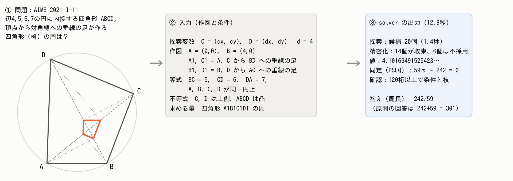
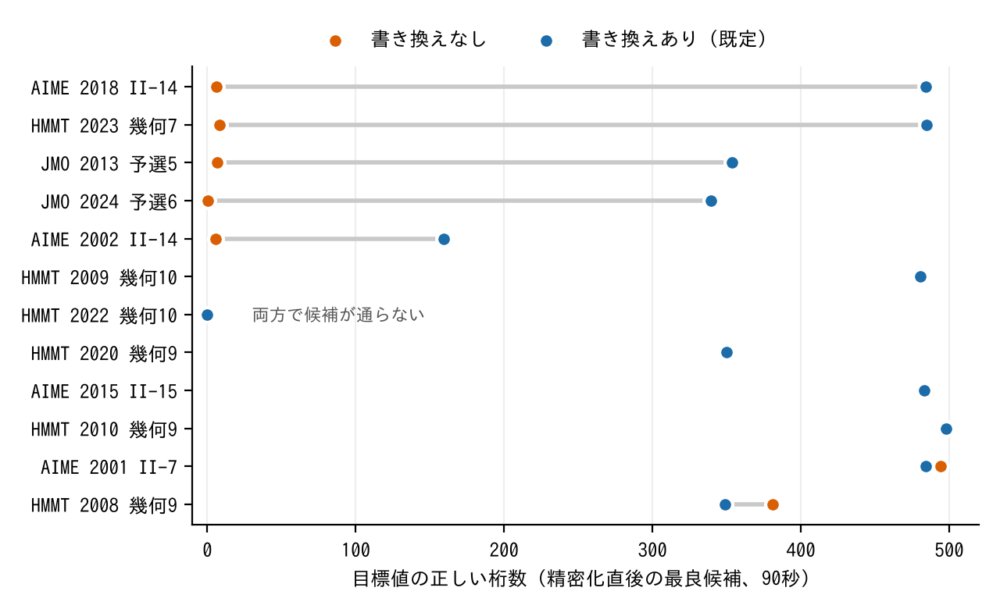

# 作図による幾何の求値 ― 数値計算で解くための工夫と、その効き方

（v13・10/24。GPT-Pro 相談23（判定 B）の指摘を反映。中心を5.3（接する条件の残差の書き換え）に置き、主張の範囲を実験に合わせて狭めた。【 】は本人確認か、実行中の実験の結果待ち。証明・実装・全ての表は補足 S1〜S6。）

## 要旨

幾何の求値問題を、作図と条件で書いた入力から、定理を探さずに解く solver を作った。数値探索で図を見つけ、高精度化し、答えを √ などを含む式として同定する。数値計算で求値をするときの障害を、候補を見つける・精密化する・式にする、の3段に分け、工夫の効き方を、完成した solver から工夫を外す比較と、変更する段の入力をそろえた比較で調べた。中心の結果は「接する」条件の扱いである。円周上の点を通る直線の接触を中心からの距離で書くと、残差は接線からのずれの2乗でしか変わらない。solver は入力の作図から接点を確かめ、接点で半径と接線が垂直という残差に自動で直す。同じ候補から精密化だけを比べると、12問中5問で、目標値は書き換えなしで0.4〜8桁しか合わず、ありで159〜485桁合った。【S3：この差が接点を使う変換によるかの結果を1文。】最終検証にも同じ考えの変換があり、精密化から外しても答えは多くの場合救われたが、時間が増えた。ほかに、候補を散らして選ぶと、答えが複数ある問題での集合の取りこぼしが減ること、調べた同定の失敗では係数の上限が制約になっていたことを示した。完成した solver は開発に使っていない34問で170回中161回正解し、記録の残る169回で誤った値を返さなかった。

## 1 はじめに

LLMの数学の力を競う大会（AIMO）で、私はLLMが長さや角度を求める幾何の問題（求値問題）を苦手とすることを知った。数学オリンピックで幾何を学んできた経験から言えば、人間が苦労するのは補助線や定理を見つける部分である。しかし、図を正確に作れれば、答えは計算で求まるはずである。そこで、問題を作図と条件で書いた入力から、計算だけで答えを求める solver を作った。【本人確認：AIMOを見た時期と、目的の書き方。】

ただし、数値計算で求値をするのは簡単ではない。条件を満たす図に当たらない、当たっても精度が上がらない、値が分かっても式にならない、という障害がある。本稿の問いは、(1) solver はそれぞれの障害をどんな工夫で越えたか、(2) その工夫は、どの問題で、どの段に、どれだけ効くか、(3) 完成した solver は開発外の問題でどこまで解け、厳密法とどう違うか、である。

## 2 先行研究と位置づけ

AlphaGeometry [1, 2] は記号的な推論で証明や値の計算をする。図を座標の多項式で表して厳密に解く方法 [3, 13] は、答えの正しさを保証できる。数値的な方法では GMB [6] が最も近く、作図に当たる直接計算で変数を減らし、条件を満たす図を数値的に生成する。GMB にも接点を指定する条件や接線の表し方はある。重根を扱いやすくする数値解析の方法や、数値から代数的な関係を復元する PSLQ [11] も既知である。本研究の新しさは、接点を使う発想そのものではなく、入力の構文から適用できるかを確かめて残差を自動で直す仕組みと、その効果を求値の精度で測ったことにある。加えて、答えの集合を取りこぼさない候補の選び方、同定と検証のつなぎ方を、実際の出題問題で調べる。

## 3 solver の設計

問題は、探索変数 u、作図 h、等式 F(u) = 0、不等式 G(u) > 0、求める量 τ で書き、集合 { τ(u) ｜ F(u) = 0, G(u) > 0 } を求める。中点や交点などは作図で u から計算するので変数にならない。

表1　障害の段階と、受け持つ工夫

| 段階 | 障害 | 工夫 | 節 |
|---|---|---|---|
| 候補を見つける | 条件を満たす図に当たらない。答えが複数あると一部を取りこぼす | 微分を使わない探索 NOMAD [9] を軸に、答えが出なければ別の探索で補う（S1.2）。候補は互いに離れたものを残して選ぶ | 5.1、5.2 |
| 精密化する | 「接する」条件などで残差の変化が鈍く、精度が上がらない | 作図から接点を確かめられるとき、接点で垂直という残差に直す。多倍長の LM法 [10] とニュートン法 | 5.3 |
| 式にする | 値の最小多項式の係数が大きいと同定できない | 整数関係（PSLQ）で候補の式を作り、桁数を上げた連続する2段の計算（最後は180桁以上）で条件と枝を確かめる | 5.4 |

図1に AIME 2021 I-11 での流れを示す。C、D の座標の4つを探索変数にし、垂線の足は作図で計算する。1段目の探索が1.4秒で候補を20個出し、精密化で14個が収束した。周長 4.1016949… を PSLQ が 242/59 と同定し、180桁以上で条件と枝を照合した。全体で12.9秒だった。

図1　例題での solver の流れ。① 問題、② 入力（作図と条件）、③ 出力。

## 4 実験の設計

比較は2種類ある。1つは、完成した solver から工夫を1つ外す比較で、他の段が補う分も含めた最終的な効果を見る。もう1つは、変更する段の入力をそろえる比較で、同じ候補の集合から精密化だけ、同じ高精度値から同定だけを比べ、その段での効果を見る。前者には開発群323問から機械的な規則で選んだ72問を使った（遅い・不安定な問題48、速い問題16、答えが複数ある問題の全件8。S4.6）。差が出やすい問題を多めに選んでいるので、全問題の平均とはしない。各問は3 seed、180秒、1コアで解き、3回中2回以上で答えの集合が完全に一致すれば「解けた」とした。費用は、正解なら実時間、それ以外は180秒として平均した。予測はすべて実行前に公開した。solver は凍結版（60db4b6）で、スイッチ以外は変えていない。

## 5 工夫はどの障害に、どう効くか

### 5.1 候補を見つける：探索の重ね方

素朴な方法（箱から一様に選んだ出発点から局所探索を1回）では一度も正しい図に当たらない問題が、292問中25問あった。そのうち21問を完成した solver は3回とも解き、答えを出した段は NOMAD、第2探索、救済の探索に分かれた（S4.1）。1つの探索だけでは届かない問題を、探索の重ね方で解いている。ただし72問の比較では、第2探索を外しても解けた問題は69問から67問に減っただけで、第2探索が動いたのも216回中13回だった。遅い問題で4問以上減るという予測は外れた（S4.6）。開発群の全問では、第2探索を外すと9問を失った（S2.2）。局所探索の当たりやすさを上げる工夫（出発点の選び直し）も、局所探索1回の成功率は上げたが、完成した solver の費用は下げなかった（S5.5）。前段を改善しても、全体の性能に移るとは限らない。

### 5.2 候補を散らして残す：答えの集合を取りこぼさない

答えが複数ある問題では、図の候補が同じ谷に集まると、別の答えの図を落とす。そこで solver は、残差の小さい候補だけでなく、互いに離れた候補を残して20個を選ぶ。この選び方だけを「残差の小さい順に20個」に替えると、答えが複数ある8問（24回）で集合が完全に一致した回数は19回から13回に減り、一部の値だけを返した回数は2回から8回に増えた。答えが1つの64問では、解けた問題の数は63問と64問で、時間の比の中央値も0.98倍だった（S4.7）。この問題群では、散らす選び方は単一値の問題の時間をほぼ変えずに、複数値の取りこぼしを減らした。

### 5.3 接する条件の残差を直す

単位円と、円上の点 T = (1, 0) を通り方向 (s, 1) の直線を考える。接する条件を「中心から直線までの距離＝半径」で書くと、残差は 1/√(1+s²) − 1 = −s²/2 + O(s⁴) で、接する s = 0 で1次の変化が消える。円周上の点を通るように直線を作図すると、このように接線からのずれが残差に2次でしか現れない。このときニュートン法は誤差を毎回およそ半分にしか減らせない。一方、「接線は接点で半径に垂直」を使った残差 (T − O)·(s, 1) = s は1次で変わり、1回で解ける。solver は、接点が円と直線の上にあることを入力の作図から確かめられる場合に限り、この形に自動で直す（S1.4）。直線を平行に動かす作図では元の残差も1次で変わるので、この書き換えが効くのは作図の仕方による。また書き換えても、系全体の重根や特異性が必ず消えるわけではない。

同じ候補の集合から、書き換えあり・なしで精密化だけを比べた（接する条件を含み、候補が作られる12問、各90秒）。5問では、書き換えなしの最良の候補で目標値が0.4〜8桁しか合わなかったのに対し、ありでは159〜485桁合った（図2、S4.8）。5問では差は20桁以内で、1問はなしの方が良く（381桁対349桁）、1問はどちらも候補が通らなかった。以前の比較で差が出た7問のうち6問以上で差が出るという予測は、5問で外れた。

この比較で外したのは、接する条件の書き換えに、距離0の座標差と半径の補助式を加えた一式だった。そこで、接する条件の扱いだけを、元の残差・絶対値の折れ目だけを除いた残差・接点を使う残差の3通りに替えて比べた（事前登録10、S4.11）。【S3の結果：3条件の比較。読み方は事前に固定（T0≈T1でT2だけ良い→接点の寄与、T1≈T2→折れ目の寄与、分かれる→複数の原因）。結果に合わせてこの節の主張を確定する。】

最終検証も、符号付きの残差とニュートン法の修正を使う。精密化の直後に書き換えありだけが通った5問を、同じ候補のまま最終検証まで追うと、4問では書き換えなしの側も最終検証の修正を経て通り、差が残ったのは1問（JMO 2024 予選6）だった。完成した solver で精密化の書き換えを外すと、72問で解けた問題は69問から68問とほぼ変わらなかったが、費用の平均は26.8秒から33.1秒に増えた（S4.7）。増えた6.3秒のうち3.3秒は両方が正解した実行で余分にかかった時間、3.0秒は外した側だけが失敗した実行の分だった。1.5倍以上遅くなったのは9問で、半数以上の問題で影響が出るという予測は外れた。この問題群では、前段の書き換えの寄与は、解けた問題の数よりも費用に現れた。後段のどの処理が補ったかは、今回は分けていない。

図2　接する条件を含む12問で、同じ候補の集合から精密化したときの、目標値の正しい桁数（書き換えあり・なし、事前登録7のS1）。点が1つに見える問題は、両者がほぼ重なっている。【S3の3条件を加える】

### 5.4 式にする：図は同じで、求める量だけ難しくする

AIME 2014 II-10 の答え 3042147√3 の最小多項式は x² − 27763975108827 で、2次だが係数が14桁ある。solver は5回とも図を見つけたが、同定で落ちた。保存した高精度の値で、係数の上限を10⁸のまま桁数を120・250・500と上げても同定は全て棄却され、上限を10¹⁴、10²¹に上げると正しい式が得られた。

AIME 2019 I-12 では、同じ図のまま、求める量だけを原問・長さ・面積・角・比に替えた（S5.7）。原問と比は同定できたが、長さと面積は、桁数を120・250・約350と上げても全て棄却され、上限を10²¹にすると両方とも正しい式が得られた（真の最大係数は長さで1.3×10²⁰、面積で3.1×10¹⁴）。図を得る難しさを変えずに、式にする難しさだけが変わる。

計画した78条件のうち、実施した54条件では正しい式が50、誤った式が0、棄却が4だった。24条件は、必要な桁数の座標が得られず実施できなかった（S4.9）。調べたこれらの同定の失敗では、桁数ではなく係数の上限が制約になっていた。上限を上げると誤った式の危険も増えるので、上げるだけでは解決しない。

### 5.5 目標値が満たす多項式を厳密に認証する

solver の答えは高精度の数値照合で確かめるが、保証はない。そこで、求める量 T を変数として加えた多項式の系 J（作図と条件を、入力から決まる非零条件で飽和したもの）について、solver の答えの最小多項式 p(T) が J の根基に属することを、グレブナー基底で確かめた。属すれば、入力の等式を満たすどの図でも、目標値は p の根になる。証拠の恒等式は、別のプログラムで検算した（S4.10）。

開発外で変換できた21問では、当初の規則で認証できたのは4問で、予測より大幅に少なかった。失敗の多くは、「距離は負にならない」が等式に入らず、T − a に対して T² − a² しか従わないためだった。そこで、p(T)·p(−T) を認証し、求める量の形から正の根を選ぶ規則を追加し、実行前に固定して同じ21問で確かめると、さらに7問を認証でき、合わせて11問になった。当初の規則で認証できた4問の時間の中央値は0.9秒だった。認証した11問を調べると、8問では、正であることと合わせて目標値が1つに決まった（許容な図があれば、という条件付き）。2問では認証した多項式に正の根が2つ残り、1問は求める量が座標なので符号を構文から決められなかった。この3問の余分な根は、いずれも元の入力の不等式や角の主値で除ける（S4.10）。残る問題は、今回の等式化と非零条件を使う認証では判定できなかった。この認証は、図の実在や答えの集合の完全さを示すものではない。

## 6 完成した solver は何ができ、厳密法とどう違うか

開発に使っていない34問（AIME 17問、HMMT 17問）を、入力を書き、予測を固定してから5 seed で解いた。170回中161回正解し、失敗は答えなし8回と記録の欠測1回で、記録の残る169回では誤った値はなかった。入力を原文と照合すると、答えから得た定数は0問で、解法の関係式が入った問題が5問あった。その5問を除いた29問でも、145回中141回正解した（S3.2）。2026年の新しい20問でも60回中55回正解した。開発外の問題には答えが複数ある問題がなく、集合の回収は開発群でしか確かめていない。また最初に作った別の26問では、答えの形式（m + n など）を整数の変数として書いた入力規則のために、130回中85回にとどまった（S3.3）。

比較のため、同じ34問を多項式に自動変換して msolve [13] で解くと、正しい答えの集合が出たのは23問だった。そこで、入力から機械的に決まる規則で、求める量への消去、非零条件による飽和、三角関数の定数の代数化、未知数0の場合の直接評価を行う強化版の厳密法を作った。規則の開発に使った5問を除く開発外29問（上の29問とは別の組）では、20問を解いた。また、従来の msolve で解けなかった開発群122問のうち39問を解いた。後者は従来法の失敗例に限った追加の評価である（S4.3）。

solver が解けて強化版が解けなかった問題は、開発外で8問、開発群で82問だった。この90問のうち52問は、π や角度を含むなど、今回の変換器が扱えない入力だった。残る38問の内訳は、600秒の時間切れ15問、答えの一部だけを得た9問、求める量が有限個に定まらなかった7問、図の復元が終わらなかった6問、実行エラー1問だった。変換器が扱えないことは、厳密法一般の限界とは区別する。2つの問題群を合わせ、両方が解けた58問では、実行時間の中央値は強化版0.9秒、solver 2.7秒だった。これは両方が解けた問題に限った、共有機での参考値である。また強化版も、多項式の部分は厳密に計算するが、枝の選別と成功の判定には solver と同じ数値検証を使った。

以上から、今回の実装では、両方が解けた問題の速さと、時間内に扱える入力の範囲に違いがあった。solver は、今回の厳密処理が扱えないか時間切れになる問題にも答えを返した。5.5の認証は、こうして得た答えについて、目標値が満たす多項式が入力の条件から従うことを、検算できる証拠で確かめる試みである。

## 7 限界

solver は、すべての答えを見つけたことを保証しない。工夫の比較は開発群の72問と12問など限られた問題で行い、seed も3つ以下である。同じ72問・同じ seed を2台の PC で解くと、216回中4回で結果が違った（3回は180秒の上限の近く）。開発外の34問は少数で、HMMT は17問中16問が Guts である。入力はAIが作ったので、入力作成まで含めた未知問題の評価ではない。時間は共有機の負荷の下での参考値である。外れた予測の全てと、そこから主張をどう狭めたかは S5.4 にまとめた。

## 8 結論

数値計算で幾何の求値をするための障害を、候補を見つける・精密化する・式にするの3段に分け、工夫の効き方を2種類の比較で調べた。中心の結果は、接する条件の残差を、入力から確かめた接点を使って直す工夫である。同じ候補からの精密化では、5問で目標値の合う桁数が数桁から数百桁に上がった。【S3の結論を1文。】最終検証が同じ考えで補うので、最終的な正解数には現れにくく、時間に現れた。候補を散らして選ぶと、この問題群では複数値の取りこぼしが減った。調べた同定の失敗では係数の上限が制約で、図が同じでも求める量によって式にする難しさが変わった。完成した solver は開発外の34問で170回中161回正解し、答えの一部では目標値の満たす多項式を厳密に認証できた。【本人確認：次の一手。】

## 生成AIの利用について

【本人が後で書く。】

## 参考文献

1. Trinh, T. H. et al. Solving olympiad geometry without human demonstrations. Nature 625 (2024).
2. Chervonyi, Y. et al. Gold-medalist Performance in Solving Olympiad Geometry with AlphaGeometry2. arXiv:2502.03544 (2025).
3. Cox, D., Little, J., O'Shea, D. Ideals, Varieties, and Algorithms. Springer.
6. Krueger, R., Han, J. M., Selsam, D. Automatically Building Diagrams for Olympiad Geometry Problems. CADE-28 (2021).
9. Audet, C. et al. NOMAD version 4. ACM TOMS (2022).
10. Moré, J. J. The Levenberg–Marquardt algorithm: implementation and theory. Lecture Notes in Math. 630 (1978).
11. Ferguson, H. R. P., Bailey, D. H., Arno, S. Analysis of PSLQ. Math. Comp. 68 (1999).
13. Berthomieu, J., Eder, C., Safey El Din, M. msolve: A Library for Solving Polynomial Systems. ISSAC 2021.
