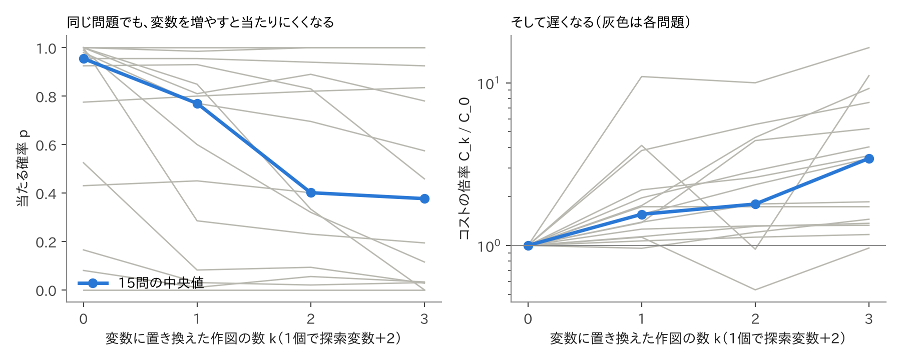
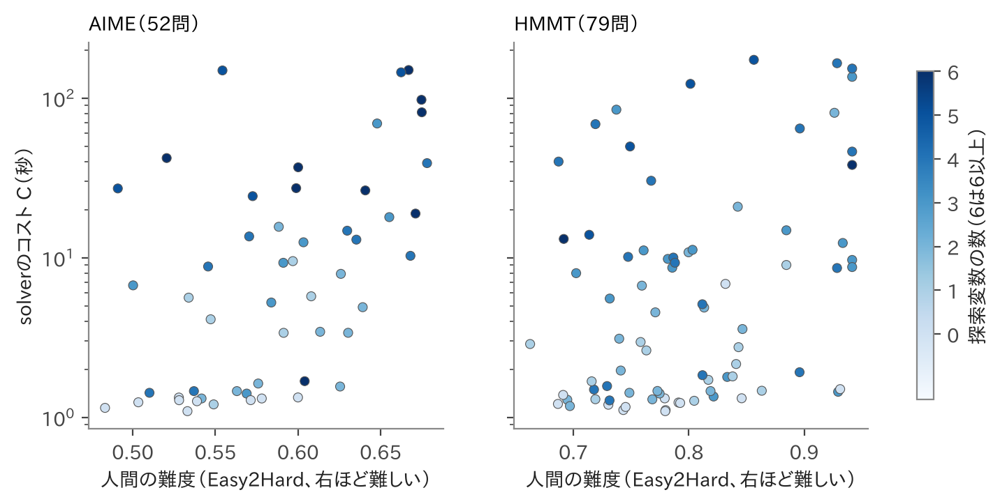

# （題名は後で決める）

（第一案 v2・10/22。v1を読みやすさの観点で全面的に書き直した版。【 】は未確定の数値や、本人の確認が必要な箇所。）

## 要旨

長さや角度などの値を答える幾何の問題（求値問題）を、自動で解くプログラム（solver）を作った。このsolverは、幾何の定理を使わない。問題の条件を満たす図を数値計算で探し、答えの値を √ などを含む式の形に直して、数百桁の精度で確かめる。

数学コンテストの幾何の問題323問では、969回の実行のうち953回で正解し、かかった時間の中央値は5.2秒だった。solverを完成させた後に出題された20問でも、18問を毎回解いた。図を多項式の方程式に直して解く方法（msolve）と比べると、msolveが解けた201問ではmsolveの方がずっと速かったが、残りの約4割の問題ではmsolveは答えを出せなかった。solverは、それらの問題もほぼすべて解いた。【GMBとの比較を再測定後に一文。】

さらに、solverにとって何が難しいかを調べた。solverの難しさは、主に「solverが動かして探す数（探索変数）」の個数で決まっていた。同じ問題でも、表し方を変えて探索変数を増やすと、solverは遅くなった。一方、人間にとっての難しさは、solverの時間をあまり説明しなかった。

## 1 はじめに

### 1.1 きっかけ

大規模言語モデル（LLM）の数学の力を競う大会（AIMO）を見て、私はLLMが幾何の求値問題を苦手としていることを知った。私は数学オリンピックで幾何を学んできた（IMO 2025 金メダル、JMO 2025 【銀賞】）。その経験から言うと、人間がこの種の問題で苦労するのは、補助線や使う定理を見つける部分である。しかし、図を正確に作ることさえできれば、答えの値は計算で求まるはずである。

そこで私は、幾何の知識を使わずに、計算だけで答えを求めるsolverを作ろうと考えた。そのようなsolverがあれば、人間やLLMが幾何の問題を解く助けになる。

【本人確認：AIMOを見た時期。「人間やLLMの支援」という目的の書き方はこれでよいか。】

### 1.2 solverがすること

solverには、問題を「点の置き方」「作図の手順」「条件」「求める量」の4つで書いたものを入力する（図1）。solverは、条件を満たす図を数値計算で探す。図が見つかったら、求める量の値を計算し、その値を √ や分数を含む式の形に直す。最後に、その式が本当に条件を満たすかを、数百桁の精度で確かめてから答えとして返す。

答えが複数ある問題では、見つかった答えをすべて返す。ただし、すべての答えを見つけたことまでは保証しない。

【図1：入力の例と出力の例。AIME 2006 I-1（四角形、答え84）程度の小さな例を使う。】

### 1.3 研究の問い

本研究では、次の二つを調べた。

1. このsolverは、コンテストの幾何の問題をどれだけ速く、正確に解けるか。既存の方法と比べてどうか。
2. solverにとって難しい問題とは、どんな問題か。それは、人間にとって難しい問題と同じか。

## 2 先行研究

計算機で幾何の問題を解く方法は、主に三つある（表1）。

【表1：方法の系統（証明型・代数的な方法・数値的な方法・本研究）と、出力、強み、本研究との違い。】

一つ目は、命題を証明する方法である。AlphaGeometry [1, 2] は、数学オリンピックの幾何の証明問題を高い割合で解く。ただし、評価の中心は証明であり、値を求める本研究とは課題が違う。

二つ目は、図を座標の多項式の方程式で表し、それを厳密に解く方法である [3]。答えの正しさを保証できる。GeoGebra Discovery は、この方法で2つの長さの比などを求められる [4]。ただし、角度を含む条件の扱いや、2つの交点のどちらを使うかを人が選ぶ必要があることが、限界として報告されている [5]。

三つ目は、数値計算で図を作る方法である。本研究に最も近いのは GMB [6] である。GMB は、条件のずれを小さくするように点を動かして、条件を満たす図を1つ作る。ただし、答えの値を式の形に直すことはしない。また、「考えられる値をすべて求めよ」という形の問題は書けない。

問題の難しさを計算機の側から測る研究はある [7]。しかし、コンテストの求値問題について、人間にとっての難しさと、数値計算で解くsolverにとっての難しさを、数百問の規模で比べた研究は、調べた範囲では見当たらなかった。

## 3 solverの仕組み

### 3.1 問題の表し方

問題は、少数の「動かせる数」を使って表す。たとえば三角形なら、2つの頂点を (0, 0) と (1, 0) に固定し、3つ目の頂点を (x, y) と置く。この x と y が、solverが動かして探す数である。本研究では、これを「探索変数」と呼ぶ。中点や2直線の交点、垂線の足などは、作図の命令で作る。作図で決まる点は、探索変数にしない。そのため、探索変数の数は少なくなる。323問では、探索変数の数の中央値は3個だった。

条件には、等式のほかに不等式も書ける。たとえば「点Pは線分ABの内側にある」「四角形は凸である」などである。条件を満たす図が複数ある場合に、どれを指すかも書ける。たとえば「2つの交点のうち、Aから遠い方」である。以下では、このような図の選び分けを「枝」と呼ぶ。

### 3.2 処理の流れ

solverは、次の4つの段階で問題を解く（図2）。

1. **式で直接解く。** 条件が1つの変数だけの方程式に直せるときは、その方程式を解いて答えの候補を直接求める [8]。
2. **図を探す。** 条件がどれだけ満たされていないかを「ずれ」として数値にし、ずれが0になる探索変数の値を探す。広く探す部分にはNOMAD [9] という探索法を使う。ある出発点から少しずつ動いてずれを減らす計算（以下、局所探索）には、Levenberg–Marquardt法（LM法）[10] を使う。見落としがあれば、設定を変えてもう一度探す。
3. **図を正確にする。** 見つかった図を、数百桁の精度まで正確にする。
4. **答えを式に直して確かめる。** 答えの値に合う式を、PSLQ [11] という方法で探す。たとえば 1.7320508… という値から √3 を見つける。最後に、その式が条件を満たすかを120〜500桁の精度で確かめる。

【図2：処理の流れ。探索変数が2つの問題で、ずれの大きさを高さにした地形の図を添える。】

### 3.3 工夫

使っている計算法は、どれも既存のものである。本研究の工夫は、それらを組み合わせて、答えを式の形で求めるところまで一つの流れにした点にある。主な工夫は次の三つである。

- **難しい条件もそのまま扱う。** 角度、面積、接する、枝の指定などを、多項式に直さずに「ずれ」として計算する。
- **「接する」条件で精度が落ちないようにする。** 「接する」をそのまま等式にすると、後で述べる重根になり、精度が上がりにくい。そこで、確かめる段階では、同じ意味の別の式に置き換える。
- **答えをすべて集める。** 多くの出発点から探し、さらにもう一度探すことで、答えが複数ある問題での見落としを減らす。

なお、作図で決まる点を探索変数にしない考え方は、GMB [6] にもある。本研究では、それがsolverの難しさをどう変えるかを5章で確かめた。

### 3.4 なぜ数値計算で解くのか

開発の途中で、私はAIから、図を経由せずに答えだけを直接求める厳密な方法を提案された。しかし私は、それでは本質的な改善にならないと判断し、数値計算の方法を続けた。理由は二つある。

一つ目は、書ける問題の広さである。角度の条件などは、座標の多項式では表しにくい。数値計算なら、そうした条件もそのまま書ける。二つ目は、効率である。求めたいのは、条件を満たす実際の図だけである。方程式のすべての解を求める必要はない。

正直に言うと、私は当初、厳密な方法はもっと遅いと考えていた。実際には、4.4節で示すように、小さな問題では厳密な方法の方が速かった。しかし、上の二つの理由は4.4節の結果で裏付けられた。

【本人確認：3.4の書き方。】

## 4 実験1：solverは何ができるか

### 4.1 実験の条件

solverは2026年10月21日の版で固定し、それ以降は変更していない。各問題に、180秒の制限時間と、CPUの1コアを与えた。探索の出発点は乱数で決まるので、乱数の種（seed）を3通り変えて、各問題を3回ずつ解いた。計測は、比較も含めてすべて同じPCで行った。答えの値の集合が、正解の集合と過不足なく一致したとき、正解とした。

使った問題は3種類ある（表2）。

- **開発用の323問。** AIME、HMMT、日本数学オリンピック予選の、2000〜2025年の幾何の求値問題から、私が選んだ。開発中に使ってきた問題である。
- **2026年の新しい20問。** solverを固定した後に、2026年のHMMTと日本数学オリンピック予選から作った。一度だけ解かせた。
- **自動で作った88問。** 答えが2〜4個ある問題を32問含む。開発中には一度も解かせていない。

323問は、私が問題を選び、AIが入力の形に書いた。そのため、書く段階で解き方の一部が入り込んでいないかを、全問について調べた。調べるときは、正解やsolverの結果を見ないようにした。その結果、57問では、その問題に固有の関係を手で導いて入れていた。残りのうち、問題文をそのまま書き移したと確認できた246問を「直接入力の246問」と呼び、主な結果を並べて示す。

表2　問題の種類ごとの成績（各問題3回ずつ）

| 問題 | 問題数 | 正解した回数 | 3回とも正解した問題 | 時間の中央値 |
|---|---|---|---|---|
| 開発用 | 323 | 953/969 | 313 | 5.2秒 |
| うち直接入力 | 246 | 724/738 | 237 | 6.6秒 |
| 2026年の新しい問題 | 20 | 55/60 | 18 | 9.9秒 |
| 自動で作った問題 | 88 | 264/264 | 88 | 1.3秒 |
| うち答えが複数 | 32 | 96/96 | 32 | — |

### 4.2 速さと正確さ

開発用の323問では、969回中953回で正解し、時間の中央値は5.2秒だった。95%の実行は116秒以内に終わった。直接入力の246問でも、成績はほとんど変わらなかった。開発に使っていない問題でも、2026年の20問中18問を3回とも解き、答えが複数ある32問では96回すべてで答えを過不足なく出した。

### 4.3 GMBとの比較

GMBの論文で使われた36問（2000年以降の国際数学オリンピックの幾何）を、GMBとsolverの両方に3回ずつ解かせた。そして、出てきた図が条件をどれだけ正確に満たすかを、同じ方法で調べた。誤差100万分の1以内で条件を満たした回数は、solverが108回中100回、GMBが30回だった。GMBは、図を出すこと自体は95回でできた。しかし、多くの図は条件を近似的にしか満たしていなかった。

【GMBは公式実装の既定の設定で測った。GMBが計算を止める基準を厳しくして測り直しているので、その結果で書き直す。】

### 4.4 厳密な方法との比較

図を座標の多項式の方程式で表し、方程式を厳密に解くソフト msolve [13] で解く方法を、同じPCで323問に試した。制限時間は1問30分とした。以下は、今回の方程式の作り方とmsolveでの結果であり、厳密な方法一般の限界を示すものではない。

msolveが正しい答えを出せたのは、323問中201問だった（表3）。この201問では、msolveの方がはるかに速かった。時間の中央値は、msolveが0.03秒、solverが2.0秒だった。小さな問題では、厳密な方法の方がずっと速い。

一方、残りの約4割の問題では、msolveは答えを出せなかった。理由の一つは、座標で表すと未知数が増えることである。solverの探索変数は中央値3個だったが、方程式の未知数は中央値9個になった。68問では、方程式の解が無数にあり、msolveでは扱えなかった。図は無数にあっても、求める値は1つに決まる問題である。24問は、制限時間かメモリの上限を超えた。15問は、角度などの条件を多項式に直せなかった。solverは、これらの問題もほぼすべて解いた。

表3　msolveの結果ごとの、solverの成績（323問）

| msolveの結果 | 問題数 | solverが3回とも正解 |
|---|---|---|
| 正しい答えを出せた | 201 | 198 |
| 解が無数にあり扱えない | 68 | 65 |
| 時間切れ・メモリ超過・異常終了 | 24 | 22 |
| 条件を多項式に直せない | 15 | 14 |
| 探索変数がない・その他 | 15 | 14 |

まとめると、今回の厳密な方法は、書けて小さい問題ではとても速い。solverは遅いが、より広い範囲の問題を同じ方法で解ける。3.4節の二つの理由が、この違いに表れている。

### 4.5 どの工夫が効いているか

工夫を1つずつ外して、323問を解き直した（表4）。もう一度探す処理を外すと、正解した問題が317問から308問に減った。NOMADを外すと、時間の中央値が5.3秒から29.0秒に増えた。式で直接解く処理を外すと、一部の問題で大きく遅くなった。他の工夫の効果は、今回の計測でははっきりしなかった。

【表4：工夫を外したときの結果。】

## 5 実験2：solverにとって何が難しいか

### 5.1 「当たる確率」で難しさを測る

ランダムな出発点から1回だけ局所探索をしたときに、正しい図にたどり着く確率を「当たる確率」p と呼ぶ。p が小さいほど、何度も探し直す必要がある。1回の局所探索にかかる時間を t とすると、探す時間はおよそ t ÷ p になる。

  （solverの時間）≈ t ÷ p ＋（図を正確にする時間）＋（式に直して確かめる時間）

この式はsolverの動きをそのまま表すものではなく、難しさを考えるための目安である。探索変数がある292問について、出発点を200個ずつ選び、solverと同じ局所探索を行って p と t を測った。出発点を選び直しても、p はほぼ同じ値になった。

この目安 t ÷ p は、実際のsolverの時間とよく合っていた（図3右）。2つの量の大小の並びがどれだけ一致するかを表す順位相関（1なら完全に一致、0なら無関係）は、0.69だった。ただし、式で直接解けた99問は、p に関係なく1〜2秒で解けたので、除いて計算した。

図3　左：探索変数の数ごとの当たる確率 p（292問。黒い線は中央値）。右：目安 t ÷ p と実際の時間。オレンジ色の点は、式で直接解けた問題。

### 5.2 探索変数が多いと当たりにくい

当たる確率 p は、探索変数が多いほど小さかった（図3左）。p の中央値は、探索変数が1個のとき1.00、3個のとき0.72、5個のとき0.15、6個以上のとき0.11だった。

外れた局所探索の多くは、ずれが0にならない場所で止まるか、探す範囲の外へ出ていた。枝を間違えた、という外れ方はほとんどなかった。

ただし、探索変数の数が同じでも、p は問題によって大きく違った。また、p が0.1未満の59問でも、9割はsolverが3回とも解いた。NOMADで広く探すことや、式で直接解くことで、p の小ささを補っている。

### 5.3 同じ問題で探索変数を増やす

5.2節は違う問題どうしの比較なので、探索変数の数以外の違いも混ざっている。そこで、同じ問題の書き方だけを変える実験をした。私は開発中に、問題に余分な変数をつけて書くと、solverが急に遅くなることに気づいていた。これを確かめるため、作図で決まる点を、あえて自由な点として書き直した。たとえば「MはABの中点」と書く代わりに、Mを自由な点 (u, v) とし、「AMとMBが等しく、同じ向き」という等式を足す。意味も答えも変わらないが、探索変数が2個増える。このような書き直しを、1つの問題で0〜3か所（以下 k か所）行った。

対象は15問である。直接入力の問題のうち、探索変数が1〜4個で、書き直せる作図が3つ以上ある問題を、結果を見る前に決めた規則で選んだ。

結果を表5と図4に示す。書き直しを増やすほど、当たる確率 p は下がり、solverの時間は増えた。p の中央値は、k = 0、1、2、3 で0.96、0.77、0.40、0.38だった。solverの時間は、書き直す前と比べて、中央値で1.55倍、1.80倍、3.43倍になった。この傾向は、統計的な検定でも偶然とは考えにくかった。一方、正解の数はほとんど変わらなかった。余分な変数は、solverを解けなくするのではなく、遅くしたのである。

変わり方は問題によって違った。AIME 2014 II-14 では、1か所書き直しただけで p が1.00から0.29に下がり、時間は1.8秒から19.7秒になった。一方、HMMT 2011 2月 代数・幾何8 では、ほとんど変わらなかった。

ただし、書き直した点の出発位置もランダムなので、正しい位置から遠くで探し始めている。そこで、書き直した点だけを作図どおりの位置から探し始める測定もした。k = 2 では p の中央値が0.40から0.76に戻ったが、k = 3 ではほとんど変わらなかった。p が下がった理由は、出発位置だけでは説明できない。また、書き直すと等式も増えるので、探索変数の数だけの効果とも言えない。この実験から言えるのは、「作図で決まる点を、自由な点と等式で書き直すと、同じ問題でも当たりにくくなり、遅くなる」ということである。

図4　作図を k か所書き直したときの当たる確率 p（左）と、solverの時間が何倍になったか（右）。灰色の線は各問題、青い線は15問の中央値。

表5　作図を k か所書き直したときの変化（15問。正解の数は3回の合計、それ以外は中央値）

| k（探索変数の増え方） | 0（増えない） | 1（2個増） | 2（4個増） | 3（6個増） |
|---|---|---|---|---|
| 正解の数（45回中） | 42 | 40 | 42 | 41 |
| 当たる確率 p | 0.96 | 0.77 | 0.40 | 0.38 |
| 1回の局所探索の時間（何倍か） | 1.0 | 2.4 | 4.1 | 7.9 |
| solverの時間（何倍か） | 1.00 | 1.55 | 1.80 | 3.43 |

### 5.4 人間にとっての難しさとの比較

人間にとっての難しさとして、Easy2Hard [12] の難度を使った。これは、実際のコンテストでの正答率をもとに、問題ごとの難しさを数値にしたものである。AIMEとHMMTの131問について、この難度とsolverの時間を比べた。

全体で見ると、人間に難しい問題ほど、solverも時間がかかる傾向があった。順位相関は、AIMEで0.56、HMMTで0.32だった。しかし、人間に難しい問題は、探索変数も多く、入力も長い傾向がある。そこで、探索変数の数と入力の長さの影響を取り除くと、相関は0.28と0.25に下がった。弱い関係は残るが、全体で見たときほど強くはない。

次に、solverの時間を予測するのに、人間の難度が役立つかを調べた。1年分の問題を除いて予測の式を作り、除いた年で試すことを、すべての年でくり返した。探索変数の数など入力の形だけを使った予測は、順位相関0.80（AIME）、0.70（HMMT）でよく当たった。これに人間の難度を加えても、0.80と0.71で、ほとんど良くならなかった。直接入力の問題だけでも同じだった。

つまり、人間にとっての難しさとsolverの時間は、無関係ではない。しかし、入力の形がわかれば、人間の難度はsolverの時間についてほとんど新しい情報を与えない。

具体例を挙げる。HMMT 2019年2月 幾何10番は、人間にとっては難しい問題である。しかし、作図だけで図が決まり、探索変数が0個なので、solverは1.5秒で解いた。逆に、AIME 2015 I-7 は人間には比較的易しい問題だが、探索変数が5個あり、solverは149秒かかった（図5）。【本人に、この2問が人間にとってなぜ難しい／易しいかを一、二文で書いてもらう。】

図5　人間にとっての難度と、solverの時間。点の色は探索変数の数。同じ難度でも時間は100倍以上ばらつき、色の濃い（探索変数が多い）問題ほど上にある。

## 6 考察

### 6.1 solverが苦手とする三つの場合

実験から、solverが苦手とする場合は三つに分けられる。

**探索変数が多い場合。** 5章で見たとおり、局所探索が途中で止まったり、範囲の外へ出たりしやすくなる。323問でsolverが遅かった問題の多くは、この場合にあたる。

**枝の選び分けが難しい場合。** 2026年のHMMT 2月 幾何5番は、3回とも解けなかった。調べると、等式だけを満たす図には、出発点の約99%からたどり着けた。しかし、問題の図のとおりの配置（小さい円が弦の外側にある、など）になっていたのは、約0.3%だけだった。この場合、95%の確率で一度当てるには、約1000回探す必要がある。人間なら図を見れば明らかな配置が、solverには大きな難しさになることがある。

**重根になる場合。** 方程式の解が「重根」になると、精度が上がりにくい。重根とは、たとえば x² = 0 の x = 0 のように、2つの解が重なった解である。HMMT 2009年2月 幾何9番で、ある条件 f = 0 を、同じ意味の f² = 0 に書き換えると、5回とも解けなくなった。重根では、図を正確にする計算で、1回ごとに誤差が半分にしかならない。100桁の精度を得るには約330回の計算が必要になり、solverの計算回数の上限では足りなかった。

### 6.2 実行環境による違い

同じプログラムでも、OSやCPUが違うと、一部の問題で結果が変わった。小数の計算のごく小さな違いが、探索の道筋を変えたためと考えられる。そのため、比較はすべて同じPCで測った。

### 6.3 この研究で言えること・言えないこと

- solverは、すべての答えを見つけたことを保証しない。また、答えは数百桁の数値で確かめたものであり、数学的な証明ではない。
- 323問は、開発に使った問題である。開発に使っていない問題での成績は、2026年の20問と、自動で作った88問で示した。
- 323問のうち57問には、書く段階で手で導いた関係が入っている。主な結果は、それを除いた246問でも確かめた。

## 7 結論

1. 数値計算で図を探し、答えを式の形に直して確かめるsolverは、コンテストの幾何の求値問題の大部分を数秒で解いた。開発後に出題された問題でも、20問中18問を毎回解いた。【GMBとの比較は再測定後に一文。】
2. 図を多項式の方程式にして解く方法は、書けて小さい問題ではsolverよりずっと速い。しかし、今回の323問の約4割では答えを出せなかった。solverは、それらの問題もほぼすべて解いた。
3. solverにとっての難しさは、人間にとっての難しさではあまり説明できず、主に探索変数の数で決まっていた。同じ問題でも、書き方を変えて探索変数を増やすと、solverは遅くなった。

今後は、問題の書き方を自動で小さくすること（作図で決まる点を自動で見つけること）と、枝の選び分けが難しい問題での探索の改良に取り組みたい。【本人確認：次の一手。】

## 生成AIの利用について

本研究では、Claude（Anthropic）とChatGPT（OpenAI）の有料版を、2026年1月から、その時点の最新版で使った。発想と研究の方向は私が決めた。solverの中心となる計算法は、AIと相談しながら決めた。プログラムの実装と細かな改良は、AIが行った。評価用の323問は私が選び、AIが入力の形に書いた。実験の実行、集計、レポートの下書きにもAIを使い、内容は私が確認した。【本人確認：役割分担の書き方。】

## 参考文献

1. Trinh, T. H. et al. Solving olympiad geometry without human demonstrations. Nature 625 (2024).
2. Chervonyi, Y. et al. Gold-medalist Performance in Solving Olympiad Geometry with AlphaGeometry2. arXiv:2502.03544 (2025).
3. Cox, D., Little, J., O'Shea, D. Ideals, Varieties, and Algorithms. Springer.
4. Kovács, Z., Vajda, R. Symbolic Comparison of Geometric Quantities in GeoGebra. arXiv:2202.04626 (2022).
5. Hota, A., Kovács, Z., Vujic, A. Solving Some Geometry Problems of the Náboj 2023 Contest with Automated Deduction in GeoGebra Discovery. EPTCS 398 (2024).
6. Krueger, R., Han, J. M., Selsam, D. Automatically Building Diagrams for Olympiad Geometry Problems. CADE-28 (2021).
7. Kovács, Z., Recio, T., Vélez, M. P. Showing Proofs, Assessing Difficulty with GeoGebra Discovery. arXiv:2401.11900 (2024).
8. Meurer, A. et al. SymPy: symbolic computing in Python. PeerJ Computer Science (2017).
9. Audet, C. et al. NOMAD version 4. ACM TOMS (2022).
10. Virtanen, P. et al. SciPy 1.0. Nature Methods (2020).
11. Ferguson, H. R. P., Bailey, D. H., Arno, S. Analysis of PSLQ. Math. Comp. 68 (1999).
12. Ding, M. et al. Easy2Hard-Bench. NeurIPS 2024 Datasets and Benchmarks. arXiv:2409.18433.
13. Berthomieu, J., Eder, C., Safey El Din, M. msolve: A Library for Solving Polynomial Systems. ISSAC 2021.
