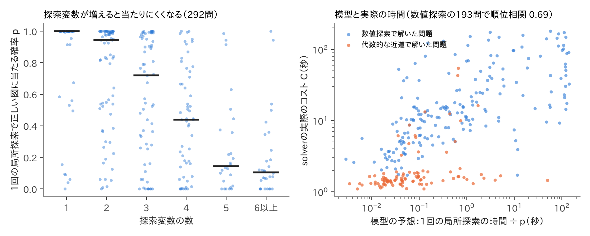

# （題名は後で決める）

（v5・10/22夜。v4から：3章を制作記録（旧リポジトリ・experimentブランチ・10/11の候補記録）で書き直し、5章を理論中心に全面改稿。追加実験「ずれ座標」を5.3節に入れた。【 】は本人確認か未完。）

## 要旨

幾何の求値問題を、定理を使わず数値計算で解くsolverを作った。作図で決まる点を変数にせず、探す変数を図の自由度まで減らし、見つけた図を数百桁まで精密化して、答えを √ などの式に直して確かめる。コンテストの323問では969回中953回正解し、時間の中央値は5.2秒だった。完成後に出題された20問でも18問を毎回解いた。図を多項式で表して厳密に解く方法（msolve）は、解けた201問ではずっと速かったが、残りの122問は解けず、solverはそのほぼすべてを解いた。この違いを、二つの方法が解いている問題そのものの違い（図の全体を決めるか、値だけを決めるか）と、難しさを決める量の違い（解の個数か、正しい解へ流れ込む出発点の割合か）から説明した。さらに、解を変えない書き換えでも探索の難しさが変わることを、ヤコビアンの分解と具体例で示し、15問の介入実験で確かめた。

## 1 はじめに

LLMの数学の力を競う大会（AIMO）で、私はLLMが長さや角度を求める幾何の問題（求値問題）を苦手とすることを知った。数学オリンピックで幾何を学んできた経験から言えば（IMO 2025 金メダル）、人間が苦労するのは補助線や定理を見つける部分である。しかし、図を正確に作れれば、答えは計算で求まるはずである。そこで、幾何の知識を使わず計算だけで答えを求めるsolverを作った。【本人確認：AIMOを見た時期と、目的の書き方。】

問いは二つである。(1) どう設計すれば、コンテストの求値問題を速く、厳密な答えで解けるか。(2) そのsolverにとって何が難しいのか。それは厳密な方法や人間の難しさと、どう違うのか。

## 2 先行研究

計算機で幾何を解く方法は三つある（表1）。AlphaGeometry [1, 2] は命題を証明する方法で、値を求める本研究とは課題が違う。代数的な方法は、図を座標の多項式で表して厳密に解き [3, 13]、答えの正しさを保証できる。GeoGebra Discovery は量の比を厳密に求められるが [4]、角度の扱いと、交点のどちらを使うかを人が選ぶ必要が限界とされる [5]。数値的な方法では GMB [6] が最も近い。GMB は条件のずれを小さくして図を1つ作るが、答えを式に直さず、「考えられる値をすべて求めよ」型も書けない。コンテストの求値問題で、solverの難しさを厳密な方法や人間の難しさと数百問の規模で比べた研究は、調べた範囲では見当たらなかった。

【表1：方法の系統と出力・強み・本研究との違い。】

## 3 solverの設計と制作

### 3.1 問題を「値の集合」として表す

問題は、探索変数 u（d 個の実数）、作図、条件、求める量 τ で書く。たとえば三角形は頂点を (0,0)、(1,0)、(x,y) と置き、u = (x,y) とする。中点や交点などは作図の命令で u から計算する。条件は等式 F(u) = 0 と不等式 G(u) > 0 で、不等式は「点は線分の内側」のように、条件を満たす図が複数あるときにどれを指すか（以下、枝）を決める。求めるのは集合 { τ(u) ｜ F(u) = 0, G(u) > 0 } で、答えが1つの問題も「すべての値を求めよ」型も同じ形で書ける。

### 3.2 設計の柱

**作図で変数を消す。** 作図で決まる点は u の関数として計算し、変数にしない。探す変数の数は図の自由度に等しくなる（323問の中央値で3個）。

**条件を「ずれ」として扱い、探索と精密化を分ける。** 等式のずれと不等式の違反をまとめたベクトル r(u) を0にする u を探す。角度や接する条件も多項式に直さずそのまま計算できる。ただし幾何の計算は、交点がない、円が作れないなど、図によっては値が定義されない。そこで広く探す段階には、定義されない点や不連続に強い探索法 NOMAD（DiscoMADS）[9] を使い、近くの解へ下りる段階には Levenberg–Marquardt法（LM法）[10] を使う。見落としがあれば設定を変えてもう一度探す（第2探索）。

**数百桁に精密化し、式に直して確かめる。** 見つけた図を多倍長計算で精密化し、最後はニュートン法で仕上げる。単根なら1回ごとに正しい桁数がおよそ倍になる。数百桁の値 a について、1, a, …, aⁿ の整数係数の関係を PSLQ [11] で探して a の多項式を得て、√ などの式に直す。最後に、その式の図が条件と枝を満たすかを120〜500桁で確かめる。証明ではないが、偶然一致する可能性は極めて小さい。

### 3.3 制作の経緯

最初の版（2025年12月）から、PSLQによる同定と「接する」条件の命令はあった。2026年3月、それまでの探索と精密化を部分的に直し続けた結果、仕組みが複雑になりすぎたため、外部の探索器を使う構成を試した。計画書では、値が定義されない点や不連続が多い問題では単純な差分進化法は不利だとして NOMAD を第一候補にし、高精度化は mpmath に一本化した。試験では、2つの答え（312と468）を持つ問題で両方を残差 10⁻⁷⁹ まで回収でき、これを新しい構成の基本にした。【本人確認：この時期の判断と、1〜7月の没になった検討の範囲。】

7月10日に全体を作り直し、厳密な方法を主な経路にしないと決めた。図を連立方程式にすると未知数が非常に多くなるからである。小さな多項式系なら厳密な方法で探索の見落としを補えるかも試したが、当時の開発用145問で条件に合う問題は0問だった。7月27日、旧版で作った NOMAD・精密化・PSLQ を新しい枠組みに移した。

8月3日、全点を自由な座標で探していた入力を、作図で点を作る形に書き直した。8変数以上だった44問は0問になった。書き直す前、この44問のうち17問は時間切れだった。【きっかけ：本人確認。】8月には答えの集合が正解と過不足なく一致したときだけを正解とする採点に切り替え、205問中139問だった成績を、精密化と同定の誤りの修正で190問まで上げた。

10月11日の改良では、8つの段階版を323問で測りながら進めた（表2）。最も効いたのは、図の大きさの自由度を固定して探索変数を1つ減らす処理（v5）で、時間の中央値は4.4秒から3.1秒に下がった。一方、格子点を狙う探索と正の半径を仮定する探索は、成績は上がっても特定の問題に合わせすぎるおそれがあるとして外した（v7、v8）。そのため正解数は322問から321問に下がったが、こちらを最終版とした。10月21日にsolverを固定した。

表2　10月の改良の段階（323問、seed 0）

| 版 | 主な変更 | 正解 | 時間の中央値 |
|---|---|---|---|
| 改良前 | — | 309 | 6.2秒 |
| v2 | 小さな多項式系の枝の列挙、接条件の等価な式 | 314 | 4.8秒 |
| v4 | 解析的な微分、定数になる量の候補 | 319 | 4.4秒 |
| v5 | 大きさの自由度の固定 | 322 | 3.1秒 |
| v6 | 角度の代数式 | 318 | 2.9秒 |
| v8（最終版） | 合わせすぎの疑いがある探索を除去 | 321 | 3.0秒 |

## 4 達成したこと

### 4.1 323問と新しい問題

各問題に180秒と1コアを与え、seedを変えて3回ずつ解いた。計測はすべて同じPCで行い、答えの集合が正解と過不足なく一致したときを正解とした。開発用の323問は、AIME・HMMT・日本数学オリンピック予選（2000〜2025年）から私が選んだ。入力はAIが書いたので、解き方が入り込んでいないかを正解を見ずに全問調べ、問題文をそのまま書き移したと確認できた246問を「直接入力」と呼ぶ（表3）。

表3　問題の種類ごとの成績（各3回）

| 問題 | 問題数 | 正解した回数 | 3回とも正解 | 時間の中央値 |
|---|---|---|---|---|
| 開発用 | 323 | 953/969 | 313 | 5.2秒 |
| うち直接入力 | 246 | 724/738 | 237 | 6.6秒 |
| 2026年の新しい問題 | 20 | 55/60 | 18 | 9.9秒 |
| 自動生成（答えが複数の32問を含む） | 88 | 264/264 | 88 | 1.3秒 |

### 4.2 GMBとの比較

GMBの論文の36問を両者に3回ずつ解かせ、同じ検査器で調べた。GMBは止める基準を 10⁻⁸ に厳しくし、反復の上限も増やした。誤差 10⁻⁶ 以内で条件を満たした回数は、solverが108回中101回、GMBが29回で、基準を変えてもGMBは23〜43回、solverは99〜101回だった。平均時間はsolverが33秒、GMBが136秒だった。

### 4.3 厳密な方法との比較

図を座標の多項式で表し、msolve [13] で解く方法を同じPCで323問に試した（1問30分）。msolveは201問で正しい答えを出し、時間の中央値は0.03秒で、solverの2.0秒よりはるかに速かった。残りの122問では答えを出せず、solverはそのほぼすべてを解いた（表4）。

表4　msolveの結果ごとの、solverの成績

| msolveの結果 | 問題数 | solverが3回とも正解 |
|---|---|---|
| 正しい答え | 201 | 198 |
| 図が無数にあり扱えない | 68 | 65 |
| 時間切れ・メモリ超過 | 24 | 22 |
| 今回の多項式化では角度などに未対応 | 15 | 14 |
| その他 | 15 | 14 |

【4.4 機構を外す実験（NOMADなし：中央値5.3→29.0秒、第2探索なし：317→308問）。字数を見て残すか決める。】

## 5 solverにとっての難しさ

### 5.1 図を決める問題と、値を決める問題

msolveは座標の多項式系の解をすべて求める。つまり図の全体を決める。solverが必要とするのは τ の値だけで、この二つは別の問題である。条件を満たす図の集合 M の上で τ が連続で、値が有限個しかないなら、τ は M のひとつながりの部分（連結成分）の上で一定になる。連結な集合を連続関数で移した像は連結で、有限集合の連結な部分は1点しかないからである。だから図が無数にあっても、各成分から図を1つ見つければ値は決まる。表4の68問はこの型で、solverは65問を毎回解いた。【実験3：恒等式で値が一定であることを示した例を入れる。】

難しさを決める量も違う。1回の局所探索が正しい値に当たる確率を p、1回の時間を t とすると、出発点を独立に選び直す限り、最初に当たるまでの時間の期待値は正確に

  E[T] = t / p　…(1)

である。そして解の個数は p を決めない。f(x) = x + x^D（D は奇数）は複素数の解を D 個持つが、ニュートン法では |x_次| ≤ (1 − 1/D)|x| となり、どの実数から出発しても解 0 に収束する（p = 1）。逆に、(x − 1 + δ)(x − 1 + 2δ) の大きい方の解が正しい枝なら、[−1, 1] から出発して当たる確率は 3δ/4 で、いくらでも小さくなる。実測もこれに合う。msolveが解けた201問で、方程式の次数の積（ベズー数。解の個数の上限）と探索変数の数の順位相関は0.12だった。msolveの時間はベズー数と0.69、探索変数の数と0.28の相関で、solverの時間は探索変数の数と0.57、ベズー数と0.50の相関だった。

### 5.2 当たる確率と、解のまわりの収束域

正しい解でのヤコビアン（r の微分の行列）の最小特異値を s、ヤコビアンが場所によって変わる速さを L とする。減衰のないLM法（ガウス・ニュートン法）の誤差 e は e_次 ≤ Le²/(2(s − Le)) を満たすので、半径 ρ = s/(2L) の球の中から出発すれば誤差は毎回半分以下になり、必ず収束する。出発点を一辺 W の箱から一様に選ぶなら

  p ≥ v_d (ρ/W)^d　（v_d は半径1の d 次元球の体積）　…(2)

で、ρ は条件数 κ（最大特異値 ÷ 最小特異値）が大きいほど小さい。この下界は d について指数的に小さくなる。ただし(2)は下界であって法則ではない。線形の問題なら、κ が大きくても1回で解ける。

探索変数がある292問で、出発点200個から p を測った（別の乱数でも順位相関0.99）。p の中央値は d = 1 で1.00、3 で0.72、5 で0.15、6以上で0.11だった（図3）。当たり数を二項分布として回帰すると、d だけで説明できる割合（McFaddenの決定係数）は0.20、log κ を加えると0.24で、(2)が示す d と log κ の積の効果は見られなかった。外れた出発点の多くは解から遠い所で止まっていた。d = 5 では51%が残差の残る点で止まり、6以上では42%が探す範囲の外へ出た。次元と解のまわりの条件は p に効くが、p の多くは解から離れた所の地形で決まる。

図3　左：探索変数の数ごとの当たる確率 p（292問、黒線は中央値）。右：t/p と実際の時間（橙は式で直接解けた問題）。

### 5.3 解を変えない書き換えが、地形を変える

作図 y = h(u) を自由な点 y に変え、等式 y − h(u) = 0 を加えても、正しい図の集合は変わらない。何が変わるかをヤコビアンで見る。元の残差の u と y による微分を A、B、作図の微分を H とし、作図で消した系のヤコビアンを J_R = A + BH とすると、書き換えた系のヤコビアンは

  J_aug = [[I, B], [0, I]] · [[J_R, 0], [0, I]] · [[I, 0], [−H, I]]　…(3)

と分解できる。両側の行列は逆行列を持つので rank J_aug = q + rank J_R（q は増えた座標の数）である。条件を満たしたまま図が動ける方向の数は変わらず、探索中に作図に合わせる方向が q 個増えるだけである。

しかし両側の行列は条件数を悪くしうる。最も簡単な r = u、h = au でも、κ(J_R) = 1 に対し κ(J_aug) はおよそ a² になる（a ≈ 9 で82）。地形の形も変わる。y の方向だけ先に最小化すると、二乗和 |R|² は Rᵀ(I + BBᵀ)⁻¹R に変わり、零点は同じでも方向ごとの重みが変わる。h = 0、f = u² − 1 として残差を (f + 2y, uf) にすると、元は極大だった u = 0 が残差の残る谷底（偽の局所解）に変わり、逆に (f, 2uf + 2y) では元の偽の谷底が消える。よって書き換えは p を下げることも上げることもある。

実験で確かめた。直接入力の問題から、探索変数が1〜4個で書き換えられる作図が3つ以上ある15問を、結果を見る前に規則で選び、中点・交点・垂線の足・外心を k か所（k = 0〜3）書き換えた（表5）。p の中央値は 0.96、0.77、0.40、0.38 と下がり、時間は3.43倍まで増えたが、正解の数はほとんど変わらなかった。書き換えはsolverを「解けなくする」のではなく「遅くする」。当たり数の二項回帰（問題の違いを除き、誤差は問題単位で評価）では、1か所ごとに当たるオッズが約0.49倍になった（p値0.006）。正しい解での κ の中央値は 1.8、82、92、159 と悪化し、同じ問題の中で κ の悪化と p の低下は連動した（順位相関 −0.66、問題単位のブートストラップ95%区間 −0.85〜−0.26）。

では、悪化の原因は変数が増えたことか、座標の取り方か。(3)の右端の因子 [[I, 0], [−H, I]] は、y を「作図からのずれ」z = y − h(u) に取り替えると消え、ヤコビアンは [[J_R, B], [0, I]] になる。変数と等式の数は同じで、z = 0 から出発すれば出発時の図も「書き換えた点を作図どおりの位置から出発させる」場合と同じである。45の書き換え版で比べると、作図どおりの位置からの出発では p の中央値は k = 1〜3 で 0.77、0.76、0.42 だったが、ずれ z を変数にすると 0.81、0.75、0.77 で、k = 3 でも書き換え前（0.96）に近い問題が多かった（45組中24組で上昇、11組で低下、符号順位検定 p値0.003）。κ の中央値も 12〜27 から 5〜8 に下がった。違いのほとんどは、探す範囲の外へ出る割合（29%→12%）だった。つまり難しさを生んでいたのは変数の数そのものより、探索中に図が作図からずれていく座標の取り方である。ただし、探す範囲はsolverが表し方から自動で決めるので、範囲の違いの影響はまだ切り分けていない。

表5　作図を k か所書き換えたときの変化（15問。正解数は3回の合計、他は中央値）

| k（探索変数の増加） | 0（0） | 1（+2） | 2（+4） | 3（+6） |
|---|---|---|---|---|
| 正解数（45回中） | 42 | 40 | 42 | 41 |
| 当たる確率 p（ランダムに出発） | 0.96 | 0.77 | 0.40 | 0.38 |
| p（作図どおりの位置から出発） | — | 0.77 | 0.76 | 0.42 |
| p（作図からのずれを変数にする） | — | 0.81 | 0.75 | 0.77 |
| solverの時間（倍） | 1.00 | 1.55 | 1.80 | 3.43 |

### 5.4 枝と重根

p は次のように分けられる。

  p ＝ Pr（等式を満たす図に着く）× Pr（それが正しい枝｜等式を満たす図に着く）

後者は、等式の各解 j に流れ込む出発点の割合を w_j として、正しい枝の w_j の和を全体の和で割ったものである。正しい解の数の割合と一致するのは w_j が等しいときだけで、実測では両者の順位相関は0.26だった。2026年のHMMT 2月 幾何5番では、等式を満たす図には出発点の約99%で着くが、正しい枝（小さい円が弦の外側にある、など）は約0.3%で、3回とも解けなかった。

重根では精密化が遅くなる。f(x) = (x − α)^ν g(x)（g(α) ≠ 0）のとき、ニュートン法の誤差は e_次 ≈ (1 − 1/ν)e となり、二重根なら1回で約0.3桁しか進まない。さらに残差が δ まで小さくなっても、座標の誤差は (δ/|g(α)|)^(1/ν) 程度までしか言えない。二重根なら、残差が100桁小さくても座標は50桁程度である。「接する」条件はこの形になりやすい。円の上かつ直線の上に作った点の、接点からの符号付きの位置を h とすると、円の中心と直線の距離 d と半径 R について R − d = h²/(R + d) で、R − d は h の二乗になる。JMO 2013年予選5番では、作業精度を50桁から200桁に上げても答えの精度は8.15桁で止まり、残差を符号付きの h に変えると100.4桁に上がり、再び二乗すると8.15桁に戻った。

### 5.5 人間にとっての難しさとの関係

実際の正答率から推定された人間の難度（Easy2Hard [12]）がある131問で比べた。人間に難しい問題ほどsolverも遅い傾向はあったが（順位相関 AIME 0.56、HMMT 0.32）、探索変数の数と問題文の長さの影響を除くと0.28と0.25に下がった。1年ずつ除いて予測式を作り、除いた年で試すと、入力の形だけの予測は順位相関0.80、0.70で当たり、人間の難度を加えても0.80、0.71だった。HMMT 2019年2月 幾何10番は人間には難問だが、探索変数0個で1.5秒で解けた。AIME 2015 I-7 は人間には易しめだが、探索変数5個で149秒かかった。【本人：この2問が人間にとってなぜ難しい／易しいかを一文ずつ。】

## 6 限界

solverは、すべての答えを見つけたことも、答えの式の正しさも、数学的には保証しない。323問は開発に使った問題で、開発外の成績は2026年の20問と自動生成の88問で示した。厳密な方法との比較は今回の多項式化とmsolveに限る。5.2節の(2)は局所の模型で、NOMADを含むsolver全体の保証ではない。浮動小数のごく小さな違いで探索の道筋が変わるので、比較はすべて同じPCで測った。

## 7 結論

作図で変数を消し、条件をずれとして扱い、数百桁の精密化と式への変換で答えを確かめるsolverを作り、コンテストの求値問題の大部分を数秒で解いた。厳密な方法は図の全体を決めるので解の個数に左右され、solverは値だけを決めるので正しい解へ流れ込む領域の大きさに左右される。そのため得意な問題が違う。同じ解を表す書き換えでも、作図からずれる方向を増やすと地形が悪くなり、ずれ自体を変数にすると多くが元に戻った。今後は、この知見を使って表し方を自動で選ぶことと、枝の指定が厳しい問題の探索の改良に取り組みたい。【本人確認：次の一手。】

## 生成AIの利用について

Claude（Anthropic）と ChatGPT（OpenAI）の有料版を、2025年12月からその時点の最新版で使った。発想と研究の方向は私が決め、solverの中心となる計算法はAIと相談して決めた。実装と細かな改良、評価問題の入力の作成、実験の実行と集計、レポートの下書きにAIを使い、内容は私が確認した。【本人確認：使い始めた時期と書き方。】

## 参考文献

1. Trinh, T. H. et al. Solving olympiad geometry without human demonstrations. Nature 625 (2024).
2. Chervonyi, Y. et al. Gold-medalist Performance in Solving Olympiad Geometry with AlphaGeometry2. arXiv:2502.03544 (2025).
3. Cox, D., Little, J., O'Shea, D. Ideals, Varieties, and Algorithms. Springer.
4. Kovács, Z., Vajda, R. Symbolic Comparison of Geometric Quantities in GeoGebra. arXiv:2202.04626 (2022).
5. Hota, A., Kovács, Z., Vujic, A. Solving Some Geometry Problems of the Náboj 2023 Contest with Automated Deduction in GeoGebra Discovery. EPTCS 398 (2024).
6. Krueger, R., Han, J. M., Selsam, D. Automatically Building Diagrams for Olympiad Geometry Problems. CADE-28 (2021).
7. （削除候補）
8. Meurer, A. et al. SymPy: symbolic computing in Python. PeerJ Computer Science (2017).
9. Audet, C. et al. NOMAD version 4. ACM TOMS (2022).
10. Moré, J. J. The Levenberg–Marquardt algorithm: implementation and theory. Lecture Notes in Math. 630 (1978).
11. Ferguson, H. R. P., Bailey, D. H., Arno, S. Analysis of PSLQ. Math. Comp. 68 (1999).
12. Ding, M. et al. Easy2Hard-Bench. NeurIPS 2024 Datasets and Benchmarks. arXiv:2409.18433.
13. Berthomieu, J., Eder, C., Safey El Din, M. msolve: A Library for Solving Polynomial Systems. ISSAC 2021.
