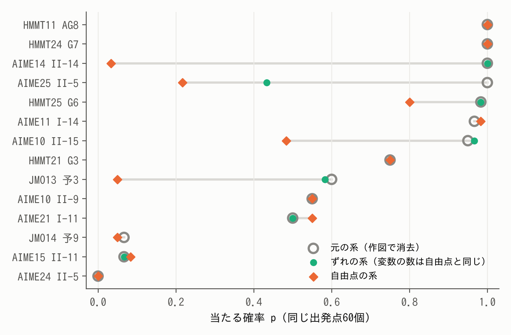
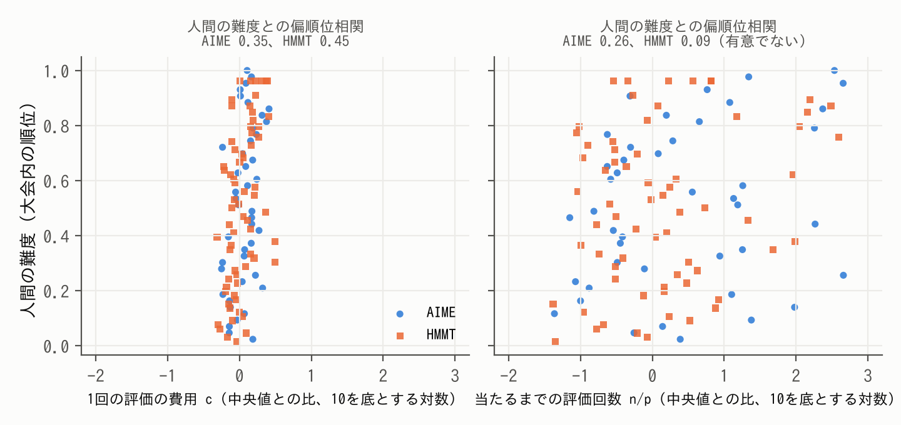

# 作図で解く求値幾何solverと、その難しさ（題名は仮）

（v6・10/23朝。v5から全面的に組み替えた。中心の問いを2つに固定し、どちらも「理論から予測を立て、別のデータで確かめる」形にした。細かい表・証明・手順は補足資料 S1〜S4 に回した。【 】は本人確認か未完。）

## 要旨

幾何の求値問題を、定理を使わず数値計算で解くsolverを作った。作図で決まる点を変数にせず、見つけた図を数百桁まで精密化し、答えを √ などの式として同定する。コンテストの323問では969回中953回正解し、時間の中央値は5.2秒だった。本研究の問いは2つである。(1) solverをどう実現したか。(2) そのsolverにとっての難しさは、人間が感じる難しさとどう違うか。(1)では、各仕組みが受け持つ困難を決め、通常の実行の記録から「その仕組みを外すと、どの問題が、どう変わるか」を予測して、外す実験と照らした。(2)では、solverの費用を「1回の評価の費用」と「正解に当たるまでの評価回数」の積に分けた。問題ごとの費用の違いの87%は後者から来ており、後者は作図で決まらない自由度の数と強く関係した。人間の難度と関係したのは、主に前者（入力の大きさ）だった。さらに、人間には同じ問題である書き換えで、solverの当たる確率が1.00から0.03まで変わることを示し、その仕組みを座標の取り方の理論で説明して、同じ出発点からの実験で確かめた。solverの難しさは、問題そのものではなく、何が作図として与えられ何を探すのかで決まる。

## 1 はじめに

LLMの数学の力を競う大会（AIMO）で、私はLLMが長さや角度を求める幾何の問題（求値問題）を苦手とすることを知った。数学オリンピックで幾何を学んできた経験から言えば（IMO 2025 金メダル）、人間が苦労するのは補助線や定理を見つける部分である。しかし、図を正確に作れれば、答えは計算で求まるはずである。そこで、幾何の知識を使わず計算だけで答えを求めるsolverを作った。【本人確認：AIMOを見た時期と、目的の書き方。】

問いは2つである。(1) solverをどう実現したか。(2) そのsolverにとっての難しさは、人間が感じる難しさとどう違うか。(2)は、solverを人間やLLMの補助に使うとき、どの問題で役に立つかを決める。

## 2 先行研究

AlphaGeometry [1, 2] は命題を証明する方法で、値を求める本研究とは課題が違う。図を座標の多項式で表して厳密に解く方法 [3, 13] は、答えの正しさを保証できる。数値的な方法では GMB [6] が最も近い。GMB は条件のずれを小さくして図を1つ作るが、答えを式に直さず、「考えられる値をすべて求めよ」型も書けない。コンテストの求値問題で、solverの難しさを人間の実測難度と数百問の規模で比べた研究は、調べた範囲では見当たらなかった（S4）。

## 3 solverをどう実現したか

### 3.1 問題の表し方

問題は、探索変数 u（d 個の実数）、作図 h、等式 F(u) = 0、不等式 G(u) > 0、求める量 τ で書く。中点や交点などは作図で u から計算する。不等式は、条件を満たす図が複数あるときにどれを指すか（以下、枝）を決める。求めるのは集合 { τ(u) ｜ F(u) = 0, G(u) > 0 } で、答えが1つの問題も「すべての値を求めよ」型も同じ形で書ける。

### 3.2 4つの困難と、それを受け持つ仕組み

求値の過程には4つの困難がある。それぞれに仕組みを当てた（表1）。

表1　困難と仕組み

| 困難 | 仕組み |
|---|---|
| 探す変数が多い | 作図で点を消す。式で直接解ける小さな系は、枝を列挙して探索を省く（代数的前処理） |
| 正しい図に当たらない | 微分を使わない安い探索（NOMAD [9]）を1段目に置き、答えが出なければLM法 [10] の多点出発（第2探索）と、範囲を分けた再探索（rescue）で補う |
| 精度が上がらない | 多倍長のLM法とニュートン法。「接する」条件は符号付きの残差に直す |
| 値が式にならない | PSLQ [11] で最小多項式を同定し、120〜500桁で条件と枝を確かめる |

### 3.3 制作の過程

最初の版（2025年12月）から、PSLQによる同定と「接する」条件の命令はあった。2026年3月、探索と精密化の部分的な修正が重なって仕組みが複雑になりすぎたため、外部の探索器を使う構成に移った。計画書では、値が定義されない点や不連続が多い問題では単純な差分進化法が不利だとして NOMAD を選び、高精度化は mpmath に一本化した。7月10日に全体を作り直し、厳密な方法を主な経路にしないと決めた。図を連立方程式にすると未知数が非常に多くなるからである。8月3日、全点を自由な座標で探していた入力を、作図で点を作る形に書き直した。8変数以上だった44問は0問になった。書き直す前、この44問のうち17問は時間切れだった。solverの強みは入力の書き方の自由度が高いことなのに、元の入力ではそれを生かせていないと感じたのがきっかけである。10月は、8つの段階版を323問で測りながら改良し、正解は309問から321問に、時間の中央値は6.2秒から3.0秒になった（S3）。【本人確認：3月の判断と、1〜7月の没になった検討の範囲。】

### 3.4 仕組みの役割を、通常の実行から予測して確かめる

各仕組みの役割が表1のとおりなら、通常の実行で「その仕組みが答えを出した問題」だけが、その仕組みを外したときに変わるはずである。本計測（323問×3回）の記録から答えの出どころを調べ、1つずつ外した計測（各323問）と照らした（S2）。

- **代数的前処理。** 答えを出したのは97問だった。外すと、この97問のうち74問が1.5倍以上遅くなった（中央値2.3倍）。他の226問では0問だった。正解数は変わらず、他の経路が遅れて解いた。
- **第2探索。** 答えを出した10問のうち9問を、外すと失った。他の問題で失ったものはなかった。
- **rescue。** 答えを出した9問のうち、外して失ったのは1問だけだった。残りは第2探索などの別の経路が解いた。仕組みが重なっているので、1つを外しても正解数には表れにくい。

1段目の探索は、基準となる模型と比べて特徴づけた。1回の局所探索が当たる確率を p、1回の時間（外れも含めた平均）を t とすると、出発点を独立に選び直す限り、最初に当たるまでの時間の期待値は E[T] = t/p である（S1）。LM法の多点出発を1段目に使うと、その探索時間はこの模型とよく合い（問題ごとの t/p との順位相関0.72）、t/p の上位4分の1では中央値63秒かかった。NOMADの探索時間は模型に従わず、同じ問題でも1.5秒にとどまった。NOMADは、難しい問題でも費用がほとんど増えない安い1段目として働いている。ただし、この模型からは二段構えが有利だとは言えない。二段構えの利点は、外れた分を後ろの段が受け持つことと、その費用の大きさで決まる。ただし、外れの費用は大きい。1段目が出した候補は数百桁まで精密化されてから真偽が決まるので、時間の51%は精密化に使われる。p が低い問題ほど偽の候補が増え、p の下位4分の1では1回あたり中央値7個が偽と判定され、精密化に7.0秒かかった（上位4分の1では0個、0.07秒）。

### 3.5 精度と同定

323問の答えの最小多項式は、次数が4以下、係数は最大で10⁹程度だった。PSLQで同定に要る桁数はおよそ（次数）×（係数の桁数）で、最大でも約35桁である。solverは120桁以上で計算するので、桁数には大きな余裕がある。偶然に一致する確率は、粗い見積もりで10⁻⁷⁰程度である（S1）。これは証明ではない。高精度で一致を確かめ、公式の答えとの一致で検算した、という意味である。難しいのは、精度が上がらない場合である。「接する」条件は重根になりやすく、二重根では残差が100桁小さくても座標は50桁程度しか決まらない（S1）。JMO 2013年予選5番では、作業精度を200桁にしても答えは8.15桁で止まった。残差を符号付きに直すと100.4桁に上がり、二乗に戻すと8.15桁に戻った。

## 4 達成したこと

各問題に180秒と1コアを与え、seedを変えて3回ずつ同じPCで解いた（表2）。開発用の323問は、AIME・HMMT・日本数学オリンピック予選（2000〜2025年）から私が選んだ。入力はAIが書いたので、解き方が入り込んでいないかを正解を見ずに全問調べ、問題文をそのまま書き移したと確認できた246問を「直接入力」と呼ぶ。

表2　問題の種類ごとの成績（各3回）

| 問題 | 問題数 | 正解した回数 | 時間の中央値 |
|---|---|---|---|
| 開発用 | 323 | 953/969 | 5.2秒 |
| うち直接入力 | 246 | 724/738 | 6.6秒 |
| 2026年の新しい問題 | 20 | 55/60 | 9.9秒 |
| 自動生成（答えが複数の32問を含む） | 88 | 264/264 | 1.3秒 |

GMBの論文の36問では、条件を満たす図を作れた回数がsolver 101/108、GMB 29/108だった。図を多項式にして msolve [13] で解く方法は、解けた201問ではsolverよりはるかに速かった（中央値0.03秒）が、残る122問を解けず、solverはそのほぼすべてを解いた（S2）。

## 5 solverにとっての難しさ

### 5.1 値だけを決めればよい

msolveが解けなかった122問のうち68問は、条件を満たす図が無数にあると判定された。solverに必要なのは τ の値だけである。τ が連続で、値が有限個しかないなら、τ は図の集合のひとつながりの部分（連結成分）の上で一定になる。各成分から図を1つ見つければ値は決まる。答えの多項式 P が得られた63問のうち24問で、条件の多項式 F_i の組み合わせとして s^N P(τ) = Σ C_i F_i を作り、どの図でも P(τ) = 0 となることを確かめた（S1）。

### 5.2 費用は「1回の評価の費用」と「当たるまでの評価回数」の積に分かれる

E[T] = t/p を、評価1回の費用 c と、1回の局所探索の評価回数 n に分けると

  E[T] = c × (n / p)　…(1)

となる。探索変数のある292問で、出発点200個から c、n、p を測った（S2）。作図はどの評価でも順に計算されるので、c は作図の数とともに増えるはずである。p については、正しい解のまわりで LM法が必ず収束する球の半径を ρ とすると、一辺 W の箱から出発するとき p ≥ v_d (ρ/W)^d で、この下界は d について指数的に小さくなる（S1）。ただし作図は地形も変えうるので、n と p が作図の数によらないかは、理論からは言えない。実測で確かめた。

結果は次のとおりだった。d の影響を除くと、作図の数は n とも p とも関係せず（偏順位相関 0.03、0.06）、c とだけ関係した（0.58）。逆に d は、作図の数の影響を除いても n と強く関係し（0.78）、p とも関係した（−log p との順位相関 0.54）。問題ごとの c の違いは、上下5%を除いて約4.5倍の幅しかないが、n/p の違いは約3,300倍あった。問題ごとの費用の違いを対数で測ると、その87%（95%区間 84〜91%）は n/p の違いから、3%は c の違いから来ていた。局所探索で測る限り、solverの難しさの大部分は「作図で決まらない自由度で探すこと」の難しさで、作図の数は1回の評価の費用を通して小さく効くだけである。

### 5.3 解を変えない書き換えが、難しさを変える

作図 y = h(u) を自由な点 y に戻し、等式 y − h(u) = 0 を加えても、正しい図は変わらない。人間にとっては同じ問題である。15問で作図を k か所（k = 0〜3）書き換えると、当たる確率の中央値は 0.96、0.77、0.40、0.38 と下がり、1か所ごとに当たるオッズが約0.49倍になった（S2）。

理由を座標の取り方で説明する。LM法は、ヤコビアンの各列の大きさで変数ごとの歩幅を調整する。自由点の系では、u の列に作図の微分 H が加わる。そのため u の列が見かけ上大きくなり、u の歩みが鈍る。一方、y を「作図からのずれ」 z = y − h(u) に取り替えると、u の列は元の系と同じになる。書き換えた点が等式に現れない場合、z = 0 から始めた反復は元の系と完全に一致することが証明できる（S1）。変数の数は自由点の系と同じなのに、である。

同じ出発点（60個）と同じ判定範囲で、元の系、自由点の系、ずれの系を比べた（14問、k = 3、図1）。
- 書き換えた点が等式に現れない6問では、ずれの系の終点は360回中356回で元の系と一致した。
- 自由点の系は、H による列の膨らみが大きい問題で崩れた。膨らみが約590倍の AIME 2014 II-14 では、当たる確率が1.00から0.03に落ち、97%が範囲の外へ出た。膨らみが1.01倍以下の5問では、元の系とほぼ同じだった。ただし例外もある。膨らみが1.1倍の AIME 2025 II-5 でも1.00から0.22に落ち、17.6倍の HMMT 2024年2月 幾何7番では落ちなかった。膨らみと低下の順位相関は0.44で、膨らみだけでは説明しきれない。

図1　同じ出発点60個からの当たる確率。灰色の輪が元の系、緑の点がずれの系、橙の菱形が自由点の系。

難しさを生んでいたのは、変数の数ではない。作図との結び付きが探索の歩幅に入り込む座標の取り方だった。作図で点を消すという設計（3.2節）が効く理由も、これで説明できる。

## 6 人間の難しさとどう違うか

### 6.1 同じ問題でも、solverの難しさは表し方で変わる

5.3節の書き換えは、人間にとっては同じ問題である。それでもsolverの当たる確率は、座標の取り方だけで1.00から0.03まで変わった（AIME 2014 II-14）。逆に、人間には難しい問題でも、入力の作図だけで図が決まればsolverは探索をしない。HMMT 2019年2月 幾何10番は、正方形を3段重ねた図が複雑で、面積の求め方がすぐには見えないため、人間には難しい（HMMTの79問中、難しい方から上位9%）。しかし作図だけで図が決まる（d = 0）ので、探索も精密化もなく1.5秒で解けた。

solverの難しさは、問題そのものではなく「何が作図として与えられ、何を探すのか」で決まる。人間が補助線や定理で見つけなければならない関係が、solverの入力には作図として既に入っていることがある。比べているのは「作図の手順が与えられた後のsolverの難しさ」と「問題文から解く人間の実測難度」である。

### 6.2 両者が共有する部分

実際の正答率から推定された人間の難度（Easy2Hard [12]）と、5.2節の c、n/p を、両方がそろう109問で比べた（図2）。人間の難度は c と関係した（n/p の影響を除いた偏順位相関 AIME 0.35、HMMT 0.45）。c は入力の大きさ（作図の数、入力の長さ）とともに増える量である。一方、solverの費用の違いの大部分を占める n/p とは、c の影響を除くと、はっきりした関係が残らなかった（0.26、0.09。95%区間は0をまたぐ）。人間の難度とsolverの難しさが重なるのは、主に入力の大きさの部分である。ただし、2つの因子への効き方の違いを人間とsolverで直接比べると、109問では差を確定できなかった（S2.3）。

図2　人間の難度（大会内の順位）と、solverの費用の2つの因子。横軸の目盛りは両方で同じ。

AIME 2015 I-7 は逆の例である。構造が見えやすく、人間には比較的易しい（AIMEの52問中、易しい方から33%）。しかし d = 5 で、200回の局所探索は1回も当たらず、範囲を分けた再探索で初めて答えが見つかった。56個の候補のうち54個が偽で、時間の大部分（128〜179秒）はその精密化と判定に使われた。この2問は、選び方からして説明のための例で、予測の検証には数えない。

## 7 限界

solverは、すべての答えを見つけたことも、答えの式の正しさも、数学的には保証しない。323問は開発に使った問題で、開発外の成績は2026年の20問と自動生成の88問で示した。c、n、p は、LM法の局所探索を独立な出発点から測った量で、NOMADを含むsolver全体の値ではない。人間の難度との比較は109問で、図の大きさは入力の作図の数で代用した。入力はAIが書いたので、作図の数は書き方にも左右される。

## 8 結論

作図で変数を消し、安い探索と補いを重ね、数百桁の精密化と同定で答えを確かめるsolverを作り、コンテストの求値問題の大部分を数秒で解いた。各仕組みの役割は、通常の実行の記録から外したときの変化を問題ごとに予測でき、その予測は外す実験と合った。solverの費用は「1回の評価の費用」と「当たるまでの評価回数」の積に分かれ、違いの大部分は後者が占めた。人間の難度と重なったのは主に前者だった。solverの難しさは図の見通しではなく、何が作図として与えられ、何をどの座標で探すのかで決まる。【本人確認：次の一手。】

## 生成AIの利用について

Claude（Anthropic）と ChatGPT（OpenAI）の有料版を、2025年12月からその時点の最新版で使った。発想と研究の方向は私が決め、solverの中心となる計算法はAIと相談して決めた。実装と細かな改良、評価問題の入力の作成、実験の実行と集計、レポートの下書きにAIを使い、内容は私が確認した。

## 参考文献

1. Trinh, T. H. et al. Solving olympiad geometry without human demonstrations. Nature 625 (2024).
2. Chervonyi, Y. et al. Gold-medalist Performance in Solving Olympiad Geometry with AlphaGeometry2. arXiv:2502.03544 (2025).
3. Cox, D., Little, J., O'Shea, D. Ideals, Varieties, and Algorithms. Springer.
6. Krueger, R., Han, J. M., Selsam, D. Automatically Building Diagrams for Olympiad Geometry Problems. CADE-28 (2021).
9. Audet, C. et al. NOMAD version 4. ACM TOMS (2022).
10. Moré, J. J. The Levenberg–Marquardt algorithm: implementation and theory. Lecture Notes in Math. 630 (1978).
11. Ferguson, H. R. P., Bailey, D. H., Arno, S. Analysis of PSLQ. Math. Comp. 68 (1999).
12. Ding, M. et al. Easy2Hard-Bench. NeurIPS 2024 Datasets and Benchmarks. arXiv:2409.18433.
13. Berthomieu, J., Eder, C., Safey El Din, M. msolve: A Library for Solving Polynomial Systems. ISSAC 2021.
（番号は最後に振り直す。）
