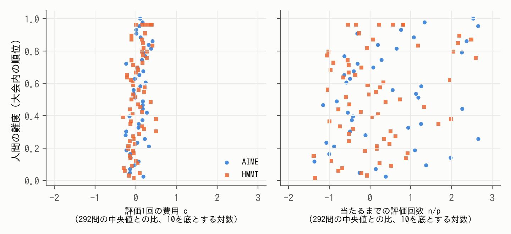

# 作図で解く求値幾何solverと、その難しさ（題名は仮）

（v7・10/23朝。v6 に GPT-Pro の第9回・第10回レビューを反映し、夜の間に行った実験を加えた。証明・手順・全ての表は補足資料 S1〜S4 に置いた。【 】は本人確認か未完。）

## 要旨

幾何の求値問題を、作図と条件で書いた入力から、定理を探さずに数値計算で解くsolverを作った。作図で決まる点は変数にしない。見つけた図を数百桁まで精密化し、答えを √ などを含む式として同定する。コンテストの323問では969回中953回正解し、時間の中央値は5.2秒だった。問いは2つである。(1) solverをどう実現したか。(2) そのsolverにとっての難しさは、人間の難しさとどう違うか。(1)では、通常の実行の記録から各仕組みを外したときに影響を受ける問題を予想し、外す実験と比べた。(2)では、局所探索の費用を「評価1回の費用」と「当たるまでの評価回数」に分けた。問題ごとの違いの87%は後者から来ていた。人間の難度は両大会で前者と正の関係があったが、2つの因子の効き方が人間とsolverで違うかは確定できなかった。さらに、正しい図を変えない入力の書き換えで、局所探索の当たる確率が1.00から0.03に下がる例があった。同じ変数の数でも表し方で結果が変わり、変数の数だけでは説明できない。反復の追跡から、作図の線形近似のずれが一歩を切り詰める機構を示した。予測は実行前に固定し、外れたものも報告した。

## 1 はじめに

LLMの数学の力を競う大会（AIMO）で、私はLLMが長さや角度を求める幾何の問題（求値問題）を苦手とすることを知った。数学オリンピックで幾何を学んできた経験から言えば（IMO 2025 金メダル）、人間が苦労するのは補助線や定理を見つける部分である。しかし、図を正確に作れれば、答えは計算で求まるはずである。そこで、問題を作図と条件で書いた入力から、定理を探さずに計算だけで答えを求めるsolverを作った。【本人確認：AIMOを見た時期と、目的の書き方。】

問いは2つである。(1) solverをどう実現したか。(2) そのsolverにとっての難しさは、人間が感じる難しさとどう違うか。(2)が分かれば、solverを人間やLLMの補助に使うとき、どの問題で役立つかが分かる。

## 2 先行研究

AlphaGeometry [1, 2] は命題を証明する方法で、値を求める本研究とは課題が違う。図を座標の多項式で表して厳密に解く方法 [3, 13] は、答えの正しさを保証できる。数値的な方法では GMB [6] が最も近い。GMB も座標の取り方を工夫して条件のずれを最小化し、図を作る。本研究が違うのは、「考えられる値をすべて求めよ」型を含めて答えの値の集合を求めること、複数の図を探すこと、値を式として同定して高精度で確かめることである。コンテストの求値問題で、solverの難しさを人間の実測難度と比べた研究は、調べた範囲では見当たらなかった（S4）。本研究では solver を323問で評価し、そのうち人間の難度がそろう109問で比べた。

## 3 solverをどう実現したか

### 3.1 問題の表し方

問題は、探索変数 u（d 個の実数）、作図 h、等式 F(u) = 0、不等式 G(u) > 0、求める量 τ で書く。中点や交点などは、作図で u から計算する。不等式は、条件を満たす図が複数あるときにどれを指すか（以下、枝）を決める。求めるのは集合 { τ(u) ｜ F(u) = 0, G(u) > 0 } で、答えが1つの問題も「すべての値を求めよ」型も同じ形で書ける。

### 3.2 4つの困難と、それを受け持つ仕組み

求値の過程には4つの困難がある。それぞれに仕組みを当てた（表1）。

表1　困難と仕組み

| 困難 | 仕組み |
|---|---|
| 探す変数が多い | 作図で点を消す。式で直接解ける小さな系は、枝を列挙して探索を省く（代数的前処理） |
| 正しい図に当たらない | 微分を使わない安い探索（NOMAD [9]）を1段目に置き、答えが出なければLM法 [10] の多点出発（第2探索）と、範囲を分けた再探索（rescue）で補う |
| 精度が上がらない | 多倍長のLM法とニュートン法。「接する」などの条件は符号付きの残差に直す |
| 値が式にならない | PSLQ [11] で最小多項式を同定し、120〜500桁で条件と枝を確かめる |

### 3.3 1問を通して見る

AIME 2021 I-11 を例にとる。円に内接する四角形 ABCD の辺が 4, 5, 6, 7 で、各頂点から対角線に下ろした垂線の足 4 つが作る四角形の周の長さを求める。入力では A = (0, 0)、B = (4, 0) と置き、C、D の座標の 4 つを探索変数にする（d = 4）。垂線の足は作図で計算するので変数にならない。等式は BC = 5、CD = 6、DA = 7 と、4点が同一円上にあることの4つ、不等式は C、D が上側にあることと凸であることである。

実行（seed 0）では、1段目の探索が1.4秒で候補を20個出した。精密化（1.8秒）で14個が収束し、6個は偽として捨てられた。残りの候補から得た値 4.1016949… を、PSLQ が 242/59 と同定し、120桁以上で条件と枝を確かめた（7.9秒）。全体で12.9秒だった。1回の局所探索（LM法）で見ると、当たる確率は0.49、評価回数は129回、評価1回は2.0ミリ秒だった（5.2節）。

### 3.4 仕組みの役割を、通常の実行から予想して確かめる

表1の役割分担が正しければ、通常の実行で「その仕組みが答えを出した問題」が、外したときに影響を受けやすいはずである。本計測（323問×3回）の記録から答えの出どころを調べて影響を予想し、1つずつ外した計測（各323問）と比べた（S2.2）。

- **代数的前処理。** 答えを出した97問のうち74問が、外すと1.5倍以上遅くなった。他の226問では0問。正解数は変わらなかった。
- **第2探索。** 答えを出した10問のうち9問を、外すと失った。他の問題で失ったものはなかった。
- **rescue。** 答えを出した9問のうち、外して失ったのは1問で、残りは別の経路が解いた。仕組みが重なっているので、1つを外しても正解数には表れにくい。

1回の局所探索が当たる確率を p、1回の時間を t とすると、出発点を独立に選び直す限り、当たるまでの時間の期待値は t/p である（S1.1）。LM法の多点出発を1段目に使うと、探索時間は t/p と順位がよく合い（順位相関0.72）、t/p の上位4分の1では中央値63秒かかった。NOMADは同じ問題で中央値1.5秒で、難しい問題でも費用がほとんど増えない安い1段目として働いている。

外れの費用も大きい。候補は数百桁まで精密化されてから真偽が決まるので、時間の51%は精密化に使われ、p の下位4分の1の問題では1回の実行で中央値7個の偽の候補を精密化していた（S2.9）。

### 3.5 精度と同定

323問のうち π を含まない316問の答えの最小多項式は次数4以下で、PSLQ で同定に要る精度の目安は最大でも43桁だった（S2.7）。solverの作業精度は120桁以上だが、作業精度は正しい桁数と同じではない。正しい桁数を下げるのは重根である。「接する」条件は重根になりやすく、二重根では残差が100桁小さくても座標は50桁程度しか決まらない（S1.5）。そこで接する条件などを符号付きの残差に直している。接する条件を含む12問で、同じ候補を、この書き換えありとなしで精密化した。精度を、最良の候補での残差の大きさの桁数（−log₁₀）で測ると、なしでは7問が8〜48桁で止まり、ありでは同じ候補が119〜502桁に届いた。4問は差がなく、1問はなしの方が12桁多かった（S2.7）。同定は証明ではなく、高精度で一致を確かめ、公式の答えとの一致で検算したという意味である。

## 4 達成したこと

各問題に180秒と1コアを与え、seedを変えて3回ずつ解いた（表2）。開発用の323問は、AIME・HMMT・日本数学オリンピック予選（2000〜2025年）から私が選んだ。入力はAIが書いたので、解き方が入り込んでいないかを正解を見ずに全問調べ、問題文をそのまま書き移したと確認できた246問を「直接入力」と呼ぶ。答えが複数ある問題は、値の集合が一致したときだけ正解とした。時間の中央値は失敗も含む。成績と時間は、入力が与えられた後のsolverを測ったものである。

表2　問題の種類ごとの成績（各3回）

| 問題 | 問題数 | 正解した回数 | 時間の中央値 |
|---|---|---|---|
| 開発用 | 323 | 953/969 | 5.2秒 |
| うち直接入力 | 246 | 724/738 | 6.6秒 |
| 2026年の新しい問題 | 20 | 55/60 | 9.9秒 |
| 自動生成（答えが複数の32問を含む） | 88 | 264/264 | 1.3秒 |

GMBの論文の36問で、両方の出力を同じ独立の検査（条件のずれ 10⁻⁶ 以内）にかけると、図を作れた回数は solver 100/108、GMB 30/108 だった。論文の93.52%は「モデルを返した」割合で、私たちの計測では88%だった。差は主に、成功の定義と等式のずれの許容から来ている（S2.8）。図を多項式にして msolve [13] で解く方法は、答えを得た201問ではsolverよりはるかに速かった（中央値0.03秒）。残る122問には、解が有限個でない問題のほか、この変換で多項式にできない問題、時間切れ、未知数がない・未実行の問題も含まれる。msolve がこれらすべてで失敗したという意味ではない。solverは122問のうち121問を解いた（S2.8）。

## 5 solverにとっての難しさ

### 5.1 値だけを決めればよい

msolveが解けなかった122問のうち68問は、解が有限個でないと判定された（65問は複素数の範囲で正次元、3問は自由な変数が残る）。solverに必要なのは τ の値だけである。τ が連続で値が有限個なら、τ は図の集合のひとつながりの部分（連結成分）の上で一定になる。各成分から図を1つ見つければ値は決まる。例えば HMMT 2013年2月 幾何2番では、台形の高さが決まらないが、求める長さの2乗はどの高さでも24になる。このような恒等式 s^N P(τ) = Σ C_i F_i（F_i は条件の多項式）を作り、どの図でも P(τ) = 0 となることを63問中24問で確かめた（S1.4）。

### 5.2 費用は「評価1回の費用」と「当たるまでの評価回数」に分かれる

t/p を、評価1回の費用 c と、1回の局所探索の評価回数 n（微分の計算に使う評価も含む）に分けると

  t/p = c × (n / p)　…(1)

となる。探索変数のある292問で、最大200個の出発点から c、n、p を測った（S2.3）。作図はどの評価でも順に計算されるので、c は作図の数とともに増えるはずである。一方、n と p が作図の数によらないかは、理論からは言えない。作図は地形も変えうるからである。

結果は次のとおりだった。探索に残した変数の数 d の影響を除くと、作図の数と n、p の偏順位相関は小さく（0.03、0.06）、c とは0.58だった。逆に d は、作図の数の影響を除いても n と強く関係した（0.78）。問題ごとの c の違いは上下5%を除いて約4.5倍の幅しかないが、n/p は約3,300倍の幅があった。問題ごとの t/p の違いを対数で測ると、その87%（95%区間 84〜91%）は n/p の、3%は c のばらつきで、残り約10%は両者の共分散だった。p が0の問題の扱いを変えても、87〜91%だった。この分解は、LM法の局所探索という物差しでの結果で、NOMAD を含むsolver全体の時間の分解ではない。

### 5.3 正しい図を変えない書き換えが、難しさを変える

作図 y = h(u) で計算していた点を自由な点 y に戻し、作図を表す等式 G(u, y) = 0 を加えても、正しい図は変わらない。人間に示す問題文も変わらない。15問で作図を k か所（k = 0〜3）書き換えると、1回の局所探索が当たる確率の中央値は 0.96、0.77、0.40、0.38 と下がった（1か所ごとにオッズ約0.49倍）。完成したsolverでは、正解は45回中42回から41回でほぼ変わらず、費用（失敗は180秒として数えた時間）が問題ごとの比の中央値で3.43倍になった（S2.6）。

変数が増えたせいだろうか。点を y = h(u) + z と作図で作り直し、ずれ z を変数にした系（ずれの系）は、変数の数が自由点の系と同じである。書き換えた点が元の等式に現れないとき、z = 0 から始めたLM法の u の反復は元の系と一致する（命題1、S1.3）。同じ出発点からの実測でも、この場合ずれの系は元の系とほぼ同じで、自由点の系だけが落ちた（図1）。新しい43問では、命題1に基づく予測を実行前に固定した。終点と残差の一致という事前の基準は15問中12問で満たし、3問で満たさなかった。当たり外れの判定は600組すべてで一致し、不一致は収束しなかった終点で生じていた（有限精度の影響と考えられる。S2.5）。変数の数の増加だけでは、難しさは説明できない。

ただし、ずれの系は座標（y を h(u)+z に）と作図の行の式（G を z に）を同時に変えている。そこで、座標だけを取り替えて作図の行は G のまま残した系も作り、自由点の系が不利だった10問で比べた（S2.5(e)）。当たる確率の中央値は、自由点の系0.15に対しこの系は0.77（元の系0.93）で、5問では元の系とほぼ同じになった。一方、事前に一致を予測した JMO 2013 予選3 では0.45にとどまり（元の系0.65）、予測は外れた。不利の多くは座標の取り方で生じていたが、作図の行の式も効く場合がある。

図1　同じ出発点60個からの当たる確率（14問、k = 3）。灰色の輪が元の系、緑の点がずれの系、橙の菱形が自由点の系。上の6問は、書き換えた点が元の等式に現れない問題（命題1が成り立つ）。

では、自由点の系では何が起きるのか。私は最初、出発点での u の列の膨らみ（作図の微分が加わる分）で低下を予測できると考え、43問で実行前に予測を固定した。しかし膨らみ3倍以上の6問で当てたのは3問で、列の膨らみだけでは低下を安定して予測できなかった（S2.5）。そこで AIME 2014 II-14（自由点の系で1.00→0.03）の反復を、減衰のないガウス・ニュートン法（残差が減るまで一歩を半分にする）で追跡した。書き換えた点が元の等式に現れず、作図の等式が y について解けるとき、この方法で u を動かす向きは元の系と同じになる（S1.3）。実際、最初の一歩の向きは一致した。違ったのは、受け入れられる一歩の長さだった。長さ 1/128 の一歩では、元の等式の残差はどちらの系でも同じだけ減った。しかし自由点の系では、線形近似では0のはずの作図の等式の残差（2乗和）が、実際には約550になり、一歩は 1/8192 まで切り詰められた。作図の曲がりによるずれが、一歩の受け入れを妨げたのである。実際のLM法では、これに減衰と変数の尺度の影響が加わり、一歩の向きも変わりうる。ここで示したのは、悪化を生む機構の一つである。

この機構なら、出発点が解に近いほど一歩が短く、不利は小さいはずである。自由点の系が0.2以上不利だった10問で、正しい解を中心とする箱から出発点を選び、箱の幅 r を変えた（予測は実行前に固定。S2.5）。r が元の箱の2%のときは10問中8問で両者の差が0.10以内で、r を広げると自由点の系の不利の中央値は 0、0.07、0.30、0.50 と増えた。ずれの系の不利は中央値0〜0.02だった（図2）。結果は説明と整合する。ただし10問中8問は書き換えた点が元の等式にも現れる問題で、この場合はずれの系も元の系と一致しない（図1下）。悪化の原因を一つに特定したわけではない。

図2　出発点を正しい解の周りの箱から選んだときの、当たる確率の差（元の系 − 各系）。細い線は各問題の自由点の系。

同じ幾何の条件でも、座標と制約の表し方によって局所探索の結果は変わる。作図で点を計算するという設計（3.2節）が効く理由の一つは、点がいつも作図の上にあり、作図の線形近似のずれが一歩を妨げないことにある。

## 6 人間の難しさとどう違うか

### 6.1 solverの難しさは、問題文だけでは決まらない

5.3節の書き換えは、人間に示す問題文を変えずに solver の難しさを変えた。逆に、人間には難しい問題でも、入力の作図だけで図が決まればsolverは探索をしない。HMMT 2019年2月 幾何10番は、正方形を3段重ねた複雑な図で、人間には難しい（HMMTの79問中、難しい方から上位9%）。しかし作図だけで図が決まる（d = 0）ので、探索も精密化もなく1.5秒で解けた。

人間が補助線や定理で見つけなければならない関係が、solverの入力には作図として既に入っていることもある。入力を書くときにAIが人間の推論（中心の位置などを手で求めたもの）を入れていた5問で、その推論を外して原文の条件だけに戻した（S2.10）。探索変数が5〜6個増えた2問では、時間が8倍と12倍になった。一方、外した形が小さな多項式の系になった1問は、代数的前処理で解けて逆に速くなった。何を与えると楽になるかは、人間の見通しではなく、solverの仕組みが決める。

### 6.2 両者が重なる部分

実際の正答率から推定された人間の難度（Easy2Hard [12]）と、5.2節の c、n/p を、両方がそろう109問で比べた（図3）。人間の難度は、両大会で c と正の関係があった（n/p の影響を除いた偏順位相関 AIME 0.35、HMMT 0.45）。c は入力の大きさ（作図の数、入力の長さ）とともに増える量である。n/p との関係は、c の影響を除くと 0.26、0.09 で、区間が0をまたいだ。2つの因子への効き方が人間とsolverで違うかは、109問では確定できなかった（S2.3）。

図3　人間の難度（大会内の順位）と、solverの費用の2つの因子（生の散布図。偏相関の値は本文と S2.3）。

逆に AIME 2015 I-7 は、人間には比較的易しい（AIMEの52問中、易しい方から33%）が、d = 5 で200回の局所探索は1回も当たらず、範囲を分けた再探索で初めて答えが見つかった。56個の候補のうち54個が偽だった。この2問は説明のための例で、検証には数えない。

## 7 限界

solverは、すべての答えを見つけたことも、答えの式の正しさも、数学的には保証しない。323問は開発に使った問題で、開発外の成績は2026年の20問と自動生成の88問で示した。c、n、p は、LM法の局所探索を独立な出発点から測った量で、NOMADを含むsolver全体の値ではない。5.3節の書き換えの実験も、局所探索での結果である。人間の難度との比較は109問で、入力はAIが書いたので、作図の数は書き方にも左右される。

## 8 結論

作図で決まる点を計算し、候補の探索、高精度化、値の同定を組み合わせたsolverを作った。開発用323問を各3回解き、969回中953回正解し、時間の中央値は5.2秒だった。仕組みを外す実験から、代数的前処理は主に速さに、第2探索は正解の回収に効いていた。LM法の局所探索では、問題による費用の違いの多くが、当たるまでの評価回数から来ていた。同じ幾何の条件でも、座標と制約の表し方によって当たる確率とsolverの費用が変わり、その機構の一つとして、作図の線形近似のずれが一歩を切り詰めることを示した。人間の難度は評価1回の費用と正の関係を示したが、2つの因子の効き方が人間とsolverで違うかは確定できなかった。solverの難しさは問題文だけでは決まらず、何を作図で計算し、残りをどう表して探すかで変わる。【本人確認：次の一手。】

## 生成AIの利用について

Claude（Anthropic）と ChatGPT（OpenAI）の有料版を、2025年12月からその時点の最新版で使った。発想と研究の方向は私が決め、solverの中心となる計算法はAIと相談して決めた。実装と細かな改良、評価問題の入力の作成、実験の実行と集計、レポートの下書きにAIを使った。【本人確認：自分で確かめたことを具体的に書く（例：どの数値を自分で再実行したか、どの問題の入力を自分で読んだか）。】

## 参考文献

1. Trinh, T. H. et al. Solving olympiad geometry without human demonstrations. Nature 625 (2024).
2. Chervonyi, Y. et al. Gold-medalist Performance in Solving Olympiad Geometry with AlphaGeometry2. arXiv:2502.03544 (2025).
3. Cox, D., Little, J., O'Shea, D. Ideals, Varieties, and Algorithms. Springer.
6. Krueger, R., Han, J. M., Selsam, D. Automatically Building Diagrams for Olympiad Geometry Problems. CADE-28 (2021).
9. Audet, C. et al. NOMAD version 4. ACM TOMS (2022).
10. Moré, J. J. The Levenberg–Marquardt algorithm: implementation and theory. Lecture Notes in Math. 630 (1978).
11. Ferguson, H. R. P., Bailey, D. H., Arno, S. Analysis of PSLQ. Math. Comp. 68 (1999).
12. Ding, M. et al. Easy2Hard-Bench. NeurIPS 2024 Datasets and Benchmarks. arXiv:2409.18433.
13. Berthomieu, J., Eder, C., Safey El Din, M. msolve: A Library for Solving Polynomial Systems. ISSAC 2021.
（番号は最後に振り直す。）
