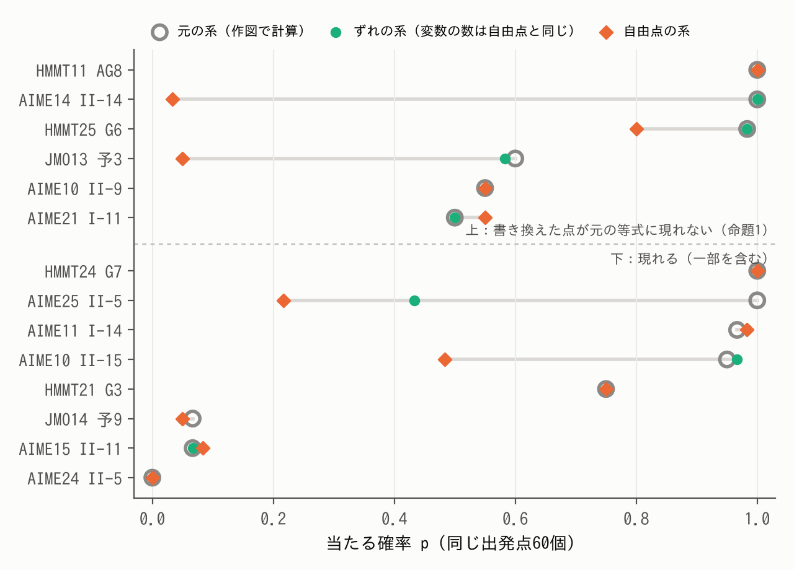
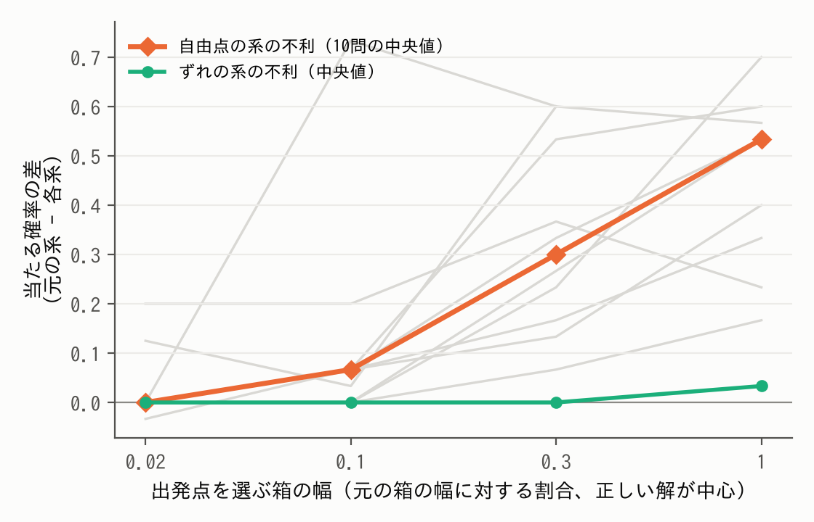
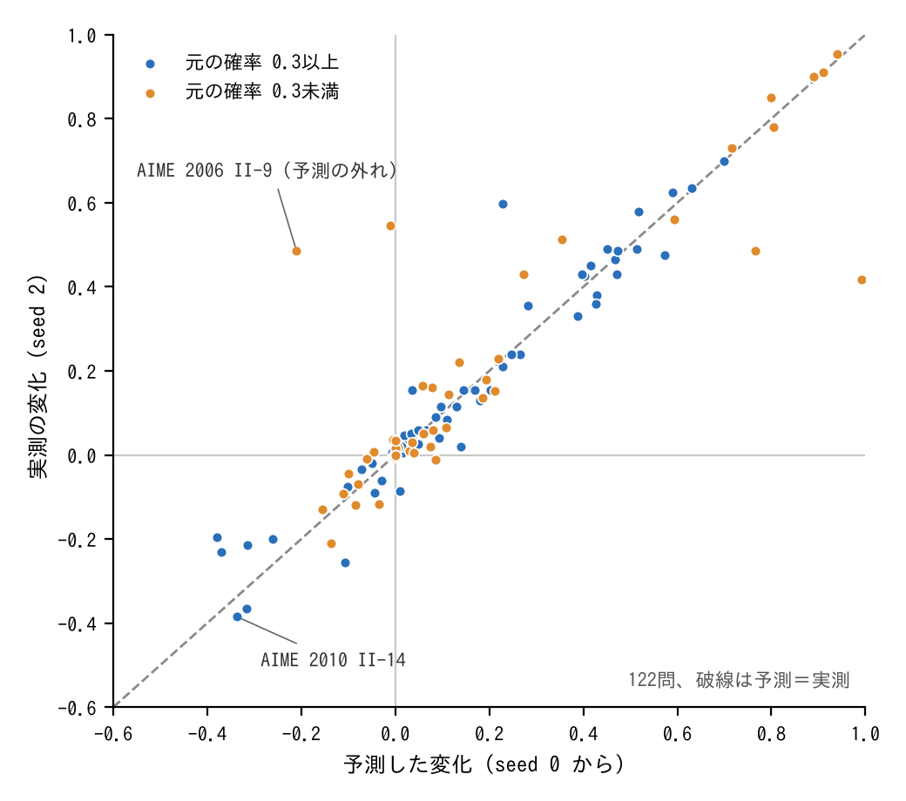

# 作図で解く求値幾何solverと、その難しさ（題名は仮）

（v9・10/23夜。GPT-Pro相談15の指摘を反映。検証した仮説と判定基準は実行前に commit し、追加の分析は事後分析と明記した。証明・手順・全ての表は補足資料 S1〜S5。【 】は本人確認か未完。）

## 要旨

幾何の求値問題を、作図と条件で書いた入力から、定理を探さずに数値計算で解くsolverを作った。作図で決まる点は変数にせず、見つけた図を数百桁まで精密化し、答えを √ などを含む式として同定する。開発に使った323問では969回中953回正解し、開発外の2026年の20問では60回中55回正解した。問いは2つである。(1) solverをどう実現したか。(2) そのsolverにとっての難しさは、人間の難しさとどう違うか。人間の正答率に基づく難度と、solverの局所探索の成功率 p の対応は強くなかった。一方、人間に示す問題文を変えずに、条件の持たせ方や出発点の選び方を変えると、p は大きく変わった。作図を等式に戻す系では、作図の線形近似のずれが一歩を切り詰める例を示した。また、出発点の図が許容条件（不等式・点の並び・三角形がつぶれないなど）を満たすかで p は分かれ、満たす出発点を優先する方策で、150問の平均 p は0.39から0.55に上がった。過去の試行から予測した問題ごとの変化は、新しい seed での実測と順位相関0.90で対応し、下がる問題も予告できた。ただし効果は問題ごとに大きく異なった。【完成solverでの費用込みの結果を一文。】

## 1 はじめに

LLMの数学の力を競う大会（AIMO）で、私はLLMが長さや角度を求める幾何の問題（求値問題）を苦手とすることを知った。数学オリンピックで幾何を学んできた経験から言えば（IMO 2025 金メダル）、人間が苦労するのは補助線や定理を見つける部分である。しかし、図を正確に作れれば、答えは計算で求まるはずである。そこで、問題を作図と条件で書いた入力から、計算だけで答えを求めるsolverを作った。【本人確認：AIMOを見た時期と、目的の書き方。】

問いは2つである。(1) solverをどう実現したか。(2) そのsolverにとっての難しさは、人間が感じる難しさとどう違うか。

## 2 先行研究と、この研究の新しさ

AlphaGeometry [1, 2] は命題を証明する方法で、値を求める本研究とは課題が違う。図を座標の多項式で表して厳密に解く方法 [3, 13] は、答えの正しさを保証できる。数値的な方法では GMB [6] が最も近く、座標の取り方を工夫して変数を減らし、点を離す損失なども使って、幾何条件を満たす図を数値的に生成する。したがって「作図で変数を減らす」「退化した図を避ける」こと自体は新しくない。本研究の新しさは2つある。1つは、答えの値の集合を求め、値を式として同定して高精度で確かめる solver を作り、323問で評価して、msolve との比較と、GMB の36問での比較を行ったこと。もう1つは、同じ問題に対して条件の持たせ方と出発点の選び方を変える対照実験と介入を行い、問題ごとの効果を先に予測して確かめたことである。

## 3 solverをどう実現したか

### 3.1 問題の表し方

問題は、探索変数 u（d 個の実数）、作図 h、等式 F(u) = 0、不等式 G(u) > 0、求める量 τ で書く。中点や交点などは、作図で u から計算する。不等式は、定義域・点の順序・非退化の条件と、条件を満たす図が複数あるときにどれを指すか（枝）を表す。求めるのは集合 { τ(u) ｜ F(u) = 0, G(u) > 0 } である。

### 3.2 4つの困難と、それを受け持つ仕組み

表1　困難と仕組み

| 困難 | 仕組み |
|---|---|
| 探す変数が多い | 作図で点を消す。式で直接解ける小さな系は、枝を列挙して探索を省く（代数的前処理） |
| 正しい図に当たらない | 微分を使わない安い探索（NOMAD [9]）を1段目に置き、答えが出なければ局所探索（LM法 [10]）の多点出発（第2探索）と、範囲を分けた再探索で補う |
| 精度が上がらない | 多倍長のLM法とニュートン法。「接する」などの条件は符号付きの残差に直す |
| 値が式にならない | 整数関係（PSLQ [11]）から答えの式の候補を求め、120〜500桁で条件と枝を確かめる |

### 3.3 1問を通して見る

図1に AIME 2021 I-11 での流れを示す。C、D の座標の4つを探索変数にし（d = 4）、垂線の足は作図で計算する。1段目の探索が1.4秒で候補を20個出し、精密化で14個が収束し、6個は精密化・検証を通らず採用されなかった。値 4.1016949… を PSLQ が 242/59 と同定し、120桁以上で条件と枝を確かめた。全体で12.9秒だった。

図1　例題での solver の流れ。① 問題、② 入力（作図と条件）、③ 出力。

### 3.4 仕組みの役割

本計測（323問×3回）の記録から、各仕組みが答えを出した問題を調べて影響を予想し、1つずつ外した計測と比べた（S2.2）。代数的前処理は、答えを出した97問のうち74問で、外すと1.5倍以上遅くなった（他の問題では0問）。第2探索は、答えを出した10問のうち9問を、外すと失った。時間の51%は候補の精密化に使われる（S2.9）。接する条件などの残差を書き換えると、同じ候補集合を精密化したとき、最良残差が8〜48桁で止まっていた12問中7問が、119〜502桁に届いた（S2.7）。

## 4 達成したこと

各問題に180秒と1コアを与え、seedを変えて3回ずつ解いた（表2）。開発用の323問は、AIME・HMMT・日本数学オリンピック予選（2000〜2025年）から私が選んだ。入力はAIが書いたので、解き方が入り込んでいないかを正解を見ずに全問調べ、問題文をそのまま書き移したと確認できた246問を「直接入力」と呼ぶ。答えが複数ある問題は、値の集合が一致したときだけ正解とした。時間は入力を作る時間を含まず、失敗した実行も含めた中央値である。

表2　問題の種類ごとの成績（各3回）

| 問題 | 問題数 | 正解した回数 | 時間の中央値 |
|---|---|---|---|
| 開発用 | 323 | 953/969 | 5.2秒 |
| うち直接入力 | 246 | 724/738 | 6.6秒 |
| 2026年の新しい問題 | 20 | 55/60 | 9.9秒 |
| 自動生成（答えが複数の32問を含む） | 88 | 264/264 | 1.3秒 |

GMB の論文の36問を各3回解き、両方の出力した図を同じ独立の検査（等式のずれ10⁻⁶以内に加え、枝と境界の判定）にかけると、通過した回数は solver 100/108、GMB の既定設定 30/108 だった（GMB が図を返したのは95回。厳格な設定でも29回。S2.8）。多項式にして msolve [13] で解く方法（1問1800秒・4並列の別の設定）は、答えの集合が一致した201問では中央値0.03秒で、本solverの同じ201問での2.0秒より速かった。その他の122問には、正次元の系、多項式にできない問題、時間切れに加えて、未知数がなく実行しなかった15問を含む。この122問のうち、本solverは121問で3回中少なくとも1回正解した。

## 5 solverにとっての難しさ

### 5.1 局所探索の費用差は、当たるまでの評価回数に大きく依存する

局所探索1回の平均時間を t、当たる確率を p とすると、独立に出発点を選び直す限り、当たるまでの時間の期待値は t/p である。探索変数のある292問で、問題ごとの t/p の対数のばらつきを分解すると、当たるまでの評価回数 n/p の項が87%を占め、1評価当たりの費用の項は3%だった（S2.3）。以下では p を、箱から一様に選んだ出発点から凍結版の局所探索（272問はLM法、条件より変数が多い20問はPowell法）を1回行い、正しい答えの図に到達する確率として調べる。この局所探索は、完成solverでは第2探索として使われる（1段目は NOMAD）。

### 5.2 作図を等式に戻すと、一歩が切り詰められる

作図 y = h(u) で計算していた点を自由な点 y に戻し、作図を表す等式 Q(u, y) = 0 を加えても、正しい図も問題文も変わらない。15問で作図を k か所書き換えると、当たる確率の中央値は 0.96、0.77、0.40、0.38 と下がった（k = 0〜3）。

変数の数の増加だけによるかを調べるため、同じ数の変数を持つ2つの系を、同じ図から出発させた（図2、14問）。自由点の系（y を変数にし、等式 Q を加える）と、ずれの系（y = h(u) + z と置き、z を変数にする。作図の残差も z に置き換える）である。書き換えた点が元の等式に現れない場合には、一定の仮定の下で、ずれの系の反復は元の系と一致する（命題1、S1.3）。この条件に当てはまる6問では、ずれの系は元の系とほぼ同じ確率だったが、自由点の系は2問で大きく下がった（AIME 2014 II-14 で1.00→0.03、JMO 2013 予選3 で0.60→0.05）。条件に当てはまらない問題では、ずれの系も下がることがあった（AIME 2025 II-5 で1.00→0.43）。

AIME 2014 II-14 を、減衰のないガウス・ニュートン法で切り分けた。同じ出発点での最初の方向は元の系と同じだった。違ったのは受け入れられる一歩の長さで、求めた方向を1/128倍した一歩で元の等式の残差は両方の系で同じだけ減ったが、自由点の系では線形近似では0のはずの作図の等式の残差（2乗和）が約550に跳ね、一歩は 1/8192 倍まで切り詰められた。これは LM法での悪化を説明する機構の一つである。不利が見られた10問で、既知解の周りの出発箱を狭めると、不利の中央値は小さくなった（図3）。作図で点を計算する設計が効く理由の一つは、点がいつも作図の上にあり、このずれが生じないことである。

図2　同じ出発点60個からの当たる確率（14問、k = 3）。灰色の輪が元の系、緑の点がずれの系、橙の菱形が自由点の系。破線より上の6問は、書き換えた点が元の等式に現れない問題（命題1の条件）。

図3　出発点を既知解の周りの箱から選んだときの、当たる確率の差（元の系 − 各系）。

### 5.3 出発点の選び方を変えると、問題ごとに予告どおり変わる

作図は反復の中で条件を守らせる方法だった。では、作図で守らせていない条件はどう効くか。本節では、破ると局所探索の残差に一定の罰則が加わる判定（不等式・枝・直線が定まる・三角形がつぶれない・作図が評価できる。S5.1）を許容判定と呼ぶ。solver は箱から一様に出発点を選ぶので、許容判定を破る図から始まることがある。

292問の55,097出発点では、34%が許容判定を破っていた。当たる割合は、満たす出発点で0.71、破る出発点で0.33だった。問題ごとの「出発点が許容判定を満たす割合」φ は反復探索なしに測れ、p との順位相関は0.48（変数の数をそろえて0.38）だった。別の seed でも同程度だった（S5.1）。

そこで、最大2000回まで同じ箱から引き直して、許容判定を満たす出発点を優先する方策を試した（検証用の改変で、凍結した solver の成績とは分ける）。同じ問題で、満たす出発点からの確率を p_F、破る出発点からを p_I とすると p = φ p_F + (1 − φ) p_I なので、全ての出発点を許容点にできれば、変化は (1 − φ)(p_F − p_I) となる。式自体は既知の分解である。検証したのは、seed 0 で測った問題ごとの p_F・p_I から求めたこの理想化した変化が、新しい seed で実施した方策の効果を予告できるかである。上限までに許容点を得られなかった場合は、許容しない点から探索した。予測を固定してから150問を実行し、事前に登録した4項目はすべて成立した（S5.2）。

- 平均 p は 0.390 から 0.545 に上がった（93問で上昇、27問で低下、30問で同じ。符号検定 p < 10⁻⁹）。
- 問題ごとの変化は予測と順位相関0.90、平均絶対誤差0.05で対応した（図4、seed 0 で許容点があった122問）。
- 選び直した p は、122問中109問で seed 0 の p_F と ±0.10 以内だった。
- seed 0 で p < 0.3 の75問では、変化の中央値は0.02だった。ただし18問は0.30以上上がり、36問は変化の絶対値が0.05未満で、効果は大きく分かれた。

悪化を予告できた例もあった。AIME 2010 II-14 では、seed 0 の当たる割合が許容点で12/116、許容しない点で76/84だったため、選び直しで0.337下がると予測した。seed 2 でも100/200から23/200へ、0.385下がった。負の変化を予測した29問では21問で下がったが、逆に大きく上がった問題もあった（AIME 2006 II-9。seed 0 の許容点は200個中1個だけで、p_F の推定が1試行に頼っていた）。

図4　選び直しによる当たる確率の変化。1点が1問。横軸は seed 0 から予測した変化、縦軸は新しい seed での実測、破線は予測と実測が等しい線。seed 0 で許容点からの確率を推定できた122問。色は seed 0 の p。

つまり、初期点の選び方だけを変えることで p を変えられ、その問題別の効果を過去の試行から予告できた。ただし、許容点を優先するのが有利かどうかも、効果の大きさも、問題によって違った。【完成 solver での費用込みの比較（A：既定の solver、B：1段目を局所探索の多点出発にした solver。各150問×3 seed×2条件）の結果を3〜4文。】

### 5.4 当たりにくさの別の指標を探す

元の探索の外れた終点を調べると、予備調査の201問では約35%が、最小の2点間距離が図の直径の10⁻⁶以下になるほど2点が重なった図だった（当たりではほぼ0%）。そこで、2点を一致させた系を数値探索で解き、元の等式の残差が10⁻¹⁰以下になる候補を検出できる問題（65/292問）を調べると、変数の数をそろえた5つの層すべてで p の中央値が低かった（層を考慮した並べ替え検定 p = 0.0016）。変数の数・φ・この検出の有無で p を予測する式を292問で固定し、未使用の2026年の20問に当てると、実測との順位相関は0.79だった（変数の数だけでは0.71）。ただし事後の比較では、検出の有無を除いた式の方が良く（0.82）、この20問では検出を加える予測改善は確認できなかった。また、検出した2点に反発する項を加えても、改善の中央値は0で、事前登録の基準を満たさなかった。重なった図の検出は開発用の問題では当たりにくさと結びついたが、因果的な寄与は確認できなかった（S5.3、S5.4）。

## 6 人間の難しさとどう違うか

本研究で比較したのは、人間の正答率から推定された難度と、作図と条件を入力した後の solver の局所探索の成功率である。Easy2Hard [12] の難度との順位相関は、AIME の43問では p が −0.24、φ が −0.34 だった。HMMT の66問では、それぞれ −0.14、−0.08 だった。本データでは強い対応は見られず、大会別の値も上のとおり異なった。これは人間の思考過程を調べた結果ではない。

一方、人間に示す問題文を変えずに、solver での条件の表し方や出発点の選び方を変えると、p は変わった。作図を等式で探す系では一歩が切り詰められる例があり（5.2）、許容点を優先する方策には p を上げる問題と下げる問題の両方があった。その効果を過去の試行から予測し、新しい seed で確かめた（5.3）。

人間に難しくても探索を必要としない例もある。HMMT 2019年2月 幾何10番は、人間の難度を得られた HMMT の79問中で上位約1割だったが、問題文の作図をそのまま書いた入力（S2.10）では作図だけで図が決まり（d = 0）、探索なしに1.5秒で解けた。この比較には、問題文を入力へ変換する労力を含めていない。

## 7 限界

solver は、すべての答えを見つけたことも、答えの式の正しさも、数学的には保証しない。323問は開発に使った問題である。5章の p は凍結版の局所探索1回の成功率で、完成した solver の時間ではない。φ は実装した許容判定で測った量で、枝や作図の評価可能性も含む。重なった図の検出は数値探索によるもので、検出されない問題に重なった図がないことは示していない。外れた予測（重なった図への反発、単調な誤差の変換の一般化、条件の種類からの予測、純粋な座標の取り替えでの予測）は S5.4 と S2.5 に、予測・判定・主張をどこまで縮めたかの形で記した。

## 8 結論

作図で決まる点を計算し、候補の探索、高精度化、値の同定を組み合わせた solver を作った。開発用323問では969回中953回、開発外の20問では60回中55回正解した。

問2について、人間の難度と局所探索の成功率の対応は強くなかった。同じ問題文でも、条件の表し方と出発点の選び方によって成功率は変わった。作図を等式として探す系では、線形近似のずれが一歩を切り詰める例を示した。また、許容条件を満たす出発点を優先する方策により、150問の平均成功率は0.390から0.545へ上がった。過去の試行から予測した問題別の変化は、新しい seed での実測と順位相関0.90で対応し、悪化を予告できた例もあった。ただし、効果は問題ごとに異なり、大きく改善する問題と変化の小さい問題が残った。【完成 solver の費用込みの結果を一文。】【本人確認：次の一手。】

## 生成AIの利用について

【本人が後で書く。】

## 参考文献

1. Trinh, T. H. et al. Solving olympiad geometry without human demonstrations. Nature 625 (2024).
2. Chervonyi, Y. et al. Gold-medalist Performance in Solving Olympiad Geometry with AlphaGeometry2. arXiv:2502.03544 (2025).
3. Cox, D., Little, J., O'Shea, D. Ideals, Varieties, and Algorithms. Springer.
6. Krueger, R., Han, J. M., Selsam, D. Automatically Building Diagrams for Olympiad Geometry Problems. CADE-28 (2021).
9. Audet, C. et al. NOMAD version 4. ACM TOMS (2022).
10. Moré, J. J. The Levenberg–Marquardt algorithm: implementation and theory. Lecture Notes in Math. 630 (1978).
11. Ferguson, H. R. P., Bailey, D. H., Arno, S. Analysis of PSLQ. Math. Comp. 68 (1999).
12. Ding, M. et al. Easy2Hard-Bench. NeurIPS 2024 Datasets and Benchmarks. arXiv:2409.18433.
13. Berthomieu, J., Eder, C., Safey El Din, M. msolve: A Library for Solving Polynomial Systems. ISSAC 2021.
（番号は最後に振り直す。）
