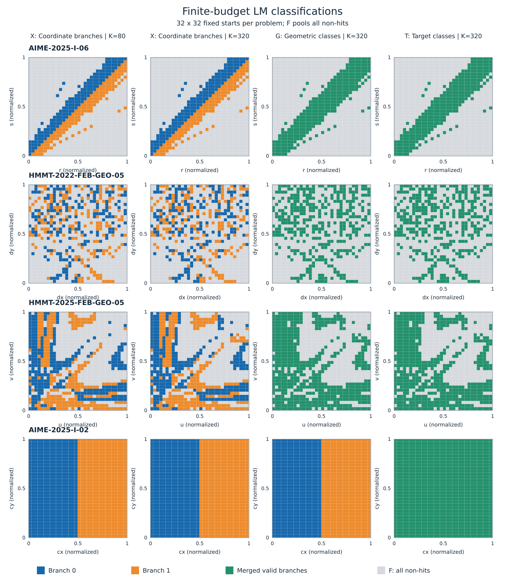
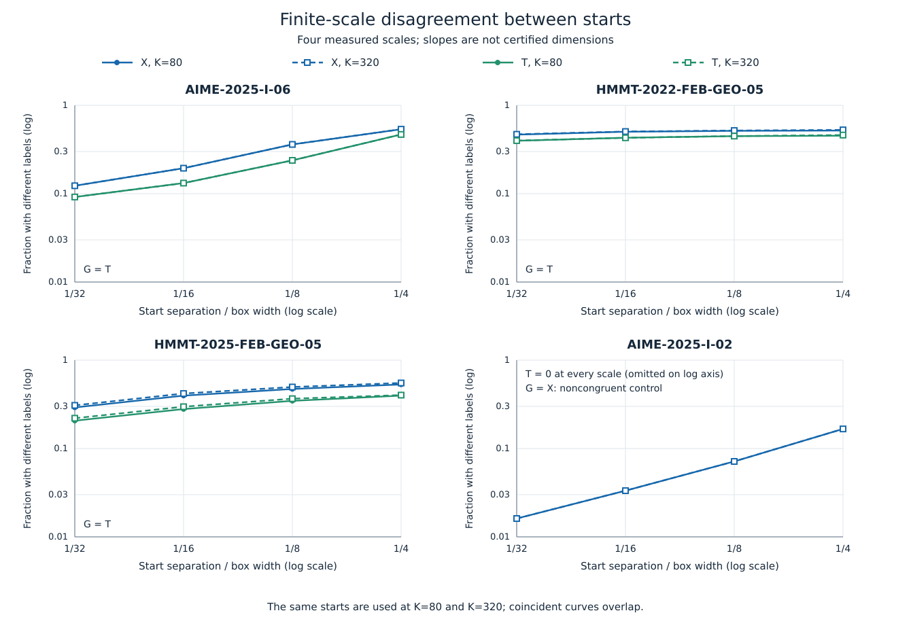

Aの核になりうるか：不可

Q20b・力学系レンズ。2026-10-23。ここでの「不可」は、今回得られた成果をAの核として採用できないという判定であり、この分野に今後の可能性がないという意味ではない。

**結論。** 最も有望と考えた「座標上の複雑な枝選択が、幾何対称性でまとめると大幅に単純化する」を、主3問・対照1問で検証した。結果を見る前に固定した継続条件を満たした主対象は **0/3問**。鏡映統合で消えた最小格子間隔の相違対は約15〜29%で、要求した50%に届かなかった。成功・不採用の混在が多く残り、有限尺度の傾きが単純な境界に近づくという条件も0/3問だった。評価上限を4倍にしたときの分類の頑健性だけは3/3問で満たした。

この結果からフラクタル性・Wada性・その不在のいずれも認定できない。残る2案は未検証であり、既知の同変性やNewton法の複雑な盆を再現するだけでは追加基準(f)〜(h)を満たさない。否定的な結果を別の有望案に読み替えず、今回はここで候補1の拡張計算を止める。

**根拠：何を測ったか。** 対象は既存の局所probeが使うSciPyのLevenberg–Marquardt法（LM）であり、完成solverの主探索NOMADを走らせた結果ではない。3問とも2変数、保存結果に孤立した2枝があり、正解図での既存Jacobian記録は列フルランクだった。既知の開発問題を選んだ探索的検証であり、無作為抽出や未知問題での確認実験ではない。

| 対象 | 2枝を交換する幾何対称性 | seed 0の旧hit率 | 代表図の対称性照合誤差 |
|---|---|---:|---:|
| AIME-2025-I-06 | r↔s、水平反射、A↔D・B↔C | 0.265 | 3.67×10⁻¹⁶ |
| HMMT-2022-FEB-GEO-05 | dx↔−dx、左右反射、B↔C | 0.385 | 1.61×10⁻¹⁶ |
| HMMT-2025-FEB-GEO-05 | u↔v、正三角形の反射、B↔C | 0.545 | 4.00×10⁻¹⁶ |
| 対照：AIME-2025-I-02 | 同じラベルの図は非合同、目標値だけ一致 | 1.000 | 合同としての誤差0.394 |

照合は全作図点の距離行列を、明示したラベル交換の前後で比較したもの。共通の長さで誤差を規格化し、図を個別に拡大して一致させてはいない。主3問でもラベル交換なしの誤差は0.235〜0.928あり、「同じ座標」と「問題を保つ対称変換で同じ図」を区別した。DSL・探索箱・代表図・対称交換は [inputs.json](inputs.json) に保存した。

元の探索箱を[0,1]²へ正規化し、((i+0.37)/32, (j+0.61)/32)、i,j=0,…,31の1024点を使った。同じ始点をK=80と320で計算した。KはSciPyの `max_nfev` であり、全残差呼出し数や反復回数とは同義ではない。通常の残差、guard、hard条件、箱、停止許容値を保ち、Kだけをプロセス内で変更した。1回3秒・全体3600秒の上限を固定した。

格子計算8192回と旧出発点の再生20回、計8212回の局所探索を1プロセス・1スレッドで実施し、約542秒で完了した。時間切れはゼロ。新探索前の22:16:43 JSTに [preregistration.md](preregistration.md)、実験コード、入力のSHA-256を [registration-lock.json](registration-lock.json) に固定した。結果を見た後の問題の入替え、格子の移動、閾値の変更、追加探索はしていない。

分類は次の3段階で比較した。

- **X（座標）**：正しい終点を既存2枝R0・R1に分け、それ以外をFにまとめる。枝の照合距離は箱幅で規格化したL∞距離10⁻⁵。
- **G（幾何）**：問題の条件と目標を保つ上記対称性で、Xの正しい枝をまとめる。
- **T（目標）**：同じ目標値を持つ正しい枝をまとめる。主3問ではG=T、非合同対照ではX=GとTが異なる。

hitは残差ノルム≤10⁻⁸、元のguard・hard・箱の判定、答え相対誤差≤10⁻⁶を満たす局所候補である。完成solverの集合正答や厳密な解保証ではない。旧2枝に属さない新しいhitはUとして別に記録する規約だったが、今回はゼロだった。Fは有限予算での不採用クラスであり、一つのアトラクタとは呼ばない。

間隔s=1,2,4,8で水平・垂直の全点対を比較し、ラベルの異なる対の割合U_L(s/32)を求めた。対の数は順に1984、1920、1792、1536。4点のlog U対log εの傾きをα_Lと記す。これは有限尺度の記述量であり、フラクタル次元の推定値としては扱わない。点対が端点を共有するため、独立二項標本の信頼区間やp値は付けない。

事前に「主3問の同じ2問以上が次の全条件を満たす」とした。

1. **Q1・量**：両K、s=1と2の両方で、幾何統合により相違対が50%以上減る。
2. **Q2・形**：両Kでα_X≤0.7かつα_T≥0.9。傾き判定には最小尺度20相違対以上を要する。
3. **Q3・予算頑健性**：K間のXラベル不一致≤2%、未知枝U≤1%、時間切れなし。

これは今回の継続判断のための規約であり、文献で確立された普遍的閾値でも、Aを保証する条件でもない。

**根拠：実際に出た結果。** 以下の相違対数は最小尺度s=1の値。「除去」は幾何統合で消えた相違対の割合であり、境界の長さ・面積の割合ではない。

| 問題・K | hit / 1024 | 相違対 X→T | 除去 s=1 / s=2 | α_X | α_T |
|---|---:|---:|---:|---:|---:|
| AIME-2025-I-06・80 | 307 | 244→182 | 25.4% / 32.2% | 0.727 | 0.791 |
| 同・320 | 307 | 244→182 | 25.4% / 32.2% | 0.727 | 0.791 |
| HMMT-2022-FEB-GEO-05・80 | 364 | 925→788 | 14.8% / 14.5% | 0.049 | 0.063 |
| 同・320 | 369 | 933→791 | 15.2% / 15.1% | 0.053 | 0.069 |
| HMMT-2025-FEB-GEO-05・80 | 543 | 579→410 | 29.2% / 29.5% | 0.284 | 0.314 |
| 同・320 | 562 | 611→437 | 28.5% / 29.1% | 0.277 | 0.291 |

| 主対象 | K間でX分類が変わった点 | 上限停止件数 80→320 | Q1 | Q2 | Q3 | 全条件 |
|---|---:|---:|---|---|---|---|
| AIME-2025-I-06 | 0/1024（0%） | 83→0 | 未達 | 未達 | 達成 | 未達 |
| HMMT-2022-FEB-GEO-05 | 5/1024（0.49%） | 70→24 | 未達 | 未達 | 達成 | 未達 |
| HMMT-2025-FEB-GEO-05 | 19/1024（1.86%） | 43→23 | 未達 | 未達 | 達成 | 未達 |

AIME-2025-I-06では上限停止が83件から0件になってもX分類は変わらなかった。ただし、これは今回の2予算の比較であり、無限反復への収束証明ではない。HMMT-2025-FEB-GEO-05のF内訳は、K=80でstuck 376・error 60・left_box 45、K=320で376・60・26だった。他2問のFはstuckである。これらを一括してFとしたため、失敗種別を細分して見かけの複雑さを増やしてはいない。

図の各セルは1始点の結果であり、そのセル全体の分類を保証するものではない。青・橙が座標枝、緑が統合された正しい枝、灰色がF。軸は元の箱の下限と上限を0と1へ写したもの。HMMT-2025のu,vの元の箱は各[0,24]で、作図上望ましい領域だけを切り出した図ではない。箱に依存する観測である。

主3問の目標分類でも相違対が多く残った。HMMT-2022の小さな傾きは、今回の粗い4尺度では相違率があまり減らないという観測にとどまる。真のフラクタル境界、適応的な停止規則、数値精度、より細かな尺度で滑らかな構造のどれが主因かは判別していない。

対照AIME-2025-I-02は両Kで1024/1024点がhit、各枝512点。X=Gの最小尺度の相違対は32、Tでは0だった。しかし面積式からcy=42、目標=14cy=588が直ちに導ける。cx=±√6517で図が変わっても目標が同じことは、紙と鉛筆で先に分かる。これを支持例に数えない。また、この直線状の2色境界の有限尺度の傾きは1.121だった。有限の箱と粗い尺度だけで値が1からずれる具体例であり、αをそのまま次元へ変換しない理由になる。導出は [theory.md](theory.md) に記した。

**検証の確かさと範囲。** 旧始点20件の再生は分類・終点座標がすべて一致し、最大座標差は0だった。独立したスカラーの二重ループで全相違対数を再集計し、元の集計と一致した。保存終点128件を公式評価器で再採点し、不一致は0件。別の高精度作図評価経路で代表図の座標成分92個を照合し、最大相対誤差は4.78×10⁻¹⁶だった。これらの検算は新たな局所探索を含まない。[independent-verification.json](independent-verification.json)

srcのPythonファイル246個のハッシュと、4問の旧rawデータのハッシュは一致した。今回の数値結果は少数の既知2変数問題・特定の探索箱・特定の局所法に限られる。323問全体、主探索NOMAD、人間の難度へ一般化しない。人間難度との相関探索は行っていない。

**候補1は「座標の境界と、求める値の境界が異なる」という案だった。現時点のA判定は不可。** 最初に選んだ理由は、単なる当たり率の比較を越え、幾何の対称性が探索の不確実性のどの部分を消すかを、同じ実装と同じ始点で反証可能にできたためである。

- **(a) 一文の主張。** 幾何問題の局所探索で見える細かな行き先の違いの多くは対称な正解枝の選択であり、問題を保つ対称性でまとめると、目標への到達分類は大幅に単純になる――という仮説。今回の予備検証では支持されなかった。
- **(b) 意外性。** 色数が減ること自体は自明。非自明なのは、近い始点の相違が主として正解枝どうしで起き、成功・不採用の相違は少なく、尺度依存性まで変わるという量的主張である。複雑な盆がそのまま求値の不安定さを意味するとは限らない、という分離を狙った。
- **(c) 既存研究。** 盆の局所的な混ざり方を扱う [Dazaほかのbasin entropy（2016）](https://arxiv.org/abs/1605.02342) が測定の背景。統合そのものは [Wada merging method（2018）](https://arxiv.org/html/1803.03480) に先行例があり、新手法とはしない。完全Wadaなら非自明な統合で共通境界は残るという性質は、むしろ本仮説への制約になる。
- **(d) 1.5日で確かめる設計。** 進めるなら、最初の3時間でDSL上の符号反転・変数交換・点名交換から対称候補を列挙し、手で解法を与えずに扱える6問を固定する。残りの1日目に同じ分類を32²点×2予算で測り、半日で事前固定した部分領域2か所を16²点ずつ追加する。約1.9万局所探索、最大2並列・累積CPU 1時間を上限とし、未完了は判定不能。少なくとも4/6問で今回と同じQ1〜Q3を満たし、拡大域でも同方向の変化を示すことを継続条件とする。現段階では入口の0/3により、この拡張を実行しない。
- **(e) 外れたときに残るもの。** 今回のように、鏡映の重複だけでは有限予算の混在を説明できないという限定的な否定結果、座標・幾何・目標を区別する集計、再利用可能な分類図が残る。Aの核ではなく分析資料である。
- **(f) 紙と鉛筆で導けるか。** U_T≤U_G≤U_X、対称な2解の等しい目標値、対照例の全面的な色統合は導ける。そこは新規性ゼロ。除去率と尺度変化は自明でないが、今回は要求した効果が出なかった。
- **(g) 代替手段で得られるか。** 各問題を手で式にすれば普通のSciPyでも再現できる。GeoGebraや厳密法でも図と値の同一性は示せる。多数の異なるDSLに共通の機構で適用する点に意義を持たせる必要があるが、今回の3問と手で指定した対称性だけでは不足する。
- **(h) solverの能力が中心か。** 共通の作図・残差・判定入口は中心に使った。しかし示せたのは局所backendの終点分類であり、解法を知らず多様な問題を処理する能力が新しい機構を発見したとはまだ言えない。現状では未達。

**候補2は「反復写像の逆像の階層が境界を作る」という案である。未検証で、現時点のA判定は不可。** 終点や直近の特異点までの距離ではなく、反復によってどこへ細い境界が増殖するかを説明する案である。

- **(a) 一文の主張。** 作図と残差が有効な領域の細かな境界は、実際の反復写像の折り畳み・切替集合とその逆像の階層から生じ、その位置をDSLに共通の処理で予測できる――という仮説。
- **(b) 意外性。** 単純で正則な解が2個しかなくても、そこへ至る地図は複雑になりうる。核にするなら、きれいな絵を示すだけでなく、まだ測っていない領域に現れる境界の位置を、少数の生成規則から先に言い当てる必要がある。
- **(c) 既存研究。** 減衰Newton法に複雑な盆が残ることは [Epureanu・Greenside（1998）](https://arxiv.org/abs/chao-dyn/9612010) で既知。このsolverの作図DSLと適応LMの状態から共通に逆像構造を導く先行研究は、今回の調査では未確認。存在しないとは言わない。正則化されたLMで残差Jacobianのランク低下をNewton写像の極と同一視してはいけない。
- **(d) 1.5日で確かめる設計。** 最初の4時間で実装の受理反復、スケール、信頼領域状態を記録できるか確認する。残差の呼出し列しか取れない場合は軌道と称さず、実solverについての検証を打ち切る。記録可能なら、距離・角・交点を含む層から固定規則で選んだ3問と単純な代数系1問を使い、1日目に状態遷移の切替集合と深さ5までの逆像を構成する。半日で未使用の小領域を測定し、予測帯の面積を固定した上で境界位置のprecision・recallがともに0.8以上、単なる最近傍特異集合より両方0.2以上高いことを要求する。Kと算術精度を変えて位置が消えないかも確認する。総数8000開始点・累積CPU 1時間・最大2並列を上限とする。これは今後の設計で、今回の閾値や結果には適用していない。
- **(e) 外れたときに残るもの。** 粗い分類図の細片が停止規則・丸めに敏感だったという切分け、または逆像の機構では説明できなかったという記録。単なる「壁が近い」という結果なら既存線の補足にとどめる。
- **(f) 紙と鉛筆で導けるか。** 境界の逆像を考える形式論や標準Newton系の例は既知で、紙でも追える。多様な幾何DSLに同じ生成規則を使い、未使用領域の細部を予測して初めて自明性を越える。今回はそこを実証していない。
- **(g) 代替手段で得られるか。** 単一の多項式Newton系なら通常の力学系計算で十分。厳密法で根を列挙しても特定LMの盆は直ちには分からないが、その違いだけでsolver固有の成果とはならない。適応状態を無視した別のNewton法に置き換えた場合も、元solverの説明にはならない。
- **(h) solverの能力が中心か。** 共通の作図評価と探索状態が境界の生成規則を与える場合に限り中心になりうる。今あるデータは疎な終点と今回の有限格子であり、生成規則を得ていない。手で選んだ一例を外部力学系ソフトで描けば足りる段階なので、現状は未達。

**候補3は「対称性が保つ部分空間と、その外への脱出」という案である。不変性だけなら既知であり、現時点のA判定は不可。** 数値的に対称な初期図と、数学的に対称な問題が同じ探索挙動を与えるかを分けて考える。

- **(a) 一文の主張。** 問題の対称性が作る不変部分空間の近くでは、横断方向の不安定性と微小な数値的非対称性が枝選択を支配し、共通の線形化から脱出過程を予測できる――という仮説。
- **(b) 意外性。** 対称できれいな初期図が良い出発点という期待に対し、対称性を厳密に守ることと枝を見つけることが両立しない場合を考える。ただし「固定集合に解がないので出られなければ解けない」だけでは当然であり、核にはしない。非自明部分は有効な図の近傍での定量的な枝選択・脱出の説明である。
- **(c) 既存研究。** 同変写像が固定部分空間を保つことは [Golubitsky・Stewart（2015）, Proposition 3.2](https://www.asc.ohio-state.edu/golubitsky.4/reprintweb-0.5/output/papers/recent_advances.pdf) の標準的性質。条件付きLMの導出は [theory.md](theory.md) に記した。特定GeoSolverでの普遍的な横断脱出則は未確認。
- **(d) 1.5日で確かめる設計。** 1日目の前半に、DSLの符号反転・変数交換から対称候補を抽出し、残差が滑らかで作図と不等式が有効な固定集合を持つ3問を固定する。受理反復を正しく記録できることも入口条件とする。後半に各問10点、対称方向と横断方向、±10⁻²〜±10⁻¹⁰の変位を固定して比較する。半日で、軌道の初期部分の線形化から予測した脱出時刻と未使用の変位を照合する。脱出半径は正規化箱で10⁻²、3問中2問以上で時刻の相対誤差中央値≤10%を要求し、対称性を保つ算術と通常の有限差分で枝の対応も確認する。約1500開始点・累積CPU 30分・最大2並列を上限とする。正答率を上げる初期化手法の提案を成果にはしない。
- **(e) 外れたときに残るもの。** 幾何の対称性が実装の対称性を保証しない箇所の記録、または一般的な同変性の確認だけ。退化図や不許容な固定集合で止まる例しかなければ、今回対象外の既存線に戻るため核候補から落とす。
- **(f) 紙と鉛筆で導けるか。** 固定部分空間の不変性も、一定の横断倍率λでのlog(1/δ)型脱出時間も紙で導ける。ここが最大の弱点。実装を含む多様なDSLで定量予測が成立しても、既知の一般則の例示を越えるかを改めて問う必要がある。
- **(g) 代替手段で得られるか。** 単一の対称残差なら通常の最適化や数式処理で得られる。紙で設計した対称系をsolverで確認するだけでは代替可能性が高い。
- **(h) solverの能力が中心か。** DSLから自動的に対称性と横断方向を取り出し、解法を知らない複数問に同じ機構を適用できて初めて中心になる。今回そこは実装・検証していない。AIMEのr=sのように入力で禁じられた集合を使うだけでは、solverの新しい能力の説明にならない。

**既存資料との区別。** [basins-323.csv](../../../difficulty/minima/basins-323.csv) では323問中71問が複数の正しい座標クラスタを持つが、その列は真のアトラクタ数ではない。例えばAIME-2010-II-09の多数の終点は自由な尺度の影響を受ける。連続自由度・角度周期・鏡映・非合同な等値図を分けずに盆の数と呼ばない。約200点/問の旧乱数終点だけから微小尺度のフラクタル性も測れない。[old-census.json](old-census.json)

既存[J](../../astra-consult-17/J/answer.md)の枝の希少性、[Q9](../../astra-consult-17/Q9/answer.md)の符号や初期点の多様化、[Q6](../../astra-consult-17/Q6/answer.md)の数値的退化受入れ、[H](../../astra-consult-17/H/answer.md)・[Q10](../../astra-consult-17/Q10/answer.md)の成分・厳密確認を新規候補へ言い換えてはいない。人間難度の予測や改善率の比較にも進めていない。

採用できる事実は、選んだ3問では対称な枝を統合しても有限予算の細かな混在の大半が残った、という範囲までである。その残りを説明する力学系の機構は得られていない。Aを支える意外な一般則が出たとは報告しない。

測定値の全表は [uncertainty.csv](uncertainty.csv)、集計と判定は [summary.json](summary.json)、全終点は [raw/](raw/)、文献と理論上の適用範囲は [literature.md](literature.md)・[theory.md](theory.md)、再解析手順は [README.md](README.md) に保存した。1.5日の設計はいずれも未実行である。
