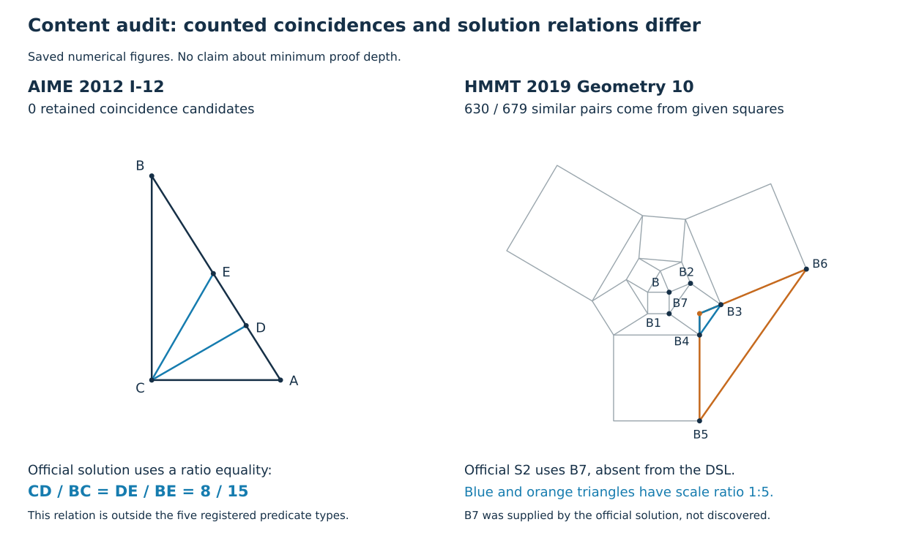

Aの核になりうるか：不可

Q22a「図から人間の難しさを読む：隠れた一致の深さ」。2026-10-23、小検証・内容監査後の判定。

**結論。** 正解図から共線・共円・等長・相似・接触を列挙し、その数と作図上の出現深さを加えても、既存の構造量を超える人間難度の説明は得られなかった。固定した年度外し評価では、予測二乗誤差がAIMEで6.40%、HMMTで6.38%増えた。誤差差の区間は0を含むため、「有意に悪い」とは言わない。事前に置いた「両大会で10%以上改善」という予測は外れた。

列挙自体はできた。しかし、その大部分が解答の難所だという証拠は無い。内容監査では、与えられた正方形から明らかな相似が大量に残る一方、公式解答の比の等式や、入力に無い補助点を使う関係を取りこぼした。GeoGebraには近接する自動列挙の先行研究もある。現状の成果は、**この代理指標の不成立と、取りこぼし・過剰計数を具体化した探索結果**である。人間の難所をsolverが指摘できたとは主張しない。

一方、今回の結果だけで「公式解答に必要な推論の深さは人間難度に関係しない」とは言えない。その深さは測っていない。「作図の深さ」「数値図で成立する関係」「証明に必要な依存鎖」の三つを同じものとして扱えないことが、主要な限界である。

**何を固定し、何を測ったか。** 数値列挙前に[事前登録](preregistration.md)、131問の[対象・年度分割](manifest.json)、コード・入力・srcの[SHA-256](registration-lock.json)を保存した。登録時刻は2026-10-23 13:44:32 UTC。外部登録ではなく、既に他の分析でも使われた開発集合でのローカルな固定である。未知問題による確認研究とは呼ばない。

human非欠測131問（AIME52、HMMT79）中、保存hitを使える99問と、変数0で作図を直接評価できる22問、計121問（AIME49、HMMT72）を測定した。保存hitをk順に最大3個使い、現版の元等式残差、guard、hard条件を再検査した。保存hitの無い10問は除外し、新しく解き直して埋めなかった。除外はAIME 2015-I-07、2019-II-15、2021-I-13、HMMT 2014-08、2014-10、2017-05、2020-08、2022-10、2023-07、2024-08（HMMTは全て2月幾何）。成功した図を利用できる問題への選択なので、欠測を無作為とはみなせない。変数0の問題のpは未定義のままにした。

「全探索」は**DSLに名前のある平面点・円の有限集合**についてである。全三点組、全四点組、全線分対、全三角形対、全二点直線×名前付き円、全名前付き円対を調べた。相似は合同も含む。匿名の補助点・暗黙の円・任意の比・角度等式は追加しない。点数30超を欠測にする上限も固定した。図の直径で正規化し、重なる点対とほぼ退化した三角形を除き、主閾値1e-7、感度分析1e-8／1e-6を用いた。複数図があれば全てで成立する候補だけを採用した。これは数値確認で、定理の厳密認証ではない。

DSLの明示条件と、所属・中点・同一半径など指定した構文上の帰結を除いた。角の帰結、正方形内の三角形の相似、座標式に埋まった全ての既知関係までは除いていない。従って以下の「候補」は**指定した明示関係除去で説明されなかった数値的一致**であり、「問題文に書かれていない定理」の上側代理にすぎない。幾何的に同じ情報の異なる点組も残る。

| 種類 | 数値的一致 | 指定した明示関係を除いた候補 |
|---|---:|---:|
| 共線 | 582 | 245 |
| 共円 | 777 | 709 |
| 等長 | 2,456 | 2,011 |
| 相似・合同 | 9,771 | 9,771 |
| 接触 | 155 | 132 |
| 合計 | 13,741 | 12,868 |

作図深さは別名参照DAGの深さ、一致の出現深さは参加する点・円の深さの最大値とした。これは公式解答の推論段数ではなく、入力の書き方にも依存する。根から全て座標式で記述すれば浅くなり、途中の作図名を導入すれば深くなる。

**固定比較の結果。** 大会ごとに1年を外すLOYO。B_Sは変数数・作図数・点数・円数・等式数・不等式数・角／接触の有無・DSL長の9量。B_Dはさらに最大作図深さを加えた基準。B_HはB_Dに5種類別の候補数のlog1pと最大出現深さを加えた。訓練年度だけでECDF順位化・標準化し、ridge罰則を1に固定した。特徴選択・閾値探索はしていない。統計的評価器による増分比較であって、難度予測アプリや機械学習モデルを研究成果にする提案ではない。

| 大会・共通分母 | B_Dの順位MSE | B_Hの順位MSE | MSE改善率 | Spearman B_D → B_H |
|---|---:|---:|---:|---:|
| AIME 49問・11年度 | 0.057776 | 0.061475 | −6.40% | 0.569 → 0.530 |
| HMMT 72問・14年度 | 0.075442 | 0.080255 | −6.38% | 0.338 → 0.318 |

年度単位の対応再標本化2,000回によるMSE差「B_D−B_H」の95%区間は、AIME [−0.019923, 0.006397]、HMMT [−0.014860, 0.004203]。年度数が少なく、訓練集合も重なるため精密な一般化保証ではない。全131問のB_DはAIMEでMSE 0.055859・ρ=0.591、HMMTで0.073123・ρ=0.402だった。121問の比較と混ぜて改善率を計算していない。

相談5のLOYO 0.80／0.70を生成した元コード・分母・前処理は、指定資料と作業ツリーの検索では特定できなかった。**相談5の再現比較は未確認**である。今回のρは依頼記載値を下回るが、同一条件の対決を実施したとは書かない。原手順を得たら再現する必要がある。現段階では、今回自分で固定した構造基準に対しても追加価値が出ていない。

| 事前予測 | 観測 | 判定 |
|---|---|---|
| P1：人間MSEを両大会10%以上改善 | AIME −6.40%、HMMT −6.38% | 不成立 |
| P2：ρが0.80／0.70を超える | 0.530／0.318。ただし元比較の再現は未確認 | 参考基準にも未達 |
| P3：変数あり問題の25%以上に、解上では成立し作図変数摂動で破れる候補がある | 60/99問＝60.6%、計1,325候補 | 成立 |
| P4：同じ追加特徴の局所探索難度へのMSE改善は両大会5%以下 | AIME −25.22%、HMMT ＋11.75% | 不成立 |
| 品質：閾値を10倍厳しくしても90%以上の問題で種類別個数が同じ | 120/121問＝99.17% | 成立 |

P3の摂動は等式を再び解く操作ではない。変数を1e-3スケールで動かした作図図形を各8個作り、評価できる候補が2回以上破れるかを調べた。「解の条件に依存」と呼ぶが、因果的重要性・定理の非自明性・全解での普遍性は意味しない。中点連結定理のように、どの作図変数でも成立する有用な定理もあるため、摂動で残る候補を全て自明として捨てていない。この副次特徴B_Cの人間MSE改善はAIME −2.94%、HMMT ＋3.68%で、主仮説を救済する結果ではなかった。

P4では保存開始からのD=−log((hit+0.5)/(start+1))を使った。分母は変数あり・図を評価できたAIME40問、HMMT59問。低い相関や一方だけの改善を独立性の証明にしない。**人間難度とpの機構的独立は未検証**である。

厳しい閾値で変わったのはAIME-2014-I-15のみ（候補15→7、等長8→3、相似5→2）。この閾値でもB_Hの改善率はAIME −3.72%、HMMT −6.38%。緩い閾値では主結果と同じだった。都合のよい閾値で結論を選んでいない。

**公式解答との内容監査。** 以下の2例は事前登録に診断例として固定した既知例であり、新規の独立検証ではない。全121問の公式解答への適合率を測ったわけでもない。

AIME-2012-I-12は5点で、4件の共線は全て明示条件として除かれ、5種類の残存候補は0だった。一方、公式解答は角の二等分線定理からCD/BC=DE/BE=8/15を使う。保存座標でも双方0.5333333333333333だった。これは単純な等長でも三角形全体の相似でもなく、今回の語彙では表せない。候補0は「使うべき導出が無い」という意味にならない。[MAA公式冊子の第三者ミラー、問題12・p.5](https://www.isinj.com/mt-aime/2012AIME-ISolutions.pdf)

HMMT-2019-FEB-GEO-10は21点、作図深さ4、変数0。残存720候補中679件が相似だった。そのうち630件＝92.78%は、問題で与えた9個の正方形に属する36個の直角二等辺三角形の総当たりC(36,2)だった。全候補の87.5%に当たる。この部分は紙と鉛筆で計算前に数えられる。公式解答のS2は、B5B4とB6B3の交点B7を導入して別の合同・相似を使うが、B7は入力に無い。解答から教えられたB7を事後的に加えると相似比1:5を数値確認できた。これは自動発見の成功例ではない。また、この一解答を使っただけで、B7が全解法で必須とは主張しない。[HMMT公式解答、問題10・S1/S2](https://hmmt-archive.s3.amazonaws.com/tournaments/2019/feb/geo/solutions.pdf)

この例は元から作図のみで、p=1の例にはしていない。既存の[補足資料](../../../draft/supplement-v10.md)ではHMMTの人間難度79問中8番目に難しい問題とされるが、今回の列挙は「何を見抜けばよいか」を720候補から特定していない。

**比較すべき先行研究。** GeoGebra DiscoveryのDiscoverは共線・共円・等長などの数値列挙と記号的確認、作図から明らかな関係への対処を既に扱う。普通のGeoGebraのRelationも指定した対象の関係を調べられる。従って「人がGeoGebraで一組ずつ探すより全探索できる」という差は不十分である。[Kovács–Yu 2022](https://arxiv.org/html/2202.04627v1)、[Relation公式説明](https://geogebra.github.io/docs/manual/en/commands/Relation/)

AlphaGeometryのDD+ARが持つのは、成立する命題に加えて、それがどの前提・推論から出たかの依存DAGである。本件の数値集合には依存辺が無い。一般に、数値図で同時に成立することから導出順序は読めない。これを「演繹閉包に近い」と呼ぶ場合でも、真らしい関係の集合という限定が必要になる。[Trinh et al. 2024、Fig.3とMethods](https://www.nature.com/articles/s41586-023-06747-5)

**検討した3候補。** 小検証前には候補1を最も直接検証できる案として選んだ。候補2は固定した副次対照、候補3は本来の仮説に近いが未実装の案である。現状で(a)〜(h)を全て満たす候補は得られなかった。

**候補1：解を得て初めて見える一致の出現深さが、人間の難度を追加説明する。判定：不可。**

(a) 主張：解法を使わずに得た数値図の一致数・種類・作図上の出現深さは、入力規模と既存の作図深さを超えて人間難度を説明するが、局所探索難度には同じ説明力を持たない。

(b) 意外性：solverは証明の段階を辿らずに図を得る。それでも、人間が後から必要とする深い関係の存在を図だけで拾えるなら意外である。ただし「点が多い」「作図が長いほど難しい」だけなら既知・直感的なので、B_Dに対する上乗せと公式解答との対応の両方を要求した。今回は前者が出なかった。

(c) 土台：Discoverの数値列挙、AlphaGeometryの依存DAG、人間の知覚的まとまりに関するKoedinger–Anderson。図の複雑さ・推論段数と成績の関係自体はHsu–Silverにも先行する。機械の深さが人間の深さをそのまま表すという仮定は置けない。[文献確認記録1・3・5・6](sources.md)

(d) 1.5日の設計：下記の共通日程で、未使用・人間難度付きの24問を確保できた場合だけ対象を固定する。今回と同じ特徴・閾値・評価器を変更せず適用し、相談5の原手順も確保できればその基準を再現する。同時に、難度値と数値候補を隠して公式解答の非入力関係を2名が注釈する。数値候補がその関係を表せる割合と、入力から明らかな候補の割合を測る。MSE両大会10%以上改善に加え、24問中18問以上で公式解答の非入力関係を少なくとも一つ表現できることを必要条件とする。これでも発見順序や因果的な人間難度の説明にはならない。条件を満たす未使用資料・注釈担当を確保できなければ、1.5日での確認は未達とする。

(e) 外れたとき：今回のような、有限語彙の網羅性・明示関係除去・形式化依存の監査が残る。学術的な方法検討にはなるが、Aの中心成果へ格上げしない。

(f) 紙と鉛筆で先に導けるか：作図段数が難度に効きそうだという弱い主張は導ける。今回の問題群全体での追加改善率は自明ではないが、予言は外れた。HMMT例の630件という増加は計算前に組合せとして導ける。不合格。

(g) 代替で得られるか：数値列挙はDiscover、個別確認はRelation、解法なしの図生成はGMB型の数値最適化に先行がある。同一121問・同一予算の完全比較は未実施であり、本solverの優位は示せていない。不合格。

(h) solverが成果の中心か：今回の特徴は出来上がった座標だけから計算し、solverがどう図を得たかを使っていない。多様な入力から図を得た実績は土台だが、人間の難所の特定に固有の寄与は測れておらず、現状ではデータ供給の役割に留まる。不合格。

**候補2：作図由来の一致と、解の条件に依存する一致を分けると、人間の難所が現れる。判定：不可。**

(a) 主張：正解図の一致のうち、作図だけを摂動すると破れる関係に限れば、与えられた図形の自明な関係が薄まり、人間が使うべき関係が集中する。

(b) 意外性：数値探索は推論をしていないのに、前提を同時に満たしたことで現れる構造を切り分けられるなら意味がある。しかし「条件を外せばその帰結が破れる」は自明である。意外性になるのは、その区分が公式解答で使う関係を具体的に選別する場合だけで、今回そこは示していない。

(c) 土台：Discoverが作図から直接分かる帰結を扱う点と、AlphaGeometryが前提依存を遡る点。本件は等式を課さない近傍摂動で代用するが、推論依存の同定ではない。[文献1・3](sources.md)

(d) 1.5日の設計：共通対象の変数あり問題からID順に12問を固定し、依存候補と持続候補を各問最大5件ずつ、深さ降順・同順位は名前順で選ぶ。区分を隠して公式解答に使われる関係かを注釈し、依存群の適合率が持続群より20ポイント以上高いと予言する。標本不足・同じ定理の重複はそのまま報告し、候補を足して救済しない。中点連結・正方形など、持続しても有用／持続して自明の両対照を入れる。この注釈は既存解答との対応であり、人間の思考実験とは呼ばない。新しい解探索は共通24問の上限に含める。

(e) 外れたとき：摂動依存と幾何的非自明性が異なることを例と分母付きで残せる。連続的条件数・探索の壁の研究へ言い換えて救済しない。

(f) 紙と鉛筆で先に導けるか：与条件を外すとその帰結が壊れることも、一般的な作図定理が残ることも、簡単な例で予想できる。P3成立だけでは新知見にならない。不合格。

(g) 代替で得られるか：普通の作図評価と乱数摂動で同じ区分を得られる。GeoGebraのドラッグと数値確認も近い役割を果たす。本件の8摂動を上回る一般性の保証も無い。不合格。

(h) solverが成果の中心か：副次比較B_CはAIMEで悪化し、HMMTでも3.68%改善に留まった。区分の有用性も固有性も示せず、solverが例を用意した段階を超えていない。不合格。

**候補3：一致の総量ではなく、目標に必要な関係の依存鎖を図から見つける。判定：保留仮説だが、今回のA候補としては不可。**

(a) 主張：解法なしで得た図の候補から、目標までの証明に使う少数の関係と必要な補助点を特定できれば、その依存深さが人間の難所を表し、solverのpとは別の構造を明らかにできる。

(b) 意外性：「深い証明は難しい」自体ではない。証明探索や公式解答を見ずに数値図からその関係を先に選び、多様な問題で当てることが意外性の候補になる。ただし現在は関係の必要性を選ぶ方法が無く、B7も公式解答から与えた。成功した主張として扱えない。

(c) 土台：AlphaGeometryのDD+ARとtraceback、Koedinger–Andersonの知覚的まとまり、Hsu–Silverの段数操作。前者の依存DAGには本件に無い情報があり、後二者は機械の一規則と人間の一段階を同一視しない理由になる。[文献3・5・6](sources.md)

(d) 1.5日の設計：まず公式解答の注釈24問について、各非入力関係を「現在の名前付き対象・語彙で表せる／新しい点・円が必要／比・角・面積など別語彙が必要」に分ける。次にID順の8問だけで、既存のDD+ARが表現できる範囲と、固定した規則・補助点集合内の証明DAGを照合する。導出不能を深さ無限や容易に置き換えず欠測として残す。数値候補からの選択規則を**解答を見る前に**定められないなら、その時点で未実装と判定する。定められた場合だけ、上位5候補の少なくとも一つが注釈された関係に一致する率を測り、24問中18問以上、同じ候補予算のGeoGebra列挙基準より5問以上多いことを最低予言にする。最短証明全体の保証や新規人間実験は1.5日で出来るとは見込まない。

(e) 外れたとき：有限の完成図から必要な語彙・補助点が欠ける割合を残せる。これは適用範囲の記述であり、証明書や事前診断を新しい核として復活させるものではない。

(f) 紙と鉛筆で先に導けるか：与条件と目標を読めば、熟達者が先に補助線を提案できる場合がある。「数値図だけからは必要性が分からない」という限界も原理的には予想できる。人間が事前に選べない関係をsolverが選べた実績が要る。未達。

(g) 代替で得られるか：証明DAGをDD+ARで作ってから関係を選ぶなら、その成果の中心は記号的推論器になる。GeoGebraでの補助点作図・人間の解答注釈も強い代替。数値solverならではの選択能力は未確認。

(h) solverが成果の中心か：現状は公式解答を読んで補助点を加え、solverの図で確認している。その順序ではユーザーの基準に反する。解法を与えず同じ仕組みで関係・補助点を選べる方法が具体化するまで、核にはできない。既存Q20e／Q22bの「同じ前提で目標だけ替える」実験は繰り返さなかった。

**1.5日の実施順と停止条件。** これは未実施の追試設計で、大きな計算は開始していない。0–3時間で相談5原手順の所在と、過去の解析に含めていない24問（AIME/HMMT各12、人間難度・一次資料あり）の適格性を確認し、ID・分割・語彙・全予言を固定する。条件を満たす24問を確保できなければ、既知問へ差し替えて「外部検証」とは呼ばず停止する。3–11時間を、難度・候補を隠した入力と公式解答の注釈、独立確認に割く。次の2時間程度を図の生成・再評価に充てる。上限は24問×64開始×5秒＝約2.13コア時、同時2プロセス・各数値ライブラリ1スレッド。既存保存図が使えれば新規探索は減らす。残りで候補対応の不一致を裁定し、固定評価・代替比較・報告を行う。読解・注釈・基準再現が終わらなければ未達を記録し、計算数で補わない。

この日程の主な制約は計算量ではなく、**解答に必要な関係の定義と盲検注釈**である。1.5日で人間の発見時間の因果効果まで示せる設計にはしていない。元のLOYO手順・独立資料・solver自身による関係選択のいずれも未確保のまま、予測相関の上昇だけでA判定に変えない。

**検算と成果物。** [実験コード](experiment.py)による図の再評価・列挙・摂動は約13.96秒（LOYO集計や文献調査等を除く）、新規局所探索0回。35桁で座標を再評価した後、列挙は倍精度で行った。[事後監査コード](audit.py)は主コードや特徴を変更せず、予測CSVからMSEとρを再計算し、数値候補の個数を再集計した。HMMT例の1,330三角形の全対比較は679相似の集合と完全一致。共円777件は別の外心計算でも確認し、半径の相対ばらつき最大3.76e-9。登録した382ファイルのハッシュ差分は0だった。数値検算の通過は「隠れた定理」の意味的正しさや候補の解答関連性を保証しない。

対象別・候補別の根拠は[features.csv](features.csv)、[figures/](figures/)、評価は[summary.json](summary.json)と[LOYO予測](loyo-predictions.csv)、内容監査は[audit-results.json](audit-results.json)、先行研究と未確認事項は[sources.md](sources.md)、再実行方法は[README.md](README.md)に保存した。srcと他担当の既存ファイルは変更していない。
