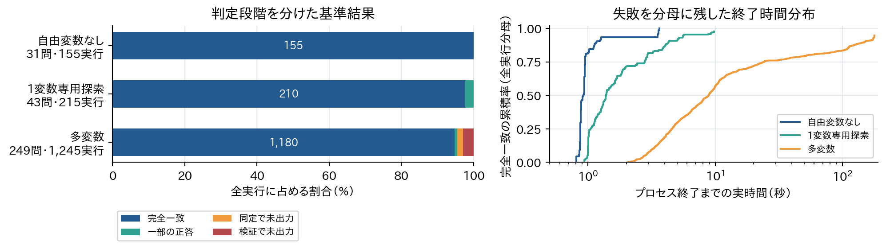
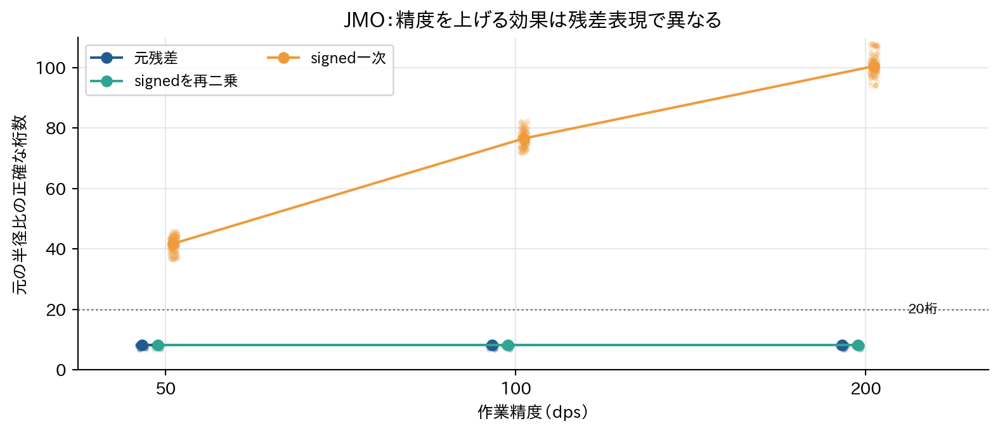
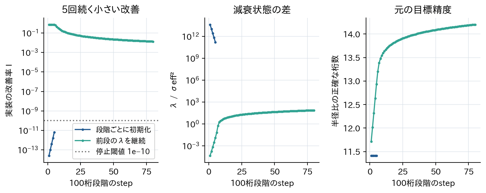
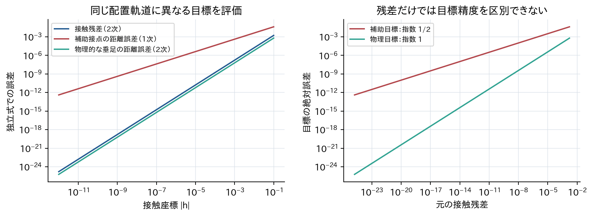
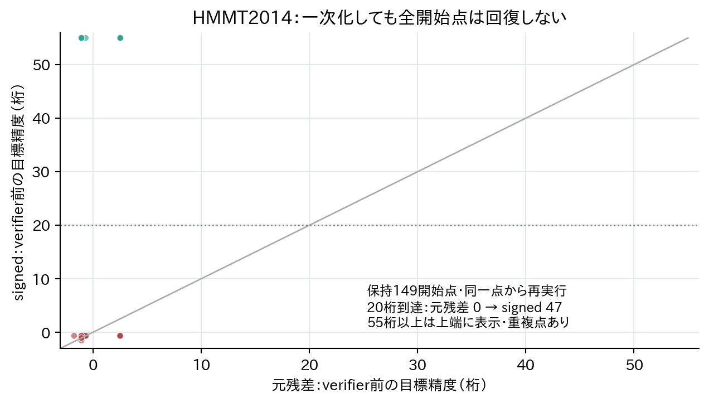
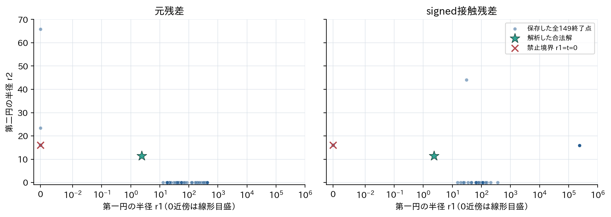
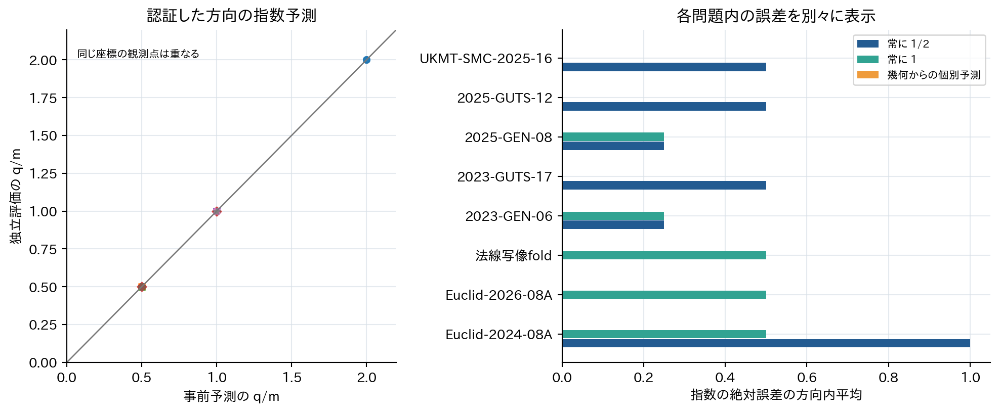
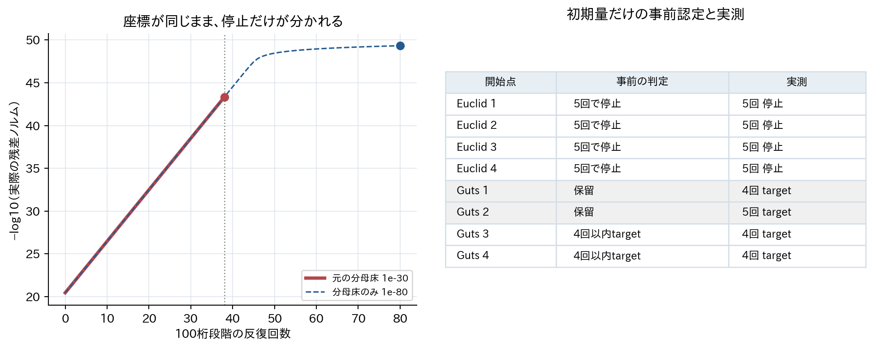

# GeoSolverの構成・残差・目標精度を結ぶ機構分析

対象：research実装 `e703e2d99484793f162f961bc50126ae65e4069f`  
実験環境：Linux、180秒／問題、1物理コア／実行、数値ライブラリ1 thread、8並列  
版：最終版 v1  
作成日：2026年9月11日


## 要旨

GeoSolverの成否を、数値配置の発見、目標値の精度、元条件の検証、値の同定、全値集合の回収に分けて調べた。固定実装の323問を共通seed 0〜4で測定し、完全一致は1,545/1,615実行、正しい値を一つ以上出力したのは1,559/1,615実行だった。自由変数なし31問と専用の1変数探索を持つ43問を除いた、多変数249問の完全一致は1,180/1,245実行である。詳細集合は旧実験から選んだ40問に新しい不安定例と対照を加えた47問とした。

中心的な説明は、構成によって接触条件が二次残差になり、その同じ構成が目標量の解から離れた点での誤差をどう変えるか、という関係である。円上かつ直線上に構成した点があると、接線残差は符号付き接触座標hについて厳密に `R−d=h²/(R+d)` となる。目標の縮約した誤差がhのq次なら、局所的な目標誤差の上界は残差のq/2乗である。q=1とq=2を、同じ残差・同じ座標軌道で区別する必要がある。

自然問題JMO-2013-PRE-05の保持候補107点では、同じ開始座標・80反復で作業精度を50桁から200桁へ上げても、元残差の目標精度中央値は約8.15桁だった。符号付き接触残差へ変更すると約41.75、76.50、100.40桁となり、再び二乗すると元の停滞が戻った。安定評価、尺度、恒等式の除去、探索器、値同定の変更を別に調べ、単純な「高精度不足」や「平方根の相殺」へ帰属しないようにした。

停止機構については、段階ごとの減衰再初期化と、改善率の分母床を区別した。正確な微分と受理full stepを仮定する初期量の十分条件を導き、将来の反復を計算せずに次段階の停止を条件付きで予測した。人手で構造を解析した自然2問・8開始のうち6開始に予測を与え、実装の停止イベントは6件全てが一致、2件は保留した。有限精度実装全体の数学的認証ではない。通常の一様初期化からpilotを作り、根を中心とする開始点は使っていない。一方、根の位置を使う局所LM漸化式156条件は、停止イベントの一致と反復数の事前許容差1以内という、実装と独立式の照合として分けた。問題固有の手解析に依存しない有用な未知予測、既存理論に対する広い追加価値という中心要求は未達である。


局所誤差評価、特異根の一次化、目標感度、適応精度の必要性は先行理論に属する。本研究の追加対象は、それらを具体的な幾何入力の構成・枝・目標式から導き、固定実装の停止イベントと介入効果まで対応付ける点にある。元の未知自然60問への自動接触検出は0/60であり、広い自然問題群を自動診断する理論としての被覆率は得られていない。この限界を、機構で選定した追加自然問題や生成例の成績で置き換えない。

## 1. 研究の問いと現行solverの強み

### 1.1 何を成功と呼ぶか

本研究の問いは、GeoSolverのどの仕組みが、どの幾何構造に対して成功を支え、同じ仕組みがどの条件で失敗を生むかである。実装改善の提案数や実験件数ではなく、自然問題の現象、競合仮説、同じ途中状態からの介入、数学的導出、未使用問題への事前予測、反証の連鎖を評価する。

一つの成功率へ集約すると、異なる現象を見失う。例えば、参照値の一部を正しく返すsolverと、数値配置は得るが厳密値を出力しないsolverは、後段のどの処理を調べるべきかが異なる。本報告では次を区別する。

| 判定 | 本報告での意味 |
|---|---|
| 数値配置 | 元条件の数値検査を通過した配置。全問集計ではsolver診断、主要例では独立な式でも検査 |
| 一値の正答 | 少なくとも一つの出力が独立参照に含まれる |
| 参照集合との完全一致 | 出力集合と採点用参照集合が一致。参照が全解と証明されない場合は全解証明を意味しない |
| 参照外の出力 | 独立検査が必要。直ちに誤答と呼ばない |
| 未出力 | 検証・同定・探索等のどの段階で出力がなくなったかを別に記録 |
| 厳密な保証 | 指定した入力・枝の数学的な証明または認証。数値descriptorの存在と分ける |

固定実装の強みは、構成で満たせる条件を直接計算へ移し、残りを探索し、複数段階の高精度計算と検証・同定へ接続するところにある。ただし、探索不要な問題や専用探索の成功も含む全体成績から、多変数汎用探索だけの強さを推定することはできない。

### 1.2 実装と実験の固定

対象ソースのSHA-256は `6d59d43c8bcbe882e0cf35457e1671ed7ef94a421b6c67c8c98268308f2fe758` であり、experimentに保存された9月7日最終snapshotと一致する。再利用した過去の最終版969実行とsolver-a1の969実行は、生データのarchive memberをmanifestと照合した。旧記録と固定tagは上書きしていない。

通常の性能実験は180秒、1実行につき独立した物理コア、数値ライブラリthread数1、8並列で行った。旧実験の16並列で得られた壁時計時間を、新しい8並列の速度比較へ直接流用しない。詳細な計測を付けた実行と通常実行も別である。介入の主効果は同じ開始座標・同じ反復上限で比較し、評価回数、計算精度、実時間を併記する。

研究用コードはresearch側の `benchmarks/solver_analysis/` に置き、製品コードは変更していない。介入は別プロセスで評価器・残差・精密化設定を差し替える。一般用途の制御方法としての製品実装は本研究の範囲外である。

### 1.3 パイプラインの実際の経路

| 段階 | 入力・出力 | 今回の主な計測 |
| --- | --- | --- |
| 問題表現 | 構成・残差・目標・guard・bounds | 評価不能点を条件違反と分ける |
| 初期点・探索 | probeから多点探索、必要ならfallback | 外部seedと内部seed、開始点、実評価費用 |
| 候補保持 | 台帳、重複除去、順序と保持枠 | 保持群に条件付けた再実行と全探索比較を分離 |
| 精密化 | 50/100/120桁LM、closure、rank経路 | 各段階80反復、減衰と停止イベントを保存 |
| 元条件検証 | guard、枝、非退化性、残差 | 修正前の検査と座標修正を伴う検証を別記 |
| 値同定・出力 | 整数関係、候補不確かさ、descriptor | 出力したrevisionだけを結果に対応付ける |

詳細なソース対応は [実装対応表](../implementation-map.md) に示す。

自由変数なしの入力は直接評価へ進み、通常DiscoMADS経路の1変数問題には専用の枝走査がある。最初の探索・精密化・同定でaccepted候補がない場合、残り時間に応じてhybrid fallbackが動く。primary内部seedは外部seed一つ、fallbackは外部seedから連番5個であり、隣接外部seedの内部列は重なる。rescueや離散条件の補完も条件付きで起動する。

探索時間が未指定なら、その時点の残り時間の55%を探索へ割り当てる。精密化後の最終処理には残り時間の20%、最大30秒を予約する。これは各段階が必ず同じ比率の時間を使うという意味ではない。guardを満たす候補の台帳は全評価点の完全な履歴でもない。

通常LMの作業精度は50/100/120 dps、各段階80反復、残差目標は1e−20/1e−50/1e−80である。closureと最終検証はさらに高い精度を使う。最終verifierは座標を修正するため、「検証を通った点」と「検証へ入力した点」を同一視しない。候補のrevisionとその座標を保存し、改善後の座標を過去の時刻へ結び付けない。

## 2. 実験履歴から見つかった現象

### 2.1 過去の採否を仮説の入口にする

過去の変更には、採用された高速化だけでなく、不採用・無効果・悪化した条件が含まれる。seal 4,512件、個別provenance 8件に不一致はなかった。ただしファイルが一致することは、旧報告の原因説明が正しいことの証明ではない。

| 変更 | 履歴の判断 | 今回の調査との関係 |
| --- | --- | --- |
| F02・F26 | 構成依存と差分疎性の再利用 | 実時間内の評価量が変わる。反復の数学的改善とは別 |
| F05〜F07・F12 | 1変数の重複除去・枝走査 | 一値の成功と全値回収を分ける |
| F08 | 極端な値だけ安全なノルム評価へ | 探索器の目的関数と演算順の両方が変わり得る |
| F14・F17 | 品質重み付き候補選択は不採用 | 無効果・悪化を残し、未知候補順位の万能則としない |
| F20 | 早期の高精度安定判定を撤回 | 250桁通過でも500桁で境界棄却。偽の安定性 |
| F23 | 最終化の3秒予約を撤回 | 段階予算の変更が最終回収へ作用 |
| F25〜F29 | 限定されたキャッシュ・型検査の削減 | 同じ点・同じ精度等の成立条件を保つ |
| F32・F33 | 数値backend変更を不採用 | 局所速度より互換性と小さい幾何量の保持を優先 |

照合済みの旧3 seedでは、solver-a1の完全一致が929/969、現行と同じsnapshotが930/969だった。同じ問題・seedで不一致から一致へ変わったのは2対、一致から不一致へ変わったのは1対である。改善はAIME-2018-II-14とJMO-2025-PRE-05、悪化はAIME-2016-I-15で、それぞれ1 seedだった。これは複数の変更を含む履歴上の差であり、個々の変更の因果効果とはみなさない。新しい5 seed実験と旧実験の時間を混ぜず、成功率のわずかな総差だけを高速化の証拠にしない。

F08のように、残差ノルムの計算順を変えるだけで探索列が変わる場合がある。ノルムと二乗ノルムは同じ零点を持っても、モデルを構築する探索器にとって同じ目的関数ではない。従って変化を丸め誤差だけで説明しない。またキャッシュによる高速化は一定時間内の探索量を増やすので、数学的に同じ一反復が改善されたこととは区別する。

旧世代のGeoTarget、Juliaの生成族、EXP-SINGULARの特異根・多重根・自由度の例は、現行DSL・実装の結果と区別した。過去の生成資産では1,518ファイル、626の入力ID・構文指紋組、317の族名・問題ID組を点検した。新しい入力に完全一致や係数を捨てた構文一致がないことを確認したが、幾何的同型を完全に判定したわけではない。fold、二重根、近接根、真の自由度という原理自体は既に開発資料に存在した。

### 2.2 成功・失敗機構を絞った三つの自然現象

**JMO-2013-PRE-05。** 高精度候補が得られ、元条件の検証を通ることがあるのに値が出力されない。記録上500桁で計算した座標でも、独立式での目標誤差は約10^−25にとどまる。作業精度と正確な桁数の差が直接観測できる。一方、同じ候補から同定の提案列だけを変えると正答が得られるため、精密化と値同定の二つを切り分ける必要がある。

**HMMT-2014-FEB-GEO-10。** 合法な接触配置の近傍で停滞する候補と、半径が0へ向かう禁止境界へ進む候補が同時にある。最小残差の候補が最も正しい目標値を持つとは限らない。接触条件を一次化しても全開始点が合法な枝へ進むわけではなく、局所条件の改善と大域的到達性を区別できる。

**AIME-2003-I-7。** solverは二つの正しい値を返すが、遠方の第三値を回収しない。x=0に近い禁止境界候補は実在するものの、未回収の主原因をその候補の存在へ帰属する根拠はない。一値の出力後に追加列挙を省略する実装経路を調べるべき例であり、境界の新しい数学理論として扱わない。

HMMT-2013-FEB-GEO-04は既存DSLに退化配置を除く条件がある一方、自然言語の原問題はその除外が明瞭ではなかった。既存ベンチマークは固定して残し、この入力の成績を原問題一般の数学的反例として採用しなかった。

### 2.3 GMBの既存比較が測っているもの

GMBの既存資産では、36問の幾何定理について、制約を満たす一配置を得たかを共通の独立checkerで調べている。今回の323問に対する求値・全値回収とは異なる課題であり、この成績を現行solverの値同定能力へ読み替えない。旧solver-a1の結果であることも区別する。

| 既存36問・各3 seed | GeoSolver solver-a1 | GMB |
| --- | --- | --- |
| 共通checkerで有効な一配置（許容値1e−6） | 99/108 | 30/108 |
| 3 seed全てで有効な配置を得た問題 | 33/36 | 8/36 |
| 元GMBの結論評価だけに通過（評価可能出力が分母） | 87/90 | 74/86 |
| 最初の出力が配置検査と結論評価の両方を通過 | 83/108 | 29/108 |

元GMBの結論評価は許容値0.01であり、配置自体の正しさを検査するものではない。そのため、結論だけの通過率を使うと、共通の配置検査とはかなり異なる印象になる。36問の比較では原文と入力の整合、strict条件、境界、無効な交点も別に点検されているが、存在証明・定理証明・全配置の列挙ではない。旧測定はCPUを専有した同時対応実験でもなかったため、普遍的な速度優位を主張しない。GMBも構成と最適化を併用するので、その組合せ自体は今回の追加知見ではない。

## 3. 323問の全体像と詳細分析

### 3.1 全体結果

| 集合 | 問題 | 実行 | 数値配置診断 | 一値の正答 | 完全一致 | 時間中央値（秒） |
| --- | --- | --- | --- | --- | --- | --- |
| 自由変数なし | 31 | 155 | 155 | 155 | 155 | 0.92 |
| 1変数 | 43 | 215 | 215 | 215 | 210 | 1.39 |
| 多変数 | 249 | 1245 | 1209 | 1189 | 1180 | 8.80 |



参照外の出力はこの基準実験では0件だった。未出力56実行の段階診断は最終検証36、値同定20である。これは最後に止まった段階の分類であり、その段階の実装が単独原因だという因果帰属ではない。数値的に元条件を満たしたという全問の集計はsolver診断に基づく。独立の幾何的保証は主要例の別解析に限る。

一値を得た1,559実行のうち14実行は参照集合と完全一致しない。特に1変数問題はすべて一値以上を得ても完全一致が210/215であり、専用探索の一配置発見と全値回収を分ける意味がある。未出力を除いた実行だけの平均時間を、全体の速度として報告しない。

### 3.2 詳細集合の選定と依存

旧3 seedで完全一致が分かれた12問、すべて不一致だった7問に、構造が近い成功対照21問を加えた40問から開始した。対照は変数数、等式・guard・構成数、演算子集合の距離で選び、近い候補の中で速いものと遅いものを交互に選んだ。

新しい5 seedの全体測定で4問の不安定例が見つかった。このうちJMO-2015-PRE-02は既に成功対照に含まれていたため、新規3問と対応する対照4問を追加し、詳細集合は47問となった。これは結果に基づく発見用集合であり、無作為に選んだ自然問題母集団の頻度を表さない。

47問×30 seedの1,410実行と、seed 0・1を反復した94実行を解析した。30回すべて完全一致した問題は21問、成否が分かれた問題は19問、全て不一致は7問だった。同じseedの反復で完全一致の判定が変わったのは0/94対、出力集合が一致したのは94対だった。

内部seedの重なりがある外部seed対は1,521、保存された候補点が少なくとも一つ一致する対は2,040だった。出力revisionとの照合不一致は0件。問題別の成功率を再標本化した記述的95%区間は57.4〜79.8%である。これは結果に基づいて選んだ詳細集合内の不確かさで、自然問題母集団の信頼区間ではない。

同じ外部seedでも時間予算で後続探索が変わり、隣接seedの内部列は重なる。保存されない点もあるため、実点の重複数は下界である。seed数を問題数へ加算せず、問題単位で集計した。

## 4. 主要機構：構成による接触残差と目標精度

### 4.1 競合仮説と介入

同じ配置で残差が小さいのに目標精度が進まない原因として、少なくとも、評価の相殺、残差尺度、二次消失、恒等式の差分ノイズ、探索開始点、減衰と停止条件、値同定の提案打切りが競合する。各条件を個別に変え、二次消失を除いたときだけ改善するか、逆に再二乗で停滞が戻るかを調べた。

| 介入 | 保つもの | 切り分ける原因 |
|---|---|---|
| 元残差→安定な二乗恒等式 | 零点、接触次数、元条件による検証 | 差の相殺 |
| 接触二乗→符号付き接触座標h | 指定した非退化な枝の零点、開始配置 | 残差の二次消失 |
| h→h² | 同じ零点、同じ開始点 | 一次化の逆介入 |
| 尺度7倍・式の並べ替え・冗長式追加 | 元条件と目標 | 尺度、実装経路、数値的rank |
| λfloorと段階間のλ継続 | 開始候補、元残差 | 減衰下限と精度遷移の状態リセット |
| 同じ保存座標に複数目標を評価 | 数値軌道全体 | 目標の解から離れた点での感度 |
| 同じ高精度候補で値提案のみ変更 | 座標、元条件検証 | 同定の提案打切り |

介入なしの再実行、計測有無、500桁を超える座標の保存・読込、枝情報、候補revisionの対応をharnessで点検した。初期版で平滑化経路を混同した実験や、高精度モードへfloatを混入した準備エラーは削除せず、修正後の版と区別した。無介入再現が成立する対象段階の範囲を超えて、全optimizer内部状態を復元したとは主張しない。

### 4.2 接触条件の二次消失は構成から導かれる

半径R>0の円上の点Tを構成し、Tを通る直線lとの接触を条件とする。円中心OからTへのベクトルの接線成分をh、法線成分の絶対値をdとすると、直交分解より

\[
R^2=h^2+d^2,\qquad R-d=\frac{h^2}{R+d}.
\]

非退化でR+dに正の上下界がある近傍では、公開の距離差はhの二次である。製品の精密化はtop-levelの接線残差を `d²−R²` に平滑化するが、この式は `−h²` なので二次消失は残る。絶対値を外すこと、安定評価すること、符号付きhへ一次化することは別の介入である。

他の正則条件を消去し、横方向をw、真の自由方向をzとする。接触座標hのwに関するJacobianが正則で、分母・枝・guardに余裕があれば、局所的に `||F|| ≍ ||w||²` が得られる。記号≍は、その近傍で正の定数によって上下から挟めることを表す。境界で定数が発散する場合、この結論を境界まで延長できない。

### 4.3 残差の次数だけでは目標精度は決まらない

縮約した目標の最初の非零項がq次なら、

\[
G(w,z)-G_* = P_q(w,z)+O(\|w\|^{q+1}),\qquad
|G-G_*|\le C\|F\|^{q/2}.
\]

これは原則として上界である。P_qが球面上で0になる方向を持てば、全方向の下界は得られない。q=1の線形形式は二次元以上では核を持ち、q=2でも半正定値・不定値の二次形式には相殺方向がある。方向別の次数を実験で調べた際、証明のない方向を事後に都合よく採点対象へ入れない。

またqは元の幾何問題だけの不変量ではない。同じ解上の値を返しても、補助接点を使う式と、円や直線から垂足を作る式は、解から離れた配置で異なる値を返し得る。実際の構成座標と実際の目標式の組を評価する必要がある。

他条件f(x)=0を消去するときは曲率項も必要である。x(t)=x*+tv+t²a/2+…がその条件上にあるには `Df a=−D²f[v,v]` が必要で、目標の二次項は `D²G[v,v]+DG a` となる。接空間上のHessianだけでqを決めると、他条件の曲率を落とす。

### 4.4 JMO：真の自由度と目標一定性、横方向の一次誤差

X=(0,0)、R=(9,0)、S=2(cosθ,sinθ)、P=(p,0)、Q=q(cosθ,sinθ)とし、0<θ<π、p,q>0を考える。入力の二つの接触座標は符号を除き

\[
h_1=q/p-p/2,\qquad h_2=9p/(2q)-q/2.
\]

正の零点はp³=36、q³=162であり、hの(p,q)に関するJacobianの行列式は3/4である。横方向は正則で、θには真の自由度が残る。目標の半径比は解集合上で `(2/9)^(1/3)` と一定だが、半径そのものはθで変わる。配置が一意でないことを、そのまま求値の不定性とみなしてはいけない。

半径比は横方向に非零の一次項を持つため、一般方向では目標誤差が残差の平方根程度までしか減らない。一方、θ→0で半径が発散すると公開残差にはsinθの係数が現れる。p=3、q=5を固定してθ→0とすれば残差→0だが半径比→5/12となる。これは境界で一様な誤差評価が破れる厳密な反例である。ただし、自然実行の保持高精度候補には内部配置の停滞も多く、この境界反例だけを自然問題の未出力原因とはしない。

| 残差 / dps | 開始数 | 目標精度中央値 | 20桁到達 | LM反復中央値 | 数値時間中央値（秒） |
| --- | --- | --- | --- | --- | --- |
| 元残差 / 50 | 107 | 8.15 | 0 | 80 | 0.305 |
| 元残差 / 100 | 107 | 8.15 | 0 | 80 | 0.327 |
| 元残差 / 200 | 107 | 8.15 | 0 | 80 | 0.351 |
| signed / 50 | 107 | 41.75 | 107 | 8 | 0.030 |
| signed / 100 | 107 | 76.50 | 107 | 11 | 0.042 |
| signed / 200 | 107 | 100.40 | 107 | 13 | 0.052 |
| 再二乗 / 200 | 107 | 8.15 | 0 | 80 | 0.303 |

別に導いた元の距離・接触条件とstrictな定義域を、verifierへ渡す前の座標で検査した。signed腕で元条件の数値検査と目標20桁の両方を満たしたのは、50/100/200桁でそれぞれ107/107、107/107、107/107点だった。これは数値検査であり、各点への区間存在証明ではない。



### 4.5 二次残差と有限LMの停止

スカラー正規形F(e)=c e^m、c>0、m≥1に対する正確なLM full stepは

\[
e^+=e\left(1-\frac{m c^2e^{2m-2}}{m^2c^2e^{2m-2}+\lambda}\right).
\]

固定λがJacobianの二乗より大きい領域では、m≥2の座標誤差は反復数kに対して `Θ(k^(−1/(2m−2)))` のべき速度となる。m=2ではk^−1/2であり、作業精度だけを上げても、同じ反復数の到達精度はほぼ変わらない。これは既知の局所LM解析の具体化であり、製品全体の収束定理ではない。

実装の停止判定はさらに具体的である。r=|F|、残差床δ=1e−30に対して

\[
I=\frac{r-r^+}{\max(r,\delta)}
\]

を使い、I<τ=1e−10が5回続くとstalledとする。成功step後にλを4で割り、精度段階の開始時にはλ0=1e−6へ戻す。このため、低い精度段階で残差を十分小さくしたことが、新しい段階の初期減衰に対しては小さすぎる改善率を生み得る。

z=c^(2/m) r^(2−2/m)/λ、B_m(z)=(1+m(m−1)z)/(1+m²z)、Φ_m(z)=1−B_m(z)^mと置く。λminを下限とし、B*=min(256,λ0/λmin)、η0=min(1,r0/δ)なら、

\[
\eta_0\Phi_m(B_*z_0)<\tau
\]

は最初の5回の受理full stepがすべてsmallとなる十分条件である。さらに `r0 B_m(B*z0)^(5m)>T` なら、残差目標Tへ先に到達しない。5回の判定に使うλの倍率1,4,16,64,256を含むため、初回だけの改善率を使った説明ではない。

多変数では最小特異値だけでは不十分である。残差がどの左特異方向へ載るかにより改善が変わる。保存したJ、F、実step Δに対する線形予測は

\[
I_{\rm lin}=\frac{\|F\|-\|F+J\Delta\|}{\max(\|F\|,\delta)},\qquad
\sigma_{\rm eff}^2=\frac{\|J^TF\|^2}{\|F\|^2}.
\]

床より上でλが全特異値の二乗を上回るとき、I_linは概ねσ_eff²/λである。非線形項、線探索の短縮、boundsとguard、有限差分の誤差を別に検査する。m=1でも極端な尺度やr<1e−40の残差床によって停止し得るため、signed腕の停止をすべて異常とみなさない。

減衰下限3条件×継続の有無×同じ107候補を比較した。**すべての対で100桁段階の開始座標が一致**した。従ってこの段階内の差には、前段で得た座標の違いが混入していない。

| λ下限 | 初期化側の100桁段階 | 継続側の100桁段階 | 100桁終了時の目標精度差の中央値 | 全精密化終了時の差 |
|---|---|---|---|---|
| 1e−12 | 全107点で80反復上限 | 全107点で80反復上限 | ＋0.016桁 | ＋0.016桁 |
| 1e−24 | 全107点で5回停滞 | 全107点で80反復上限 | ＋2.708桁 | ＋2.868桁 |
| 1e−48 | 全107点で5回停滞 | 100点で38回、7点で39回の後に停滞 | ＋11.439桁 | ＋12.943桁 |

全精密化には、100桁以後のpromotion・closureの変化も含む。これを100桁の同じ回数の反復による効果とは呼ばない。1e−12・初期化側の1点では30秒の安全上限に達しており、欠測として除かず表の107対に残した。下限を小さくするだけでは新段階の初期λが変わらず、継続だけでも元の下限が支配すれば大きな改善がない、という二要因の関係が得られた。



同じstalledという名前でも、停止の数値的な理由は異なる。下限1e−24・1e−48の初期化側では、残差床は最後の5回に作用せず、真の相対改善自体が小さかった。一方、下限1e−48の継続側107点すべてでは、最後の5回も真の相対改善は1e−10以上だったが、r<1e−30の床が掛かることで実装の改善率だけが閾値を下回った。最後の真の相対改善の中央値は約0.750であり、残差が約4分の1ずつ減っていても停止する。前者の減衰状態と後者の絶対尺度による停止を区別する必要がある。

尺度対照は、台帳順に選んだ16開始点・20反復で、残差を7倍または1/7倍し、λもその二乗倍する条件と固定する条件を比較した。λも変えた条件では、step相対差の最大値の開始点内中央値が約4.3e−65と7.4e−65で、共変性の代数式と整合した。しかし、この開始集合ではλ/σ_eff²の最大値の中央値が約8.5e−27と極めて小さく、λを固定した対照でも目標精度差の中央値は0桁だった。この対照を、尺度だけで成否が変わったという証拠にはしない。減衰が支配しない領域での無効果を保存した結果である。

集計は [減衰の対応差 v2](../analysis/damping-paired-v2/) と [停止・尺度の数値診断](../analysis/damping-diagnostics-v2/) にある。初期集計はLM呼出し時の周囲の精度180桁を段階精度と取り違え、100桁の反復数を0と数えていた。stage boundaryの精度へ訂正した版を採用し、v1と訂正記録を残した。座標・目標誤差・optimizer実行は変更していない。

停止式を原因として直接確認するため、保持台帳の点0について追加の一対を凍結した。同じ100桁開始点と継続λ、λ下限1e−48、80反復上限で、改善率の分母δだけを1e−30から1e−80へ変えた。元は38回でstalled、変更側は80回上限となった。**38回目まで両者の座標は保存値として完全一致**した。精密化の更新そのものが異なる前に、分母床が停止を作ったことを切り分ける対照である。研究用プロセス内で一つのAST定数だけを変更し、製品ソースは変えていない。[分母床の対応実験](../development/denominator-pair-v1/summary.json)

また、初期量の十分条件そのものを、将来の反復を計算せずに検証した。m=1、2、4と通常・微小係数から作った15スカラー条件で、有理数の上界とtarget非到達下界を事前保存した。5回停止を認定した7条件、初期target到達を認定した4条件は全てnative stageと一致した。残る4条件は保留であり、実測では3条件が7〜9回でtargetへ、1条件が80回上限へ達した。十分条件の不成立を「停止しない」と解釈していない。微小係数ではm=1でも停止するため、次数だけの説明は成立しない。[初期量だけの認定](../development/initial-stop-certificates-v1/summary.json)


### 4.6 構成写像が目標の次数を変える例



General6では、円の物理的な中心・半径の変化が接触座標hについて二次でも、構成に使った補助接点は一次で動く。同じ軌道に、補助接点への距離と実際の垂足への距離を評価すると、前者の誤差は一次、後者は二次となる。目標式の変更をoptimizerへ渡さず、保存座標へ両方を評価することで、数値軌道の変化を混ぜずに比較した。

固定した三直線上の点から円を作るGuts17では、接触点の接線方向の一次移動が円の中心・半径の一次変化を生まない。接触法線n_iと半径について `n_i·dO+dR=0` となり、この3行が正則ならdO=dR=0である。さらに正の重みα_iによる厳密な恒等式 `R−R*=Σα_i(R−d_i)` があれば、半径目標の誤差は二次接触残差と同じ次数になる。

固定円上の点対から共通接線を構成するEuclid2024-8Aは、その逆向きの構成である。接触時には直線の一次変化が消え、物理面積の誤差に二次方向と四次方向が現れる。四つの角度をd,e,f,gとすると、d,f単独軸の四次係数は81√2/4、e,g単独軸の二次係数は−18√2となる。したがって「二次残差だから目標精度は常に平方根程度」とする対照は、この例では誤る。

これらは独立した三つの一般理論ではなく、構成と目標の組合せが接触次数の意味を変える、同じ原理の異なる実現である。構成DAGの違いと数学的な新規性を混同しない。

### 4.7 境界と到達性：HMMT2014

HMMT-2014-FEB-GEO-10では、strictな正値条件のもとで合法な解は `r1=1507415/640008`、`t=115955/300816`、目標 `r2=1235/108` となる。一方、r1=t=0、r2=√260は禁止境界上にあり、残差だけで高く評価され得る。

合法な接触枝の局所二次因子を除くsigned介入は、元残差の149開始点中0点だった20桁の目標精度を47点へ増やした。一方、102点では同じ到達基準を満たさない。局所の一次化が大域的な枝の選択を保証するわけではない。incidenceの因子除去、相対残差化、恒等式除去、尺度変更を単独で行っても同じ改善は得られなかった。

| 介入 | 目標20桁 / 149 | 独立な元条件＋20桁 / 149 | 数値時間中央値（秒） |
| --- | --- | --- | --- |
| 元残差・通常HP | 0 | 0 | 0.159 |
| 接触のsigned一次化 | 47 | 47 | 0.114 |
| 接触の再二乗 | 0 | 0 | 0.124 |
| incidence因子除去 | 0 | 0 | 0.035 |
| 両式の相対残差 | 0 | 0 | 0.177 |





### 4.8 値同定は独立した原因である

JMOの高精度候補では、正しい三次関係9x³−2の前に、近いが誤った二次関係が提案される。提案内部の許容精度は通るが、元の候補不確かさでの外側検査には通らず、そこで探索が打ち切られる。これは誤った値を公開した事象ではなく、検査で棄却した後に正しい別提案へ進まない事象である。

同じ高精度座標から提案列の継続だけを変える実験を行った。この変更だけで正答が出せる場合、「数学的な停滞により正答の情報が全く得られなかった」とは結論できない。残差多重度による目標精度の損失と、有限な同定手順でその情報を使い切れないことを別々の原因として扱う。以下の二要因比較では、成功指標についての相互作用は0だった。

旧実行から保存した500桁候補の値、不確かさ、検証tierを固定した単独再生では、元の方式が誤った二次提案を外側検査で棄却した後、提案列の継続によって正しい三次関係を得た。座標や幾何条件の再評価は行っていない。この例は、既にある数値情報を提案手順が利用できなかったことを示し、JMOの未出力を接触二乗だけに帰属する説明を否定する。

別に、107保持開始点の元HP／signed HPと、提案継続の有無を交差させた。各HP出力に対する二つの提案腕は、同じ保存済みverifier出力のhashを共有する。

| 高精度化の残差 | 元の提案手順 | 棄却後も提案を継続 | 主な結果 |
|---|---|---|---|
| 元の二乗残差 | 正しく同定0/107 | 正しく同定0/107 | 全点で必要な目標精度が不足 |
| signed残差 | 正しく同定107/107 | 正しく同定107/107 | 全点で正しい三次関係を同定 |

提案継続の成功率差は両残差腕で0なので、差の差としての相互作用も0である。旧500桁候補で生じた提案打切りを、今回の107点すべてへ広げてはいけない。逆に、この比較の元HPで数値精度が足りなかったことも、別の高精度候補で提案停止が原因となる事実を消さない。数値情報を得る段階と、その情報から値を同定する段階の切り分けが成果であり、提案手順の不備を新しい数学的機構に数えない。

対応表と全428腕は [二要因比較](../analysis/development-comparisons-v1/multiplicity-proposal-runs.jsonl)、単独再生の定義と監査は [第2回監査記録](../audits/02-prediction-audit.md) にある。


### 4.9 同じ候補群の選択と標準探索器

候補選択の比較では、107個の保持済み自然候補をすべて残し、元残差、signed残差、正則化した目標補正量、元の台帳順を比較した。保持数Kと総反復予算を固定する。これは現行solverが保持した候補に条件付けた試験であり、未保持の探索点まで含む母集団を代表しない。

同じ表現に対する標準的な多点最小二乗との比較では、範囲、変数尺度、実際の初期点、評価費用を揃え、共通の高精度後段と元条件検証・値同定を接続した。表現を変える場合は、同じ物理的配置から全ての実持上げを保持する比較と、それぞれの自然な初期化による比較を分けた。持上げのない点、無効点の検査、枝数の増加も費用として残す。

候補選択は3つの元台帳内で、4順位×保持数K=1または4×2種類のHP残差を比較した。K=1では1点に80反復、K=4では各点20反復とし、合計上限を80に揃えた。全48条件群、120回の局所再開始を含む。元のHPを使う24群では、座標を修正しない元条件検査と目標20桁を両方満たす群は0だった。signed HPでは24/24群だった。最良目標精度の群内最大値の中央値は、それぞれ7.958桁、78.185桁となった。

この結果は、保持された群の中で順位だけを変えても、元HPの精度不足を解消できなかったことを示す。順位の万能な優位性は支持されない。各候補へ均等に反復を配る実験では、同じ集合内の順序だけを変えても全候補の最終和集合は変わらない。そのため、順序による時間切れや先着出力の因果効果をこの実験で検証したとはしない。保持数と候補ごとの配分の効果までが測定範囲である。

標準探索器の比較では、同じ表現に同じ有効開始点を与え、数値微分も含む実際の幾何評価呼出しを計測した。各前段が選んだ候補へ、共通の元残差によるHP、元条件検証、値同定を接続した。多変数での結果は次の通りである。

| 比較する層 | NOMAD：完全一致 | SciPy：完全一致 | NOMAD：数値配置あり | SciPy：数値配置あり |
|---|---|---|---|---|
| 1変数の12腕 | 12/12 | 12/12 | 12/12 | 12/12 |
| 多変数の19腕 | 8/19 | 4/19 | 13/19 | 9/19 |

これは成績を見て選んだ8開発問題における表現別の腕であり、31問の独立比較ではない。元の専用1変数経路を通常設定で競わせた結果でもない。固定仕事量の実験でNOMAD側に完全一致が多かったことは確認できるが、自然問題全体での優位性や、今回の接触理論による差の説明までは示さない。

凍結計画には誤って0変数1問題の8腕も含まれた。direct NOMADの4腕はSIGSEGVで出力せず、SciPyの4腕は最適化する変数がなかった。これらの試行を保存し、最適化比較が定義できない層として上表の分母から分けた。通常のGeoSolverは0変数専用経路を通るため、この実験用の直接呼出しの障害を製品の失敗には加えていない。

前段とHPを取り違えないため、SciPy直後、HP直後、最終化後を別に評価した。JMOのsigned腕でSciPy直後の目標精度中央値は15.976桁で、20桁到達は0/107だった。その後のsigned HPで107/107点が20桁へ到達した。したがって、20桁の回復をSciPy単体の成果とは呼ばない。中央2問題について、2種類の前段×2種類の前段残差が選んだ計8候補群を元／signed HPへ独立に接続した。元HPでは完全一致0/8群、signed HPでは8/8群となり、この保存候補群では後段の残差変更だけで結果が変わった。どの前段でも十分よい群を選べた範囲での比較であり、探索が難しい全入力にも同じ関係があるとはいえない。

全ての開始候補、未処理点、実評価数、段階時間、停止、Phase Cの判断は [共通開始点の比較](../analysis/development-comparisons-v1/common-runs.jsonl) と [HP交差比較](../analysis/development-comparisons-v1/common-hp-cross.jsonl)、順位と配分は [候補選択の全条件群](../analysis/development-comparisons-v1/selection-groups.jsonl) に対応する。


## 5. 未使用問題への事前予測と実測

### 5.1 三層のデータと情報の分離

既存323問と過去生成例を開発側とし、途中確認用30問、最終確認用30問をCEMC、UKMT、HMMT Novemberから各10問ずつ選んだ。原問題の出典PDF、選定時点、DSL、構造指紋、変更理由を保存した。solver成績を選定基準にせず、入力作成中の図・条件の曖昧さによる差替えは実行前の記録として残した。

原問題が複数値の積や座標組を求める場合には、solverの値集合として扱う目標へ明示的に適応した。その適応と参照値の対応を別表に示す。元60問の初回個別予測については、その凍結後に公式解答の取得を開始した。探索用casesの答え欄は空のまま保存し、独立参照用のcasesは別ディレクトリに置いた。後の有限LM・初期量停止の補足時点では、公式参照や解析的な解が既に存在する。補足で主張する情報分離は、予測コードが参照答・目標評価・測定対象の将来軌道を読み込まないことであり、人間が解を知らなかったことではない。さらに5.5の補足では、開始点を解中心で生成していない。根中心の有限LM照合はこの最後の条件を満たさない。

| 問題 | 原問題からの目標の適応 | 採点用の参照 |
|---|---|---|
| HMMT-NOV-2023-THM-02 | 二つの面積の積414を求める設問から、個々の面積を返す求値へ | 36−21√2、36＋21√2 |
| HMMT-NOV-2022-THM-04 | 整数の塔の高さを列挙。正の水平距離を満たす二つの枝 | 7、15 |
| CEMC-EUCLID-2024-04B | 点の座標組からx座標だけを目標にする | 4/5 |
| CEMC-EUCLID-2024-05A | 長方形の三つの面積2、3、6の配置による第四の面積を列挙 | 1、4、9 |
| CEMC-EUCLID-2024-10A | 点Pの座標組からx座標だけを目標にする | −1/2 |
| CEMC-EUCLID-2023-05B | 組(a,b)=(24,15)を単一目標a+bへ変える | 39 |
| UKMT-SMC-2023-13 | 角の関係を比∠PUT/∠PTUへ変える | 1/2 |
| UKMT-SMC-2023-14 | 二つの距離の和16から、個々の距離を返す求値へ | 6、10 |

これらの出力が参照集合と一致しても、元設問の座標組や全配置を復元したことにはならない。参照の公式出典と値集合は付録Bおよび `unknown-references/assessment-v1/` に保存した。

最初の60問の素のDSLで自動に認証できた接触因子は0件だった。これを不都合な結果として隠さず、自動検出の被覆率0/60として報告する。この結果を見て別の60問へ入れ替えていない。

局所機構を検査するため、自然問題General6、Guts17、Euclid2024-8Aには、解集合との対応を証明した構成表現を別に用意した。これらは規則構築に関与した設計表現であり、未使用構造の最終証拠には数えない。規則固定後に選んだ自然追加4問も、機構に着目して選んだ集合として元60問と分ける。放物線の法線写像は新しいDAGによる生成移転であり、古典的foldそのものを未発見の数学として扱わない。

| 集合 | 役割 | 数え方 |
| --- | --- | --- |
| 元の自然30＋30問 | 途中・最終の大域測定と被覆率 | 各集合CEMC/UKMT/HMMT各10問 |
| General6 / Guts17 / Euclid2024-8Aの構成表現 | 規則構築に関与した自然入力の局所予測 | 新しい独立自然問題へ重複計上しない |
| 観測点オフセットの生成接触族 | 途中確認で目標次数と相殺を検査 | 1幾何族、3目標は同じ軌道 |
| 規則固定後の自然追加4問 | 機構で選んだ正例・負例の移転 | 元60問と別の選定母集団 |
| 放物線法線写像と高さ±.01 | 別DAGのfold・2根・0根対照 | 1生成構造族の3条件 |

### 5.2 何を予測し、何を保留したか

入力だけから認証した予測、費用を固定した初期計算の診断、入力から解析的に得た根の近傍での局所実験、解を得た後の説明を区別した。有限点の小さな勾配だけから根でのqを認証する規則は採用していない。

根を中心にした診断開始点は、独立に導いた根と固定方向から作る。これは次数や介入を検査するための局所実験であり、大域探索へ与える実用的な初期点選択ではない。全pipelineの成功・失敗を予測する分類器も固定理論には含まれない。従って成功率の表に「理論の予測的中率」を付けず、常に成功という対照に勝ったとも主張しない。

比較対象は、目標誤差対残差の指数を常に1/2または常に1とする説明、常に一次化が改善するとする説明、変数・式数、公開残差、通常の正の特異値の条件数、目標補正量、初期進捗である。次数の比較は独立に非零の先頭係数を証明した方向だけを採点し、相殺方向の保留も表示する。

有限な停止イベントまで検査する補足として、未実行のGeneral6と観測点オフセット族、最終用の放物線族について、保存済み開始点から最大80回の解析的LM漸化式を別に計算した。156条件分の漸化式評価は計3.91秒で、解析的に導いた独立な幾何式を使い、Jacobianはmp.diffで350桁の数値微分を行った。この時間に手作業の構造分析、解の導出、開始点の作成は含まない。指定した対象出力ファイルが一つも存在しない時点で全予測を保存し、元の事前予測は変更していない。これは、入力から解位置を導いて作った開始点に条件付く局所の有限計算であり、解を知らない大域探索の代替ではない。

この補足は、最初の5 stepの大きさとsmall判定、停止の種類、停止までの反復数を予測する。full stepが受理されることと定義域の内部に留まることを仮定し、有限差分・丸め・線探索短縮・時間切れを誤差の候補として残す。実測前に相対誤差許容値1e−6、停止回数の許容差1を固定した。仮定が崩れた条件も分母から削除しない。元の60問への自動分類とは異なる追加の予測である。

### 5.3 途中確認と理論の採否

自然30問×3 seedでは、一値以上の正答を90/90実行、参照集合との完全一致を87/90実行で得た。0変数8問と1変数8問は各24/24完全一致、多変数14問では39/42完全一致だった。CEMC-EUCLID-2024-05Aでは三つの参照値1、4、9の一部が欠落した。参照と異なる追加値はなかった。理論は大域的な完全一致について全30問で予測を保留しているため、これを87/90の予測的中とは報告しない。

入力だけの自動因子検出は0/30、固定pilotは0変数8問、因子非検出21問、不明1問だった。記録されたpilot関数内の時間合計は3.678秒で、別プロセスの起動・import時間は含まない。0変数以外では因子非検出でも固定探索とHPを実行するが、接触次数を認証する出力は得られなかった。これは費用を限定した診断の記録であり、30問の数学的構造を完全に解析した費用ではない。

General6では、他条件を厳密に満たす正負2方向の400桁独立評価で、接触のm=2と、補助目標q=1・物理目標q=2を確認した。先頭係数も入力からの式と一致した。4方向・目標観測におけるq/mの平均絶対誤差は約2.0e−13、常に1/2および常に1の対照はともに0.25だった。4観測は一つの自然問題の中の対応比較である。

構成表現の4開始点×4残差腕×3精度の48条件に、同じ物理配置に持ち上げた36条件を加え、計84条件を実行した。欠測や安全時間による打切りはなかった。構成開始点でのsigned介入は、50・100・200桁の全てで両目標が4/4点とも20桁へ達した。元、再二乗、安定gapはいずれも0/4だった。

| 残差介入 | 50桁：補助目標の桁数差中央値 | 50桁：物理目標の桁数差中央値 | 100・200桁での方向 |
|---|---|---|---|
| signed一次化 | ＋30.214 | ＋22.249 | 全8対で両目標改善 |
| 再二乗 | 0 | 0 | 全8対で差0 |
| 安定なgap | −0.774 | −1.549 | 全8対で両目標悪化 |

安定gapは相殺を避けても二次消失を保ち、残差尺度も元の平滑化二乗式と異なる。従って悪化を「相殺を直したことが有害」とは解釈しない。二次消失を残した安定評価だけでは、固定作業量での改善を保証できなかったという結果である。

ここで、他条件を消去した曲線上の次数を、実際の全反復へ延ばす説明が破れた。signed後の物理目標精度は補助目標の約2倍にならず、約8桁低かった。前もって導いた恒等式

\[
G_f^2-30=5\eta-4g+\eta g-g^2,\qquad \eta=XY-6
\]

で保存点を分解すると、元腕では4gが、signed腕では全12点で5ηが支配した。signed腕の比 `|5η/(4g)|` の対数中央値は50・100・200桁で39.8、77.4、99.5だった。局所次数の予測は他条件上で支持されたが、有限反復後には別の残差成分が目標誤差を制限した。この分解は事後説明であり、予測成績に加えていない。

凍結文の「q=2なら物理目標の桁数改善が小さいかもしれない」という記述は、改善量を一意に予測しないため採点不能とした。必要な座標精度と実現する目標桁数の増分は異なる。同じ座標改善量ならq=2の方が大きな桁数改善を生み得るので、観測に合わせて的中へ読み替えなかった。

有限LM補足では、General6の48条件と観測点オフセット族の48条件全てで、停止種類は96/96で事前計算と一致し、反復数も96/96で事前許容差1以内だった。最初の5回の残差normは480/480で事前数値許容値内、small判定も480/480一致した。相対step誤差を採点した474/474回は事前許容値内だった。残る6回は予測stepが凍結した絶対床より小さく、相対誤差を保留した。全96条件で初5回のfull step・定義域内部という仮定を確認した。これは既知の局所開始点からの解析的漸化式と実装の整合であり、96の独立問題や解を知らない大域予測ではない。

第3回監査を受け、保存軌道の停止まで全5964stepを点検した。全て所定の数値許容値によるfull step判定を満たして受理され、宣言した座標域内にあった。small判定は全5964回で一致した。各実際の入力点で独立式を数値微分して求めたstepは、事前の微小step床を超える5940回全てで相対誤差1e−6以内だった。残る24回の微小stepも絶対誤差を保存した。常に80回上限とする対照は72/96、常にstalledとする対照は8/96だった。精度別に事後の最頻イベントを選ぶ楽観的な対照も72/96である。これらとの相違はモデル照合の内容を示すが、解を使わない予測能力の代替にはしない。

全結果は [局所の対応比較](../analysis/prospective-mid-v1/)、[全軌道まで拡張した有限LM照合](../analysis/finite-lm-mid-v3/)、[General6の事後分解](../analysis/general6-decomposition-v1/) に保存した。v1はfull stepだけを数え、v2は初5回の座標域を、v3は全軌道と同一点のstepを追加点検した。予測、実測、初5回の許容値と96条件の判定は変更していない。


途中の新しい生成族では、円O=(0,2)、直線y=0、構成点T=(h,0)を共通にし、観測点P_a=(a,1)への距離を同じ座標軌道で評価した。a=0、1e−6、1/3を固定すると

\[
G_a(h)^2-G_a(0)^2=h^2-2ah
\]

なのでa=0ではq=2、a≠0ではq=1となる。小さい非零aでは有限スケールで二次に見える領域があり、根の次数と有限点の勾配を区別する必要がある。またh=2a≠0では目標値だけが厳密に一致して元残差は正である。目標誤差だけの成功判定を反証する例として残した。

第3回GPT-6 Pro監査では、局所の介入効果と目標次数の説明を限定採用し、解を使わない未知予測と研究中心の完成は保留とした。96条件の停止一致は、解から作った開始点に対する独立モデル照合であり、将来反復を計算しない予測の証拠にはならないとの指摘を採用した。

最終へ進む前に、既存軌道の全stepを点検し、初期量だけの十分条件を15スカラー条件で確認し、改善率床だけの対応介入を行った。これらは第4章と付録Aに示した。元の30問の保留を変更せず、追加の自然2例について、入力範囲の通常の乱数初期化と固定pilotから次段階を予測する補足を別に凍結した。中心成果の採用を先に決めるのではなく、限定した機構の反証試験として最終集合へ進んだ。[監査への対応](../audits/03-adoption-audit-response.md)


### 5.4 固定後の最終確認

最終自然30問×3 seedの90実行では、参照集合との完全一致85、一値以上の正答87、参照外の出力0だった。0変数7問は21/21、1変数6問は18/18、多変数17問は46/51完全一致だった。HMMT-NOV-2022-THM-04は3実行全てで全値回収に失敗し、うち2実行は参照値の一部を出力、1実行は最終検証で未出力だった。HMMT-NOV-2023-GUTS-23は1/3完全一致、残る2実行は最終検証で未出力だった。最後の停止段階と根本原因は区別する。

追加の自然4問では12実行中11実行が完全一致した。Euclid2026-8A、Guts2025-12、UKMT2025-16は各3/3、General2025-8は2/3で、残る1実行は最終検証で未出力だった。時間中央値はそれぞれ63.225、0.953、4.229、17.414秒だった。生成した放物線族のfold、2根条件は各3/3で全参照値を回収した。0根条件では3/3が空出力だったが、solverによる不存在証明ではない。不存在の根拠は独立のSturm列である。0根条件の約75.100秒という中央値も成功例だけの速度比較へ混ぜない。

局所診断と物理配置を揃えた比較は計1,236条件、全て実測があり、解析エラーと安全時間打切りは0だった。次表は根中心の4開始（General2025は鏡映を含む8開始）を各80反復・100桁で比較したものである。目標誤差は元の検証器が座標を修正する前に、保存座標を独立式で評価した値である。作業桁数を超える目標精度は、目標の一次変化の相殺等によって生じ得る。座標全体の同じ桁数の正しさや、製品による精度認証を意味しない。

| 問題・族 | 元残差：物理目標の桁数中央値 | signed：物理目標の桁数中央値 | signedの元条件数値検査＋20桁 |
|---|---|---|---|
| Euclid2024-8A・設計表現 | 16.57 | 155.92 | 4/4 |
| Guts2023-17・設計表現 | 17.29 | 155.12 | 4/4 |
| Euclid2026-8A・追加自然 | 7.79 | 74.18 | 4/4 |
| General2025-8・追加自然 | 18.24 | 77.64 | 8/8 |
| 放物線法線fold・生成移転 | 7.09 | 77.86 | 4/4 |

これらのsigned腕は50・100・200桁の全条件で元条件の数値検査と20桁を満たした。元腕は全条件で20桁へ達しなかった。Euclid2024、Guts2023、Euclid2026、General2025の再二乗は元腕と目標精度が同じで、安定gapも20桁へ達せず、物理目標の精度は全対で悪化した。安定gapは尺度も異なるため、相殺を避けること自体の逆効果とはしない。

放物線族では再二乗が元より約0.923桁改善したが、約8.01桁に留まった。正則条件だけを消去したreducedは約7.39桁、消去と一次化を併用したreduced_signedは100桁作業で約74.09桁だった。従って「再二乗が全ての入力で完全に元の数値軌道を再現する」という一般化はしない。一次化の有無という主効果と、尺度・消去による小さな差を分ける。

負対照Guts2025-12とUKMT2025-16は、接線条件があっても単純根を持つ。元残差のまま50・100・200桁で全4開始が20桁と元条件の数値検査を通過し、100桁での目標精度中央値は81.74、75.52桁だった。「接線述語があるだけで停滞する」という説明の反例となる。

同じ物理配置の全持上げを保持した比較では、各表現・各物理配置の総反復上限を80へ揃え、Euclid2024は16枝、Guts2023は8枝、General2025は16枝に予算を分配した。

| 問題 | 物理配置の数 | 物理座標の元表現：成功配置数 | 構成表現の元残差 | 構成表現のsigned | 数値時間中央値：物理／構成signed（秒） |
|---|---|---|---|---|---|
| Euclid2024-8A | 4 | 4/4 | 0/4 | 4/4 | 0.054 / 0.636 |
| Guts2023-17 | 4 | 4/4 | 0/4 | 4/4 | 0.032 / 0.247 |
| General2025-8 | 8 | 8/8 | 0/8 | 8/8 | 0.035 / 0.699 |

成功は少なくとも一つの持上げが元条件の独立数値検査と20桁を満たすことを意味する。実際にはsigned側の全持上げ64、32、128点が通過した。全持上げを求める前処理時間の合計は順に約0.0072、0.0026、0.0168秒で、表の数値時間と別に保存した。これらは根近傍の対応配置であり、自然な初期化による大域探索の優劣を示さない。構成での枝の増加と評価費用を含めると、次元削減の利益だけから実時間の優位は導けない。

400桁の独立摂動評価では、57方向全てで事前の残差次数mが許容範囲内に入った。非零の先頭係数を証明した57方向・目標観測のqと、別に固定した4相殺対照も全て対応した。複数の目標は同じ方向を共有するため、57方向と57方向・目標観測は同じ分母ではない。目標次数を採点しない方向は12で、Euclid2024の混合3方向、UKMT2025の混合3方向、General2025の正逆鏡映各3方向である。これらも残差次数の57方向には含めたが、非零の目標先頭係数が事前に認証されないためqの成績からは保留した。General2025では2目標があるので、未採点は12方向・18方向×目標観測である。予定した79方向×目標観測のうち、非零次数57、相殺対照4を採点し、18を保留した。係数が認証されない方向を事後に成功へ加えていない。

| 問題・族 | 残差の方向数 | 非零目標次数 | 相殺対照 | 未採点の方向×目標 |
|---|---|---|---|---|
| Euclid2024-8A | 11 | 8 | 0 | 3 |
| Euclid2026-8A | 2 | 2 | 0 | 0 |
| 放物線fold | 2 | 2 | 0 | 0 |
| Guts2023-17 | 9 | 9 | 0 | 0 |
| General2025-8 | 22 | 32 | 0 | 12 |
| Guts2025-12 | 2 | 2 | 0 | 0 |
| UKMT2025-16 | 9 | 2 | 4 | 3 |
| 合計 | 57 | 57 | 4 | 18 |

放物線族の有限LM照合60条件では、停止種類は60/60で事前モデルと一致し、停止までの反復数も60/60で事前許容差1以内だった。全3,076stepが所定の数値許容値によるfull step判定を満たし、宣言した座標域内で、small判定も全て一致した。同じ実測点からの独立式によるstepのうち事前の微小床を超える3,050回は全て相対誤差1e−6以内、残る26回は相対誤差を保留した。常に80回上限の対照は36/60、常にstalledは8/60だった。これは一つの生成族における根中心のモデル照合である。

[最終通常実行の採点](../analysis/unknown-final-global-v1/)、[局所・物理配置対応の全結果](../analysis/prospective-final-v1/)、[最終有限LM照合](../analysis/finite-lm-final-v1/)、[予測スコアカード](../analysis/prediction-final-v1/) に失敗・保留を含む結果を保存した。




追加自然問題の主要な反証対照は、接線述語があっても残差が単純根となるGuts2025-12とUKMT2025-16である。一方、Euclid2026-8Aは素の入力で自動に接触因子を検出できる正例であり、General2025-8は同じ解上目標の補助点・垂足による次数差と、二次形式の相殺を検査する。

放物線P(t)=(t,t²/2)の法線上に `N=(t(1−λ),t²/2+λ)` を構成し、N=(-1,5/2)を条件とすると、正則条件からλ=1+1/tを消去して

\[
\rho(t)=\frac{(t-1)^2(t+2)}{2t},\qquad
G(t)-1=\frac{(t-1)(t+1)}{2}
\]

を得る。guard 1/2<t<3/2、1<λ<3ではm=2、q=1、`(G−1)²/ρ→2/3` を予測できる。高さを+.01動かすと二つの単純根、−.01ならguard内に根がないことをSturm列で独立に確認した。全値集合をsolver同士の一致や発見値の和集合で確定していない。

### 5.5 解を中心に作らない開始点からの停止予測



途中監査後の補足として、既に選定した最終追加自然2問に、通常の初期化からの有限停止予測を試した。Euclid2026-8Aでは正則な長さ比条件を上半円へ縮約し、Guts2025-12では元の一変数表現を用いた。入力のguard範囲からseed固定の一様乱数64点を生成し、残差の良い4点を各256評価上限のfloat最小二乗、50桁・80LM反復・λ下限1e−24のpilotへ渡した。根の近傍への摂動は使っていない。

予測側が読むのはpilotの保存座標と、次段階のλ0=1e−6、λ下限1e−24、δ=1e−30、τ=1e−10、T=1e−70である。目標の評価、参照答、100桁の将来軌道は入力に含めなかった。付録A.11の有理式の上界・下界だけを使い、将来のLM反復を一回も計算していない。

| 自然問題 | 事前認定 | 実測 | 保留 |
|---|---|---|---|
| Euclid2026-8A・縮約表現 | 4開始で5回small停止 | 4開始とも5回でstalled | 0 |
| Guts2025-12・元表現 | 2開始で4回以内にtarget | 2開始とも4回でtarget | 2開始。実測は4回と5回でtarget |

Euclid側の初期残差は約1.075e−26、5回の改善率上界は最大2.478e−17で、閾値1e−10より十分小さかった。target非到達の下界も約1.075e−26であり、T=1e−70を大きく上回った。Guts側で保留した上界は約1.637e−70と1.569e−66で、Tより大きかった。実際にはtargetへ達しても、事後に予測的中へ変更していない。

全8開始のstep受理とguardを確認し、独立式とのJacobian相対差は最大3.5e−48未満、step相対差は最大1.9e−30未満だった。終了座標は、元の交点・距離・接触とstrictな条件を独立式で検査した。Euclid側は接触残差が小さくても目標は約13.74桁に留まった。Guts側は約74.6〜80.7桁だった。この目標精度は事後の検査であり、停止の予測的中数には含めていない。

full stepの判定は凍結したコードの許容値を用いたが、この補足ではJacobian・残差の数値差に独立した事前合否閾値を置いていない。数値差は事後の適合度診断として示し、有限精度まで認証した停止定理とは呼ばない。実行を除外せずにイベントを採点しているので、この不足によって保留や不一致が集計から消えることはない。

認定した6開始は全て一致し、保留は2/8だった。同じ認定集合で常にstalledとすれば4/6、常に4回以内のtargetとすれば2/6である。ただし、4開始ずつは各1問に属する対応観測であり、独立6問への一般化や、母集団の高い予測精度を示す数字ではない。Euclidの4開始は全てstalled、Gutsの4開始は保留分も含め全てtargetへ達したため、停止種類は問題IDだけでも事後に分類できる。今回の対照比較は、問題間の差と問題内の状態に応じた予測能力を切り分ける証拠として十分ではない。

実測したpilot費用は、Euclidでfloat132評価・HP残差964評価・0.392秒、Gutsでfloat113評価・HP残差43評価・0.049秒だった。有理式の予測計算は合計約0.00105秒で、手作業の構造解析、縮約の証明、プロセス起動とimportは含まない。幾何の残差評価はpilot50桁・対象100桁、外側のLM制御演算は250桁で固定した診断条件である。通常180秒の全pipelineと同じ性能測定ではない。

この補足が支持するのは、**人手で入力から認証した構造と、解を中心に作らないpilot状態から、特定の次段階の停止を条件付きで判定できた**という関係である。構造証明には根を明らかにする因子が含まれるため、問題を一切解析せず、答えを知らない自動検出器が一般問題を予測したとは呼べない。Euclid側は新しい縮約表現であり、元の二変数pipelineの成功予測でもない。元60問の自動検出0/60、通常pilotの全保留、一般的な未知成否分類の未達を、この結果で置き換えない。

[事前登録](../unknown-intake/rootfree-stop-v1/protocol.json)、[初期量の予測](../unknown-intake/rootfree-stop-v1/predictions.json)、[実測と保留](../unknown-intake/rootfree-stop-v1/assessment.json)、[費用・独立検査](../unknown-intake/rootfree-stop-v1/independent-checks.json) に対応する。


### 5.6 被覆率と予測の限界

| 評価 | 適用・予測 | 実測と対照 | 解釈 |
|---|---|---|---|
| 元の自然30＋30問：入力だけ | 自動接触因子検出0/60、全体成否は全保留 | 通常実行は途中87/90・最終85/90完全一致 | 被覆率不足。常に成功という対照に勝ったとはいえない |
| 同60問：固定pilot | 認証した根次数・全体成否は全保留 | 途中3.678秒、最終3.100秒。起動・手解析の費用を含まない | 小規模計算でも適用不足を解消しなかった |
| 規則固定後の自然追加4問 | 素の入力で因子検出1/4、標準pilotは全保留 | 正例Euclidも小さい他行を認証できず保留 | 検出と利用可能な予測を区別 |
| 構造証明＋根中心の局所次数 | 最終57方向のm。79方向×目標中、非零次数57、相殺4を採点、18を保留（12方向） | 全て固定許容内。表下の定数予測と比較 | 解析的な解近傍実験。未知の根を発見する分類器ではない |
| 独立式で将来LMを計算 | 途中96＋最終60条件 | 停止イベント156/156一致、反復数156/156で事前許容差1以内 | 既知開始点で同じ計算法を照合した結果 |
| 人手の構造証明＋通常pilot状態 | 自然2問の8開始中6認定、2保留 | 6/6一致。認定集合で常にstalledは4/6 | 根中心初期化と将来step計算を使わない限定的な次段階予測 |

最終局所観測でのq/mの平均絶対誤差は、Euclid2024で8.65e−22、General2025で1.99e−11だった。常に1/2とする対照は順に1.00、0.25、常に1とする対照は0.50、0.25であり、入力・方向・目標の構造を使う違いが現れた。一方、Euclid2026と放物線は全採点方向でq/m=1/2なので常に1/2の対照と同じ、Guts2023、Guts2025、UKMT2025はq/m=1なので常に1の対照と同じである。理論が全問題で対照を上回るとは主張しない。

変数数・式数は同じ軌道へ後付けで評価した目標の違いを区別しない。通常の条件数や残差だけも、同じ制約と保存座標の二つの目標のqを区別しない。ただし、十分な目標の高次微分と制約の曲率を与えた既存の感度解析との一般的な優位性は証明していない。初期進捗・残差・条件数から広い自然問題の成否を推定する学習済み対照に勝ったという評価も未実施である。

局所の一次化改善は正例群で支持されたが、常に一次化すると予測する対照に対しては、変換の非適用条件と単純根の負対照を含めた記述に留まる。適用できない問題への架空の介入効果を採点しない。General6の「物理目標の改善が小さいかもしれない」は採点不能、他条件を消去したqを全反復へ延長する説明は事後分解により制限された。

このため、採用する主張の強さは、特定構造での介入効果と条件付き停止の説明までである。広い未使用問題に対し、答えを知らず、入力か低費用の初期計算だけから適用を判定して成否を予測する研究の中心要求は未達である。


成功した少数例や多数の方向を、独立した自然問題数として数えない。HMMT2025の鏡映枝、複数の構成持上げ、同じ軌道の複数目標、seedの反復は対応のある観測である。主要な一般化単位は自然問題または構造族である。

## 6. 先行研究との関係と、本研究で確認した実証知見

構成と最適化の併用はGMBにも存在する。deflation、Hölder型の局所誤差評価、真の自由度と目標感度、精度とstep制御の協調、整数関係の探索と係数・精度の関係は、それぞれ先行理論がある。局所式を求めたことだけで新しい一般理論とはしない。

| 論点・原典 | 既に知られていること | 適用条件と今回との差 | 今回検証する追加の関係 |
|---|---|---|---|
| [Krueger, Han, Selsam: GMB](https://arxiv.org/abs/2012.02590v2), §3.2、付録C | 構成によるパラメータ化、直接計算、数値最適化の併用。接線などに特化した表現も含む | 主目的は図の配置生成。数値配置・一つの値・全値集合の回収を分ける必要がある | 固定GeoSolverの候補・精密化・値同定まで同じ入力と予算で追い、どの段階で表現差が出力へ伝わるか |
| [Leykin, Verschelde, Zhao: Newton's method with deflation](https://arxiv.org/abs/math/0408419v2), 定理3.1 | 孤立した多重根を拡張系の正則根にしてNewtonの二次収束を回復する | 孤立多項式根が対象。JMOの真の自由度は商・横断面を区別しなければそのまま適用できない | 構成DAGから接触の符号付き幾何量を得る入力限定の介入。一般的deflationより新しい理論とはしない |
| [Ahookhoshほか: LM under Hölder metric subregularity](https://arxiv.org/abs/1703.07461), §2以降 | 特異な誤差評価のもとでのLM局所収束、適応減衰、Łojasiewicz型の速度解析 | 固定λ、有限反復、精度段階の再初期化、実装の残差床とは条件が異なる | 自然入力からmを導き、実際のλ/σ²、step、5回停止へ接続する。Hölder指数・べき収束則自体は既知 |
| [Zou, Feng: Witness Configuration Methodの限界](https://arxiv.org/abs/1904.00526), §3 | 同じ幾何対象でも表現の選択によりrank診断が変わること | witnessでの数値rankを自由度や解集合全体の構造と同一視できない | 恒等残差の差分ノイズ、構成の特異写像、真の自由度を、独立な式と同一候補介入で区別する |
| [Granzow, Seidl, Bond: Linearization Errors](https://arxiv.org/abs/2305.15285v2) | 非線形な制約と目標の線形化で落ちる項が目標誤差推定へ影響する | PDEの有限要素・離散随伴推定。今回の有限次元幾何の接触枝とは対象が異なる | 他条件上の曲率項と目標の解外拡張を保持し、同じ軌道でq=1とq=2を比較する。目標指向という考え自体は新規ではない |
| [Endtmayer, Langer, Wick: Multigoal-Oriented Error Estimates](https://arxiv.org/abs/1804.01331) | 複数目標の誤差制御と非線形反復の停止を結ぶ | PDE離散化誤差との均衡が中心。今回には同じ離散化誤差はない | 複数の同値な幾何目標を同じ保存座標で測り、残差だけの精度説明に足りない情報を特定する |
| [Batesほか: Adaptive multiprecision path tracking](https://academicweb.nd.edu/~jhauenst/preprints/bhswAMP.pdf) と [Stepsize control](https://academicweb.nd.edu/~jhauenst/preprints/bhswAMP2.pdf) | 精度とstepの適応を独立に扱うと効率低下・失敗があり、両者を協調させる意義がある | ホモトピーの経路追跡。固定根へのLM、段階ごとのλ初期化、残差床の具体的規則は別 | 「高精度が常に改善する」を否定する一般論でなく、e703e2d99の停止閾値・減衰倍率から事前の十分条件を作り、carry介入で検証する |
| [Ferguson, Bailey, Arno: Analysis of PSLQ](https://www.davidhbailey.com/dhbpapers/pslq.pdf) | 整数関係の探索と係数規模・数値精度が結び付く | 整数関係が見つかることは、元の幾何問題の全解証明ではない | 同じ高精度候補から提案の列挙・採否だけを変え、精密化不足と列挙停止を切り分ける |

今回の追加の知見は三つの対応に限定する。第一に、接触の二乗因子を元の構成から導き、同じ自然候補で一次化・再二乗・安定評価を別々に変えたときの、固定作業量での目標精度の変化と結んだ。第二に、同じ配置の解外での目標式と他条件の曲率からqが変わることを、同じ保存軌道と反例で示した。第三に、実装固有のλ再初期化・5回small判定・残差分母床を、初期量の十分条件と一要因介入へ結んだ。これらを別の幾何構成へ局所的に持ち出したことが、単なる成功率一覧を超える部分である。

ただし、最初の二つは古典的な局所展開・誤差評価の具体化であり、第三も新しい一般収束定理ではない。構成と最適化の併用は[GMBの方法](https://arxiv.org/abs/2012.02590v2)に既にあり、多重根の正則化は[deflation](https://arxiv.org/abs/math/0408419v2)、特異な誤差評価とLM収束は[Hölder metric subregularityの理論](https://arxiv.org/abs/1703.07461)との比較が必要である。今回のsigned変換は枝とguardを用いて元の幾何量へ戻す限定的な非線形前処理であり、一般deflationを上回る方法としない。

値同定の提案列継続は、実装経路の別原因として扱う。「構成・残差・目標」と「有限停止」は本報告の主な実証対象である。ただし、当初の中心成果の採用基準、新しい一般理論、未知自然問題全体への実用的予測能力は未達である。候補選択の万能則やGeoSolverの普遍的優位も得ていない。


## 7. 未説明の現象と次の段階への条件

固定323問の全体・詳細測定から、現行solverは多くの問題で正しい値を得る一方、候補が持つ目標情報を残差だけでは評価できず、精密化、最終検証、値同定、全値列挙が別々の制限を持つことが分かった。接触構成の二次残差、目標の解外拡張、段階ごとの減衰と停止床については、自然例、競合仮説、対応介入、導出、局所移転、負対照を結び付けた。

本計画の到達状況は次の通りである。

| 要求 | 到達した範囲 | 未達と次に必要な検証 |
|---|---|---|
| 固定版の現象と因果関係 | 323問、詳細47問、同一候補の表現・減衰・同定介入 | 保存された保持群以外の選択効果、大域的な未回収枝の原因 |
| 条件付き数学説明 | 幾何からのmとq、他条件の曲率、有限停止の十分条件と反例 | 一般多変数での誤差認証、guard境界に接する場合の適用判定 |
| 未使用問題への予測 | 事前に固定した局所効果・次数、2自然問でのpilot状態からの停止認定 | 広い自然問題の入力だけの自動適用率、全pipelineの成否・段階予測 |
| 既存理論を具体的実装へ適用して確認した知見 | 具体的な自然構成とe703e2d99の停止・目標・介入の対応 | 一般理論の新規性や、既存感度解析に対する広い予測優位は未確立 |

主な未達は、問題固有の手解析に依存しない適用判定と予測の有用性、および既存の感度解析・正則化に対する追加価値の実証である。元の新規自然60問では因子検出も利用可能な次数認証も得られず、機構を人手で認証した表現へ変える必要があった。したがって、より多くのseedを同じ局所例へ追加するより、未使用入力から恒等行・正則な他条件・符号と枝を認証して、適用か保留かを返す手続きを固定し、別の自然集合で費用と被覆率を測る必要がある。その段階では失敗段階の予測を、残差・初期進捗・通常の条件数・常に成功の各対照と問題単位で比較すべきである。認識処理の自動化だけで中心要求が満たされるとは先取りしない。

次の改善に直結する条件も限定できる。接触一次化は同値な合法枝を認証できる場合に候補となる。停止制御には現在のλと残差床を含む状態が必要で、作業桁数だけでは判断できない。目標誤差には他条件からの寄与を含める。値同定は候補不確かさを保ったまま提案を列挙し、全値回収は一つの正答の検出と別に扱う。これらは製品へ採用する前の検証条件であり、今回の結果から実用制御や他分野への有効性を保証するものではない。


広い自然問題に対する自動の適用率、複数の大域的枝の回収、guardに接する構成の認証、候補選択による総費用の削減、値同定が扱う次数・係数範囲との協調には追加検証が必要である。局所のsigned残差を製品へ採用する場合にも、変換可能な入力条件と枝、元の検証、有限予算、数値的な副作用を確認する必要がある。

本研究では、数学的な因子認証や局所改善から全solverの完全性・健全性を保証していない。独立に検査した主要例の保証を全323問へ拡張せず、実装上の不具合が説明した部分を数学的発見へ数えない。

## 付録A. 数学的導出と反例

### A.1 二次接触から誤差上界へ

接触残差を `f_i=h_i²/a_i` と書き、近傍内で0<a_min≤a_i≤a_maxとする。s本の接触座標について

\[
\frac{\|h\|_2^2}{a_{\max}\sqrt{s}}
\le \|F\|_2 \le \frac{\|h\|_2^2}{a_{\min}}
\]

を得る。左側はΣh_i^4≥(Σh_i²)²/s、右側はΣh_i^4≤(Σh_i²)²から従う。hの横方向Jacobianが正則であれば、逆関数定理とコンパクトな近傍の微分の上限から `c||w||≤||h||≤C||w||` が成り立つ。

目標のq−1階までの微分が消え、q階微分が有界ならTaylorの積分剰余により `|G−G*|≤C_G||w||^q`。上の不等式を代入して `|G−G*|≤C'||F||^(q/2)` となる。P_qが非零というだけでは全方向の下界は得られず、単位球面上での正の下界が必要である。この導出は一般的な局所解析の帰結である。

元の距離差 `R−d` ではa_i=R+dだが、製品の二乗差ではa_i=1に相当する。半径が発散したり0へ近づいたりすると、公開残差に対する定数の上下界が失われる。残差の名称だけで同じ誤差評価を適用できない。

### A.2 固定減衰の反復速度

F(w)=(w_i^m)、E=Σw_i^(2m)/2、m≥2とする。十分小さい近傍で固定λ>0がJᵀJを支配すると、LM更新は `−∇E/λ` の相対o(1)摂動になる。full stepの受理、固定した枝、guardへの余裕を仮定すると

\[
E_k-E_{k+1}\asymp \lambda^{-1}\|\nabla E\|^2
\asymp \lambda^{-1}E_k^{2-1/m}.
\]

最後の同値性は有限次元のべきノルム比較による。a=1−1/mと置き、平均値の定理をE^−aへ適用すると、その一反復の増分が正の定数/λで上下から挟まれる。したがって

\[
E_k\asymp (\lambda/(k+k_0))^{m/(m-1)},\qquad
\|w_k\|\asymp (\lambda/(k+k_0))^{1/(2m-2)}.
\]

λが常に変化する実装や、rank subsystem、差分の打切り、精度段階、時間終了をこの定理へ含めていない。それらが作動する前の局所モデルとして、実際のstepとλ/σ²を照合する。

### A.3 5回停止の保守的な上界

線探索係数0<s≤1も許すと、e^+=e(1−sβ)、β=m c²e^(2m−2)/(m²c²e^(2m−2)+λ)≤1/mである。Bernoulli不等式より

\[
I\le \min(1,r/\delta)\,m\beta
\le \frac{m^2c^{2/m}}{\lambda}r^{2-2/m}\min(1,r/\delta).
\]

受理ごとにrは減り、5回目までのλは `λ_lower=max(λmin,λ0/256)` 以上なので、右辺のrをr0、λをλ_lowerで置いたB5がτ未満なら、5回ともsmallとなる。これはλ支配の漸近仮定を使わない上界である。

製品値λ0=1e−6、τ=1e−10、δ=1e−30、m=2、r0≥δでは、B5≤1024 c r0/λ0である。r0≤1e−20の場合でも、係数cを確認せず一律に停止すると断定できない。c<9.765625ならこの上界による十分条件を満たす。目標が先に達成されない条件は本文の厳密なB_m式を使う。より粗い条件として、真の相対改善の上界 `D=m²c^(2/m)r0^(2−2/m)/λ_lower<1` が得られる場合は、`r0(1−D)^5>T` でも十分である。ここでは0≤λmin≤λ0を仮定し、λmin=0では本文のB*=256とする。

m=1では床より上の改善率はc²/(c²+λ)であり、r自体には依存しない。床より下ではI≤r/δなので、r<1e−40は次数によらずsmallの領域である。二つの停止原因を分けて記録する。

### A.4 残差尺度と減衰の共変性

F→aF、J→aJ、λ→a²λ、a>0なら

\[
-(a^2J^TJ+a^2\lambda I)^{-1}a^2J^TF
=-(J^TJ+\lambda I)^{-1}J^TF
\]

であり、正確なLM stepは不変である。減衰の初期値と下限もa²倍すれば更新則は対応する。残差目標Tと分母床δもa倍しなければ、終了イベントまでの完全な共変性は成り立たない。

実験では実際に評価した残差ベクトルへ外側から一様尺度を掛ける。DSL式内部の定数変更は、相殺・差分・前処理の経路を変える可能性があるため別の介入である。絶対閾値、branch、boundsが初めて軌道を分ける時点までは、stepの一致を直接比較できる。

### A.5 General6の他条件の誤差を保持する

補助接点T=(u−h,5)、円中心O=(u,v)とすれば `v=(25−u²+h²)/10`。η=XY−6、g=R−(5−v)を用いると、枝の符号を固定した物理目標G_fについて

\[
G_f^2-30=5\eta-4g+\eta g-g^2
\]

が成り立つ。他条件を厳密に満たすη=0の曲線上では、u=√5−h²/(3√5)+O(h⁴)、g=h²/6+O(h⁴)となる。補助目標と物理目標の先頭項は

\[
G_T-\sqrt{30}=-\frac{\sqrt{5}}{\sqrt{30}}h+O(h^2),\qquad
G_f-\sqrt{30}=-\frac{1}{3\sqrt{30}}h^2+O(h^4).
\]

実際のLM軌道にηが残る場合、物理誤差をh²だけで説明しない。保存座標でηとgを別に測定する。二つのhの符号は同じ円へ写るため、物理的な目標はシートの符号を区別しない一方、補助目標は区別する。

### A.6 Guts17とEuclid2024の目標次数

Guts17の固定外向き法線は `(-√3/2,-1/2)`、`(√3/2,-1/2)`、`(0,1)` であり、その和は0である。同じ内接枝では中心項が消えるので、`R−3√3=(g1+g2+g3)/3` が厳密に成立する。構成点が各支持直線と円上にあるためg_i≥0であり、接触座標が正則なら半径誤差の二次形式は正定値となる。

Euclid2024-8Aでは、各側の直線をn·X=p、n_y=bとすると、面積の一次変分は `12√2 dp−36√2 db`。接触残差をρ_A、ρ_Bと置けばp=4−ρ_A、b=(1−ρ_A+ρ_B)/3なので、全体で

\[
G-G_*=-12\sqrt{2}(\rho_{LB}+\rho_{RB})+O(\|\rho\|^2)
\]

となる。大円に対応する角度軸ではこの二次項が消え、四次項81√2/4が残る。小円の軸では二次項−18√2が残る。任意方向の上界と、個別軸の四次下界を分ける。

### A.7 HMMT2014の合法枝と境界

独立な幾何式で円上条件を因数分解すると、strictなt>0により `t=(8889/54314)r1` が得られる。残る合法な枝ではr2=α−βr1、α=2188976/135785、β=17558738/8826025となり、別の距離式との差は

\[
-\frac{4(640008r_1-1507415)^2}{77898717300625}
\]

である。この二次因子が合法な接触の多重度を示す。r1=t=0の禁止境界とは異なる。正の解の代入で元の3条件を厳密に確認し、境界側も独立に評価した。境界近くの小残差を合法な根の誤差指標として流用しない。

### A.8 AIME2003の全値集合

x>0、m=√(x²+225)、n=√(x²+36)が整数なら、`(m−n)(m+n)=189`。正の奇数因子対は(1,189)、(3,63)、(7,27)、(9,21)であり、最後はx=0なので除く。残るmは95、33、17で、目標30+2mの全値は220、96、64である。solverが64と96を出しても、全値集合の回収とは異なる。この有限因数分解による全解確定を、solverが発見した値の和集合へ置き換えていない。

### A.9 放物線法線写像とSturmによる根数

本文の法線写像は(1,2)でJacobianの階数が1、核方向は(1,−1)である。行列式 `1−λ+t²` の核方向微分は3≠0なので、局所的には通常のfoldである。第一条件を消去した曲線上で `ρ=(t−1)²(t+2)/(2t)`。guardの外には単純根t=−2もあるため、DAGだけで全体に一つのmを割り当てられない。

高さをε動かした条件は `(t−1)²(t+2)/(2t)=ε`。ε=0、+.01、−.01について、区間(1/2,3/2)の実根数はそれぞれ1、2、0である。符号だけの数値推定ではなく、正確な有理係数多項式とSturm列・有理隔離区間を保存した。ε>0での目標値は二つの孤立した代数的数として独立参照へ記録した。

詳細な厳密計算と入力の対応は [導出確認](../development/derivation-check-v0.json)、[Euclid面積のjet](../unknown-intake/cemc-line-area-jet-proof-v1.json)、[追加自然問題のjet](../unknown-intake/enriched-physical-v1/exact-jets.json)、[生成族の根隔離](../unknown-references/final-extension-v1/derivations.json) にある。

### A.10 JMOの自由方向と境界因子を含む評価

入力の長さを一般にXS=a、XR=b、a,b>0とし、P=(p,0)、Q=q(cosθ,sinθ)、S=a(cosθ,sinθ)と置く。円(PQS)の方程式を `|X|²−2O1·X+K1=0` とすると、QとSの代入からK1=aq、Pの代入から `O1,x=(p²+aq)/(2p)` が得られる。第二円も同様で、二つの接触座標は

\[
h_1=\frac{aq-p^2}{2p},\qquad h_2=\frac{bp-q^2}{2q}.
\]

正の接触解は `p*=(a²b)^(1/3)`、`q*=(ab²)^(1/3)` である。hの(p,q)に関するJacobianは、この点で対角成分−1、非対角成分a/(2p*)、b/(2q*)を持つ。p*q*=abなので行列式は3/4であり、横方向は正則である。一方、θは任意に残る。この真の自由方向を、hの正則性が失われた特異な横方向と取り違えない。

`D=|P−Q|`、μ=sinθ>0とすると、三角形の面積から二つの外接半径は

\[
R_1=\frac{D\sqrt{p^2+a^2-2ap\cos\theta}}{2p\mu},\qquad
R_2=\frac{D\sqrt{q^2+b^2-2bq\cos\theta}}{2q\mu}.
\]

従って半径比は

\[
G=\frac{q\sqrt{p^2+a^2-2ap\cos\theta}}
{p\sqrt{q^2+b^2-2bq\cos\theta}}.
\]

`t=(b/a)^(1/3)` と書けば、p*=at、q*=at²であり、二つの平方根に共通な因子を消してG*=1/tとなる。θへの依存は解上で消えるが、解の外では一般に残る。

今回のa=2、b=9では、p*、q*、a、bは必要な点の一致から正の距離を持つ。十分小さい閉じた(p,q)近傍を選ぶと、θの全範囲0<θ<πで、Dと各平方根の分子を正の定数で上下から挟める。そのためR_iは1/μと同程度であり、R_i≤R_i+d_i≤2R_iと、厳密な式 `g_i=R_i−d_i=h_i²/(R_i+d_i)` から

\[
c\mu\|h\|^2\le\|g\|\le C\mu\|h\|^2,\qquad
|G-G_*|\le C_G\sqrt{\frac{\|g\|}{\mu}}
\]

を得る。後者には、上の半径比の分母が0から離れていることによる(p,q)方向の一様な微分上界も使った。a=bなど、点の一致を除けないパラメータへこの一様な定数を持ち出さない。

指数1/2が一般に必要なことも確認できる。q方向の対数微分は `∂q log G=b(b−q cosθ)/(q(q²+b²−2bq cosθ))` であり、今回のq*<bでは正である。固定した内部θでp=p*を保ちqだけを動かすと、目標誤差は一次、残差は二次になる。

境界因子μは消せない。p=3、q=5を固定してθ→0とすると、R1は1/(3θ)、R2は4/(5θ)に漸近し、g1はθ/24、g2はθ/40へ減る一方、G→5/12で正答へ近づかない。この経路は局所根近傍の一様性を保証するものではなく、境界を除かない大域的な「小残差なら正答」という主張への反例である。製品の平滑化残差は−h_i²で、このμによる弱まりを既に除く。自然実行の精密化を説明するときは、その実際の残差へ戻って減衰と停止を分析する必要がある。

### A.11 初期量だけの有限停止上界とEuclid2026への適用

非負な一変数残差fを考える。実数・正確微分のLMにおいて、段階開始時の連続small回数は0、λ0>0、0≤λmin≤λ0とし、受理ごとにλを4で割って下限λminで止める。最初の5反復でfull stepが定義域・guard内にあり、残差を厳密に減らして受理され、deadline・評価不能・線探索失敗などの別の終了条件が先行しないと仮定する。各stepの線分でfが開始値f_jを超えず、その線分上で `|f'|²≤K f` が成り立つとする。LM stepと平均値の定理から

\[
|\Delta_j|\le\frac{\sqrt{K}f_j^{3/2}}{\lambda_j},\qquad
0\le f_j-f_{j+1}\le\frac{K f_j^2}{\lambda_j}.
\]

λ_lower=max(λmin,λ0/256)、D=K f0/λ_lower、η0=min(1,f0/δ)と置く。最初の5回でf_j≤f0、λ_j≥λ_lowerだから、D<1なら `f_j≥f0(1−D)^j`、実装の改善率はI_j≤η0Dとなる。従って

\[
D<1,\qquad\eta_0D<\tau,\qquad f_0(1-D)^5>T
\]

は、上の受理・実行継続の仮定の下で、targetに先行する5回small停止の十分条件である。以後の座標や反復を計算せずに使える。条件不成立は保留であり、停止しないという結論ではない。単なる非増加では受理を保証しない。例えば正の定数残差はK=0で上の数値不等式を満たし得るが、stepが0で厳密な改善がなく、実装では線探索失敗になる。一般の多変数・非単調なstepへ拡張していない。

Euclid2026-8AではA=(2,0)、B=(−2,0)、円半径2であり、UはBと異なる直線BCと円の第二交点である。線分上のBU=2UCから `U=B+(2/3)(C−B)`。Uが円上という条件を代入すると `(x−1)²+y²=9` となる。上半円 `y=√(9−(x−1)²)`、−2<x<4では、y>0、OC>2、0<BU、0<UCとUの線分条件を保つ。元の二乗接触残差の絶対値は

\[
f(x)=\frac{2(x-2)^2}{6-x},\qquad
\frac{f'(x)^2}{f(x)}=\frac{2(10-x)^2}{(6-x)^3}\le9.
\]

最後の上界はz=6−x∈(2,8)に対し、`2(z+4)²/z³` の微分が `−2(z+4)(z+12)/z⁴<0` であることから従う。e=x−2と置くと、f>Tの範囲ではfull stepはeを1−β倍し、`0<β≤(6−x)/(10−x)<2/3` なので、座標は元の点とx=2の間に留まり、fは厳密に減る。従って実数・正確微分ではguardを保って最初の線探索候補が受理され、K=9を使える。時間切れなどの実行中断は別に除外条件として必要であり、有限精度での受理は数値差の診断と実際のtraceで確認した範囲に留まる。

対照Guts2025-12では、円の中心x座標が−(7+d)/2、半径の二乗が `((7−d)²+64)/4` だから、直線x=0への二乗接触残差はF=7d−16である。全stepはdと16/7の間に留まりd>0を保つ。r=|F|は `r_next=r λ/(49+λ)` となり、λが減るので

\[
r_4\le r_0\left(\frac{\lambda_0}{49+\lambda_0}\right)^4.
\]

右辺がT以下なら4回以内のtarget到達を認定できる。これは5smallより先に起こる。縮約の記号式と元評価器の照合は [入力の証明記録](../unknown-intake/rootfree-stop-v1/proof.json)、数値軌道と独立な元条件は [検査記録](../unknown-intake/rootfree-stop-v1/independent-checks.json) にある。これらの不等式は実数・正確微分の命題であり、製品の有限精度算術を区間演算で一括認証したものではない。

### A.12 一つの実効特異値に還元できない例

λ=1、F=(1,1)/√2に対し、J_A=IとJ_B=diag(1/√2,√(3/2))は共にσ_eff²=1である。しかし線形LM後の残差ノルム比はそれぞれ1/2と2√17/15であり、異なる。σ_eff²/λはλが全特異値二乗を十分上回る場合の近似であり、一般の停止判定を一意に決めない。

さらに非線形残差ではE_nl=F(x+Δ)−F(x)−JΔと置くと、逆三角不等式より

\[
|I-I_{\rm lin}|\le\frac{\|E_{\rm nl}\|}{\max(\|F\|,\delta)}.
\]

保存された次座標から右辺を測ることは事後診断である。予測に使う場合は次座標を読まず、入力由来の近傍上界が必要である。


## 付録B. 問題別結果

全323問のseed 0〜4の結果。ここでの完全一致は、採用DSLに対する採点用参照集合との一致である。原問題とDSLの全ての意味同値性や、全解の数学的認証とは別である。完全一致と一値は5実行中の件数。時間は失敗を含む中央値。詳細なrun単位の段階・候補情報は [run索引](../analysis/baseline-v1/run-index.jsonl) にある。

| 問題ID | 変数 | 完全一致 / 5 | 一値 / 5 | 時間中央値（秒） |
| --- | --- | --- | --- | --- |
| AIME-2006-I-01 | 2 | 5 | 5 | 2.81 |
| AIME-2006-I-07 | 1 | 5 | 5 | 1.40 |
| AIME-2006-II-01 | 1 | 5 | 5 | 1.65 |
| AIME-2006-II-06 | 3 | 5 | 5 | 3.97 |
| AIME-2006-II-09 | 4 | 5 | 5 | 4.02 |
| AIME-2006-II-12 | 4 | 5 | 5 | 5.22 |
| AIME-2007-I-09 | 3 | 5 | 5 | 3.45 |
| AIME-2007-I-12 | 0 | 5 | 5 | 1.26 |
| AIME-2007-I-15 | 3 | 4 | 5 | 175.00 |
| AIME-2007-II-09 | 0 | 5 | 5 | 0.87 |
| AIME-2007-II-15 | 3 | 5 | 5 | 109.52 |
| AIME-2008-I-02 | 1 | 5 | 5 | 1.00 |
| AIME-2008-I-10 | 5 | 5 | 5 | 173.61 |
| AIME-2008-II-05 | 2 | 5 | 5 | 3.23 |
| AIME-2008-II-11 | 5 | 5 | 5 | 7.54 |
| AIME-2009-I-05 | 4 | 5 | 5 | 7.18 |
| AIME-2009-I-12 | 2 | 5 | 5 | 8.08 |
| AIME-2009-II-05 | 3 | 5 | 5 | 2.97 |
| AIME-2009-II-10 | 2 | 5 | 5 | 23.44 |
| AIME-2010-I-13 | 3 | 5 | 5 | 7.06 |
| AIME-2010-I-15 | 3 | 5 | 5 | 4.84 |
| AIME-2010-II-09 | 1 | 5 | 5 | 1.63 |
| AIME-2010-II-14 | 3 | 5 | 5 | 4.65 |
| AIME-2010-II-15 | 2 | 5 | 5 | 7.12 |
| AIME-2011-I-02 | 4 | 5 | 5 | 10.73 |
| AIME-2011-I-03 | 0 | 5 | 5 | 0.86 |
| AIME-2011-I-04 | 2 | 5 | 5 | 2.96 |
| AIME-2011-I-14 | 1 | 5 | 5 | 3.26 |
| AIME-2011-II-02 | 3 | 5 | 5 | 10.04 |
| AIME-2011-II-04 | 3 | 5 | 5 | 13.35 |
| AIME-2011-II-10 | 5 | 5 | 5 | 7.97 |
| AIME-2011-II-13 | 1 | 5 | 5 | 1.37 |
| AIME-2012-I-12 | 6 | 5 | 5 | 11.75 |
| AIME-2012-II-13 | 0 | 5 | 5 | 0.95 |
| AIME-2012-II-15 | 2 | 5 | 5 | 4.77 |
| AIME-2013-I-03 | 3 | 5 | 5 | 5.27 |
| AIME-2013-I-09 | 0 | 5 | 5 | 0.94 |
| AIME-2013-I-12 | 1 | 5 | 5 | 9.27 |
| AIME-2013-II-04 | 4 | 5 | 5 | 7.81 |
| AIME-2013-II-05 | 0 | 5 | 5 | 0.93 |
| AIME-2013-II-08 | 1 | 5 | 5 | 2.80 |
| AIME-2013-II-13 | 3 | 5 | 5 | 3.31 |
| AIME-2013-II-15 | 2 | 5 | 5 | 4.49 |
| AIME-2014-I-13 | 6 | 5 | 5 | 127.80 |
| AIME-2014-I-15 | 4 | 5 | 5 | 7.06 |
| AIME-2014-II-03 | 5 | 5 | 5 | 21.93 |
| AIME-2014-II-08 | 2 | 5 | 5 | 53.73 |
| AIME-2014-II-11 | 6 | 5 | 5 | 11.80 |
| AIME-2014-II-14 | 2 | 5 | 5 | 3.60 |
| AIME-2015-I-04 | 0 | 5 | 5 | 0.87 |
| AIME-2015-I-06 | 2 | 5 | 5 | 10.00 |
| AIME-2015-I-07 | 5 | 5 | 5 | 177.55 |
| AIME-2015-II-07 | 1 | 5 | 5 | 5.07 |
| AIME-2015-II-11 | 4 | 5 | 5 | 10.39 |
| AIME-2015-II-15 | 1 | 5 | 5 | 4.02 |
| AIME-2016-I-06 | 3 | 5 | 5 | 7.14 |
| AIME-2016-I-15 | 5 | 4 | 4 | 168.02 |
| AIME-2016-II-10 | 2 | 5 | 5 | 4.99 |
| AIME-2017-II-10 | 2 | 5 | 5 | 46.71 |
| AIME-2018-I-04 | 4 | 5 | 5 | 18.36 |
| AIME-2018-I-15 | 3 | 5 | 5 | 112.14 |
| AIME-2018-II-04 | 0 | 5 | 5 | 0.88 |
| AIME-2018-II-09 | 0 | 5 | 5 | 0.94 |
| AIME-2018-II-12 | 4 | 5 | 5 | 10.08 |
| AIME-2018-II-14 | 4 | 1 | 1 | 178.24 |
| AIME-2019-I-03 | 0 | 5 | 5 | 0.87 |
| AIME-2019-I-06 | 5 | 5 | 5 | 17.62 |
| AIME-2019-I-13 | 6 | 5 | 5 | 11.15 |
| AIME-2019-I-15 | 3 | 5 | 5 | 19.34 |
| AIME-2019-II-01 | 4 | 5 | 5 | 4.58 |
| AIME-2019-II-07 | 0 | 5 | 5 | 0.94 |
| AIME-2019-II-11 | 7 | 5 | 5 | 15.54 |
| AIME-2019-II-13 | 2 | 5 | 5 | 2.88 |
| AIME-2019-II-15 | 7 | 5 | 5 | 23.40 |
| AIME-2020-I-01 | 6 | 5 | 5 | 34.93 |
| AIME-2020-I-13 | 2 | 5 | 5 | 2.67 |
| AIME-2020-I-15 | 7 | 5 | 5 | 75.32 |
| AIME-2020-II-04 | 3 | 5 | 5 | 15.19 |
| AIME-2020-II-13 | 5 | 4 | 4 | 113.78 |
| AIME-2020-II-15 | 2 | 5 | 5 | 21.83 |
| AIME-2021-I-02 | 0 | 5 | 5 | 0.88 |
| AIME-2021-I-09 | 3 | 5 | 5 | 4.31 |
| AIME-2021-I-11 | 4 | 5 | 5 | 10.06 |
| AIME-2021-I-13 | 6 | 5 | 5 | 20.26 |
| AIME-2021-II-02 | 2 | 5 | 5 | 3.79 |
| AIME-2021-II-12 | 4 | 5 | 5 | 12.01 |
| AIME-2021-II-14 | 3 | 5 | 5 | 9.53 |
| AIME-2022-I-03 | 1 | 5 | 5 | 1.01 |
| AIME-2022-I-08 | 1 | 5 | 5 | 2.43 |
| AIME-2022-I-11 | 3 | 5 | 5 | 10.70 |
| AIME-2022-II-07 | 2 | 5 | 5 | 9.04 |
| AIME-2022-II-11 | 6 | 5 | 5 | 71.38 |
| AIME-2022-II-15 | 2 | 5 | 5 | 12.54 |
| AIME-2023-I-05 | 3 | 5 | 5 | 4.85 |
| AIME-2023-I-08 | 5 | 5 | 5 | 12.14 |
| AIME-2023-I-12 | 2 | 5 | 5 | 4.69 |
| AIME-2023-II-03 | 3 | 5 | 5 | 4.25 |
| AIME-2023-II-09 | 1 | 5 | 5 | 1.69 |
| AIME-2023-II-12 | 4 | 5 | 5 | 11.18 |
| AIME-2024-II-05 | 3 | 5 | 5 | 37.71 |
| AIME-2024-II-10 | 3 | 5 | 5 | 6.31 |
| AIME-2025-I-02 | 2 | 5 | 5 | 2.39 |
| AIME-2025-I-06 | 2 | 5 | 5 | 3.68 |
| AIME-2025-II-01 | 7 | 5 | 5 | 104.84 |
| AIME-2025-II-05 | 2 | 5 | 5 | 7.92 |
| AIME-2025-II-06 | 2 | 5 | 5 | 3.54 |
| AIME-2025-II-12 | 1 | 5 | 5 | 5.58 |
| AIME-2025-II-14 | 6 | 5 | 5 | 9.27 |
| HMMT-2006-FEB-GEO-01 | 2 | 5 | 5 | 4.15 |
| HMMT-2006-FEB-GEO-02 | 2 | 5 | 5 | 3.24 |
| HMMT-2006-FEB-GEO-03 | 3 | 5 | 5 | 6.24 |
| HMMT-2006-FEB-GEO-04 | 0 | 5 | 5 | 0.95 |
| HMMT-2006-FEB-GEO-05 | 2 | 5 | 5 | 31.79 |
| HMMT-2006-FEB-GEO-06 | 1 | 5 | 5 | 1.00 |
| HMMT-2006-FEB-GEO-07 | 1 | 5 | 5 | 2.85 |
| HMMT-2006-FEB-GEO-08 | 3 | 5 | 5 | 4.38 |
| HMMT-2006-FEB-GEO-10 | 1 | 5 | 5 | 1.09 |
| HMMT-2007-FEB-GEO-02 | 1 | 5 | 5 | 1.00 |
| HMMT-2007-FEB-GEO-03 | 0 | 5 | 5 | 0.95 |
| HMMT-2007-FEB-GEO-04 | 2 | 5 | 5 | 4.07 |
| HMMT-2007-FEB-GEO-06 | 2 | 5 | 5 | 12.09 |
| HMMT-2007-FEB-GEO-07 | 2 | 5 | 5 | 3.91 |
| HMMT-2007-FEB-GEO-08 | 1 | 5 | 5 | 1.13 |
| HMMT-2007-FEB-GEO-09 | 2 | 5 | 5 | 3.36 |
| HMMT-2007-FEB-GEO-10 | 5 | 5 | 5 | 10.58 |
| HMMT-2008-FEB-GEO-02 | 1 | 5 | 5 | 1.00 |
| HMMT-2008-FEB-GEO-03 | 2 | 5 | 5 | 75.86 |
| HMMT-2008-FEB-GEO-04 | 2 | 5 | 5 | 3.11 |
| HMMT-2008-FEB-GEO-05 | 3 | 5 | 5 | 111.07 |
| HMMT-2008-FEB-GEO-06 | 2 | 5 | 5 | 2.99 |
| HMMT-2008-FEB-GEO-07 | 1 | 5 | 5 | 2.94 |
| HMMT-2008-FEB-GEO-09 | 2 | 5 | 5 | 165.29 |
| HMMT-2008-FEB-GEO-10 | 2 | 5 | 5 | 4.67 |
| HMMT-2009-FEB-GEO-01 | 2 | 5 | 5 | 5.79 |
| HMMT-2009-FEB-GEO-04 | 2 | 5 | 5 | 3.75 |
| HMMT-2009-FEB-GEO-07 | 3 | 5 | 5 | 4.85 |
| HMMT-2009-FEB-GEO-08 | 4 | 5 | 5 | 3.72 |
| HMMT-2009-FEB-GEO-09 | 2 | 5 | 5 | 2.73 |
| HMMT-2009-FEB-GEO-10 | 4 | 5 | 5 | 17.95 |
| HMMT-2010-FEB-GEO-01 | 0 | 5 | 5 | 0.87 |
| HMMT-2010-FEB-GEO-02 | 1 | 5 | 5 | 0.99 |
| HMMT-2010-FEB-GEO-06 | 3 | 5 | 5 | 3.51 |
| HMMT-2010-FEB-GEO-09 | 2 | 4 | 5 | 8.21 |
| HMMT-2010-FEB-GEO-10 | 0 | 5 | 5 | 0.93 |
| HMMT-2011-FEB-ALGGEO-08 | 1 | 5 | 5 | 1.00 |
| HMMT-2011-FEB-ALGGEO-10 | 2 | 5 | 5 | 2.40 |
| HMMT-2011-FEB-ALGGEO-18 | 3 | 2 | 5 | 11.96 |
| HMMT-2011-equilateral-hexagon | 5 | 5 | 5 | 52.18 |
| HMMT-2011-two-circles-tangent-line | 0 | 5 | 5 | 0.94 |
| HMMT-2012-FEB-GEO-01 | 1 | 5 | 5 | 1.00 |
| HMMT-2012-FEB-GEO-02 | 4 | 5 | 5 | 9.52 |
| HMMT-2012-FEB-GEO-03 | 2 | 5 | 5 | 7.81 |
| HMMT-2012-FEB-GEO-04 | 0 | 5 | 5 | 0.92 |
| HMMT-2013-FEB-GEO-02 | 3 | 5 | 5 | 4.49 |
| HMMT-2013-FEB-GEO-03 | 5 | 5 | 5 | 38.70 |
| HMMT-2013-FEB-GEO-04 | 5 | 1 | 5 | 5.84 |
| HMMT-2013-FEB-GEO-05 | 3 | 5 | 5 | 8.14 |
| HMMT-2013-FEB-GEO-07 | 2 | 5 | 5 | 3.12 |
| HMMT-2013-FEB-GEO-08 | 1 | 5 | 5 | 1.89 |
| HMMT-2013-FEB-GEO-10 | 3 | 5 | 5 | 8.90 |
| HMMT-2014-FEB-GEO-01 | 2 | 5 | 5 | 2.60 |
| HMMT-2014-FEB-GEO-02 | 2 | 5 | 5 | 2.31 |
| HMMT-2014-FEB-GEO-03 | 2 | 5 | 5 | 3.07 |
| HMMT-2014-FEB-GEO-04 | 3 | 5 | 5 | 36.32 |
| HMMT-2014-FEB-GEO-06 | 2 | 5 | 5 | 2.75 |
| HMMT-2014-FEB-GEO-07 | 0 | 5 | 5 | 0.86 |
| HMMT-2014-FEB-GEO-08 | 1 | 5 | 5 | 1.45 |
| HMMT-2014-FEB-GEO-09 | 3 | 5 | 5 | 3.47 |
| HMMT-2014-FEB-GEO-10 | 3 | 0 | 0 | 175.99 |
| HMMT-2015-FEB-GEO-02 | 0 | 5 | 5 | 0.86 |
| HMMT-2015-FEB-GEO-03 | 0 | 5 | 5 | 0.93 |
| HMMT-2015-FEB-GEO-04 | 4 | 5 | 5 | 10.73 |
| HMMT-2015-FEB-GEO-06 | 0 | 5 | 5 | 0.86 |
| HMMT-2016-FEB-GEO-02 | 0 | 5 | 5 | 0.87 |
| HMMT-2016-FEB-GEO-03 | 0 | 5 | 5 | 3.57 |
| HMMT-2016-FEB-GEO-04 | 1 | 5 | 5 | 1.11 |
| HMMT-2016-FEB-GEO-06 | 0 | 5 | 5 | 0.94 |
| HMMT-2016-FEB-GEO-09 | 4 | 5 | 5 | 25.11 |
| HMMT-2016-FEB-GEO-10 | 3 | 1 | 1 | 178.19 |
| HMMT-2017-FEB-GEO-01 | 5 | 5 | 5 | 8.90 |
| HMMT-2017-FEB-GEO-04 | 2 | 5 | 5 | 3.98 |
| HMMT-2017-FEB-GEO-05 | 4 | 5 | 5 | 21.29 |
| HMMT-2017-FEB-GEO-06 | 4 | 5 | 5 | 9.12 |
| HMMT-2017-FEB-GEO-07 | 1 | 5 | 5 | 1.23 |
| HMMT-2017-FEB-GEO-09 | 3 | 5 | 5 | 7.05 |
| HMMT-2017-FEB-GEO-10 | 4 | 5 | 5 | 24.31 |
| HMMT-2018-FEB-GEO-01 | 0 | 5 | 5 | 0.86 |
| HMMT-2018-FEB-GEO-05 | 1 | 5 | 5 | 1.95 |
| HMMT-2018-FEB-GEO-08 | 4 | 5 | 5 | 6.13 |
| HMMT-2018-FEB-GEO-10 | 4 | 4 | 4 | 152.49 |
| HMMT-2019-FEB-GEO-02 | 4 | 5 | 5 | 6.36 |
| HMMT-2019-FEB-GEO-05 | 6 | 5 | 5 | 7.29 |
| HMMT-2019-FEB-GEO-07 | 0 | 5 | 5 | 0.87 |
| HMMT-2019-FEB-GEO-08 | 2 | 5 | 5 | 19.75 |
| HMMT-2019-FEB-GEO-10 | 0 | 5 | 5 | 1.13 |
| HMMT-2020-FEB-GEO-02 | 1 | 5 | 5 | 1.33 |
| HMMT-2020-FEB-GEO-04 | 2 | 5 | 5 | 10.22 |
| HMMT-2020-FEB-GEO-05 | 0 | 5 | 5 | 3.56 |
| HMMT-2020-FEB-GEO-06 | 2 | 5 | 5 | 2.59 |
| HMMT-2020-FEB-GEO-07 | 1 | 5 | 5 | 1.53 |
| HMMT-2020-FEB-GEO-08 | 3 | 5 | 5 | 8.99 |
| HMMT-2020-FEB-GEO-09 | 1 | 5 | 5 | 3.85 |
| HMMT-2021-FEB-GEO-03 | 4 | 5 | 5 | 7.03 |
| HMMT-2021-FEB-GEO-04 | 2 | 5 | 5 | 3.97 |
| HMMT-2021-FEB-GEO-05 | 3 | 5 | 5 | 6.20 |
| HMMT-2021-FEB-GEO-06 | 4 | 5 | 5 | 6.55 |
| HMMT-2021-FEB-GEO-09 | 3 | 5 | 5 | 9.27 |
| HMMT-2022-FEB-GEO-01 | 1 | 5 | 5 | 1.82 |
| HMMT-2022-FEB-GEO-02 | 0 | 5 | 5 | 0.88 |
| HMMT-2022-FEB-GEO-03 | 4 | 5 | 5 | 8.82 |
| HMMT-2022-FEB-GEO-05 | 2 | 5 | 5 | 3.39 |
| HMMT-2022-FEB-GEO-06 | 4 | 5 | 5 | 5.37 |
| HMMT-2022-FEB-GEO-10 | 2 | 5 | 5 | 143.00 |
| HMMT-2023-FEB-GEO-01 | 3 | 5 | 5 | 5.10 |
| HMMT-2023-FEB-GEO-02 | 4 | 5 | 5 | 7.47 |
| HMMT-2023-FEB-GEO-04 | 3 | 5 | 5 | 7.38 |
| HMMT-2023-FEB-GEO-05 | 2 | 5 | 5 | 6.27 |
| HMMT-2023-FEB-GEO-07 | 5 | 3 | 3 | 177.86 |
| HMMT-2023-FEB-GEO-08 | 2 | 5 | 5 | 3.63 |
| HMMT-2023-FEB-GEO-10 | 3 | 5 | 5 | 6.05 |
| HMMT-2024-FEB-GEO-01 | 7 | 5 | 5 | 174.10 |
| HMMT-2024-FEB-GEO-02 | 4 | 5 | 5 | 16.31 |
| HMMT-2024-FEB-GEO-03 | 2 | 5 | 5 | 3.87 |
| HMMT-2024-FEB-GEO-04 | 2 | 5 | 5 | 2.37 |
| HMMT-2024-FEB-GEO-05 | 1 | 5 | 5 | 1.38 |
| HMMT-2024-FEB-GEO-06 | 3 | 5 | 5 | 8.15 |
| HMMT-2024-FEB-GEO-07 | 1 | 5 | 5 | 1.32 |
| HMMT-2024-FEB-GEO-08 | 4 | 5 | 5 | 118.33 |
| HMMT-2024-FEB-GEO-09 | 4 | 5 | 5 | 5.61 |
| HMMT-2024-FEB-GEO-10 | 6 | 5 | 5 | 26.01 |
| HMMT-2025-FEB-GEO-01 | 6 | 5 | 5 | 108.98 |
| HMMT-2025-FEB-GEO-02 | 5 | 5 | 5 | 14.83 |
| HMMT-2025-FEB-GEO-03 | 7 | 5 | 5 | 8.83 |
| HMMT-2025-FEB-GEO-04 | 4 | 5 | 5 | 8.54 |
| HMMT-2025-FEB-GEO-05 | 2 | 5 | 5 | 4.48 |
| HMMT-2025-FEB-GEO-06 | 2 | 5 | 5 | 4.97 |
| HMMT-2025-FEB-GEO-07 | 4 | 5 | 5 | 6.46 |
| HMMT-2025-FEB-GEO-08 | 5 | 5 | 5 | 11.17 |
| HMMT-2025-FEB-GEO-09 | 3 | 5 | 5 | 6.37 |
| JMO-2006-PRE-02 | 3 | 5 | 5 | 4.08 |
| JMO-2006-PRE-09 | 4 | 5 | 5 | 10.48 |
| JMO-2007-PRE-01 | 2 | 5 | 5 | 3.77 |
| JMO-2008-PRE-02 | 1 | 5 | 5 | 1.01 |
| JMO-2008-PRE-11 | 5 | 5 | 5 | 13.16 |
| JMO-2009-PRE-02 | 1 | 5 | 5 | 1.26 |
| JMO-2010-PRE-08 | 3 | 5 | 5 | 3.60 |
| JMO-2010-PRE-11 | 7 | 5 | 5 | 18.85 |
| JMO-2011-PRE-04 | 1 | 5 | 5 | 1.02 |
| JMO-2011-PRE-06 | 3 | 5 | 5 | 4.57 |
| JMO-2011-PRE-11 | 4 | 2 | 2 | 123.63 |
| JMO-2012-PRE-01 | 1 | 5 | 5 | 0.94 |
| JMO-2012-PRE-02 | 0 | 5 | 5 | 0.95 |
| JMO-2012-PRE-07 | 4 | 5 | 5 | 4.40 |
| JMO-2013-PRE-03 | 4 | 5 | 5 | 110.11 |
| JMO-2013-PRE-05 | 3 | 0 | 0 | 178.30 |
| JMO-2013-PRE-08 | 4 | 5 | 5 | 5.38 |
| JMO-2014-PRE-01 | 6 | 0 | 0 | 177.36 |
| JMO-2014-PRE-04 | 6 | 5 | 5 | 178.30 |
| JMO-2014-PRE-09 | 2 | 5 | 5 | 34.74 |
| JMO-2015-PRE-02 | 4 | 4 | 4 | 153.24 |
| JMO-2015-PRE-08 | 2 | 5 | 5 | 3.20 |
| JMO-2015-PRE-11 | 3 | 5 | 5 | 10.45 |
| JMO-2016-PRE-03 | 6 | 5 | 5 | 141.24 |
| JMO-2016-PRE-05 | 6 | 5 | 5 | 10.44 |
| JMO-2016-PRE-08 | 3 | 5 | 5 | 7.69 |
| JMO-2017-PRE-01 | 2 | 5 | 5 | 88.41 |
| JMO-2017-PRE-04 | 4 | 5 | 5 | 54.13 |
| JMO-2017-PRE-08 | 4 | 5 | 5 | 114.30 |
| JMO-2017-PRE-10 | 4 | 5 | 5 | 149.53 |
| JMO-2018-PRE-03 | 3 | 5 | 5 | 6.32 |
| JMO-2018-PRE-06 | 6 | 5 | 5 | 11.46 |
| JMO-2018-PRE-09 | 3 | 5 | 5 | 8.93 |
| JMO-2019-PRE-04 | 5 | 5 | 5 | 10.91 |
| JMO-2019-PRE-08 | 5 | 5 | 5 | 9.93 |
| JMO-2019-PRE-10 | 1 | 5 | 5 | 4.28 |
| JMO-2020-PRE-02 | 2 | 5 | 5 | 3.35 |
| JMO-2020-PRE-06 | 1 | 5 | 5 | 1.27 |
| JMO-2020-PRE-11 | 5 | 5 | 5 | 137.74 |
| JMO-2021-PRE-02 | 1 | 5 | 5 | 1.13 |
| JMO-2021-PRE-03 | 3 | 5 | 5 | 5.22 |
| JMO-2021-PRE-07 | 3 | 5 | 5 | 9.26 |
| JMO-2021-PRE-10 | 7 | 5 | 5 | 39.08 |
| JMO-2022-PRE-02 | 4 | 5 | 5 | 6.56 |
| JMO-2022-PRE-04 | 4 | 5 | 5 | 10.16 |
| JMO-2022-PRE-07 | 4 | 5 | 5 | 5.13 |
| JMO-2022-PRE-12 | 4 | 5 | 5 | 18.30 |
| JMO-2023-PRE-03 | 4 | 5 | 5 | 4.47 |
| JMO-2023-PRE-06 | 6 | 5 | 5 | 178.19 |
| JMO-2023-PRE-10 | 4 | 5 | 5 | 10.68 |
| JMO-2024-PRE-03 | 3 | 5 | 5 | 7.55 |
| JMO-2024-PRE-06 | 7 | 0 | 0 | 178.20 |
| JMO-2024-PRE-09 | 6 | 5 | 5 | 24.58 |
| JMO-2025-PRE-05 | 3 | 2 | 2 | 125.11 |
| JMO-2025-PRE-09 | 3 | 5 | 5 | 9.00 |
| JMO-2025-PRE-12 | 6 | 5 | 5 | 174.23 |
| aime-2000-1-14 | 3 | 5 | 5 | 6.19 |
| aime-2000-1-2 | 2 | 4 | 4 | 22.83 |
| aime-2000-2-10 | 5 | 5 | 5 | 114.49 |
| aime-2000-2-11 | 4 | 0 | 0 | 178.29 |
| aime-2000-2-6 | 5 | 4 | 4 | 24.21 |
| aime-2000-2-8 | 2 | 5 | 5 | 2.72 |
| aime-2001-1-13 | 4 | 5 | 5 | 14.03 |
| aime-2001-1-4 | 3 | 5 | 5 | 4.59 |
| aime-2001-1-9 | 5 | 5 | 5 | 8.42 |
| aime-2001-2-6 | 6 | 5 | 5 | 16.76 |
| aime-2001-2-7 | 4 | 5 | 5 | 8.04 |
| aime-2002-1-10 | 3 | 5 | 5 | 5.66 |
| aime-2002-1-13 | 3 | 5 | 5 | 4.10 |
| aime-2002-2-13 | 5 | 5 | 5 | 9.54 |
| aime-2002-2-14 | 3 | 5 | 5 | 50.76 |
| aime-2002-2-15 | 5 | 5 | 5 | 8.32 |
| aime-2003-1-10 | 3 | 5 | 5 | 4.23 |
| aime-2003-1-12 | 4 | 5 | 5 | 12.15 |
| aime-2003-1-15 | 2 | 5 | 5 | 2.92 |
| aime-2003-1-7 | 1 | 0 | 5 | 2.54 |
| aime-2003-2-11 | 2 | 5 | 5 | 2.18 |
| aime-2003-2-14 | 9 | 1 | 1 | 124.18 |
| aime-2003-2-6 | 2 | 5 | 5 | 3.31 |
| aime-2003-2-7 | 2 | 5 | 5 | 3.02 |
| aime-2004-2-12 | 3 | 5 | 5 | 4.74 |
| aime-2004-2-13 | 2 | 5 | 5 | 5.40 |
| aime-2005-1-14 | 4 | 0 | 0 | 178.19 |
| aime-2005-1-15 | 2 | 5 | 5 | 13.60 |

### 詳細47問の30 seed結果

| 問題ID | 完全一致 / 30 | 一値 / 30 | 時間中央値（秒） | fallback |
| --- | --- | --- | --- | --- |
| AIME-2006-II-12 | 30 | 30 | 5.27 | 0 |
| AIME-2007-I-15 | 22 | 30 | 174.54 | 0 |
| AIME-2008-I-10 | 29 | 29 | 173.52 | 1 |
| AIME-2008-II-11 | 30 | 30 | 8.59 | 5 |
| AIME-2011-II-02 | 30 | 30 | 8.42 | 0 |
| AIME-2011-II-10 | 30 | 30 | 8.06 | 0 |
| AIME-2015-I-07 | 30 | 30 | 178.20 | 0 |
| AIME-2016-I-15 | 19 | 19 | 176.79 | 7 |
| AIME-2018-II-14 | 3 | 3 | 178.23 | 24 |
| AIME-2020-II-13 | 17 | 17 | 114.85 | 30 |
| HMMT-2007-FEB-GEO-06 | 30 | 30 | 12.27 | 0 |
| HMMT-2008-FEB-GEO-09 | 28 | 28 | 4.54 | 11 |
| HMMT-2009-FEB-GEO-08 | 30 | 30 | 3.55 | 0 |
| HMMT-2010-FEB-GEO-09 | 19 | 30 | 7.30 | 6 |
| HMMT-2011-FEB-ALGGEO-18 | 18 | 30 | 9.21 | 0 |
| HMMT-2013-FEB-GEO-04 | 5 | 30 | 5.84 | 0 |
| HMMT-2013-FEB-GEO-10 | 30 | 30 | 8.99 | 0 |
| HMMT-2014-FEB-GEO-10 | 0 | 0 | 174.83 | 30 |
| HMMT-2016-FEB-GEO-10 | 6 | 6 | 178.19 | 15 |
| HMMT-2017-FEB-GEO-09 | 30 | 30 | 7.03 | 0 |
| HMMT-2017-FEB-GEO-10 | 30 | 30 | 24.25 | 2 |
| HMMT-2018-FEB-GEO-10 | 27 | 27 | 152.39 | 3 |
| HMMT-2019-FEB-GEO-05 | 30 | 30 | 7.08 | 0 |
| HMMT-2023-FEB-GEO-07 | 21 | 21 | 178.15 | 21 |
| HMMT-2024-FEB-GEO-01 | 30 | 30 | 175.85 | 0 |
| HMMT-2025-FEB-GEO-03 | 30 | 30 | 8.92 | 0 |
| JMO-2011-PRE-04 | 30 | 30 | 1.00 | 0 |
| JMO-2011-PRE-11 | 15 | 15 | 117.23 | 30 |
| JMO-2013-PRE-05 | 0 | 0 | 178.30 | 13 |
| JMO-2014-PRE-01 | 0 | 0 | 176.75 | 29 |
| JMO-2015-PRE-02 | 27 | 27 | 130.54 | 4 |
| JMO-2017-PRE-08 | 30 | 30 | 11.09 | 3 |
| JMO-2017-PRE-10 | 29 | 29 | 149.50 | 8 |
| JMO-2022-PRE-02 | 30 | 30 | 6.55 | 0 |
| JMO-2024-PRE-06 | 0 | 0 | 177.79 | 30 |
| JMO-2025-PRE-05 | 10 | 10 | 127.37 | 29 |
| aime-2000-1-2 | 17 | 17 | 104.67 | 18 |
| aime-2000-2-11 | 0 | 0 | 178.28 | 30 |
| aime-2000-2-6 | 26 | 26 | 49.67 | 7 |
| aime-2001-1-9 | 30 | 30 | 8.16 | 0 |
| aime-2002-1-13 | 30 | 30 | 4.12 | 0 |
| aime-2002-2-14 | 30 | 30 | 50.08 | 0 |
| aime-2002-2-15 | 30 | 30 | 18.59 | 8 |
| aime-2003-1-7 | 0 | 30 | 2.53 | 0 |
| aime-2003-2-14 | 4 | 4 | 123.48 | 27 |
| aime-2004-2-12 | 30 | 30 | 4.62 | 1 |
| aime-2005-1-14 | 0 | 0 | 178.19 | 30 |

### 途中自然30問

問題IDのリンクは独立参照の公式解答。完全一致・一値は3実行中の件数。

| 問題ID | 参照値集合 | 変数 | 完全一致 / 3 | 一値 / 3 | 時間中央値（秒） |
| --- | --- | --- | --- | --- | --- |
| [CEMC-EG-01](https://cemc.uwaterloo.ca/sites/default/files/documents/2024/EuclideanGeometrySol.pdf) | 36 | 1 | 3 | 3 | 0.93 |
| [CEMC-EG-04](https://cemc.uwaterloo.ca/sites/default/files/documents/2024/EuclideanGeometrySol.pdf) | 1/2 | 0 | 3 | 3 | 0.88 |
| [CEMC-EG-08](https://cemc.uwaterloo.ca/sites/default/files/documents/2024/EuclideanGeometrySol.pdf) | 65/2 | 2 | 3 | 3 | 27.77 |
| [CEMC-EG-13](https://cemc.uwaterloo.ca/sites/default/files/documents/2024/EuclideanGeometrySol.pdf) | 32 | 2 | 3 | 3 | 1.32 |
| [CEMC-EUCLID-2022-04A](https://cemc.uwaterloo.ca/sites/default/files/documents/2022/2022EuclidSolution.pdf) | 29 | 0 | 3 | 3 | 0.81 |
| [CEMC-EUCLID-2022-07B](https://cemc.uwaterloo.ca/sites/default/files/documents/2022/2022EuclidSolution.pdf) | 13/7 | 2 | 3 | 3 | 2.68 |
| [CEMC-EUCLID-2023-05B](https://cemc.uwaterloo.ca/sites/default/files/documents/2023/2023EuclidSolution.pdf) | 39 | 3 | 3 | 3 | 4.26 |
| [CEMC-EUCLID-2024-04A](https://cemc.uwaterloo.ca/sites/default/files/documents/2024/2024EuclidSolution.pdf) | 9 | 1 | 3 | 3 | 0.94 |
| [CEMC-EUCLID-2024-05A](https://cemc.uwaterloo.ca/sites/default/files/documents/2024/2024EuclidSolution.pdf) | 1, 4, 9 | 4 | 0 | 3 | 5.01 |
| [CEMC-EUCLID-2024-10A](https://cemc.uwaterloo.ca/sites/default/files/documents/2024/2024EuclidSolution.pdf) | -1/2 | 3 | 3 | 3 | 5.61 |
| [HMMT-NOV-2022-GEN-06](https://hmmt-archive.s3.amazonaws.com/tournaments/2022/nov/gen/solutions.pdf) | (2+√(3))·π | 0 | 3 | 3 | 3.55 |
| [HMMT-NOV-2023-GEN-02](https://hmmt-archive.s3.amazonaws.com/tournaments/2023/nov/gen/solutions.pdf) | 630 | 1 | 3 | 3 | 1.08 |
| [HMMT-NOV-2023-GEN-06](https://hmmt-archive.s3.amazonaws.com/tournaments/2023/nov/gen/solutions.pdf) | √(30) | 3 | 3 | 3 | 8.17 |
| [HMMT-NOV-2023-GUTS-05](https://hmmt-archive.s3.amazonaws.com/tournaments/2023/nov/guts/solutions.pdf) | 36 | 7 | 3 | 3 | 137.70 |
| [HMMT-NOV-2023-GUTS-14](https://hmmt-archive.s3.amazonaws.com/tournaments/2023/nov/guts/solutions.pdf) | 60/11 | 2 | 3 | 3 | 3.68 |
| [HMMT-NOV-2023-GUTS-20](https://hmmt-archive.s3.amazonaws.com/tournaments/2023/nov/guts/solutions.pdf) | 100 | 0 | 3 | 3 | 0.82 |
| [HMMT-NOV-2023-GUTS-25](https://hmmt-archive.s3.amazonaws.com/tournaments/2023/nov/guts/solutions.pdf) | 192 | 3 | 3 | 3 | 3.61 |
| [HMMT-NOV-2023-TEAM-01](https://hmmt-archive.s3.amazonaws.com/tournaments/2023/nov/team/solutions.pdf) | √(5) | 0 | 3 | 3 | 0.88 |
| [HMMT-NOV-2023-TEAM-07](https://hmmt-archive.s3.amazonaws.com/tournaments/2023/nov/team/solutions.pdf) | 143/5 | 1 | 3 | 3 | 0.94 |
| [HMMT-NOV-2023-THM-04](https://hmmt-archive.s3.amazonaws.com/tournaments/2023/nov/thm/solutions.pdf) | 23 | 2 | 3 | 3 | 4.35 |
| [UKMT-SMC-2022-08](https://ukmt.org.uk/wp-content/uploads/2023/08/SMC-2022-Extended-Solutions.pdf) | 72 | 1 | 3 | 3 | 1.07 |
| [UKMT-SMC-2022-13](https://ukmt.org.uk/wp-content/uploads/2023/08/SMC-2022-Extended-Solutions.pdf) | 9 | 3 | 3 | 3 | 2.12 |
| [UKMT-SMC-2022-17](https://ukmt.org.uk/wp-content/uploads/2023/08/SMC-2022-Extended-Solutions.pdf) | 2+2·√(2)-√(3) | 0 | 3 | 3 | 1.15 |
| [UKMT-SMC-2022-21](https://ukmt.org.uk/wp-content/uploads/2023/08/SMC-2022-Extended-Solutions.pdf) | 4+π | 0 | 3 | 3 | 0.89 |
| [UKMT-SMC-2023-03](https://ukmt.org.uk/wp-content/uploads/2023/10/SMC-2023-Solutions.pdf) | 2 | 2 | 3 | 3 | 1.33 |
| [UKMT-SMC-2023-13](https://ukmt.org.uk/wp-content/uploads/2023/10/SMC-2023-Solutions.pdf) | 1/2 | 0 | 3 | 3 | 0.88 |
| [UKMT-SMC-2023-21](https://ukmt.org.uk/wp-content/uploads/2023/10/SMC-2023-Solutions.pdf) | 1+√(3) | 1 | 3 | 3 | 1.13 |
| [UKMT-SMC-2023-24](https://ukmt.org.uk/wp-content/uploads/2023/10/SMC-2023-Solutions.pdf) | 3-√(3) | 3 | 3 | 3 | 60.98 |
| [UKMT-SMC-2024-04](https://ukmt.org.uk/wp-content/uploads/2024/10/SMC_2024_Solutions.pdf) | 100 | 1 | 3 | 3 | 0.88 |
| [UKMT-SMC-2024-18](https://ukmt.org.uk/wp-content/uploads/2024/10/SMC_2024_Solutions.pdf) | √(14)/2-1 | 1 | 3 | 3 | 0.95 |

### 最終自然30問

問題IDのリンクは独立参照の公式解答。完全一致・一値は3実行中の件数。

| 問題ID | 参照値集合 | 変数 | 完全一致 / 3 | 一値 / 3 | 時間中央値（秒） |
| --- | --- | --- | --- | --- | --- |
| [CEMC-EG-03](https://cemc.uwaterloo.ca/sites/default/files/documents/2024/EuclideanGeometrySol.pdf) | 15 | 2 | 3 | 3 | 1.92 |
| [CEMC-EG-05](https://cemc.uwaterloo.ca/sites/default/files/documents/2024/EuclideanGeometrySol.pdf) | 19 | 3 | 3 | 3 | 3.88 |
| [CEMC-EG-10](https://cemc.uwaterloo.ca/sites/default/files/documents/2024/EuclideanGeometrySol.pdf) | 302·√(2) | 2 | 3 | 3 | 4.14 |
| [CEMC-EUCLID-2022-04B](https://cemc.uwaterloo.ca/sites/default/files/documents/2022/2022EuclidSolution.pdf) | 22, 46 | 1 | 3 | 3 | 1.00 |
| [CEMC-EUCLID-2022-08A](https://cemc.uwaterloo.ca/sites/default/files/documents/2022/2022EuclidSolution.pdf) | 5/2 | 3 | 3 | 3 | 3.18 |
| [CEMC-EUCLID-2023-02B](https://cemc.uwaterloo.ca/sites/default/files/documents/2023/2023EuclidSolution.pdf) | 8 | 0 | 3 | 3 | 0.87 |
| [CEMC-EUCLID-2023-06B](https://cemc.uwaterloo.ca/sites/default/files/documents/2023/2023EuclidSolution.pdf) | 9/10 | 0 | 3 | 3 | 0.87 |
| [CEMC-EUCLID-2024-01B](https://cemc.uwaterloo.ca/sites/default/files/documents/2024/2024EuclidSolution.pdf) | 25 | 1 | 3 | 3 | 0.87 |
| [CEMC-EUCLID-2024-04B](https://cemc.uwaterloo.ca/sites/default/files/documents/2024/2024EuclidSolution.pdf) | 4/5 | 1 | 3 | 3 | 0.93 |
| [CEMC-EUCLID-2024-08A](https://cemc.uwaterloo.ca/sites/default/files/documents/2024/2024EuclidSolution.pdf) | 64·√(2) | 4 | 3 | 3 | 10.90 |
| [HMMT-NOV-2022-THM-04](https://hmmt-archive.s3.amazonaws.com/tournaments/2022/nov/thm/solutions.pdf) | 7, 15 | 3 | 0 | 2 | 178.13 |
| [HMMT-NOV-2023-GEN-04](https://hmmt-archive.s3.amazonaws.com/tournaments/2023/nov/gen/solutions.pdf) | 61 | 4 | 3 | 3 | 2.90 |
| [HMMT-NOV-2023-GUTS-03](https://hmmt-archive.s3.amazonaws.com/tournaments/2023/nov/guts/solutions.pdf) | 575 | 0 | 3 | 3 | 0.87 |
| [HMMT-NOV-2023-GUTS-11](https://hmmt-archive.s3.amazonaws.com/tournaments/2023/nov/guts/solutions.pdf) | 1+√(2) | 1 | 3 | 3 | 1.13 |
| [HMMT-NOV-2023-GUTS-17](https://hmmt-archive.s3.amazonaws.com/tournaments/2023/nov/guts/solutions.pdf) | 3·√(3) | 3 | 3 | 3 | 6.26 |
| [HMMT-NOV-2023-GUTS-23](https://hmmt-archive.s3.amazonaws.com/tournaments/2023/nov/guts/solutions.pdf) | √(401/5) | 2 | 1 | 1 | 69.30 |
| [HMMT-NOV-2023-GUTS-29](https://hmmt-archive.s3.amazonaws.com/tournaments/2023/nov/guts/solutions.pdf) | 3·√(3) | 3 | 3 | 3 | 6.78 |
| [HMMT-NOV-2023-TEAM-03](https://hmmt-archive.s3.amazonaws.com/tournaments/2023/nov/team/solutions.pdf) | √(15) | 3 | 3 | 3 | 4.51 |
| [HMMT-NOV-2023-THM-02](https://hmmt-archive.s3.amazonaws.com/tournaments/2023/nov/thm/solutions.pdf) | 36-21·√(2), 36+21·√(2) | 2 | 3 | 3 | 2.25 |
| [HMMT-NOV-2023-THM-09](https://hmmt-archive.s3.amazonaws.com/tournaments/2023/nov/thm/solutions.pdf) | 3·√(610)/5 | 4 | 3 | 3 | 4.94 |
| [UKMT-SMC-2022-04](https://ukmt.org.uk/wp-content/uploads/2023/08/SMC-2022-Extended-Solutions.pdf) | 8/21 | 0 | 3 | 3 | 0.87 |
| [UKMT-SMC-2022-14](https://ukmt.org.uk/wp-content/uploads/2023/08/SMC-2022-Extended-Solutions.pdf) | 25/81 | 0 | 3 | 3 | 0.88 |
| [UKMT-SMC-2022-20](https://ukmt.org.uk/wp-content/uploads/2023/08/SMC-2022-Extended-Solutions.pdf) | 40 | 3 | 3 | 3 | 3.38 |
| [UKMT-SMC-2022-23](https://ukmt.org.uk/wp-content/uploads/2023/08/SMC-2022-Extended-Solutions.pdf) | 441/2 | 0 | 3 | 3 | 0.88 |
| [UKMT-SMC-2023-05](https://ukmt.org.uk/wp-content/uploads/2023/10/SMC-2023-Solutions.pdf) | 12 | 2 | 3 | 3 | 2.06 |
| [UKMT-SMC-2023-14](https://ukmt.org.uk/wp-content/uploads/2023/10/SMC-2023-Solutions.pdf) | 6, 10 | 1 | 3 | 3 | 1.01 |
| [UKMT-SMC-2023-23](https://ukmt.org.uk/wp-content/uploads/2023/10/SMC-2023-Solutions.pdf) | 13/18 | 0 | 3 | 3 | 0.88 |
| [UKMT-SMC-2024-15](https://ukmt.org.uk/wp-content/uploads/2024/10/SMC_2024_Solutions.pdf) | √(19) | 2 | 3 | 3 | 2.66 |
| [UKMT-SMC-2024-22](https://ukmt.org.uk/wp-content/uploads/2024/10/SMC_2024_Solutions.pdf) | 4 | 6 | 3 | 3 | 86.94 |
| [UKMT-SMC-2024-25](https://ukmt.org.uk/wp-content/uploads/2024/10/SMC_2024_Solutions.pdf) | 12 | 1 | 3 | 3 | 0.94 |

## 付録C. 棄却・改訂した仮説

| 仮説 | 判断 | 根拠・限定 |
| --- | --- | --- |
| 低残差なら目標も同じ桁数で正しい | 棄却 | 接触二乗と一次目標、禁止境界、目標だけの相殺が反例 |
| 作業精度を上げれば同じ反復数で必ず目標精度が改善 | 棄却 | JMOの50/100/200桁固定反復で元残差の精度が変わらない |
| 平方根の差の相殺が主原因 | 中心説明として棄却 | 内部平滑化と再二乗が停滞を保つ。安定評価と一次化は別 |
| λfloorの大小だけで100桁段階の停止が決まる | 改訂 | 段階再初期化後の最初の5回では今回のfloorは作用しない |
| 最小特異値だけでLM改善率を予測できる | 棄却 | 残差の左特異方向成分と非線形余項が必要。σ_eff²も単独では十分でない |
| 小さいJacobian行は恒等式 | 棄却 | 1e−30 z=0は正則制約。証明した恒等行だけ除く |
| 有限点の勾配で根のqを判定 | 棄却 | G=w²の非零点は勾配が非零。静的証明か保留を用いる |
| q=2なら一次化による桁数の利益が常に小さい | 不採用 | 必要な精度と実現した桁数増分は異なる |
| 構成DAGだけで問題全体に一つのmが付く | 棄却 | 枝・guardと残差の選択が必要。法線写像のguard外に単純根がある |
| HMMT2013の退化除外は原問題で明瞭 | 採用保留 | DSLの除外と原文の意味を分ける |
| AIME2003の第三値未回収は境界候補が主因 | 棄却 | 二つの正答後の列挙経路と遠方根の回収が別問題 |
| JMO未出力は精密化だけが原因 | 棄却 | 同じ高精度候補から値提案の継続だけで正答を得る場合がある |

旧変更34件の採否を保存した [変更・判断索引](../history/reuse-integrity-v1/changes-and-decisions.md) も参照されたい。

## 付録D. 外部監査と対応

| 監査 | 時点 | 主な対応 | 記録 |
| --- | --- | --- | --- |
| 第1回 GPT-6 Pro | 主要仮説と介入の固定前 | 半径発散・二次消失・相殺を分離。AIMEの因果帰属と原文曖昧性を訂正 | [01-hypothesis-audit](../audits/01-hypothesis-audit.md) |
| 第2回 GPT-6 Pro | 未知予測の前 | 有限点からqを認証しない。恒等行の証明、全横特異値、元条件の非修正検査を追加 | [02-prediction-audit](../audits/02-prediction-audit.md) |
| Sol-01〜04 | 導出・写像・移転の通常点検 | 目標の解外拡張、二次形式の相殺、別DAGの限界を独立式で確認 | [sol-04-transfer-review](../audits/sol-04-transfer-review.md) |
| Sol-05 | 段階再初期化と5回停止 | 係数4を含む十分条件、残差で重み付けした感度、既知理論との境界 | [sol-05-response-and-disposition](../audits/sol-05-response-and-disposition.md) |

| 監査 | 指摘と対応 | 記録 |
|---|---|---|
| 第3回 GPT-6 Pro | 96件の簡約LM照合を未知入力予測に数えない。全軌道点検、初期量の十分条件、停止床だけの介入を追加。主線の採用は限定し、広い予測基準は保留 | [監査への対応](../audits/03-adoption-audit-response.md) |
| Sol-06 | Euclid縮約のK=9と5回上界を点検。手解析が根を含む情報の限界、2問題内の開始点依存、有限精度の事後診断を明記。強い負対照の追加式は事前成績へ反映しない | [点検と対応](../audits/sol-06-response-and-disposition.md) |
| 第4回 GPT-6 Pro | 全文1353行と主要証拠を査読。A.11の受理条件、未採点18観測、参照取得時点、回数許容差を訂正。限定報告として修正後配布、中心要求は部分達成 | [指摘と全対応](../audits/04-final-review-response.md) |


第4回の査読用本文は保存し、配布版に訂正を反映した。一般命題に正の定数残差の反例と受理前提を加え、要旨・C13では理想算術の条件付き予測と有限精度実装との実測一致を分けた。次数の評価は79方向×目標観測のうち57非零次数、4相殺対照、18保留と明示した。根中心の有限LM156条件は、停止イベントの一致と反復数の許容差1以内を区別した。予測や実測の凍結記録は変更していない。

査読側は図の画像とPDFの組版を未検査と明記した。作成側で図とPDF全ページを描画して確認し、[最終ページ検査記録](qa-final-v1/receipt.json) と再現用コード・資料索引を保存した。査読の賛同自体を証拠とせず、未達を自動化だけに限定しない結論へ改めた。


## 付録E. 実験条件と再生成

測定はPython 3.12.11、NumPy 2.5.1、SciPy 1.18.0、mpmath 1.3.0、SymPy 1.14.0、PyNomad 4.5.1で行った。図とPDFには別の小さな環境を使い、測定のdependency lockを変更していない。使用した版はreport内のrequirementsとbuild manifestに保存する。

### E.1 主要な保存先

| 内容 | 相対パス |
|---|---|
| 固定条件・323問の生データ | `campaigns/baseline-5seed-20260911/` |
| 47問×追加25 seed、同じseedの反復 | `campaigns/detail-30seed-20260911/`、`campaigns/detail-repeat01-20260911/` |
| 旧版と最終snapshotの照合 | `history/final-v4-audit/`、`history/reuse-integrity-v1/` |
| 再利用候補群、同一候補介入 | `development/stage-campaign-v2/`、`development/jmo-legacy-source-pool.json` |
| 減衰・尺度のpaired介入 | `development/damping-campaign-v1/` |
| 初期点・標準探索器・同定の比較 | `development/comparison-batch-v1/`、`development/common-completion-batch-v1/` |
| 未知問題の出典・入力・予測の凍結 | `unknown-intake/` |
| 探索から分離した独立参照 | `unknown-references/` |
| 未知自然問題の生データ | `unknown-results/mid/`、`unknown-results/final/` |
| 局所診断と同じ物理配置の持上げ | `unknown-local-v1/` |
| 採点・元条件検査・trace解析 | `analysis/` |
| 計測・保存・経路のQA | `harness-qa/` |
| 原典PDFと取得hash | `literature/sources/` |
| 監査依頼・指摘・対応 | `audits/` |
| 編集可能な本文・図・PDF | `report/` |

表の基準ディレクトリは `/home/kabatan/work/solver-experiment/research-archives/solver-analysis/`。測定結果は新しい版に保存し、失敗した初期版も残している。`completion`はプロセスの完了を意味する場合があるため、nonzero exit、timeout、未開始の件数と解析の欠落も確認する。

### E.2 コードと再生成

再利用するコードは `/home/kabatan/work/solver/benchmarks/solver_analysis/` にある。`exact_codec.py`はmpmathの二進仮数・指数等を丸めずに保存する。`paired_stages.py`は同じ候補から新しい精密化を開始し、`common_multistart.py`と`common_completion.py`は初期点を揃えた探索と共通後段を担当する。各planは入力hash、条件、順番、反復上限、精度、CPU割当を含む。

図の再生成は、report用環境で次を実行する。これはsolverを再実行しない。

```bash
REPORT_PY=/home/kabatan/work/solver-experiment/research-archives/solver-analysis/report/.venv/bin/python
STUDY=/home/kabatan/work/solver-experiment/research-archives/solver-analysis
cd /home/kabatan/work/solver
"$REPORT_PY" -B benchmarks/solver_analysis/report_figures.py "$STUDY" "$STUDY/report/figures"
"$REPORT_PY" -B benchmarks/solver_analysis/build_report.py "$STUDY"
"$REPORT_PY" -B benchmarks/solver_analysis/render_report_pdf.py "$STUDY/report/research-report-ja.md" "$STUDY/report/research-report-ja.pdf"
```

通常測定を再現する場合は、保存されたcampaign manifestの入力・source hash・dependency lockを照合し、既存結果とは別の出力ディレクトリを指定する。研究用スクリプトがあるためdirtyな作業木を許す場合にも、製品ソースと測定依存を独立に照合する。既存の結果や固定tagへ上書きしない。

固定反復の診断と180秒の通常測定の時間を直接比較しない。再実行は新しいキャッシュとoptimizerを用いる。元の全内部状態を復元する手順ではない。候補群の選択比較は保持済み群に条件付けたものであり、全探索点の均等な標本ではない。

### E.3 保証と再現の範囲

全runについて入力とsource/dependency hash、seed、予算、環境を保存し、未処理・棄却・時間切れを分母から落とさない。通常実行が保存していない全初期点や、最初の正答が発見された時刻を復元したとは主張しない。時間分布の時刻は最終returnである。

最終PDFは全ページをPNGへレンダリングし、文字・式・表・図・改ページを確認する。Markdown、図表入力manifest、PDFのSHA-256を対応させる。検査記録はreportのQA資料へ残す。


有限LM補足予測は `unknown-intake/finite-lm-supplement-v1/predictions.json` に、初期点・入力・計画のhashと共に保存した。再採点には `prospective_lm_model.py analyze ARCHIVE --split mid --output NEW_DIRECTORY` を使い、最終側は `--split final` とする。freezeコマンドは選択対象の実測が存在すると拒否する。凍結後に同じ予測を作り直して成績を置き換えない。


## 付録F. 主張と証拠の対応

| 主張ID | 主張 | 主証拠 | 適用範囲・限界 |
|---|---|---|---|
| C01 | 全体の完全一致1,545/1,615、一値1,559/1,615 | `analysis/baseline-v1/` と基準campaign全生データ | 固定323問・5 seed。参照集合と独立の全解証明は別 |
| C02 | 作業精度と正確な桁数は異なる | `analysis/stage-v3/` の固定80反復と独立目標式 | JMO保持107点。107独立問題ではない |
| C03 | 接触二乗は構成から生じ、再二乗で停滞が戻る | `development/derivation-check-v0.json`、同一候補の原形・signed・再二乗 | 非退化な局所枝、同じ元条件の検査 |
| C04 | 真の自由度と求値の安定性は異なる | JMOのθ自由度、半径比一定・半径可変の厳密式 | 入力・目標を固定。一般のrank欠損を自由度と呼ばない |
| C05 | 目標の解外拡張でq=1/q=2が変わる | General6、HMMT2025の同一座標への複数目標、固定jet | 同じ解上の値でも同じ数値誤差ではない |
| C06 | 停止にはλ状態と残差方向が必要 | `analysis/lm-traces-v1/`、`analysis/lm-events-v1/`、減衰paired対照 | 線形予測・非線形差・guard・分母床を分離 |
| C07 | 一次化後も対象の保持開始点すべてが有限予算内に目標へ達したわけではない | HMMT2014の149開始点で47点のみ20桁到達、102点は未到達 | 保持群と指定予算に条件付け。初期分布全体の成功率や大域的漸近収束を論じない |
| C08 | 値同定の列挙は精密化とは別原因 | 同じpayloadのproposal継続、M×P比較 | 正しいdescriptorは元問題の全解証明ではない |
| C09 | 元の未知60問の自動接触検出は0/60 | `unknown-intake/individual-predictions-v1.json` | 非検出は接触構造がない証明ではない |
| C10 | 予測の当否は入力・方向・枝ごとに固定して評価 | `analysis/prediction-mid-v1/`、`analysis/prediction-final-v1/` | 根中心診断、root-free pilot、大域成否を分ける |
| C11 | 放物線族のfold・2根・0根 | 入力の消去式、Sturm列、有理隔離区間 | 1生成族。古典的foldの一般理論は新規でない |
| C12 | 監査により主張範囲と反例を修正した | `audits/` の依頼・回答・対応 | モデルの賛同自体を数学・実験の証拠としない |
| C13 | 理想算術モデルの初期量の条件付き十分条件で次段階停止を予測し、実装と照合した | `unknown-intake/rootfree-stop-v1/` の事前予測、8開始の全実測、独立検査 | 人手で構造解析した自然2問。正確微分・受理full step等を仮定。6予測一致・2保留。根中心の初期化なし、将来step計算なし。有限精度全体の認証ではない |
| C14 | 分母床だけで停止が変わった | `development/denominator-pair-v1/` | 同一JMO点・同一λと座標。38回まで完全一致して元は停止、変更側80回上限。1対応対の機構介入 |

図の入力hashは `report/figures/figure-manifest.json`、本文の集計入力は本文と同名のmanifestに保存する。本文で引用する集計の各runは、元のsourceファイルとSHA-256へ遡れる。

